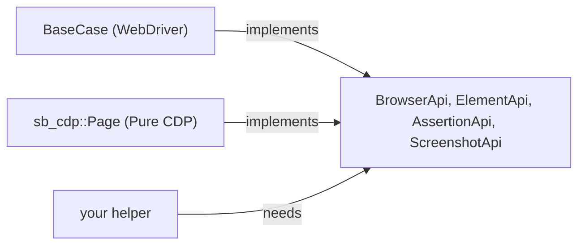

This page describes the public API surface of `seleniumbase-rs`, the stability
guarantees that apply, and how to integrate the crate with foreign code.

<Visibility for="agents">

Summary for AI exports: the crate root re-exports `BaseCase`, `BrowserConfig`, `Browser`, `DriverMode`, `BrowserSession`, `Selector`, `Fingerprint`, `StealthPolicy`, the capability traits `BrowserApi`, `ElementApi`, `AssertionApi` and `ScreenshotApi`, `run_browser_test`, `Result` and `SeleniumBaseError`. Rust has no stable ABI: treat the API as source-compatible only, and use a C shim for foreign code. The crate follows Semantic Versioning, but as a `0.x` crate its minor releases may break the API, so pin the version. `evasion::providers::session_registry` is experimental.

</Visibility>

## Public modules

The crate root exposes the following modules:

| Module | Purpose |
|---|---|
| `api` | `BaseCase`, capability traits, tours, charts, recorder, scenario runner, CDP page/driver helpers. |
| `artifacts` | The `latest_logs` folder, collision-free artifact names, and the check that keeps a caller-supplied file name inside it. |
| `behave` | Gherkin/BDD parser, step registry, and runner. |
| `browser` | `BrowserConfig`, `BrowserSession`, driver launching, and optional Playwright session. |
| `cli` | `sbrs` command-line script implementations. |
| `common` | Decorators, obfuscation, and shared exception types. |
| `config` | Settings, proxy lists, and ad-block lists. |
| `core` | Test result records and the JSON and HTML reports made from them. |
| `drivers` | The WebDriver types the API takes or returns (`By`, `WebElement`, `DesiredCapabilities`, `Key`, `Cookie`, `NetworkConditions`, ...), so a project needs no `thirtyfour` line. See [Imports and dependencies](/imports). |

| `error` | `SeleniumBaseError` and the `Result<T>` alias. |
| `evasion` | Undetected-chrome options, evasions, the evasion **provider registry**, fingerprint profiles, humanization helpers, binary patcher, and CDP reactor. `session_registry` (the registry the Pure CDP engine runs) is <Badge color="orange">Experimental</Badge>: it serves the stealth layer, which lives in [seleniumbase-rs-stealth](https://github.com/MustCodeAl/seleniumbase-rs-stealth) since 0.3.0. |
| `js_code` | `quote`, which turns a Rust string into a JavaScript string literal for the scripts the crate builds. |
| `json` | `json!`, `Value` and the parsing functions of `serde_json` that the API uses, so a project needs no `serde_json` line. |

| `macros` | `#[macro_export]` convenience macros (also re-exported at the crate root). |
| `mcp` | MCP servers (`cdp`, `driver`, `sb`) and the types to build more: `Host`, `ToolDef`, `Args`, `Output`, `ToolError`. Behind the `mcp-server` feature. |
| `profile_payloads` | External browser profile payload parsing and conversion. |
| `plugins` | Cloud/logging plugin interfaces. |
| `resources` | Where downloaded browser drivers live and how a chromedriver is found. |
| `sb_cdp` | Pure CDP engine: `Browser`, `Page`, `Locator`, input, human-paced input, cookies/storage/window/emulation, retrying expectations, CAPTCHA solving, isolated `BrowserContext`s, a `BrowserPool` with an in-memory `SessionStore`, and (with `test-util`) a mock browser. |
| `utilities` | Selenium IDE, Grid, and Python-to-Rust importer. |
| `utils` | Selectors, shadow DOM helpers, translations, and extension builders. |

<Note>

The modules `wire`, `scrape` and `impersonate` were removed in 0.3.0. They are
the crates `seleniumbase-rs-codec`, `seleniumbase-rs-scrape` and
`seleniumbase-rs-mimic` of
[seleniumbase-rs-stealth](https://github.com/MustCodeAl/seleniumbase-rs-stealth)
now. Use the unified `seleniumbase-rs-stealth` facade to access their `codec`,
`scrape` and optional `mimic` modules alongside all of the core public API,
including `sb_cdp` and `evasion`. See the [single-dependency setup](/stealth/overview#which-crate-to-depend-on).

</Note>

## Crate-root re-exports

The most common types are re-exported from the crate root for convenience:

| Type | Re-exported from crate root |
|---|---|
| `BaseCase` | yes |
| `BrowserConfig`, `Browser`, `DriverMode`, `BrowserSession` | yes |
| `Selector` | yes |
| `Fingerprint`, `StealthPolicy` | yes |
| `BatteryProfile`, `ConnectionProfile`, `SpeechVoice`, `BrandVersion`, `ClientHints`, `HumanizeConfig`, `CoherenceReport` | yes |
| `EvasionProvider`, `EvasionContext`, `EvasionConfig`, `EvasionRegistry`, `default_registry` | yes |
| `session_registry`, `SESSION_OMITTED_PROVIDERS` | yes, <Badge color="orange">Experimental</Badge> (serves the stealth layer) |
| `ChromedriverPatcher`, `ChromeBinaryPatcher`, `EnginePatch`, `engine_spoofing_args` | yes |
| `Chart`, `ChartType`, `TourTheme`, `Gui` | yes |
| `run_browser_test`, `run_cdp_test`, `RunSettings`, `PauseKind`, `Settings`, `SettingsOverrides`, `RuntimeConfig`, `LogFormat` | yes |
| `AssertionApi`, `BrowserApi`, `ElementApi`, `ScreenshotApi` | yes |
| `Result<T>`, `SeleniumBaseError`, `ResultExt` | yes |
| `import_python`, `ImportDiagnostic`, `ImportOptions`, `ImportResult`, `ImportSeverity`, `PythonSource` | yes |

`#[macro_export]` macros such as `selector!`, `sb_test!`, `sb_open!`, and
`fingerprint!` are also imported from the crate root:

```rust
use seleniumbase_rs::{selector, sb_test, sb_open, fingerprint};
```

## Capability traits

The public API is organized into capability traits in `api::traits`. They are
implemented by `BaseCase` (WebDriver) and by `sb_cdp::Page` (Pure CDP), and can
be used to write helpers that run on either engine. None of their signatures
mentions an engine's own types:

| Trait | Responsibility |
|---|---|
| `BrowserApi` | Navigation and lifecycle: `open`, `quit`, `refresh`, `go_back`, `go_forward`, `get_title`, `get_url`. |
| `ElementApi` | Interacting with elements: `click`, `double_click`, `type_text`, `get_text`, `get_attribute`. (Holding an element handle is engine-specific: `BaseCase::find_element` returns a `drivers::WebElement`, a `Page` offers `locator(..)`.) |
| `AssertionApi` | Test assertions: `assert_title`, `assert_element`, `assert_text`, `assert_no_js_errors`. |
| `ScreenshotApi` | Screenshot capture: `save_screenshot`, `screenshot_as_png`. |



*Both engines implement the capability traits; a helper depends on the traits, not on an engine.*

Use these traits when writing helpers that should work with any type exposing
the same capability, or as a blueprint for adding new cross-cutting concerns:

```rust
use seleniumbase_rs::{AssertionApi, ElementApi};

async fn assert_logged_in<E>(sb: &mut E) -> Result<(), seleniumbase_rs::SeleniumBaseError>
where
    E: ElementApi + AssertionApi,
{
    sb.assert_element("#dashboard").await?;
    sb.assert_text("Alice", "#user-name").await
}
```

## ABI note

<Warning>

Rust does not have a stable application binary interface. Do not pass
`seleniumbase-rs` types across a dynamic-library boundary or assume a fixed
memory layout.

</Warning>

If you need to drive the crate from another language, write a
small `extern "C"` shim that accepts C-compatible arguments and internally
builds a `BaseCase` or calls the Rust API:

```rust,ignore C shim
#[no_mangle]
pub extern "C" fn sb_open_url(url: *const c_char) {
    let url = unsafe { CStr::from_ptr(url).to_string_lossy() };
    // spawn runtime, create BaseCase, etc.
}
```

The default toolchain, target, and compiler version can all change the layout
of public structs.

<Info>

Treat the Rust API as source-compatible only.

</Info>

## Versioning policy

`seleniumbase-rs` follows [Semantic Versioning](https://semver.org/):

* Patch releases fix bugs without changing the public API.
* Minor releases add functionality in a backward-compatible way.
* Major releases may break the public API.

<Warning>

Because the crate is pre-1.0, minor releases (`0.x`) may contain breaking
changes. Pin to an exact version or a narrow range in production.

</Warning>

## Feature flags

The crate uses Cargo features to keep heavy dependencies off by default:

| Feature | Effect | Default |
|---|---|---|
| `playwright` | Enables the `rustwright`-backed Playwright-compatible driver. | no |
| `s3` | Enables AWS S3 artifact uploads. | no |
| `azure` | Enables Azure Blob Storage artifact uploads. | no |
| `gcp` | Enables Google Cloud Storage artifact uploads. | no |
| `mcp-server` | Enables the `mcp` module and builds the `sbrs-mcp` binary using `rmcp`. | no |
| `test-util` | Exposes `sb_cdp::Browser::new_mocked` and `MockCtrl` for testing code that drives pages without Chrome. | no |
| `turso` | Enables the `storage` module (`ResultStore`, `ProfileVault`, built on the embedded Turso database) and the `sbrs report` command. A Turso dependency needs Rust 1.90, which the crate's `rust-version` (1.99) already covers. | no |
| `full-tracing` | Enables `tracing-timing` histograms. | no |
| `error-backtrace` | Reserved for future backtrace capture on every `SeleniumBaseError`. | no |

The experimental features `scrape` and `impersonate` were removed in 0.3.0 (see
the modules above).

When adding feature-gated code, use `#[cfg(feature = "...")]` and declare the
dependency as `optional = true` in `Cargo.toml`.

## Error design

`SeleniumBaseError` is a rich, structured error enum:

* **Element errors** carry the selector and detected strategy:
  `ElementNotFound`, `ElementNotInteractable`, `StaleElement`,
  `InvalidSelector`.
* **Lifecycle errors** carry the binary path or URL:
  `BrowserLaunch`, `BrowserDisconnected`, `Navigation`, `SessionNotStarted`.
* **Subsystem errors** give context without string parsing:
  `Patcher`, `Stealth`, `Network`, `Download`, `Screenshot`, `Pdf`,
  `CdpDriver`, `Playwright`, `Mcp`, `PythonMigration`.

Every error exposes:

<ResponseField name="category()" type="&'static str">

A stable snake_case tag for dashboards.

</ResponseField>

<ResponseField name="is_transient()" type="bool">

`true` for retryable network/disconnect/timeout failures.

</ResponseField>

<ResponseField name="is_skipped()" type="bool">

`true` for the `Skipped` variant.

</ResponseField>

<ResponseField name="hint()" type="Option<String>">

A one-sentence remediation hint when available.

</ResponseField>

<ResponseField name="log() / log_in_context(op)">

Structured `tracing::error!` events.

</ResponseField>

Use the `ResultExt` trait to attach context:

```rust
use seleniumbase_rs::{Result, ResultExt};

fn read_config(path: &str) -> Result<String> {
    std::fs::read_to_string(path)
        .sb_context(format!("loading config from {path}"))
}
```

## What is not covered

<Warning>

**`evasion::providers::session_registry` is not yet a stable API.** It serves the
experimental stealth layer of seleniumbase-rs-stealth: its names and behaviour may
change in any release, even a patch release, as measurements and reviews come in.

</Warning>

<Note>

Internal helper modules, `#[doc(hidden)]` items, and items under
`api::base_case_impls` are implementation details. They may change without a
major version bump. Rely only on the public modules and re-exports listed
above.

</Note>

## API stability checklist for consumers

- [ ] Import types from the crate root or documented public modules.
- [ ] Avoid relying on paths inside `api::base_case_impls` or `#[doc(hidden)]` items.
- [ ] Pin the crate version in production.
- [ ] Do not pass `seleniumbase-rs` types across FFI boundaries without a C shim.
- [ ] Test feature-gated code with the same feature set you ship.
