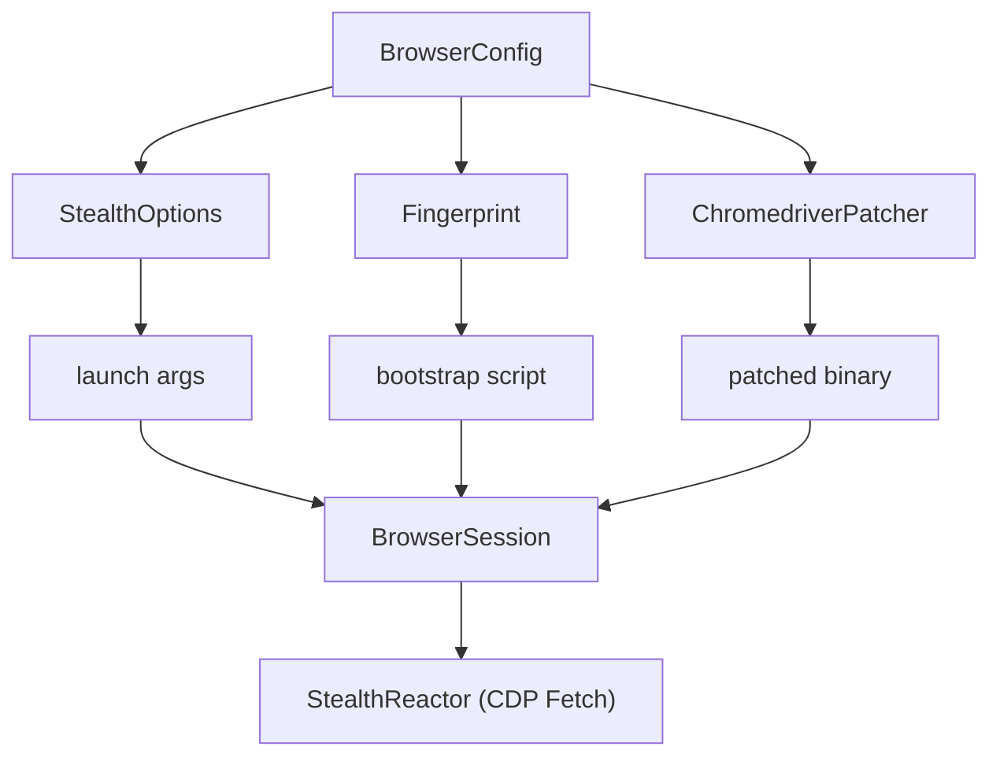
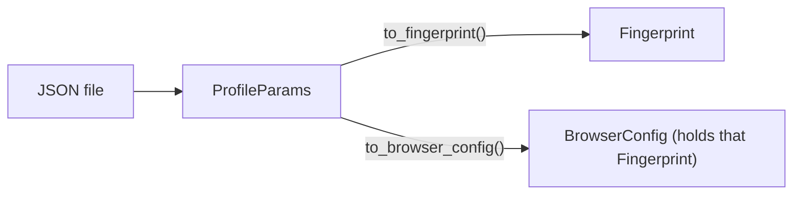

{/* layout-tree-component:start */}

export const LayoutTree = ({ children }) => (
  <div className="not-prose layout-tree" style={{ margin: "1.25rem 0", fontFamily: "var(--font-sans)", fontSize: "14px", color: "var(--text-secondary)" }}>
    <style>{`
      .layout-tree summary { list-style: none; }
      .layout-tree summary::-webkit-details-marker { display: none; }
      .layout-tree .lt-row:hover { background-color: var(--surface-subtle); }
      .layout-tree .lt-fold { color: #d5a910; }
      .dark .layout-tree .lt-fold { color: #ffd452; }
      .layout-tree .lt-fold-closed { display: none; }
      .layout-tree details:not([open]) summary .lt-fold-open { display: none; }
      .layout-tree details:not([open]) summary .lt-fold-closed { display: flex; }
      .layout-tree .lt-hl { color: var(--primary); background-color: color-mix(in srgb, var(--primary) 8%, transparent); }
      .dark .layout-tree .lt-hl { color: var(--primary-light); }
      .layout-tree .lt-ic-gray { color: #84848a; }
      .dark .layout-tree .lt-ic-gray { color: #adadb1; }
      .layout-tree .lt-ic-blue { color: #1a85d4; }
      .dark .layout-tree .lt-ic-blue { color: #69b1ff; }
      .layout-tree .lt-ic-cyan { color: #1ca1c7; }
      .dark .layout-tree .lt-ic-cyan { color: #68cdf2; }
      .layout-tree .lt-ic-green { color: #199f43; }
      .dark .layout-tree .lt-ic-green { color: #5ecc71; }
      .layout-tree .lt-ic-indigo { color: #693acf; }
      .dark .layout-tree .lt-ic-indigo { color: #9d6afb; }
      .layout-tree .lt-ic-orange { color: #d47628; }
      .dark .layout-tree .lt-ic-orange { color: #ffa359; }
      .layout-tree .lt-ic-pink { color: #d32a61; }
      .dark .layout-tree .lt-ic-pink { color: #ff678d; }
      .layout-tree .lt-ic-purple { color: #a631be; }
      .dark .layout-tree .lt-ic-purple { color: #d568ea; }
      .layout-tree .lt-ic-red { color: #d52c36; }
      .dark .layout-tree .lt-ic-red { color: #ff6762; }
      .layout-tree .lt-ic-yellow { color: #d5a910; }
      .dark .layout-tree .lt-ic-yellow { color: #ffd452; }
    `}</style>
    {children}
  </div>
)

export const LayoutRow = ({ icon, name, note, highlight = false, button = false }) => (
  <div className={highlight ? "lt-row lt-hl" : "lt-row"} style={{ display: "flex", alignItems: "flex-start", gap: "6px", minHeight: "30px", padding: "5px 8px", margin: "0 2px", borderRadius: "6px", lineHeight: "20px", cursor: button ? "pointer" : "default" }}>
    <span style={{ width: "16px", height: "20px", flexShrink: 0, display: "flex", alignItems: "center", justifyContent: "center", color: highlight ? "inherit" : "var(--text-muted)" }}>{icon}</span>
    <span style={{ whiteSpace: "nowrap", fontFamily: "var(--font-mono, ui-monospace, SFMono-Regular, Menlo, monospace)", fontSize: "13px", fontWeight: 600, color: highlight ? "inherit" : "var(--text-primary)" }}>{name}</span>
    {note ? <span style={{ color: "var(--text-muted)", fontSize: "13px", fontStyle: "italic", marginLeft: "10px", opacity: 0.9 }}>{note}</span> : null}
  </div>
)

export const LayoutFolderIcon = ({ kind }) => (
  <svg viewBox="0 0 16 16" width="16" height="16" aria-hidden="true">
    {kind === "empty" ? (
      <path fill="none" stroke="currentColor" strokeWidth="1.2" strokeLinejoin="round" d="M2 4.2A1.2 1.2 0 0 1 3.2 3h3.1c.32 0 .62.13.85.35L8.4 4.6h4.4A1.2 1.2 0 0 1 14 5.8v6a1.2 1.2 0 0 1-1.2 1.2H3.2A1.2 1.2 0 0 1 2 11.8z" />
    ) : kind === "open" ? (
      <g fill="currentColor">
        <path opacity=".5" d="M1.5 4A1.5 1.5 0 0 1 3 2.5h3.38a1.5 1.5 0 0 1 1.06.44L8.5 4H13a1.5 1.5 0 0 1 1.5 1.5V7H4.2a1.5 1.5 0 0 0-1.4.95L1.5 11.3z" />
        <path d="M4.2 8h10.6a.7.7 0 0 1 .65.95l-1.6 4.1a1.5 1.5 0 0 1-1.4.95H2.2a.7.7 0 0 1-.65-.95l1.25-3.2A1.5 1.5 0 0 1 4.2 8z" />
      </g>
    ) : (
      <g fill="currentColor">
        <path d="M1.5 4A1.5 1.5 0 0 1 3 2.5h3.38a1.5 1.5 0 0 1 1.06.44L8.5 4H1.5z" />
        <path opacity=".6" d="M1.5 4.5V12A1.5 1.5 0 0 0 3 13.5h10a1.5 1.5 0 0 0 1.5-1.5V6A1.5 1.5 0 0 0 13 4.5z" />
      </g>
    )}
  </svg>
)

export const LayoutFileIcon = () => (
  <svg viewBox="0 0 16 16" width="16" height="16" aria-hidden="true">
    <path fill="currentColor" opacity=".5" d="M8 1v3a3 3 0 0 0 3 3h3v5.5a2.5 2.5 0 0 1-2.5 2.5h-7A2.5 2.5 0 0 1 2 12.5v-9A2.5 2.5 0 0 1 4.5 1z" />
    <path fill="currentColor" d="M9.5 1a.5.5 0 0 1 .354.146l4 4A.5.5 0 0 1 14 5.5V6h-3a2 2 0 0 1-2-2V1z" />
  </svg>
)

export const LayoutDir = ({ name, note, open = false, highlight = false, children }) =>
  children ? (
    <details open={open}>
      <summary>
        <LayoutRow icon={<span className={highlight ? "" : "lt-fold"} style={{ display: "flex" }}><span className="lt-fold-open" style={{ display: "flex" }}><LayoutFolderIcon kind="open" /></span><span className="lt-fold-closed"><LayoutFolderIcon kind="closed" /></span></span>} name={name} note={note} highlight={highlight} button />
      </summary>
      <div style={{ marginLeft: "17.5px", borderLeft: "1px solid var(--border-subtle)", paddingLeft: "6px" }}>
        {children}
      </div>
    </details>
  ) : (
    <LayoutRow icon={<span className={highlight ? "" : "lt-fold"} style={{ display: "flex" }}><LayoutFolderIcon kind="empty" /></span>} name={name} note={note} highlight={highlight} />
  )

export const layoutIconColor = (name) => {
  const n = String(name).toLowerCase()
  const ext = n.includes(".") ? n.split(".").pop() : ""
  if (n === "dockerfile" || n.startsWith("dockerfile.") || n.startsWith("docker-compose")) return "blue"
  if (["rs", "json", "jsonc", "html", "htm", "zip", "gz", "tgz", "crx", "xpi", "swift", "svg"].includes(ext)) return "orange"
  if (["ts", "tsx", "mts", "cts", "py"].includes(ext)) return "blue"
  if (["js", "mjs", "cjs", "jsx"].includes(ext)) return "yellow"
  if (["md", "mdx", "sh", "bash", "zsh", "fish", "ps1"].includes(ext)) return "green"
  if (["css", "scss"].includes(ext)) return "indigo"
  if (["png", "jpg", "jpeg", "gif", "webp", "ico"].includes(ext)) return "pink"
  if (ext === "go") return "cyan"
  return "gray"
}

export const LayoutFile = ({ name, note, highlight = false }) => (
  <LayoutRow icon={<span className={highlight ? "" : "lt-ic-" + layoutIconColor(name)} style={{ display: "flex" }}><LayoutFileIcon /></span>} name={name} note={note} highlight={highlight} />
)

{/* layout-tree-component:end */}

This guide is for anyone who wants to understand, extend, or maintain the Rust
port of SeleniumBase (`seleniumbase-rs`). It covers the repository layout, the
`BaseCase` architecture, how to add new helpers, the stealth system, testing, and
release considerations.

<Info>

**What you will learn**

- How the repository is organized.
- How `BaseCase` methods are split across domain files.
- How to add a new `BaseCase` helper or evasion provider.
- How to run tests and interpret CI checks.
- Where to find the public API contract and stability notes.

</Info>

<Columns cols={2}>

<Card color="#1a85d4" title="Build from source" icon="hammer" href="/contributing/from-source">

Clone, build, keep builds small, and run the checks and the real-Chrome tests.

</Card>

<Card color="#199f43" title="Debugging" icon="bug" href="/contributing/debugging">

Logs, headed and slowed-down runs, evidence on failure, and a mocked browser.

</Card>

<Card color="#d47628" title="Benchmarking" icon="gauge-high" href="/contributing/benchmarking">

The `cpu` and `cdp_latency` harnesses, and how to compare a change.

</Card>

<Card color="#a631be" title="Contributing" icon="code-branch" href="/CONTRIBUTING">

Code style, testing rules and how to open a pull request.

</Card>

</Columns>

<Visibility for="agents">

Summary for AI exports: `BaseCase` is defined in `src/api/base_case.rs`, and its methods are split by domain across `src/api/base_case_impls/*.rs`. The capability traits are in `src/api/traits.rs`. Fallible calls return `crate::Result<T>` with `SeleniumBaseError`. No library feature is on by default; the `sbrs` and `sbrs-mcp` binaries are the package `seleniumbase-rs-cli` in `crates/cli`. Browser tests use `run_browser_test` so cleanup is awaited after success or failure.

</Visibility>

## Project goals

`seleniumbase-rs` aims to provide a Rust-native browser-automation and end-to-end
testing framework with parity to the Python SeleniumBase API. The public surface
is centered around `BaseCase`, a stateful test object that manages a browser
session, configuration, recorder, deferred assertions, tours, charts,
presentations, and optional stealth/CDP integrations.

## Repository layout

{/* layout-tree:start */}

<LayoutTree>
<LayoutDir name="seleniumbase-rs" open note="the workspace root">
<LayoutFile name="Cargo.toml" highlight note="the workspace and the library package: version, rust-version 1.99, features" />
<LayoutFile name="Cargo.lock" note="the locked dependency versions" />
<LayoutFile name="rust-toolchain.toml" note="pins Rust 1.99 with clippy and rustfmt" />
<LayoutDir name="src" open note="the library (no binary): both engines, the MCP tools, the library half of the command line">
<LayoutFile name="lib.rs" highlight note="the crate root and its public re-exports" />
<LayoutFile name="error.rs" highlight note="SeleniumBaseError: hints, exit codes, selector advice" />
<LayoutDir name="api" note="BaseCase (base_case.rs, base_case_impls/), the capability traits, recorder, scenario, charts, tours" />
<LayoutDir name="browser" note="BrowserConfig, the launcher, the WebDriver session, driver access and downloads" />
<LayoutDir name="sb_cdp" note="the pure CDP engine: Browser, Page, Locator, pool, mock" />
<LayoutDir name="evasion" note="fingerprints, evasion providers, humanize, binary patching and the CDP reactor" />
<LayoutDir name="mcp" note="the MCP servers cdp, driver, sb and dev, and their tools" />
<LayoutDir name="cli" note="the library half of sbrs, with no parser: commands.rs, scaffold.rs, scripts/" />
<LayoutDir name="testing" note="the rstest sb fixtures; bdd/: Gherkin through rstest-bdd" />
<LayoutDir name="plugins" note="reporting and logging plugins" />
<LayoutDir name="plugin_host" note="turns plugin names and options into a PluginSet (feature plugins)" />
<LayoutDir name="config" note="settings, runtime config, proxy and ad-block lists" />
<LayoutDir name="core" note="test result records and the Allure, JUnit and dashboard writers" />
<LayoutDir name="common" note="graceful shutdown, encryption, obfuscation, test ids, the debug prompt" />
<LayoutDir name="storage" note="ResultStore and ProfileVault (feature turso)" />
<LayoutDir name="utilities" note="RetryPolicy, the grid server, Selenium Grid and IDE, the Python importer" />
<LayoutDir name="utils" note="selectors, shadow DOM, URLs, geometry, bundled extensions, translations" />
<LayoutDir name="profile_payloads" note="parses external browser-profile JSON into a Fingerprint" />
<LayoutDir name="resources" note="files the crate manages on disk, such as downloaded browser drivers" />
<LayoutDir name="js_code" note="building blocks for the JavaScript the crate sends to a page" />
<LayoutFile name="artifacts.rs" note="where the files of a test run go (latest_logs) and how they are named" />
<LayoutFile name="drivers.rs" note="the WebDriver types behind BaseCase, under this crate's name" />
<LayoutFile name="json.rs" note="JSON values and json!, under this crate's name" />
<LayoutFile name="macros.rs" note="convenience macros for tests, such as sb_test!" />
<LayoutFile name="ocr.rs" note="reading text from screenshots (feature ocr)" />
<LayoutFile name="tracing_util.rs" note="tracing initialization helpers" />
<LayoutFile name="visual.rs" note="feature visual: VisualBaseline, screenshot baselines compared by SSIM" />
</LayoutDir>
<LayoutDir name="crates" open note="the workspace members besides the library">
<LayoutDir name="cli" open note="the package seleniumbase-rs-cli: the sbrs and sbrs-mcp binaries">
<LayoutFile name="Cargo.toml" note="default features: pdf, mcp-server, mcp-client, plugins-builtin" />
<LayoutDir name="src" open>
<LayoutFile name="sbrs.rs" highlight note="the sbrs command line" />
<LayoutFile name="mcp_server.rs" highlight note="the sbrs-mcp server" />
<LayoutFile name="fig.rs" note="the Fig completion spec" />
<LayoutFile name="report.rs" note="sbrs report" />
<LayoutFile name="reference.rs" note="renders docs/help/cli_reference.md from the usage spec" />
<LayoutFile name="strict.rs" note="refuses, with status 2, what the parser is too loose about" />
<LayoutDir name="mcp_install" note="sbrs-mcp install, uninstall and clients" />
</LayoutDir>
<LayoutDir name="tests" note="every test that runs the real sbrs or sbrs-mcp binary" />
</LayoutDir>
<LayoutDir name="own-imports" note="tests that import only seleniumbase_rs: the proof that its re-exports work" />
</LayoutDir>
<LayoutDir name="tests" note="integration tests of the library">
<LayoutDir name="golden" note="compiled into the library" />
<LayoutDir name="support" note="shared with crates/cli/tests" />
<LayoutFile name="sb_cdp_mock.rs" note="the pure CDP API against a mocked browser" />
<LayoutFile name="sb_cdp_chrome.rs" note="the same against a real Chrome, ignored by default" />
<LayoutFile name="browser_smoke.rs" note="the WebDriver path against a real Chrome, ignored by default" />
</LayoutDir>
<LayoutDir name="benches" note="the benchmarks">
<LayoutFile name="cdp_latency.rs" note="the pure CDP engine against a real Chrome" />
<LayoutFile name="cpu.rs" note="the library's own work, no browser" />
</LayoutDir>
<LayoutDir name="examples" note="runnable examples">
<LayoutDir name="tauri-profile-manager" note="has its own manifest and is not part of the workspace" />
</LayoutDir>
<LayoutDir name="docs" note="the pages of this site">
<LayoutFile name="docs.json" note="the Docs7 navigation and settings" />
<LayoutFile name="SUMMARY.md" note="the mdBook table of contents" />
<LayoutDir name="tutorials" note="step-by-step guides" />
<LayoutDir name="help" note="help pages" />
<LayoutDir name="design" note="design notes" />
<LayoutDir name="adr" note="architecture decision records" />
</LayoutDir>
<LayoutDir name="parity" note="the Python parity manifests">
<LayoutFile name="api.toml" note="the status of every Python SeleniumBase API" />
<LayoutFile name="upstream.toml" note="the upstream version this crate tracks" />
</LayoutDir>
<LayoutDir name="completions" note="the usage spec of sbrs">
<LayoutFile name="sbrs.usage.kdl" note="generated from crates/cli/src/sbrs.rs" />
</LayoutDir>
<LayoutDir name="schemas" note="JSON Schemas">
<LayoutFile name="fingerprint.schema.json" note="the schema of a Fingerprint file" />
</LayoutDir>
<LayoutDir name="contrib" note="files that are not part of the crate">
<LayoutDir name="tldr" note="draft tldr-pages entries for sbrs, kept to propose upstream" />
</LayoutDir>
<LayoutDir name="scripts" note="helper scripts">
<LayoutFile name="check-consumers.sh" note="just contracts: checks what the repositories that build on this crate use" />
</LayoutDir>
<LayoutDir name="tools" note="scripts for the docs and the parity manifests">
<LayoutDir name="mdx-check" note="just mdx: builds every docs page as Docs7 does" />
<LayoutDir name="parity" note="extracts, seeds and renders the parity manifest (docs/parity.md)" />
<LayoutDir name="layout_tree" note="the tree component that docs_layout_tree.py copies onto the pages" />
<LayoutFile name="docs_layout_tree.py" note="just layout-tree: writes the layout trees of the docs pages" />
<LayoutFile name="docs7_changelog.py" note="writes docs/changelog.md from CHANGELOG.md" />
</LayoutDir>
<LayoutDir name="docker" note="the Linux verification image (Dockerfile.verify, verify-linux.sh) and firefox-check/" />
<LayoutDir name=".config" note="configuration of tools">
<LayoutFile name="nextest.toml" note="the nextest configuration and its chrome test group" />
</LayoutDir>
<LayoutDir name=".github" note="GitHub Actions">
<LayoutDir name="workflows" note="ci, docker, completions, release and upstream-watch" />
</LayoutDir>
<LayoutDir name=".warp" note="the Warp terminal">
<LayoutDir name="workflows" note="the Warp workflows for sbrs" />
</LayoutDir>
<LayoutFile name="Dockerfile" note="the sbrs image; its skeleton step lists every target" />
<LayoutFile name="Makefile" note="make targets" />
<LayoutFile name="justfile" note="just recipes" />
<LayoutFile name="mise.toml" note="tools and tasks for mise" />
<LayoutFile name="deny.toml" note="the cargo-deny policy" />
<LayoutFile name="clippy.toml" note="clippy settings" />
<LayoutFile name="rust-analyzer.toml" note="settings for rust-analyzer" />
<LayoutFile name="book.toml" note="the mdBook configuration" />
<LayoutFile name="README.md" />
<LayoutFile name="CHANGELOG.md" note="what changed in each release" />
<LayoutFile name="ROADMAP.md" note="what is done and what is missing" />
<LayoutFile name="CLAUDE.md" note="the module map for coding assistants" />
</LayoutDir>
</LayoutTree>

{/* layout-tree:end */}

## BaseCase architecture

`BaseCase` is a single struct that owns the test state:

```rust src/api/base_case.rs
pub struct BaseCase {
    session: BrowserSession,
    config: BrowserConfig,
    recorder: Arc<Mutex<ActionRecorder>>,
    tour: Option<Tour>,
    deferred: DeferredAsserts,
    presentation: Option<Presentation>,
    chart: Option<Chart>,
    qa_session: Option<MasterQaSession>,
    #[cfg(feature = "playwright")]
    playwright_session: Option<PlaywrightSession>,
    time_limit: Option<Duration>,
    started: Instant,
    timeout_secs: u64,
    gui_held: Option<(i32, i32)>,
}
```

The inherent implementation is split across `src/api/base_case.rs` (core
constructors and commonly used methods) and `src/api/base_case_impls/*.rs`
(domain-specific helpers). Each included file is an `impl BaseCase { ... }`
block; they rely on the imports declared at the top of `base_case.rs`.

Domain files:

<LayoutTree>
<LayoutDir name="src/api/base_case_impls" open>
<LayoutFile name="base_case_impl_common.rs" highlight note="constructors, lifecycle, and widely-shared helpers" />
<LayoutFile name="base_case_impl_alerts.rs" note="alert and prompt handling" />
<LayoutFile name="base_case_impl_browser.rs" note="browser introspection and state" />
<LayoutFile name="base_case_impl_charts.rs" note="chart generation helpers" />
<LayoutFile name="base_case_impl_dom.rs" note="DOM querying and manipulation" />
<LayoutFile name="base_case_impl_downloads.rs" note="file download helpers" />
<LayoutFile name="base_case_impl_links.rs" note="link and anchor helpers" />
<LayoutFile name="base_case_impl_storage.rs" note="cookies and web-storage helpers" />
<LayoutFile name="base_case_impl_window.rs" note="windows, frames, and tabs" />
<LayoutFile name="base_case_impl_mouse.rs" note="mouse and hover actions" />
<LayoutFile name="base_case_impl_nav.rs" note="navigation and URL helpers" />
<LayoutFile name="base_case_impl_media.rs" note="media and screenshot helpers" />
<LayoutFile name="base_case_impl_tours.rs" note="guided tour helpers" />
<LayoutFile name="base_case_impl_presentations.rs" note="presentation helpers" />
<LayoutFile name="base_case_impl_jslibs.rs" note="third-party JS library injection" />
<LayoutFile name="base_case_impl_misc.rs" note="test-control and message-overload helpers" />
<LayoutFile name="base_case_impl_pdf_html.rs" note="PDF and HTML parsing helpers" />
<LayoutFile name="base_case_impl_extra.rs" note="extra assertion and wait helpers" />
<LayoutFile name="base_case_impl_cdp_page.rs" note="CDP-page helpers" />
<LayoutFile name="base_case_impl_dialog_inspector.rs" note="dialog inspection helpers" />
<LayoutFile name="base_case_impl_shadow.rs" note="shadow-DOM helpers" />
<LayoutFile name="base_case_impl_gui.rs" note="GUI automation helpers; compiled only with the gui feature, so lint and test it with --features gui" />
<LayoutFile name="base_case_impl_masterqa.rs" note="MasterQA helpers" />
</LayoutDir>
</LayoutTree>

### Adding a new `BaseCase` helper

<Steps>

<Step title="Choose the domain file" icon="folder-open">

Choose the appropriate domain file in `src/api/base_case_impls/` (or create
a new one if the domain does not exist).

</Step>

<Step title="Add the method" icon="code">

Add the method inside the existing `impl BaseCase { ... }` block.

</Step>

<Step title="Return a Result" icon="reply">

Return `crate::Result<T>` (an alias for `Result<T, SeleniumBaseError>`).

</Step>

<Step title="Record the action" icon="video">

Record the action with `self.record(...)` when it represents a user-facing
test step.

</Step>

<Step title="Test it" icon="flask">

Add a unit test when the helper does not require a live browser. A test that
needs a `BaseCase` with a WebDriver session can start a `MockWebDriver` (in
`base_case_impl_common.rs`): it answers the WebDriver commands you choose and
records what the `BaseCase` sent.

</Step>

<Step title="Lint and run" icon="circle-check">

Run `cargo clippy --all-targets -- -D warnings` and `cargo test`.

</Step>

</Steps>

Example:

```rust Example helper
impl BaseCase {
    /// Asserts that `css` matches exactly `count` elements.
    pub async fn assert_element_count(
        &self,
        css: &str,
        count: usize,
    ) -> crate::Result<()> {
        let elements = self.find_elements(css).await?;
        if elements.len() == count {
            Ok(())
        } else {
            Err(SeleniumBaseError::AssertionFailed(format!(
                "expected {count} elements for '{css}', found {}",
                elements.len()
            )))
        }
    }
}
```

## Capability traits

The public API is also exposed through capability traits in
`src/api/traits.rs`:

- `BrowserApi` - navigation and lifecycle
- `ElementApi` - element finding and interaction
- `AssertionApi` - test assertions
- `ScreenshotApi` - screenshot capture

These traits are implemented for `BaseCase`. Prefer them when writing helpers
that should work with any type exposing the same capability, and use them as a
blueprint when adding new cross-cutting concerns.

## Error handling

All fallible operations return `crate::Result<T>`, defined as:

```rust The Result alias
pub type Result<T> = std::result::Result<T, SeleniumBaseError>;
```

`SeleniumBaseError` is a `thiserror` enum covering WebDriver errors, I/O,
JSON, invalid configuration, assertions, CDP driver failures, GUI input, and
Playwright errors. Use `?` to propagate errors and add context in user-facing
messages.

### Error taxonomy

| Category | Example variants | Typical cause |
|---|---|---|
| Element | `ElementNotFound`, `ElementNotVisible`, `ElementNotInteractable` | Selector did not match or element is hidden. |
| Driver | `DriverNotReady`, `DriverCrashed`, `SessionNotCreated` | chromedriver is missing, incompatible, or crashed. |
| Config | `InvalidConfig`, `UnsupportedBrowser`, `InvalidUrl` | Bad `BrowserConfig` or profile payload. |
| I/O | `IoError`, `DownloadFailed`, `FileNotFound` | Filesystem or network transfer failure. |
| Assert | `AssertionFailed`, `DeferredAssertFailed`, `Skipped` | Test assertion mismatch or explicit skip. |
| CDP | `CdpError`, `CdpMethodFailed` | Chrome DevTools Protocol call failed. |
| GUI | `GuiInputError`, `OcrError` | Desktop automation or image parsing failure. |
| Playwright | `PlaywrightError` | Playwright runtime error. |

### Helper constructors

Prefer constructors over manual formatting:

```rust Helper constructors
use seleniumbase_rs::SeleniumBaseError;

SeleniumBaseError::element_not_found("#submit")
SeleniumBaseError::invalid_config("a proxy is required but the URL is empty")
SeleniumBaseError::driver_not_ready("chromedriver")
```

### Runtime diagnostics

Errors can emit `tracing::error!` events:

```rust Runtime diagnostics
use seleniumbase_rs::{ResultExt, SeleniumBaseError};

// Adds context and logs on failure
some_op().sb_context("while patching chromedriver")?;

// Logs without returning
SeleniumBaseError::download_failed(url).log();
```

The `error-backtrace` feature is declared but no code reads it yet, so it adds
no backtrace to `SeleniumBaseError`. For the backtrace of a panic, set
`RUST_BACKTRACE=1`.

## Feature flags

The crate uses Cargo features to keep heavy or optional dependencies
contained:

| Feature | Default | Purpose |
|---|---|---|
| `tui` | off | Terminal apps: `sbrs commander`, `sbrs caseplans`, `sbrs behave-gui`. Pulls `ratatui`/`crossterm`. |
| `gui` | off | Native OS dialogs and GUI automation. Pulls `rfd`/`enigo`; on Linux it needs GTK and X11 development packages. |
| `playwright` | off | Enables the `rustwright`-based Playwright-compatible engine. |
| `s3` | off | Enables AWS S3 artifact uploads. |
| `azure` | off | Enables Azure Blob Storage artifact uploads. |
| `gcp` | off | Placeholder for Google Cloud integrations. |
| `mcp-server` | off | Builds the `sbrs-mcp` binary using `rmcp`. |
| `full-tracing` | off | Verbose `tracing` span events for debugging. |
| `error-backtrace` | off | Declared for backtraces on `SeleniumBaseError`; no code reads it yet. |

JSON logs need no feature: set `SB_LOG_FORMAT=json` or call `init_tracing_json`.

No feature of the library is on by default, so a library user or a headless pool
pulls in neither the terminal UI nor the desktop automation stacks (nor any
command-line crate: `sbrs` is the workspace package `seleniumbase-rs-cli`, in
`crates/cli`, which forwards `tui`, `gui` and `turso`). Turn them on when you
want them:

<CodeGroup>

```toml Cargo.toml
seleniumbase-rs = { git = "https://github.com/MustCodeAl/seleniumbase-rs", features = ["gui", "tui"] }
```

```bash Commands
cargo install --git https://github.com/MustCodeAl/seleniumbase-rs seleniumbase-rs-cli --features tui   # sbrs commander
cargo run --example gui_automation --features gui
```

</CodeGroup>

<Note>

The crate compiles cleanly with no features and with `--all-features`; keep both
green when touching feature-gated code. CI also builds `gui,tui` on Linux and
macOS, because the default build no longer covers them.

</Note>

When adding a feature-gated API, use `#[cfg(feature = "...")]` and declare the
dependency as `optional = true` in `Cargo.toml`. Prefer `#[cfg(feature = "...")]`
over `#[cfg(not(feature = "..."))]` so the default build is the simpler path.

## Module deep dive

### `src/api/`

The public test API. `base_case.rs` defines the struct and core constructors;
`base_case_impls/*.rs` split hundreds of helpers by domain. New helpers should
land in the smallest domain file first, then be surfaced through `BaseCase` or a
capability trait.

### `src/browser/`

Launch and session plumbing:

- `config.rs` — serializable `BrowserConfig`, `Browser` enum, `DriverMode`.
- `session.rs` — `BrowserSession`, the WebDriver wrapper and CDP session cache.
- `launcher.rs` — chromedriver discovery, startup, and `StealthOptions` application.
- `playwright.rs` — optional Playwright-backed session adapter.

### `src/evasion/`

Anti-detection layer:

- `fingerprint.rs` — `Fingerprint`, `FingerprintBuilder`, `Dimension`,
  presets (including `edge_desktop`), coherence validation, and `BrowserType`;
  `spoof.rs` (`Spoof<T>`), `settings.rs` (the value types such as `ScreenSize`
  and `WebGl`) and `policy.rs` (`StealthPolicy`).
- `evasions.rs` / `providers/` — JavaScript evasion registry and 25 built-in
  providers.
- `patcher.rs` — `ChromedriverPatcher` and `EnginePatch` definitions.
- `options.rs` — `StealthOptions` builder for launch args and prefs.
- `reactor.rs` — background CDP `Fetch` interceptor.
- `dprocess.rs` — detached chromedriver/browser process helpers.
- `humanize.rs` — Bézier mouse paths and keystroke timing, and the seedable `Rng`
  the rest of the layer shares.
- `randomize.rs` — the tables and assembly behind `Fingerprint::randomized`
  (private; the method is the API).

### `src/profile_payloads/`

Parses external anti-detect profile JSON into `BrowserConfig` + `Fingerprint`.
The mapping is explicit: every JSON field is declared in `ProfileParams`, then
converted in `ProfileParams::to_browser_config()` and `browser()`.

### `src/cli/`

The library half of the command line: `commands.rs`, `devtools.rs`, `prompt.rs`,
`scaffold.rs` and the `scripts/` that the binaries, the MCP server and the golden
tests share. It has no command-line parser.

### `crates/cli/`

The workspace package `seleniumbase-rs-cli`, which builds the two binaries and
owns the dependencies only they use (the `usage` command-line parser):

- `src/sbrs.rs` — the `sbrs` CLI command tree, declared with the `usage` derives
  (and `src/report.rs`, `sbrs report`). The usage spec `completions/sbrs.usage.kdl`
  and the page `docs/help/cli_reference.md` are generated from it by a test.
- `src/fig.rs` — the Fig spec of `sbrs completions fig`, written from the same tables.
- `crates/cli/src/mcp_server.rs` — `sbrs-mcp`, which starts the Model Context Protocol
  server of `src/mcp/` (the tools are `ToolDef`s there).
- `tests/` — every test that runs the real `sbrs` or `sbrs-mcp` binary.

### `src/utilities/`

Migration and IDE tooling: Python importer, Selenium IDE parser, Selenium Grid
helpers.

## Browser session model

`BrowserSession` wraps a `thirtyfour::WebDriver` and exposes higher-level
methods such as `wait_for_element`, `text`, `click`, and `execute_script`. Most
`BaseCase` helpers delegate to the session. For CDP-only operations (such as
activating a stealth driver), `CdpDriver` and `CdpPage` provide a lightweight
Chrome DevTools Protocol client.

## Stealth architecture

The stealth system has four independent axes:

1. **Launch configuration** — `StealthOptions` emits Chromium args and prefs.
2. **Runtime JavaScript** — `EvasionProvider`s generate a bootstrap script.
3. **CDP-level overrides** — `evasions::safe_cdp_overrides()` sends
   `Network.setUserAgentOverride`, `Emulation.setDeviceMetricsOverride`,
   `Emulation.setTimezoneOverride`, `Emulation.setLocaleOverride`,
   `Emulation.setGeolocationOverride`, and related commands. When
   `StealthPolicy::native_spoofing` is enabled, providers skip JS patches for
   dimensions the browser can spoof natively, making the spoof invisible to
   page-side `toString()` / descriptor inspection.
4. **Network interception** — `StealthReactor` uses CDP `Fetch` to override
   headers and responses.
5. **Binary patching** — `ChromedriverPatcher` edits driver markers.



Use these through `BaseCase::activate_cdp_mode(url)` or by setting
`DriverMode::Uc` in `BrowserConfig`.

### Fingerprint, settings and policy

`Fingerprint` is a value type describing the desired browser surface. It is
built once with `Fingerprint::builder()`, has private fields and read accessors,
and is changed only through `to_builder()`. It is composed of:

- `browser_type`, `os_type`, `core_version`, `seed` — the persona.
- one `Spoof<T>` per setting: `user_agent`, `platform`, `hardware_concurrency`,
  `screen`, `webgl`, `geolocation`, `timezone`, `locale`, `webrtc`, `media_devices`,
  `battery`, `client_hints`, `proxy`, and the rest of what a page can probe.
- a `StealthPolicy` — how the claims are delivered (WebRTC IP policy, canvas
  and audio noise, native spoofing, granted permissions, blocked ports and
  trackers).

A `Spoof<T>` is `Natural` (the browser's own value, the default), `Random` (a
coherent value drawn when the fingerprint is built), `Value(T)` (a plain value
converts to it) or `Off` (the API is unavailable or denied; only for geolocation,
WebRTC, media devices, battery, Bluetooth, speech voices, network information and
Client Hints). A built fingerprint holds no `Random`.

Providers, launch arguments and protocol overrides do not read the fields by
themselves: they ask `Fingerprint::is_masked(Dimension::...)`, so there is one
rule, and a provider defines only a setting that is a `Value`. A policy preset
never changes a setting.

`Fingerprint::validate()` returns a `CoherenceReport` of errors and warnings
(platform and user agent against the OS persona, a WebGL renderer from another
OS's graphics API, a locale from another country than the time zone, and so on).
Add a rule there when introducing inter-dependent fields.

### Provider execution order

Providers are sorted by priority and run only when `applies(fp)` returns true.
Current priority bands:

- 5 — infrastructure (`native_to_string`).
- 20–50 — navigator, screen, WebGL, plugins, codecs, permissions.
- 60–90 — WebDriver/headless cleanup, runtime, iframe, chrome object fixes.
- 100–130 — self-defense, notification, memory, battery, connection, WebRTC.

Lower numbers run first. A provider that makes replacements look native starts
its snippet with `providers::SB_PREAMBLE` and keeps its priority above 5, because
the `native_tostring` provider (priority 5) installs the helpers that preamble
uses. They live in the scope of the assembled script, not on `window`.

### CDP reactor

`StealthReactor` starts a background task that attaches to a CDP target and
listens for `Fetch.requestPaused` events. It can:

- Override request headers (`User-Agent`, `Accept-Language`, etc.).
- Block or mock responses.
- Intercept JS/CSS resources to inject the stealth bootstrap.

Add new interceptor rules in `reactor.rs` by matching on request URL patterns
and emitting `Fetch.continueRequest` / `FulfillRequest` calls.

### Binary patching

`ChromedriverPatcher` applies byte-level search/replace patches to a driver
binary. Each patch is an `EnginePatch`:

```rust An EnginePatch
EnginePatch {
    id: "cdc_marker",
    description: "Replace cdc_... markers",
    search: b"$cdc_",
    replace: b"$sbc_",
}
```

Patches run after the driver is downloaded or located. Backups are written with
`.sb-backup` extension and restored on mismatch. Add marker-detection tests
whenever a patch targets a new driver version.

### Adding new spoofing code

<Steps>

<Step title="A new JavaScript evasion" icon="code">

If the change is a new JavaScript evasion, add a provider in
`src/evasion/providers/builtin.rs` and register it in `all()`.

</Step>

<Step title="Launch arguments" icon="terminal">

If it changes launch arguments, update `StealthOptions::apply_to` in
`src/evasion/options.rs` or add a helper such as `engine_spoofing_args()` in
`src/evasion/patcher.rs`.

</Step>

<Step title="Binary patches" icon="microchip">

If it patches the binary, add an `EnginePatch` in
`src/evasion/patcher.rs`.

</Step>

<Step title="Re-export" icon="share-from-square">

Re-export new public types from `src/evasion/mod.rs` and `src/lib.rs`.

</Step>

<Step title="Test it" icon="flask">

Add a unit test that exercises the new logic without requiring a live browser.

</Step>

</Steps>

## Adding a macro

Macros are defined in `src/macros.rs` and re-exported at the crate root via
`#[macro_export]`:

<Steps>

<Step title="Define it" icon="code">

Add the macro definition in `src/macros.rs` using `$crate::` for any path.

</Step>

<Step title="Document it in code" icon="comment">

Include a short doc comment with an `ignore` example.

</Step>

<Step title="Test it" icon="flask">

Add a unit test in the `#[cfg(test)]` module if the macro builds a value that
can be asserted without a browser.

</Step>

<Step title="Document it" icon="book">

Update `docs/tutorials/macros.md` with the macro name, signature, and example.

</Step>

</Steps>

## Adding an MCP tool

The `sbrs-mcp` binary (`--server cdp|driver|sb|dev`) is a thin wrapper over
the `mcp` module, built with the `mcp-server` feature. A server is a
`Host<S>`: a list of `ToolDef`s and the browser session `S` they share.

<Steps>

<Step title="Pick the server file" icon="server">

Pick the server file: `src/mcp/cdp.rs` (the Pure CDP engine),
`src/mcp/driver.rs` or `src/mcp/sb.rs` (WebDriver, sharing the handlers in
`src/mcp/webdriver.rs`), or, for a tool that needs no browser, the `dev` server in
`src/mcp/dev/` (`api.rs`, `author.rs`, `help.rs`, `cli.rs`, `diagnose.rs`). Every tool costs
context in every session that loads its server, so a tool for the library or the
command line goes to `dev`, not to a browser server. Tools shared by servers are
defined once in `src/mcp/devtools.rs` and registered by name.

</Step>

<Step title="Write the handler" icon="code">

Write an `async fn(Ctx<S>, Args) -> Result<Output, ToolError>` handler. Read
arguments with the typed accessors on `Args` (`str`, `opt_bool`, `choice`,
`seconds_or`, ...), which name the argument in every error. Get the session
with `ctx.session().await?`. Return `Output::Text` or `Output::Json`.

</Step>

<Step title="Register it" icon="list-ol">

Register a `ToolDef::new(name, title, description, Effect, Schema, handler)`.
Choose the `Effect` that is true of the tool (it becomes the MCP annotation
hints) and describe each argument with `Prop`.

</Step>

<Step title="Write files safely" icon="folder-closed">

Write files only through `ctx.settings().output_path(folder, name)`, which
keeps them inside the output directory.

</Step>

<Step title="Test it" icon="flask">

Test it: `tests/mcp_cdp.rs` shows how to drive a tool against the mock
browser; `tests/mcp_webdriver.rs` covers the catalogues. A `dev` tool is tested in
its own file with `Host::call`, and `install_driver` through
`mcp::dev::host_with_installer` with a fake downloader, never the network.

The `dev` tool `find_api` searches `src/mcp/dev/api_index.json`, which a test
generates from the public methods of `BaseCase` and of the pure CDP `Browser`,
`Page`, `Locator` and `BrowserContext`. After you add, remove or change the
signature or the first doc paragraph of such a method, a test fails until you
write the index again with
`SB_UPDATE_API_INDEX=1 cargo test -p seleniumbase-rs --features mcp-server api_index`
and commit it.

The `dev` tool `cli_help` reads `completions/sbrs.usage.kdl`, the usage spec of the
command line, with the small KDL reader in `src/mcp/dev/spec.rs` (the library may
not depend on a command-line crate, so it cannot use `usage-lib`). A new command or
flag shows up in `cli_help` as soon as the spec is written again, with
`SB_UPDATE_COMPLETIONS=1 cargo test -p seleniumbase-rs-cli --bin sbrs usage_spec`.
The reader has its own tests, and one of them reads the real spec and counts its
commands and flags against the text.

</Step>

<Step title="Check the parity" icon="scale-balanced">

If the tool exists upstream, `tests/parity.rs` checks it against
`parity/api.toml`; see [Syncing with upstream](/UPSTREAM_SYNC).

</Step>

</Steps>

## Testing guidelines

- Add unit tests for pure helper logic (selectors, translations, HTML parsing,
  retry and rate-limit policies, JS builders).
- Avoid tests that require a live browser in the default suite; mark them with
  `#[ignore]` or place them under `tests/`.
- Use `BaseCase::without_session(config)` to construct a `BaseCase` for testing
  helpers that do not touch the browser.
- Use `run_browser_test` for async browser tests so cleanup is awaited after
  either success or failure. `Drop` cannot perform async WebDriver cleanup.
- The default nextest profile sets retries to zero. Add retries only around a
  measured, transient, and idempotent operation rather than masking a flaky
  test.
- Run the full verification matrix before pushing:

```bash Terminal
cargo build
cargo test
cargo clippy --all-targets -- -D warnings
cargo fmt --check
cargo build --features s3,azure,gcp,playwright,mcp-server
cargo test --features s3,azure,gcp,playwright,mcp-server
cargo clippy --all-targets --features s3,azure,gcp,playwright,mcp-server -- -D warnings
cargo publish --dry-run
```

The checks CI runs today, the low-memory build settings and the tests that need
a real Chrome are in [Build from source](/contributing/from-source#run-the-checks).

## Tracing internals

The crate uses `tracing` with structured fields. Spans are created around major
operations (launch, open, click, patch). Events include:

- `seleniumbase.driver.launch` — browser/driver launch.
- `seleniumbase.stealth.patch` — binary patch applied.
- `seleniumbase.error` — structured error event with `error.category`,
  `error.transient`, and `error.hint`.

To add tracing to a new component:

```rust Instrumenting a component
use tracing::{info, instrument};

#[instrument(skip_all, fields(component = "my_component"))]
pub async fn do_work(&self) -> crate::Result<()> {
    info!("starting work");
    // ...
}
```

For JSON output, for ingestion by log analytics, set `SB_LOG_FORMAT=json` or call
`init_tracing_json`.

## Profile payload mapping

External profile payloads are normalized in `src/profile_payloads/profile.rs`.
The flow is:



When adding a new JSON field:

<Steps>

<Step title="Declare it" icon="code">

Add it to the corresponding `ProfileParams` struct with `#[serde(default)]`.

</Step>

<Step title="Convert it" icon="arrow-right-arrow-left">

Convert it in `fingerprint_builder()` (one `Spoof` per setting, through
`read` and `settle`), so the flag decides its state.

</Step>

<Step title="Leave launch-time settings to the fingerprint" icon="rocket">

Launch-time settings (`to_browser_config()`, `apply_runtime_overrides()`) read
the built fingerprint, never the raw payload, so a `natural` flag launches
nothing of that setting.

</Step>

<Step title="Test it" icon="flask">

Add a parser test and a round-trip coherence test.

</Step>

</Steps>

Keep parser logic defensive: unknown fields should not fail; invalid values
should produce `SeleniumBaseError::InvalidConfig` with the field name.

## Test patterns

### Pure-logic tests

```rust Pure-logic test
#[test]
fn selector_parses_link_text() {
    let s = Selector::LinkText("Dashboard".into());
    assert_eq!(s.to_by(), By::LinkText("Dashboard".to_string()));
}
```

### Async tests without browser

```rust Async test without a browser
#[tokio::test]
async fn a_value_turns_its_dimension_on() -> Result<(), FingerprintError> {
    let fp = Fingerprint::builder().timezone("Europe/Berlin").build()?;
    assert!(fp.is_masked(Dimension::Timezone));
    assert!(!fp.is_masked(Dimension::Screen));
    Ok(())
}
```

### Browser lifecycle tests

Use `run_browser_test` from `src/api/runner.rs`:

```rust Browser lifecycle test
use seleniumbase_rs::{run_browser_test, tokio, BrowserConfig};

#[tokio::test]
async fn example_test() -> seleniumbase_rs::Result<()> {
    run_browser_test(BrowserConfig::default(), async |sb| {
        sb.open("https://example.com").await?;
        sb.assert_title_contains("Example").await?;
        Ok(())
    }).await
}
```

<Warning>

`run_browser_test` guarantees cleanup runs after either success or failure.
`Drop` cannot await async cleanup, so never construct and drop a browser in a
synchronous test.

</Warning>

### Marking slow/flaky tests

Place browser-backed tests in `examples/` or under `tests/` and gate them with a
feature flag. Do not add retries to unit tests unless the operation is measured
to be transient and idempotent.

### Real-browser integration tests

`tests/browser_smoke.rs` exercises the end-to-end path against a real Chrome
instance: navigation, assertions, typing, screenshots, and deferred asserts.
The tests are `#[ignore]`d by default and serialized with a shared lock so
parallel test threads do not race to bind chromedriver's port.

<CodeGroup>

```bash Local
# Locally, with Chrome and chromedriver installed:
cargo test --test browser_smoke -- --ignored
```

```bash Remote grid
# Against a remote grid instead of the auto-started local chromedriver:
SB_WEBDRIVER_URL=http://grid:4444 cargo test --test browser_smoke -- --ignored
```

</CodeGroup>

The `browser-smoke` job in `.github/workflows/ci.yml` runs this suite on every
push using the Chrome/chromedriver preinstalled on GitHub-hosted runners.

## Performance considerations

- Avoid allocating large strings in hot paths. `EvasionProvider::script` runs
  once per session, so moderate allocation is fine, but do not read files inside
  the provider loop.
- Use `tokio::spawn` for independent background work (e.g. the CDP reactor).
- Cache CDP sessions and WebDriver clients rather than reconnecting.
- For chart/tour generation, build the DOM with `std::fmt::Write` instead of
  repeated string concatenation.
- Run `cargo build --release` when benchmarking; debug builds are 10–100× slower.

How to run the harnesses in `benches/`, and compare a change fairly, is in
[Benchmarking](/contributing/benchmarking).

## Security considerations

- Never hardcode secrets. `BrowserConfig` proxy passwords and cloud credentials
  must come from environment variables or a secrets manager.
- Validate all user-provided URLs before navigation to prevent SSRF.
- Do not deserialize untrusted data with `pickle`-equivalent formats. Profile
  payloads use `serde_json` with explicit structs.
- The MCP server runs browser automation on behalf of clients. It should only be
  exposed to trusted local clients; see `docs/help/mcp_server.md` for the trust
  boundary.
- Binary patches operate on local files. Always create backups and verify
  checksums before writing.

## Debugging tips

- Set `RUST_LOG=seleniumbase_rs=debug` to see driver launch args and CDP traffic.
- Use `RUST_BACKTRACE=1` for the backtrace of a panic.
- Run `sbrs doctor` to print environment diagnostics: the `SB_*` settings, the Chrome it found, and the chromedriver it found with its version next to Chrome's.
- Inspect generated bootstrap with `sbrs stealth-bootstrap --fingerprint ...`.
- For CI-only failures, reproduce with `--features s3,azure,gcp,playwright,mcp-server`
  because feature gates change code paths.

A full walkthrough, from the logs to a mocked browser and the driver checks, is
in [Debugging](/contributing/debugging).

## Python importer architecture

`utilities::python_importer` is a conservative static converter for Python
SeleniumBase and Selenium WebDriver tests. It never executes Python and never
guesses a dynamic value. `import_python` is the entry point and has two readings:

- The SeleniumBase reading (`utilities/importer/pyconv/`) parses the file with a
  small Python parser (`parse.rs`, on the lexer the Playwright importer shares)
  into the statements and expressions of `ast.rs`, finds the tests (`units.rs`:
  classes with `test*` methods, `test*` functions, `with SB(...)` blocks and
  scripts) and translates each (`stmt.rs` for statements, `expr.rs` for values and
  calls, `cdp.rs` for CDP Mode and `sb_cdp.Chrome()` scripts, which become pure CDP
  tests). `mod.rs` writes the file in the rstest `sb` fixture form that
  `sbrs mkfile` writes.
- The Selenium reading (`driver.find_element(...)`) is the older line scanner of
  `python_importer.rs`; it writes into the same fixture form.

The Python methods and their Rust calls are one table, `table.rs`, made of the
hand-written entries and `generated.rs`, which `pyconv::tests` writes from the
signatures of `BaseCase`, the `implemented` rows of `parity/api.toml` and the
Python parameters of `parity/upstream-api.json`
(`SB_UPDATE_GENERATED=1 cargo test -p seleniumbase-rs --lib the_generated_table`
writes it again). A test checks every entry against the real signature (argument
count and kinds, `async`, `Result`, call builders and their methods) and against
the parity row, so a `BaseCase` change that breaks a mapping fails a test. The
`FIX-ASSERTS` shapes of `assert_in`, `wait_for_element` and `get_select_options`
are in the table; adjust the table, not the translator, when a signature moves.

`tests/golden/import_python/` holds the Python examples of
`parity/examples.toml` and what the importer writes for each. A test checks the
importer still writes the `.rs.golden` files (`SB_UPDATE_GOLDENS=1` writes them
again) and that every `sb.method(..)` call in them is a `BaseCase` method with that
many arguments; a `cfg(doctest)` item in `python_importer.rs` compiles all of them
as a user's crate would (`cargo test -p seleniumbase-rs --features testing --doc
ImportGoldensCompile`).

Unsupported statements produce source-located diagnostics and compiling `TODO`
comments. Keep that behavior when adding mappings: uncertain conversion must
remain visible rather than silently changing test semantics. A statement the
importer does not read is a warning; a call it knows but cannot write as the
Python wrote it (an argument Rust has no equal for, a value of the wrong kind,
an undefined name) is an error. Add a unit test for each new mapping, and a
golden when it changes what an example becomes.

## MCP server

The `sbrs-mcp` binary exposes a subset of `BaseCase` through the Model
Context Protocol. It is built by the package `seleniumbase-rs-cli`
(`crates/cli/src/mcp_server.rs`) when its `mcp-server` feature is enabled, which
it is by default. See `src/mcp/` for the tool definitions and `README.md` for
client configuration examples.

## Publishing

The crate is published from the crate-only tree (`seleniumbase-rs/main`). All
dependencies must come from crates.io (no git-only dependencies). Run
`cargo publish --dry-run` before tagging a release.

## Contributing

See `CONTRIBUTING.md` for the full contributor guide. In short:

1. Keep the public API backward-compatible when possible.
2. Follow the existing module organization.
3. Write doc comments for public items.
4. Update `README.md`, `DOCS.md`, and `docs/tutorials/` when adding user-facing
   features.
5. Run `cargo fmt` before committing.

## See also

<Columns cols={2}>

<Card color="#1ca1c7" title="ABI & API Stability" icon="file-contract" href="/ABI_API">

The public API contract.

</Card>

<Card color="#d32a61" title="Contributing" icon="code-branch" href="/CONTRIBUTING">

The full contributor guide.

</Card>

<Card color="#693acf" title="Rust Test Tooling" icon="flask" href="/rust-test-tooling">

Writing tests against `BaseCase`.

</Card>

<Card color="#d5a910" title="Build from source" icon="hammer" href="/contributing/from-source">

The toolchain, the checks and the real-Chrome tests.

</Card>

</Columns>

### AI agent conventions

This repository is designed to be agent-friendly:

- Public APIs are typed explicitly; use types as hints.
- Each module has a focused responsibility; do not add unrelated logic.
- When extending stealth, providers are the preferred plugin point.
- When adding docs, mirror the existing structure in `docs/SUMMARY.md`.
- Run the verification matrix after any non-trivial change.
- `COPILOT.md` contains additional guidance for autonomous work.
