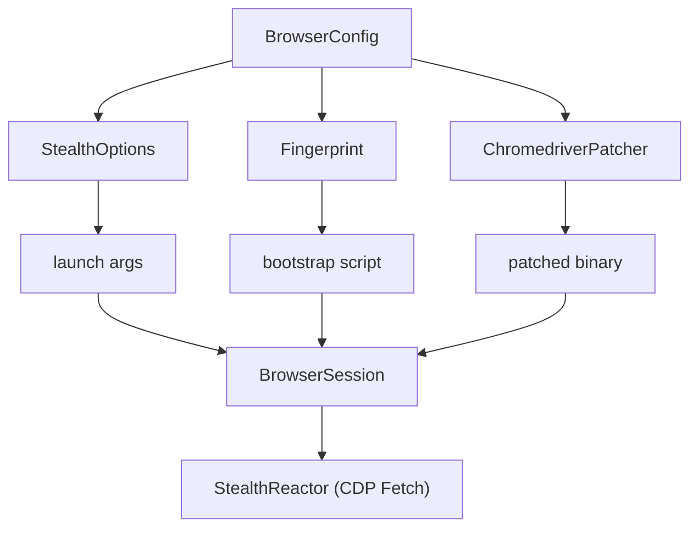

This guide is for anyone who wants to understand, extend, or maintain the Rust
port of SeleniumBase (`seleniumbase-rs`). It covers the repository layout, the
`BaseCase` architecture, how to add new helpers, the stealth system, testing, and
release considerations.

<Info>

**What you will learn**

- How the repository is organized.
- How `BaseCase` methods are split across domain files.
- How to add a new `BaseCase` helper or evasion provider.
- How to run tests and interpret CI checks.
- Where to find the public API contract and stability notes.

</Info>

## Project goals

`seleniumbase-rs` aims to provide a Rust-native browser-automation and end-to-end
testing framework with parity to the Python SeleniumBase API. The public surface
is centered around `BaseCase`, a stateful test object that manages a browser
session, configuration, recorder, deferred assertions, tours, charts,
presentations, and optional stealth/CDP integrations.

## Repository layout

```text
seleniumbase-rs/
├── Cargo.toml              # Crate manifest (optional cloud/Playwright/MCP features)
├── README.md               # User-facing quick-start and feature index
├── DOCS.md                 # Overview of major features
├── docs/                   # Tutorials and help pages
│   ├── tutorials/          # Step-by-step guides
│   └── DEVELOPER_GUIDE.md  # This file
├── examples/               # Runnable example programs
├── src/
│   ├── lib.rs              # Crate root, public re-exports
│   ├── api/                # Public test API
│   │   ├── base_case.rs    # BaseCase struct and core inherent impl
│   │   ├── base_case_impls/ # Per-domain BaseCase method modules
│   │   ├── chart.rs        # Chart generation
│   │   ├── tour.rs         # Guided tour builder
│   │   ├── presentation.rs # HTML presentation builder
│   │   ├── deferred.rs     # Deferred assertion state
│   │   ├── recorder.rs     # Action recorder
│   │   ├── html.rs         # BeautifulSoup-style HTML parsing
│   │   ├── pdf.rs          # PDF helpers
│   │   ├── runner.rs       # Async browser test lifecycle
│   │   ├── traits.rs       # Capability traits (BrowserApi, ElementApi, ...)
│   │   └── ...
│   ├── sb_cdp/             # Pure CDP engine: Browser, Page, Locator, input, state, CAPTCHA
│   ├── mcp/                # MCP servers: cdp, driver and sb toolsets
│   ├── browser/            # Browser launch, session, and configuration
│   │   ├── config.rs       # BrowserConfig, Browser, DriverMode
│   │   ├── session.rs      # BrowserSession (WebDriver wrapper)
│   │   ├── launcher.rs     # WebDriver/chromedriver launching
│   │   └── playwright.rs   # Optional Playwright-backed session
│   ├── stealth/            # Stealth / undetected automation helpers
│   │   ├── dprocess.rs     # Detached browser/driver process management
│   │   ├── options.rs      # StealthOptions builder
│   │   └── reactor.rs      # CDP Fetch interceptor
│   ├── behave/             # Gherkin/BDD runner and step registry
│   ├── cli/                # Command-line tooling (sbrs binary)
│   ├── common/             # Encryption, obfuscation, graceful shutdown
│   ├── config/             # Settings and proxy/ad-block lists
│   ├── core/               # Test result records, JSON/HTML report writers
│   ├── js_code/            # `quote`: safe JavaScript string literals for built scripts
│   ├── plugins/            # Cloud/logging plugin interfaces
│   ├── utilities/          # Selenium IDE, Grid, and Python migration
│   ├── utils/              # Selectors, shadow DOM, translations, extensions
│   └── bin/                # Additional binary targets (MCP server, ...)
├── parity/                 # Upstream API manifest (see docs/UPSTREAM_SYNC.md)
├── tools/parity/           # Scripts that extract and seed the manifest
└── tests/                  # Integration tests
```

## BaseCase architecture

`BaseCase` is a single struct that owns the test state:

```rust
pub struct BaseCase {
    session: BrowserSession,
    config: BrowserConfig,
    recorder: Arc<Mutex<ActionRecorder>>,
    tour: Option<Tour>,
    deferred: DeferredAsserts,
    presentation: Option<Presentation>,
    chart: Option<Chart>,
    qa_session: Option<MasterQaSession>,
    #[cfg(feature = "playwright")]
    playwright_session: Option<PlaywrightSession>,
    time_limit: Option<Duration>,
    started: Instant,
    timeout_secs: u64,
    gui_held: Option<(i32, i32)>,
}
```

The inherent implementation is split across `src/api/base_case.rs` (core
constructors and commonly used methods) and `src/api/base_case_impls/*.rs`
(domain-specific helpers). Each included file is an `impl BaseCase { ... }`
block; they rely on the imports declared at the top of `base_case.rs`.

Domain files:

- `base_case_impl_common.rs` — constructors, lifecycle, and widely-shared helpers.
- `base_case_impl_alerts.rs` — alert and prompt handling.
- `base_case_impl_browser.rs` — browser introspection and state.
- `base_case_impl_charts.rs` — chart generation helpers.
- `base_case_impl_dom.rs` — DOM querying and manipulation.
- `base_case_impl_downloads.rs` — file download helpers.
- `base_case_impl_links.rs` — link and anchor helpers.
- `base_case_impl_storage.rs` — cookies and web-storage helpers.
- `base_case_impl_window.rs` — windows, frames, and tabs.
- `base_case_impl_mouse.rs` — mouse and hover actions.
- `base_case_impl_nav.rs` — navigation and URL helpers.
- `base_case_impl_media.rs` — media and screenshot helpers.
- `base_case_impl_tours.rs` — guided tour helpers.
- `base_case_impl_presentations.rs` — presentation helpers.
- `base_case_impl_jslibs.rs` — third-party JS library injection.
- `base_case_impl_misc.rs` — test-control and message-overload helpers.
- `base_case_impl_pdf_html.rs` — PDF and HTML parsing helpers.
- `base_case_impl_extra.rs` — extra assertion and wait helpers.
- `base_case_impl_cdp_page.rs` — CDP-page helpers.
- `base_case_impl_dialog_inspector.rs` — dialog inspection helpers.
- `base_case_impl_shadow.rs` — shadow-DOM helpers.
- `base_case_impl_gui.rs` — GUI automation helpers (compiled only with the `gui`
  feature, so lint and test it with `--features gui`).
- `base_case_impl_masterqa.rs` — MasterQA helpers.

### Adding a new `BaseCase` helper

<Steps>

<Step title="Choose the domain file">

Choose the appropriate domain file in `src/api/base_case_impls/` (or create
a new one if the domain does not exist).

</Step>

<Step title="Add the method">

Add the method inside the existing `impl BaseCase { ... }` block.

</Step>

<Step title="Return a Result">

Return `crate::Result<T>` (an alias for `Result<T, SeleniumBaseError>`).

</Step>

<Step title="Record the action">

Record the action with `self.record(...)` when it represents a user-facing
test step.

</Step>

<Step title="Test it">

Add a unit test when the helper does not require a live browser. A test that
needs a `BaseCase` with a WebDriver session can start a `MockWebDriver` (in
`base_case_impl_common.rs`): it answers the WebDriver commands you choose and
records what the `BaseCase` sent.

</Step>

<Step title="Lint and run">

Run `cargo clippy --all-targets -- -D warnings` and `cargo test`.

</Step>

</Steps>

Example:

```rust
impl BaseCase {
    /// Asserts that `css` matches exactly `count` elements.
    pub async fn assert_element_count(
        &self,
        css: &str,
        count: usize,
    ) -> crate::Result<()> {
        let elements = self.find_elements(css).await?;
        if elements.len() == count {
            Ok(())
        } else {
            Err(SeleniumBaseError::AssertionFailed(format!(
                "expected {count} elements for '{css}', found {}",
                elements.len()
            )))
        }
    }
}
```

## Capability traits

The public API is also exposed through capability traits in
`src/api/traits.rs`:

- `BrowserApi` - navigation and lifecycle
- `ElementApi` - element finding and interaction
- `AssertionApi` - test assertions
- `ScreenshotApi` - screenshot capture

These traits are implemented for `BaseCase`. Prefer them when writing helpers
that should work with any type exposing the same capability, and use them as a
blueprint when adding new cross-cutting concerns.

## Error handling

All fallible operations return `crate::Result<T>`, defined as:

```rust
pub type Result<T> = std::result::Result<T, SeleniumBaseError>;
```

`SeleniumBaseError` is a `thiserror` enum covering WebDriver errors, I/O,
JSON, invalid configuration, assertions, CDP driver failures, GUI input, and
Playwright errors. Use `?` to propagate errors and add context in user-facing
messages.

### Error taxonomy

| Category | Example variants | Typical cause |
|---|---|---|
| Element | `ElementNotFound`, `ElementNotVisible`, `ElementNotInteractable` | Selector did not match or element is hidden. |
| Driver | `DriverNotReady`, `DriverCrashed`, `SessionNotCreated` | chromedriver is missing, incompatible, or crashed. |
| Config | `InvalidConfig`, `UnsupportedBrowser`, `InvalidUrl` | Bad `BrowserConfig` or profile payload. |
| I/O | `IoError`, `DownloadFailed`, `FileNotFound` | Filesystem or network transfer failure. |
| Assert | `AssertionFailed`, `DeferredAssertFailed`, `Skipped` | Test assertion mismatch or explicit skip. |
| CDP | `CdpError`, `CdpMethodFailed` | Chrome DevTools Protocol call failed. |
| GUI | `GuiInputError`, `OcrError` | Desktop automation or image parsing failure. |
| Playwright | `PlaywrightError` | Playwright runtime error. |

### Helper constructors

Prefer constructors over manual formatting:

```rust
use seleniumbase_rs::SeleniumBaseError;

SeleniumBaseError::element_not_found("#submit")
SeleniumBaseError::invalid_config("a proxy is required but the URL is empty")
SeleniumBaseError::driver_not_ready("chromedriver")
```

### Runtime diagnostics

Errors can emit `tracing::error!` events:

```rust
use seleniumbase_rs::{ResultExt, SeleniumBaseError};

// Adds context and logs on failure
some_op().sb_context("while patching chromedriver")?;

// Logs without returning
SeleniumBaseError::download_failed(url).log();
```

When `error-backtrace` is enabled, `SeleniumBaseError::backtrace()` captures a
full backtrace at construction time.

## Feature flags

The crate uses Cargo features to keep heavy or optional dependencies
contained:

| Feature | Default | Purpose |
|---|---|---|
| `tui` | off | Terminal apps: `sbrs commander`, `sbrs caseplans`, `sbrs behave-gui`. Pulls `ratatui`/`crossterm`. |
| `gui` | off | Native OS dialogs and GUI automation. Pulls `rfd`/`enigo`; on Linux it needs GTK and X11 development packages. |
| `playwright` | off | Enables the `rustwright`-based Playwright-compatible engine. |
| `s3` | off | Enables AWS S3 artifact uploads. |
| `azure` | off | Enables Azure Blob Storage artifact uploads. |
| `gcp` | off | Placeholder for Google Cloud integrations. |
| `mcp-server` | off | Builds the `sbrs-mcp` binary using `rmcp`. |
| `full-tracing` | off | Verbose `tracing` span events for debugging. |
| `json-logs` | off | Structured JSON log output. |
| `error-backtrace` | off | Backtraces attached to `SeleniumBaseError`. |

No feature of the library is on by default, so a library user or a headless pool
pulls in neither the terminal UI nor the desktop automation stacks (nor any
command-line crate: `sbrs` is the workspace package `seleniumbase-rs-cli`, in
`crates/cli`, which forwards `tui`, `gui` and `turso`). Turn them on when you
want them:

<CodeGroup>

```toml Cargo.toml
seleniumbase-rs = { git = "https://github.com/MustCodeAl/seleniumbase-rs", features = ["gui", "tui"] }
```

```bash Commands
cargo install --git https://github.com/MustCodeAl/seleniumbase-rs seleniumbase-rs-cli --features tui   # sbrs commander
cargo run --example gui_automation --features gui
```

</CodeGroup>

<Note>

The crate compiles cleanly with no features and with `--all-features`; keep both
green when touching feature-gated code. CI also builds `gui,tui` on Linux and
macOS, because the default build no longer covers them.

</Note>

When adding a feature-gated API, use `#[cfg(feature = "...")]` and declare the
dependency as `optional = true` in `Cargo.toml`. Prefer `#[cfg(feature = "...")]`
over `#[cfg(not(feature = "..."))]` so the default build is the simpler path.

## Module deep dive

### `src/api/`

The public test API. `base_case.rs` defines the struct and core constructors;
`base_case_impls/*.rs` split hundreds of helpers by domain. New helpers should
land in the smallest domain file first, then be surfaced through `BaseCase` or a
capability trait.

### `src/browser/`

Launch and session plumbing:

- `config.rs` — serializable `BrowserConfig`, `Browser` enum, `DriverMode`.
- `session.rs` — `BrowserSession`, the WebDriver wrapper and CDP session cache.
- `launcher.rs` — chromedriver discovery, startup, and `StealthOptions` application.
- `playwright.rs` — optional Playwright-backed session adapter.

### `src/stealth/`

Anti-detection layer:

- `fingerprint.rs` — `Fingerprint`, `FingerprintBuilder`, `Dimension`,
  presets (including `edge_desktop`), coherence validation, and `BrowserType`;
  `spoof.rs` (`Spoof<T>`), `settings.rs` (the value types such as `ScreenSize`
  and `WebGl`) and `policy.rs` (`StealthPolicy`).
- `evasions.rs` / `providers/` — JavaScript evasion registry and 25 built-in
  providers.
- `patcher.rs` — `ChromedriverPatcher` and `EnginePatch` definitions.
- `options.rs` — `StealthOptions` builder for launch args and prefs.
- `reactor.rs` — background CDP `Fetch` interceptor.
- `dprocess.rs` — detached chromedriver/browser process helpers.
- `humanize.rs` — Bézier mouse paths and keystroke timing, and the seedable `Rng`
  the rest of the layer shares.
- `randomize.rs` — the tables and assembly behind `Fingerprint::randomized`
  (private; the method is the API).

### `src/profile_payloads/`

Parses external anti-detect profile JSON into `BrowserConfig` + `Fingerprint`.
The mapping is explicit: every JSON field is declared in `ProfileParams`, then
converted in `ProfileParams::to_browser_config()` and `browser()`.

### `src/cli/`

The library half of the command line: `commands.rs`, `devtools.rs`, `prompt.rs`,
`scaffold.rs` and the `scripts/` that the binaries, the MCP server and the golden
tests share. It has no command-line parser.

### `crates/cli/`

The workspace package `seleniumbase-rs-cli`, which builds the two binaries and
owns the dependencies only they use (the `usage` command-line parser):

- `src/sbrs.rs` — the `sbrs` CLI command tree, declared with the `usage` derives
  (and `src/report.rs`, `sbrs report`). The usage spec `completions/sbrs.usage.kdl`
  and the page `docs/help/cli_reference.md` are generated from it by a test.
- `src/fig.rs` — the Fig spec of `sbrs completions fig`, written from the same tables.
- `src/mcp_server.rs` — `sbrs-mcp`, which starts the Model Context Protocol
  server of `src/mcp/` (the tools are `ToolDef`s there).
- `tests/` — every test that runs the real `sbrs` or `sbrs-mcp` binary.

### `src/utilities/`

Migration and IDE tooling: Python importer, Selenium IDE parser, Selenium Grid
helpers.

## Browser session model

`BrowserSession` wraps a `thirtyfour::WebDriver` and exposes higher-level
methods such as `wait_for_element`, `text`, `click`, and `execute_script`. Most
`BaseCase` helpers delegate to the session. For CDP-only operations (such as
activating a stealth driver), `CdpDriver` and `CdpPage` provide a lightweight
Chrome DevTools Protocol client.

## Stealth architecture

The stealth system has four independent axes:

1. **Launch configuration** — `StealthOptions` emits Chromium args and prefs.
2. **Runtime JavaScript** — `EvasionProvider`s generate a bootstrap script.
3. **CDP-level overrides** — `evasions::safe_cdp_overrides()` sends
   `Network.setUserAgentOverride`, `Emulation.setDeviceMetricsOverride`,
   `Emulation.setTimezoneOverride`, `Emulation.setLocaleOverride`,
   `Emulation.setGeolocationOverride`, and related commands. When
   `StealthPolicy::native_spoofing` is enabled, providers skip JS patches for
   dimensions the browser can spoof natively, making the spoof invisible to
   page-side `toString()` / descriptor inspection.
4. **Network interception** — `StealthReactor` uses CDP `Fetch` to override
   headers and responses.
5. **Binary patching** — `ChromedriverPatcher` edits driver markers.



Use these through `BaseCase::activate_cdp_mode(url)` or by setting
`DriverMode::Uc` in `BrowserConfig`.

### Fingerprint, settings and policy

`Fingerprint` is a value type describing the desired browser surface. It is
built once with `Fingerprint::builder()`, has private fields and read accessors,
and is changed only through `to_builder()`. It is composed of:

- `browser_type`, `os_type`, `core_version`, `seed` — the persona.
- one `Spoof<T>` per setting: `user_agent`, `platform`, `hardware_concurrency`,
  `screen`, `webgl`, `geolocation`, `timezone`, `locale`, `webrtc`, `media_devices`,
  `battery`, `client_hints`, `proxy`, and the rest of what a page can probe.
- a `StealthPolicy` — how the claims are delivered (WebRTC IP policy, canvas
  and audio noise, native spoofing, granted permissions, blocked ports and
  trackers).

A `Spoof<T>` is `Natural` (the browser's own value, the default), `Random` (a
coherent value drawn when the fingerprint is built), `Value(T)` (a plain value
converts to it) or `Off` (the API is unavailable or denied; only for geolocation,
WebRTC, media devices, battery, Bluetooth, speech voices, network information and
Client Hints). A built fingerprint holds no `Random`.

Providers, launch arguments and protocol overrides do not read the fields by
themselves: they ask `Fingerprint::is_masked(Dimension::...)`, so there is one
rule, and a provider defines only a setting that is a `Value`. A policy preset
never changes a setting.

`Fingerprint::validate()` returns a `CoherenceReport` of errors and warnings
(platform and user agent against the OS persona, a WebGL renderer from another
OS's graphics API, a locale from another country than the time zone, and so on).
Add a rule there when introducing inter-dependent fields.

### Provider execution order

Providers are sorted by priority and run only when `applies(fp)` returns true.
Current priority bands:

- 5 — infrastructure (`native_to_string`).
- 20–50 — navigator, screen, WebGL, plugins, codecs, permissions.
- 60–90 — WebDriver/headless cleanup, runtime, iframe, chrome object fixes.
- 100–130 — self-defense, notification, memory, battery, connection, WebRTC.

Lower numbers run first. A provider that makes replacements look native starts
its snippet with `providers::SB_PREAMBLE` and keeps its priority above 5, because
the `native_tostring` provider (priority 5) installs the helpers that preamble
uses. They live in the scope of the assembled script, not on `window`.

### CDP reactor

`StealthReactor` starts a background task that attaches to a CDP target and
listens for `Fetch.requestPaused` events. It can:

- Override request headers (`User-Agent`, `Accept-Language`, etc.).
- Block or mock responses.
- Intercept JS/CSS resources to inject the stealth bootstrap.

Add new interceptor rules in `reactor.rs` by matching on request URL patterns
and emitting `Fetch.continueRequest` / `FulfillRequest` calls.

### Binary patching

`ChromedriverPatcher` applies byte-level search/replace patches to a driver
binary. Each patch is an `EnginePatch`:

```rust
EnginePatch {
    id: "cdc_marker",
    description: "Replace cdc_... markers",
    search: b"$cdc_",
    replace: b"$sbc_",
}
```

Patches run after the driver is downloaded or located. Backups are written with
`.sb-backup` extension and restored on mismatch. Add marker-detection tests
whenever a patch targets a new driver version.

### Adding new spoofing code

<Steps>

<Step title="A new JavaScript evasion">

If the change is a new JavaScript evasion, add a provider in
`src/stealth/providers/builtin.rs` and register it in `all()`.

</Step>

<Step title="Launch arguments">

If it changes launch arguments, update `StealthOptions::apply_to` in
`src/stealth/options.rs` or add a helper such as `engine_spoofing_args()` in
`src/stealth/patcher.rs`.

</Step>

<Step title="Binary patches">

If it patches the binary, add an `EnginePatch` in
`src/stealth/patcher.rs`.

</Step>

<Step title="Re-export">

Re-export new public types from `src/stealth/mod.rs` and `src/lib.rs`.

</Step>

<Step title="Test it">

Add a unit test that exercises the new logic without requiring a live browser.

</Step>

</Steps>

## Adding a macro

Macros are defined in `src/macros.rs` and re-exported at the crate root via
`#[macro_export]`:

<Steps>

<Step title="Define it">

Add the macro definition in `src/macros.rs` using `$crate::` for any path.

</Step>

<Step title="Document it in code">

Include a short doc comment with an `ignore` example.

</Step>

<Step title="Test it">

Add a unit test in the `#[cfg(test)]` module if the macro builds a value that
can be asserted without a browser.

</Step>

<Step title="Document it">

Update `docs/tutorials/macros.md` with the macro name, signature, and example.

</Step>

</Steps>

## Adding an MCP tool

The `sbrs-mcp` binary (`--server cdp|driver|sb`) is a thin wrapper over
the `mcp` module, built with the `mcp-server` feature. A server is a
`Host<S>`: a list of `ToolDef`s and the browser session `S` they share.

<Steps>

<Step title="Pick the server file">

Pick the server file: `src/mcp/cdp.rs` (the Pure CDP engine),
`src/mcp/driver.rs` or `src/mcp/sb.rs` (WebDriver, sharing the handlers in
`src/mcp/webdriver.rs`).

</Step>

<Step title="Write the handler">

Write an `async fn(Ctx<S>, Args) -> Result<Output, ToolError>` handler. Read
arguments with the typed accessors on `Args` (`str`, `opt_bool`, `choice`,
`seconds_or`, ...), which name the argument in every error. Get the session
with `ctx.session().await?`. Return `Output::Text` or `Output::Json`.

</Step>

<Step title="Register it">

Register a `ToolDef::new(name, title, description, Effect, Schema, handler)`.
Choose the `Effect` that is true of the tool (it becomes the MCP annotation
hints) and describe each argument with `Prop`.

</Step>

<Step title="Write files safely">

Write files only through `ctx.settings().output_path(folder, name)`, which
keeps them inside the output directory.

</Step>

<Step title="Test it">

Test it: `tests/mcp_cdp.rs` shows how to drive a tool against the mock
browser; `tests/mcp_webdriver.rs` covers the catalogues.

</Step>

<Step title="Check the parity">

If the tool exists upstream, `tests/parity.rs` checks it against
`parity/api.toml`; see [Syncing with upstream](/UPSTREAM_SYNC).

</Step>

</Steps>

## Testing guidelines

- Add unit tests for pure helper logic (selectors, translations, HTML parsing,
  retry and rate-limit policies, JS builders).
- Avoid tests that require a live browser in the default suite; mark them with
  `#[ignore]` or place them under `tests/`.
- Use `BaseCase::without_session(config)` to construct a `BaseCase` for testing
  helpers that do not touch the browser.
- Use `run_browser_test` for async browser tests so cleanup is awaited after
  either success or failure. `Drop` cannot perform async WebDriver cleanup.
- The default nextest profile sets retries to zero. Add retries only around a
  measured, transient, and idempotent operation rather than masking a flaky
  test.
- Run the full verification matrix before pushing:

```bash
cargo build
cargo test
cargo clippy --all-targets -- -D warnings
cargo fmt --check
cargo build --features s3,azure,gcp,playwright,mcp-server
cargo test --features s3,azure,gcp,playwright,mcp-server
cargo clippy --all-targets --features s3,azure,gcp,playwright,mcp-server -- -D warnings
cargo publish --dry-run
```

## Tracing internals

The crate uses `tracing` with structured fields. Spans are created around major
operations (launch, open, click, patch). Events include:

- `seleniumbase.driver.launch` — browser/driver launch.
- `seleniumbase.stealth.patch` — binary patch applied.
- `seleniumbase.error` — structured error event with `error.category`,
  `error.transient`, and `error.hint`.

To add tracing to a new component:

```rust
use tracing::{info, instrument};

#[instrument(skip_all, fields(component = "my_component"))]
pub async fn do_work(&self) -> crate::Result<()> {
    info!("starting work");
    // ...
}
```

Enable JSON output with the `json-logs` feature for ingestion by log analytics.

## Profile payload mapping

External profile payloads are normalized in `src/profile_payloads/profile.rs`.
The flow is:

```text
JSON file ──► ProfileParams ──► to_fingerprint() ──► Fingerprint
                         └──► to_browser_config() ──► BrowserConfig (holds that Fingerprint)
```

When adding a new JSON field:

1. Add it to the corresponding `ProfileParams` struct with `#[serde(default)]`.
2. Convert it in `fingerprint_builder()` (one `Spoof` per setting, through
   `read` and `settle`), so the flag decides its state.
3. Launch-time settings (`to_browser_config()`, `apply_runtime_overrides()`) read
   the built fingerprint, never the raw payload, so a `natural` flag launches
   nothing of that setting.
4. Add a parser test and a round-trip coherence test.

Keep parser logic defensive: unknown fields should not fail; invalid values
should produce `SeleniumBaseError::InvalidConfig` with the field name.

## Test patterns

### Pure-logic tests

```rust
#[test]
fn selector_parses_link_text() {
    let s = Selector::LinkText("Dashboard".into());
    assert_eq!(s.to_by(), By::LinkText("Dashboard".to_string()));
}
```

### Async tests without browser

```rust
#[tokio::test]
async fn a_value_turns_its_dimension_on() -> Result<(), FingerprintError> {
    let fp = Fingerprint::builder().timezone("Europe/Berlin").build()?;
    assert!(fp.is_masked(Dimension::Timezone));
    assert!(!fp.is_masked(Dimension::Screen));
    Ok(())
}
```

### Browser lifecycle tests

Use `run_browser_test` from `src/api/runner.rs`:

```rust
use seleniumbase_rs::{run_browser_test, BrowserConfig};

#[tokio::test]
async fn example_test() -> seleniumbase_rs::Result<()> {
    run_browser_test(BrowserConfig::default(), async |sb| {
        sb.open("https://example.com").await?;
        sb.assert_title_contains("Example").await?;
        Ok(())
    }).await
}
```

<Warning>

`run_browser_test` guarantees cleanup runs after either success or failure.
`Drop` cannot await async cleanup, so never construct and drop a browser in a
synchronous test.

</Warning>

### Marking slow/flaky tests

Place browser-backed tests in `examples/` or under `tests/` and gate them with a
feature flag. Do not add retries to unit tests unless the operation is measured
to be transient and idempotent.

### Real-browser integration tests

`tests/browser_smoke.rs` exercises the end-to-end path against a real Chrome
instance: navigation, assertions, typing, screenshots, and deferred asserts.
The tests are `#[ignore]`d by default and serialized with a shared lock so
parallel test threads do not race to bind chromedriver's port.

<CodeGroup>

```bash Local
# Locally, with Chrome and chromedriver installed:
cargo test --test browser_smoke -- --ignored
```

```bash Remote grid
# Against a remote grid instead of the auto-started local chromedriver:
SB_WEBDRIVER_URL=http://grid:4444 cargo test --test browser_smoke -- --ignored
```

</CodeGroup>

The `browser-smoke` job in `.github/workflows/ci.yml` runs this suite on every
push using the Chrome/chromedriver preinstalled on GitHub-hosted runners.

## Performance considerations

- Avoid allocating large strings in hot paths. `EvasionProvider::script` runs
  once per session, so moderate allocation is fine, but do not read files inside
  the provider loop.
- Use `tokio::spawn` for independent background work (e.g. the CDP reactor).
- Cache CDP sessions and WebDriver clients rather than reconnecting.
- For chart/tour generation, build the DOM with `std::fmt::Write` instead of
  repeated string concatenation.
- Run `cargo build --release` when benchmarking; debug builds are 10–100× slower.

## Security considerations

- Never hardcode secrets. `BrowserConfig` proxy passwords and cloud credentials
  must come from environment variables or a secrets manager.
- Validate all user-provided URLs before navigation to prevent SSRF.
- Do not deserialize untrusted data with `pickle`-equivalent formats. Profile
  payloads use `serde_json` with explicit structs.
- The MCP server runs browser automation on behalf of clients. It should only be
  exposed to trusted local clients; see `docs/help/mcp_server.md` for the trust
  boundary.
- Binary patches operate on local files. Always create backups and verify
  checksums before writing.

## Debugging tips

- Set `RUST_LOG=seleniumbase_rs=debug` to see driver launch args and CDP traffic.
- Use `RUST_BACKTRACE=1` with the `error-backtrace` feature for full traces.
- Run `sbrs doctor` to print environment diagnostics: the `SB_*` settings, the Chrome it found, and the chromedriver it found with its version next to Chrome's.
- Inspect generated bootstrap with `sbrs stealth-bootstrap --fingerprint ...`.
- For CI-only failures, reproduce with `--features s3,azure,gcp,playwright,mcp-server`
  because feature gates change code paths.

## Python importer architecture

`utilities::python_importer` is a conservative static converter for common
SeleniumBase and Selenium WebDriver Python statements. It uses a balanced
statement and argument scanner plus targeted patterns. It deliberately avoids
executing Python or guessing dynamic values.

The importer separates parsing from rendering through typed actions and
locators. Unsupported statements produce source-located diagnostics and
compiling `TODO` comments. Keep that behavior when adding mappings: uncertain
conversion must remain visible rather than silently changing test semantics.

Add unit tests for both SeleniumBase and Selenium forms when introducing a new
mapping. Generated tests should use `run_browser_test` and remain valid Rust
even when diagnostics are present.

## MCP server

The `sbrs-mcp` binary exposes a subset of `BaseCase` through the Model
Context Protocol. It is built by the package `seleniumbase-rs-cli`
(`crates/cli/src/mcp_server.rs`) when its `mcp-server` feature is enabled, which
it is by default. See `src/mcp/` for the tool definitions and `README.md` for
client configuration examples.

## Publishing

The crate is published from the crate-only tree (`seleniumbase-rs/main`). All
dependencies must come from crates.io (no git-only dependencies). Run
`cargo publish --dry-run` before tagging a release.

## Contributing

See `CONTRIBUTING.md` for the full contributor guide. In short:

1. Keep the public API backward-compatible when possible.
2. Follow the existing module organization.
3. Write doc comments for public items.
4. Update `README.md`, `DOCS.md`, and `docs/tutorials/` when adding user-facing
   features.
5. Run `cargo fmt` before committing.

## See also

- [ABI & API Stability](/ABI_API) for the public API contract.
- [Contributing](/CONTRIBUTING) for the full contributor guide.
- [Rust Test Tooling](/rust-test-tooling) for writing tests against `BaseCase`.

### AI agent conventions

This repository is designed to be agent-friendly:

- Public APIs are typed explicitly; use types as hints.
- Each module has a focused responsibility; do not add unrelated logic.
- When extending stealth, providers are the preferred plugin point.
- When adding docs, mirror the existing structure in `docs/SUMMARY.md`.
- Run the verification matrix after any non-trivial change.
- `COPILOT.md` contains additional guidance for autonomous work.
