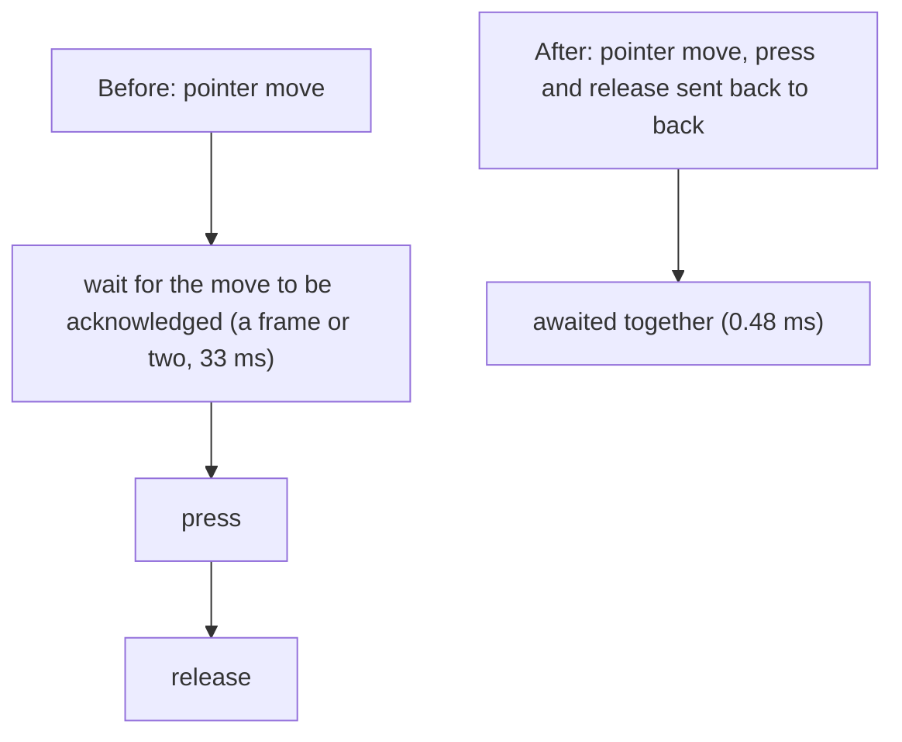

What the library costs, measured, and what Chrome costs instead. For advice on
making your own tests faster, see [Performance](/performance). Every figure
here was measured on one machine (Apple M1, 8 cores, macOS 27, Chrome 155,
release build, headless, a local page, nothing else running). Timings from
another machine will differ; the harnesses are in `benches/` so you can
repeat them.

<Panel>

<Card title="Measured on" icon="microchip">

Apple M1, 8 cores, macOS 27, Chrome 155, release build, headless, a local page, nothing else running.

Re-measured on 2026-10-11 at commit `a3348a8`, in one run of each harness.

</Card>

</Panel>

<Visibility for="agents">

Summary for AI exports: on an Apple M1 with Chrome 155 (release build, headless, one run on 2026-10-11) the Pure CDP engine took a median of 458 µs to click a button and 469 µs to fill a field, a protocol round trip costs about 0.1 ms, launching Chrome to a DevTools connection took a median of 570 ms, and the process that drives the browsers used about 7 MiB. There is no comparison with Python SeleniumBase on this page.

</Visibility>

<CodeGroup>

```bash CPU
cargo bench --bench cpu                    # the library's own work, no browser
```

```bash CPU with turso
cargo bench --bench cpu --features turso   # adds the result store and vault
```

```bash CDP latency
cargo bench --bench cdp_latency            # the Pure CDP engine against Chrome
```

</CodeGroup>

<Callout icon="clock" color="#F59E0B">

**Status of these figures.** Re-measured on 2026-10-11 at commit `a3348a8`
(after the `RunSettings` hooks, the MCP developer tools and the stealth layer
were added), in one run of each harness, on a machine that was otherwise idle but
already using about 4.5 GB of its 8 GB. A single run is a sample, not a
guarantee: the eight-tab figure below came out at roughly half of an earlier run
(1,634 against 3,223 clicks a second) and the cause was not investigated. The
`turso` figures were not re-run. Re-run the commands above on your machine
before quoting a number.

</Callout>

<Warning>

**There is no comparison with Python SeleniumBase here.** It is not installed
on the machine these numbers came from, so nothing below claims "X times faster
than Python". What can be said is structural: the Pure CDP engine talks to
Chrome over one WebSocket, with one message per command, and the driving
process stays small. A WebDriver session goes through a separate chromedriver
process and an HTTP request per command; that cost was not measured.

</Warning>

## One tab, one command at a time

| operation | <Tooltip tip="The middle measurement: half the runs were faster and half slower.">median</Tooltip> | <Tooltip tip="95 of every 100 measurements were at or below this time.">p95</Tooltip> |
|---|---|---|
| evaluate `1 + 1` | 156 µs | 854 µs |
| locator count | 123 µs | 185 µs |
| read an element's text | 276 µs | 318 µs |
| click a button | 458 µs | 702 µs |
| fill a field (11 characters) | 469 µs | 821 µs |
| type 11 characters key by key | 142 ms | 152 ms |
| viewport screenshot (PNG) | 35 ms | 52 ms |
| `goto` a local page | 9.8 ms | 12.6 ms |
| a wait notices an element that appeared | 6.5 ms | 9.2 ms |

A protocol round trip costs about 0.1 ms, so almost everything above that is
Chrome's own work, not the library's. Typing is slow on purpose: each key waits
`KEY_DELAY` (8 ms) so a page sees a person's rhythm. `fill` sets the value in
one step and is the fast way to enter text.

## Many tabs at once

Each tab clicks a button 150 times, all tabs at the same time, in one Chrome.

| tabs | clicks / second |
|---|---|
| 1 | 1,133 |
| 2 | 1,647 |
| 4 | 2,273 |
| 8 | 1,634 |

## Start-up and memory

| step | median | fastest |
|---|---|---|
| launch Chrome to a DevTools connection | 570 ms | 493 ms |
| first page attached and loaded | 51 ms | 43 ms |

(Five runs each; the slowest launch took 2.1 s, so a cold start can be much
slower than the median.) The process that drives the browsers uses about 7 MiB of
resident memory whether it drives one Chrome or eight. (Chrome's own memory is not counted.)

## The library's own work

No browser involved (`cargo bench --bench cpu`):

| operation | time |
|---|---|
| generate a random fingerprint | 1.7 µs |
| build the stealth bootstrap script (34 KiB) | 32 µs |
| check a fingerprint | 92 ns |
| classify a CSS or XPath selector | 60 ns |
| plan a human mouse path | 2.6 µs |
| plan human typing for 100 characters | 4.9 µs |
| inspect a 6 KiB page for accessibility issues | 237 µs |
| inspect a 260 KiB page | 9.1 ms |

Two rows differ from the first measurement beyond what noise explains: the
bootstrap script is now 34 KiB (it was 24 KiB) and the selector classifier takes
60 ns a call (it took 9 ns). The harness or the code changed between the two
runs; the cause was not investigated.

With the `turso` feature: recording a test result takes about 307 µs, the
flaky-test query over 2,000 results about 0.8 ms, sealing and storing an
encrypted profile about 19 µs and opening one about 15 µs. Opening the vault
takes about 58 ms on purpose: that is the key derivation (PBKDF2, 600,000
rounds), which is what makes a stolen vault file slow to attack.

## What changed because of these measurements

Before this work, a click took **33.4 ms** and eight tabs together managed
**239 clicks a second**. The harness found two things:

- **A click on a tab that was not frontmost never finished.** Chrome only
  acknowledges input for the tab it considers focused, so the click waited for
  the 30 second command timeout. Every tab is now told it has focus when it is
  attached (`Emulation.setFocusEmulationEnabled`), the same thing Playwright
  does. Several tabs can now be driven at once; this is what made the
  multi-tab figures above possible at all.
- **The whole cost of a click was waiting for the pointer move to be
  acknowledged.** Chrome answers a `mouseMoved` only at the next frame (two
  frames, 33 ms, in headless mode on this machine), while a press and release
  cost under a millisecond together. But Chrome delivers the pending move ahead
  of the press that follows it, so the move, press and release can be sent back
  to back and awaited together. The page sees exactly the same events in the
  same order (checked on a real Chrome: `mouseover`, `mousemove`, `mousedown`,
  `mouseup`, `click`, all trusted, at the right point). A click now takes
  **0.48 ms**, 69 times less, and eight tabs reached **3,223 clicks a second** in
  that run, 13 times more (a later run measured 0.46 ms per click and 1,634
  clicks a second at eight tabs, still about seven times the starting figure).

<Frame caption="How a click was sent before and after the change.">



</Frame>

## What was measured and left alone

- **Moving the pointer alone (a hover) still takes a frame or two.** Nothing
  follows it to flush it, and a hover that returned early could let the next
  command see the old state.
- **Launching Chrome takes about half a second**, nearly all of it Chrome.
- **Screenshots take about 33 ms**, which is Chrome encoding the image.
- **Launch flags such as `--disable-frame-rate-limit`** halve the cost of a
  pointer move, but they make `requestAnimationFrame` fire faster than a real
  display does, which is a signal anti-bot scripts look for. They are not used.
