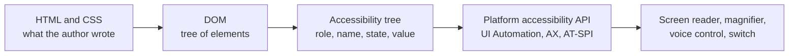

<Info>

**In short:** next to the picture you see, the browser builds a second,
simpler view of the page for screen readers and other assistive tools: the
**accessibility tree**. Each node has a role ("button"), a name ("Sign in") and
states ("expanded"). Pages written with the right HTML give that tree for free.
Tests can use it too: finding an element by role and name is more stable than a
CSS class, and it fails when the page is inaccessible.

</Info>

## Who the web has to work for

People use the web with a keyboard only, a screen reader that speaks the page, a
magnifier, voice control, a switch, or a high-contrast screen. Some of them
always do, some for a while (a broken arm), some in a moment (a phone in bright
sun, a noisy train). Accessibility ("a11y": a, eleven letters, y) is making sure
the page works for all of them. In many countries it is also a legal duty for
shops, banks and public services.

Assistive technology does not look at pixels. It asks the browser what is on the
page, and the browser answers from the **accessibility tree**.

## The accessibility tree



*From markup to a screen reader. The browser does the middle steps.*

The accessibility tree is a filtered copy of the [DOM](/concepts/selectors-and-the-dom):
it leaves out what has no meaning for a person (a purely decorative `div`, an
element hidden with `display: none`) and adds what the DOM only implies. Take
this markup:

```html
<nav aria-label="Main">
  <a href="/shop">Shop</a>
</nav>
<main>
  <h1>Welcome</h1>
  <label for="email">Email</label>
  <input id="email" type="email" required>
  <button>Sign in</button>
</main>
```

The browser derives:

| Element | Role | Name | State |
|---|---|---|---|
| `nav` | navigation | "Main" | |
| `a` | link | "Shop" | |
| `main` | main | | |
| `h1` | heading, level 1 | "Welcome" | |
| `input` | textbox | "Email" | required |
| `button` | button | "Sign in" | |

You can see the tree in Chrome: DevTools, the Elements panel, the Accessibility tab.

## Roles, names and states

Every node answers three questions.

- **Role: what is it?** A button, a link, a heading, a checkbox, a dialog, a
  landmark such as `navigation` or `main`. HTML elements carry a built-in role
  (an **implicit role**). The `role` attribute can set one explicitly.
- **Name: what is it called?** The label a screen reader speaks. The browser
  works it out from the best source available: an `aria-labelledby` reference,
  then an `aria-label`, then the content or the element's own text, a
  `label` element for a form control, the `alt` of an image, the `title` as the
  last resort.
- **State and properties: what condition is it in?** Checked, expanded,
  disabled, selected, required, invalid, busy.

**ARIA** (Accessible Rich Internet Applications) is a set of attributes
(`role`, `aria-label`, `aria-expanded`, `aria-live` and many more) for cases
where HTML has no element for the job. Its first rule is to use a native element
when one exists.

| | Accessible | Not accessible |
|---|---|---|
| A button | `<button>Save</button>`: role, name, keyboard, focus, all built in | `<div class="btn" onclick="save()">Save</div>`: no role, cannot be focused, Enter does nothing |
| Hiding an icon's meaning | `<button aria-label="Close">x</button>` gives the name "Close" | `<button>x</button>` is announced as "x, button" |
| A toggle | `aria-expanded="true"` on the trigger, updated by script | A class that only changes colour |

<Warning>

ARIA changes only what is announced, never what the element does. Adding
`role="button"` to a `div` does not make it focusable or respond to the keyboard.
Bad ARIA is worse than none, because it promises something the page does not
deliver.

</Warning>

## Screen readers and the keyboard

A **screen reader** speaks the page (or sends it to a braille display) and lets
the user move through it without a mouse: NVDA and JAWS on Windows, VoiceOver on
macOS and iOS, TalkBack on Android, Orca on Linux. People jump from heading to
heading, list the links or the form fields, or move between landmarks. That is
why headings need to be real headings in a sensible order, and why a link that
says only "click here" is useless out of context.

The keyboard is the other half. Everything a mouse can do must work without one:

- **Tab** moves **focus** to the next interactive element, **Shift+Tab** goes back.
  The order follows the DOM, so reordering with CSS can make focus jump around.
- **Enter** follows a link or presses a button; **Space** presses a button or
  toggles a checkbox; **Escape** closes a dialog or menu; the **arrow keys** move
  inside one widget (tabs, menus, radio groups).
- The focus must be **visible**, so the user can see where they are. Removing the
  outline with `outline: none` and giving nothing back is a common failure.
- `tabindex="0"` puts an element in the tab order, `tabindex="-1"` allows focus
  from a script only. Avoid positive values.
- A modal dialog keeps focus **inside** while open and returns it to the trigger
  when closed. A "skip to content" link at the top spares keyboard users from
  tabbing through the whole menu on every page.

## WCAG in one table

The **Web Content Accessibility Guidelines** (WCAG) are the standard behind most
laws. Versions 2.1 and 2.2 are in use. Each requirement has a level: **A** (the
basics), **AA** (the usual target and legal requirement), **AAA** (the highest,
not expected everywhere). They fall under four principles, remembered as POUR.

| Principle | Idea | Examples |
|---|---|---|
| **P**erceivable | Information can be seen or heard by everyone | Text alternatives for images; captions; text contrast of at least 4.5 to 1 (3 to 1 for large text); content readable when zoomed to 200% |
| **O**perable | Everything can be used with different inputs | All functions by keyboard; no keyboard trap; visible focus; enough time; targets big enough to hit |
| **U**nderstandable | The page behaves predictably and helps with mistakes | Page language set; labels on every field; clear error messages |
| **R**obust | It works with current and future assistive technology | Valid markup; correct name, role and value for custom controls; status messages announced (`aria-live`) |

## Why accessible selectors are stable

Compare three ways to find the same button:

| Selector | Breaks when |
|---|---|
| `div.container > div:nth-child(3) > button` | A wrapper is added or the order changes |
| `.btn-primary.css-1x2y3z` | A designer renames a class or a build re-hashes it |
| **role "button" with the name "Sign in"** | The button stops being a button, or its label changes: both are changes a user would notice |

A role-and-name selector asks what a person would ask: "the Sign in button".
Developers can restyle, wrap and reorder freely without breaking the test.
When such a selector **cannot** find an element that is obviously there, the
page has a real defect: no label, a clickable `div`, a missing role. The test
turns into a free accessibility check. Playwright's `getByRole` and Testing
Library made this style popular for exactly that reason (see
[selectors and the DOM](/concepts/selectors-and-the-dom) for the other kinds of selector).

Its weak spots: the name is text, so copy changes and translations change it
(use an exact match, or test with a fixed language), and two buttons with the
same name need a parent to tell them apart.

## Automated audits with axe-core

**axe-core** is an open-source JavaScript engine from Deque that checks a page
against WCAG rules. It runs inside the page and returns a list of **violations**,
each with a rule id, an impact (minor, moderate, serious, critical), an
explanation and the nodes at fault. Lighthouse's accessibility score is built on
it (see [rendering and performance](/concepts/rendering-and-performance)).

An automated tool finds a real share of problems, such as a missing `alt`, a form
field without a label or low contrast, but not all: it cannot tell whether an
`alt` text is meaningful, or whether the focus order makes sense. A real audit
adds a keyboard pass and a screen reader pass.

## How seleniumbase-rs uses it

seleniumbase-rs does not bundle axe-core. It has its own pieces, which cover
different ground.

### Role and label selectors

`SelectorBuf::role(role, name, exact)` builds a selector for an ARIA role with an
optional accessible name, the counterpart of Playwright's `getByRole`.
`SelectorBuf::label(text, exact)` finds a form control by its label, as
`getByLabel` does.

<Warning>

These are **approximations**, written as XPath, because the engine does not ask
the browser for the real accessibility tree. An element matches a role through
its `role` attribute or as the native element for it (`button`, `a` with `href`,
`h1` to `h6`, `input type="checkbox"` and so on). The name matches the
`aria-label`, text, `value`, `title` or `alt`, or the text of its `label`. Not
followed: `aria-labelledby`, roles that depend on context, hidden elements, and
states such as `checked`. A test can still pass against markup that the real
tree would name differently.

</Warning>

```rust,ignore src/main.rs
use seleniumbase_rs::utils::selectors::SelectorBuf;

// Pure CDP engine: Page::locator takes anything that converts to a SelectorBuf.
page.locator(SelectorBuf::role("button", Some("Sign in"), false)).click().await?;
page.locator(SelectorBuf::label("Email", false)).fill("me@example.test").await?;
```

### The audit_page tool

The MCP servers that have the DevTools tools (`cdp` and `sb`) offer
`audit_page`. It takes the page's HTML as it is now, after its scripts ran, and
runs `HtmlInspector` over it. It accepts `severity` (`all` or `error`) and
`limit` (50 by default, 500 at most) and returns the numbers of errors and
warnings, a count per rule, and the issues with the rule, message and a CSS
selector for the element. Its own `note` says what it cannot judge: colour
contrast, focus order and what a screen reader says. See [MCP](/concepts/mcp).

### HtmlInspector in your own tests

`seleniumbase_rs::api::html_inspector::HtmlInspector::inspect(html)` is a static
checker with stable rule ids, so it can be diffed in CI. It does not run
JavaScript, so give it the DOM as the browser has it now.

| Rule | Severity | Reports |
|---|---|---|
| `document-lang` | error | `html` has no `lang` |
| `image-alt` | error | an image has no `alt` attribute |
| `interactive-name` | error | a link or button has no accessible name |
| `form-control-label` | error | an input, select or textarea has no label |
| `duplicate-id` | error | an `id` is used more than once |
| `invalid-aria-reference` | error | `aria-labelledby` or `-describedby` names a missing id |
| `heading-order` | warning | a heading level is skipped |
| `main-landmark` | warning | there is no `main` landmark |

The table shows the main rules; the module lists them all (for example
`skip-link`, `page-h1`, `table-headers`, `link-text`).

```rust,ignore src/main.rs
use seleniumbase_rs::api::html_inspector::HtmlInspector;

let html = sb
    .execute_script("return document.documentElement.outerHTML;")
    .await?;
let result = HtmlInspector::inspect(html.as_str().unwrap_or_default())?;
assert!(!result.has_errors(), "accessibility errors: {:?}", result.issues);
```

### Running axe-core yourself

Load the axe-core file into the page and run it. Both engines can evaluate
JavaScript, and `Page::evaluate` on the pure CDP engine awaits the promise that
`axe.run()` returns.

```rust,ignore src/main.rs
let axe = std::fs::read_to_string("node_modules/axe-core/axe.min.js")?;
page.evaluate(axe).await?;
let violations = page
    .evaluate("axe.run().then(r => r.violations.map(v => ({ id: v.id, impact: v.impact, nodes: v.nodes.length })))")
    .await?;
assert_eq!(violations.as_array().map(Vec::len), Some(0), "{violations}");
```

<Tip>

Start with `HtmlInspector` for the cheap, repeatable checks in every run, add
axe-core for contrast and ARIA rules on key pages, and keep manual keyboard and
screen-reader passes for releases.

</Tip>

## Where to go next

<Columns cols={2}>

<Card title="Selectors and the DOM" icon="code" color="#199f43" href="/concepts/selectors-and-the-dom">
  The tree the accessibility tree is built from, and the other selector kinds.
</Card>

<Card title="Web APIs" icon="puzzle-piece" color="#1a85d4" href="/concepts/web-apis">
  Evaluating JavaScript in the page, which is how an axe run happens.
</Card>

<Card title="Mobile web" icon="mobile-screen" color="#d47628" href="/concepts/mobile-web">
  Touch targets, zoom and viewport rules that overlap with accessibility.
</Card>

<Card title="SEO" icon="magnifying-glass" color="#a631be" href="/concepts/seo">
  Headings, titles and structure also help search engines.
</Card>

</Columns>
