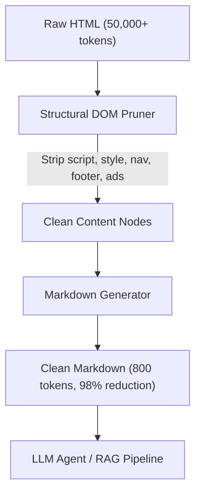

# AI & LLM Web Extraction

Web pages are written for human visual rendering, containing heavy layout trees, analytics beacons, advertisements, CSS stylesheets, and nested navigation shells. Feeding raw HTML into Large Language Models (LLMs) quickly exhausts prompt context windows and confuses reasoning algorithms with irrelevant navigational noise.



---

## Token Efficiency & Content Pruning

`seleniumbase-rs` implements high-speed, single-pass HTML-to-Markdown conversion designed specifically for RAG and AI pipelines:

1. **Noise Tag Elimination**: Tags like `<script>`, `<style>`, `<nav>`, `<footer>`, `<aside>`, `<form>`, `<svg>`, and `<iframe>` are pruned immediately.
2. **Semantic Element Formatting**: Headings (`<h1>`–`<h6>`), bulleted and ordered lists (`<ul>`, `<ol>`), blockquotes (`<blockquote>`), code spans (`<pre>`, `<code>`), and semantic tables (`<table>`) are transformed into standardized GitHub Flavored Markdown.
3. **Link & Image Control**: `MarkdownOptions` allows stripping hyperlinks or inline images to prevent token bloat during text-only synthesis tasks.

---

## Automated Strongly Typed Form Automation

Rather than writing repetitive `.type()` calls for every input field on a checkout or registration form, autonomous agents can map typed Rust models directly to DOM inputs:

```rust
#[derive(Serialize)]
struct UserProfile {
    first_name: String,
    last_name: String,
    email: String,
    bio: String,
}

// Automatically matches inputs: input[name='first_name'], input[id='email'], etc.
page.fill_form(&profile).await?;
```

The `extract::FormData` engine serializes structs via Serde into flattened key-value pairs and matches input elements by `name`, `id`, or `placeholder` attributes with zero manual selector boilerplate.
