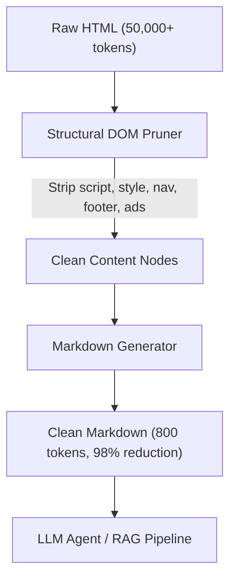

# AI & LLM Web Extraction

Web pages are written for human visual rendering, containing heavy layout trees, analytics beacons, advertisements, CSS stylesheets, and nested navigation shells. Feeding raw HTML into Large Language Models (LLMs) quickly exhausts prompt context windows and confuses reasoning algorithms with irrelevant navigational noise.



---

## Token Efficiency & Content Pruning

Since v0.10.0, HTML-to-Markdown conversion, metadata extraction, JSON-LD parsing, table parsing, typed form serialization, and AI extraction prompt builders live in `seleniumbase-rs-plugin-extractor` (inside [seleniumbase-rs-plugins](https://github.com/MustCodeAl/seleniumbase-rs-plugins)):

1. **Noise Tag Elimination**: Tags like `<script>`, `<style>`, `<nav>`, `<footer>`, `<aside>`, `<form>`, `<svg>`, and `<iframe>` are pruned immediately by `html::html_to_markdown`.
2. **Semantic Element Formatting**: Headings (`<h1>` through `<h6>`), bulleted and ordered lists (`<ul>`, `<ol>`), blockquotes (`<blockquote>`), code spans (`<pre>`, `<code>`), and semantic tables (`<table>`) are transformed into GitHub Flavored Markdown.
3. **Link & Image Control**: `html::MarkdownOptions` strips hyperlinks or inline images and caps character length to fit LLM context budgets.

---

## Automated Strongly Typed Form Serialization

Rather than mapping struct fields manually, `html::FormData::from_serializable` flattens any `Serialize` Rust struct into key-value pairs ready to populate matched DOM form inputs (`input[name]`, `input[id]`, `textarea`, `select`):

```rust
use seleniumbase_rs_plugin_extractor::html::FormData;
use serde::Serialize;

#[derive(Serialize)]
struct UserProfile {
    first_name: String,
    last_name: String,
    email: String,
    bio: String,
}

let form = FormData::from_serializable(&profile)?;
for (field, value) in form.fields() {
    page.locator(format!("[name='{field}']")).type_text(value).await?;
}
```

With the `ai` Cargo feature enabled on `seleniumbase-rs-plugin-extractor`, `ai::AiPromptBuilder` builds provider-agnostic JSON Schema prompts and `ai::parse_ai_response` / `ai::parse_ai_records` parse raw or code-fenced JSON replies without bundling an HTTP client. See the [AI & LLM Extraction tutorial](/tutorials/ai_extraction) and the [extractor plugin guide](/plugins/extractor).
