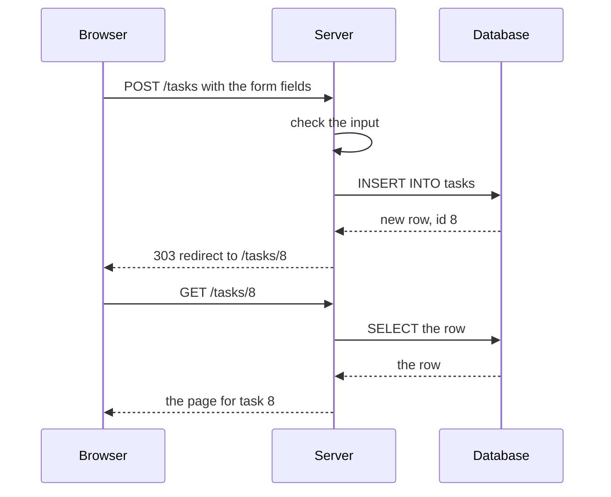
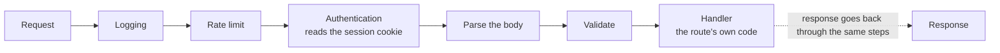
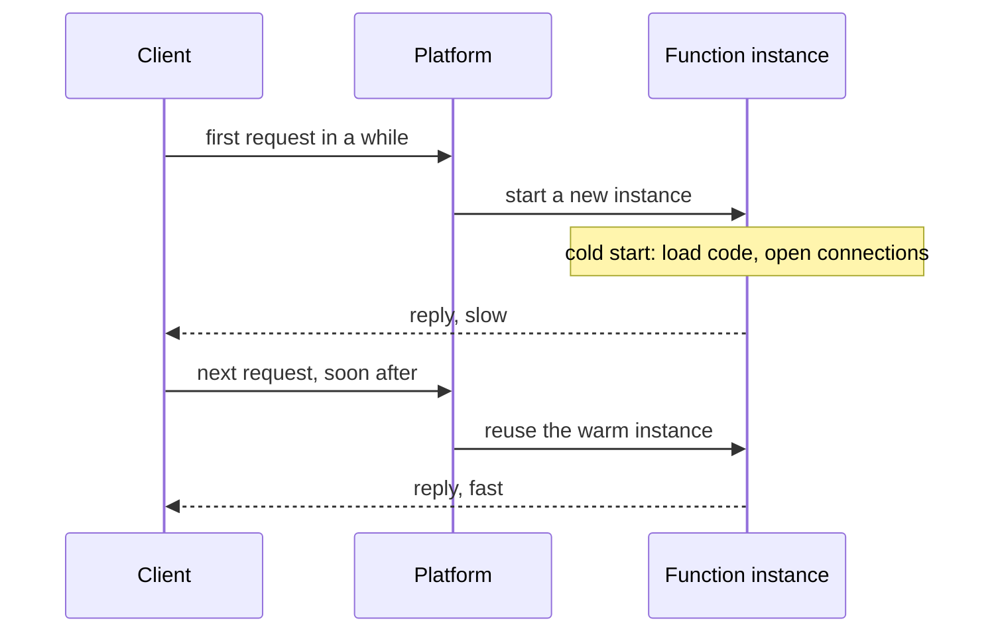

<Info>

**In short:** Behind almost every page is a program that receives a request,
checks it, reads or writes a database and sends a reply. The same few patterns
repeat: create-read-update-delete screens, a chain of middleware around each
request, and, more and more, small functions that run only when called. Knowing
which one a site uses tells a tester where state lives, why a first request can
be slow, and what must be reset between runs.

</Info>

This page continues [Frontends, backends and APIs](/concepts/frontends-backends-and-apis).
It is about the shapes inside the box labelled "server".

## CRUD: the pattern behind most apps

Most business software lets people do four things to a kind of record: **C**reate
it, **R**ead it, **U**pdate it and **D**elete it. A to-do list, a shop's product
catalogue, an admin panel and a profile page are all CRUD. The four actions
line up with four layers that you already know:

| Action | The user sees | The HTTP request | The database |
|---|---|---|---|
| Create | A form and a Save button | `POST /tasks` | `INSERT` a row |
| Read | A list, and a detail page | `GET /tasks` and `GET /tasks/7` | `SELECT` rows |
| Update | An edit form | `PUT` or `PATCH /tasks/7` | `UPDATE` a row |
| Delete | A Delete button | `DELETE /tasks/7` | `DELETE` a row |

The routes in that table follow a convention called **REST**: the URL names a
*thing* (`/tasks/7` is task number 7) and the HTTP method names the action. Not
every site follows it strictly, but the idea of "a URL per thing, a verb per
action" shows up everywhere. Some APIs use one URL for everything and put the
action in the body (GraphQL and RPC styles). The database layer is the same
either way.

### From a form to a row

An HTML form is the oldest way to reach a back end, and many pages still use it.

*A form submit. After the write, the server answers with a redirect, so a reload
does not send the form again.*

That "write, then redirect, then read" order is called **post/redirect/get**. For
a test it means a click on Save causes **two** page loads, and the thing to wait
for is the final URL or the new content, not the first reply.

Single-page apps skip the form post. Their JavaScript sends the same `POST` with
`fetch`, gets JSON back and updates the page itself, without navigating. The
back end is the same; what a test can observe is different, because the URL may
not change at all. See [frameworks and the DOM](/concepts/frameworks-and-the-dom).

## Middleware: a pipeline around every request

Real servers do many things for each request before the code you care about runs:
log it, read cookies, check who the caller is, parse the body, limit how often one
client may call, and compress the reply. Frameworks organise this as
**middleware**: a list of small steps that each get the request, may change it,
and pass it on. The reply travels back through the same steps in reverse.

*Each box can end the request early: a failed check returns an error and the
handler never runs.*

Why this matters outside the server:

- A **401** or **403** often comes from an authentication or permission step, not
  from the page you asked for. See [sessions, cookies and storage](/concepts/sessions-and-state).
- A **429 Too Many Requests** comes from a rate-limit step. A test suite that
  hammers a staging server can trigger it, and the fix is to slow down or ask for
  a higher limit, not to retry in a tight loop.
- A **400** or **422** comes from validation. The reply body usually says which
  field failed; read it.
- Steps run **in order**. A request blocked by the first step never reaches the
  later ones, so a failure in one place does not prove the others are fine.

## Serverless and edge functions

A classic server is a program that stays running and waits. A **serverless
function** is the opposite: your code is a single function that the platform
starts when a request arrives and may stop again afterwards. You do not manage the
machine, and you pay for the time it runs.

*A cold start adds delay to the first request after a quiet period.*

Three ideas follow from that model.

<AccordionGroup>

<Accordion title="Cold starts" icon="snowflake">

The first call after a pause has to load the code and open its connections before
it can answer, which can add from tens of milliseconds to several seconds. Later
calls reuse the warm instance and are fast. A test that runs once in the morning
against a quiet environment is the one most likely to meet a cold start.

</Accordion>

<Accordion title="Statelessness" icon="eraser">

Two requests may reach two different instances, and an instance can be thrown
away at any time. So the function must not keep anything in its own memory or
disk that the next call needs. Everything durable goes into a database, a cache
or object storage, and the identity of the caller travels with each request in a
cookie or token. This is the same rule as the stateless processes of a
twelve-factor app.

</Accordion>

<Accordion title="Edge functions" icon="earth-europe">

An **edge function** is a serverless function that runs in many small data centres
close to the visitor, often at the same network points as a CDN. It suits quick
work on the request itself: a redirect, an A/B test assignment, a header, a
cookie, a check of the country. It has tighter limits on time, memory and the
libraries it may use. Because the answer can depend on where the request comes
from, two people can see different results from the same URL.

</Accordion>

</AccordionGroup>

## What changes for testing

| Pattern | The risk for a test | What to do |
|---|---|---|
| CRUD with a shared database | Data left by one run changes the next; two parallel runs fight over one record | Create the records a test needs, use unique names, and clean up or reset the environment |
| Post/redirect/get | The first reply is a redirect, not the page | Wait for the final URL or content |
| Middleware auth | A session that expired, or a missing cookie, looks like a broken page | Log in as part of the test, or restore a saved session |
| Rate limits | 429 replies in a fast suite | Slow the suite, spread runs, or use a test key with a higher limit |
| Cold start | The first request is slow and may time out | Warm the environment with one request before the run, and give the wait for the first element enough time |
| Stateless instances | A value set by one request is not visible to the next unless it is stored | Test through the database or the API, not through memory |
| Eventual consistency | A write is visible on one replica before another, so a read right after a write can show old data | Wait for the new content to appear instead of reading once |
| Edge logic | The result depends on country, headers or cookies | Set the location, language and cookies explicitly |

<Tip>

When a front end is hard to test because its back end is slow, flaky or has
side effects (it sends an email, takes a payment), stub that one API call in the
browser and test the page against a fixed answer. Keep a smaller set of
end-to-end tests that use the real back end.

</Tip>

<Warning>

Do not run destructive tests against a shared or production back end. A "delete
all" button works exactly as well when a robot presses it. Test against an
environment built for it, with data you can throw away.

</Warning>

## How seleniumbase-rs deals with it

The library drives the browser; it does not run or inspect a server. It does give
you tools for the browser-side half of each pattern.

- **Stubbing and observing API calls.** `Page::intercept` in the pure CDP engine
  pauses every request a page makes and applies the first matching `Rule`.
  `Rule::fulfill(Response::json(200, &body)).url("*/api/account")` answers an
  API call with a made-up reply, which fixes the back end's side of a test.
  `Rule::block()` drops a request, and `Rule::modify()` changes a header or body
  on the way out. The returned `Interception` keeps a log of the requests it saw.
  See [the network](/concepts/network).
- **A record of what the server did.** `Page::start_har` returns a `HarRecorder`,
  which records the page's traffic as a HAR file, with status codes and timings;
  that is the place to see a 429 or a slow first request.
- **Waiting and timeouts.** `Page::with_timeout` gives a page a different wait
  for elements and conditions (7 seconds by default), which suits a screen that
  fills in after a slow first API call. A navigation has its own limit of 60
  seconds, enough for most cold starts. `Page::wait_for_function` waits until a
  script expression is truthy, which suits "the new row is in the list".
- **Retrying a flaky call.** `RetryPolicy` (exported from the crate root) runs an
  operation again after a transient failure, with exponential backoff.
  `RetryPolicy::network()` is made for network-level work, and `RateLimiter`
  keeps a loop from calling something more than a set number of times in a
  window, which is the other side of a server's own rate limit.
- **Login state.** Cookies and storage are covered in
  [sessions, cookies and storage](/concepts/sessions-and-state), including how to
  keep a login so a test does not repeat it.

<Note>

None of this replaces testing the API itself. A browser test shows that the page
and the back end agree, which is slow and broad. Tests that call the API directly
are faster and narrower, and the two together find more than either alone.

</Note>

## Where to go next

<Columns cols={2}>

<Card title="Frontends, backends and APIs" icon="server" color="#1a85d4" href="/concepts/frontends-backends-and-apis">
  The big picture: who talks to whom, and over what.
</Card>

<Card title="The network" icon="network-wired" color="#199f43" href="/concepts/network">
  Requests, status codes, interception and HAR.
</Card>

<Card title="Sessions, cookies and storage" icon="database" color="#d47628" href="/concepts/sessions-and-state">
  How a server knows who you are from one request to the next.
</Card>

<Card title="Frameworks and the DOM" icon="layer-group" color="#a631be" href="/concepts/frameworks-and-the-dom">
  How the client-side half builds the page from API replies.
</Card>

</Columns>
