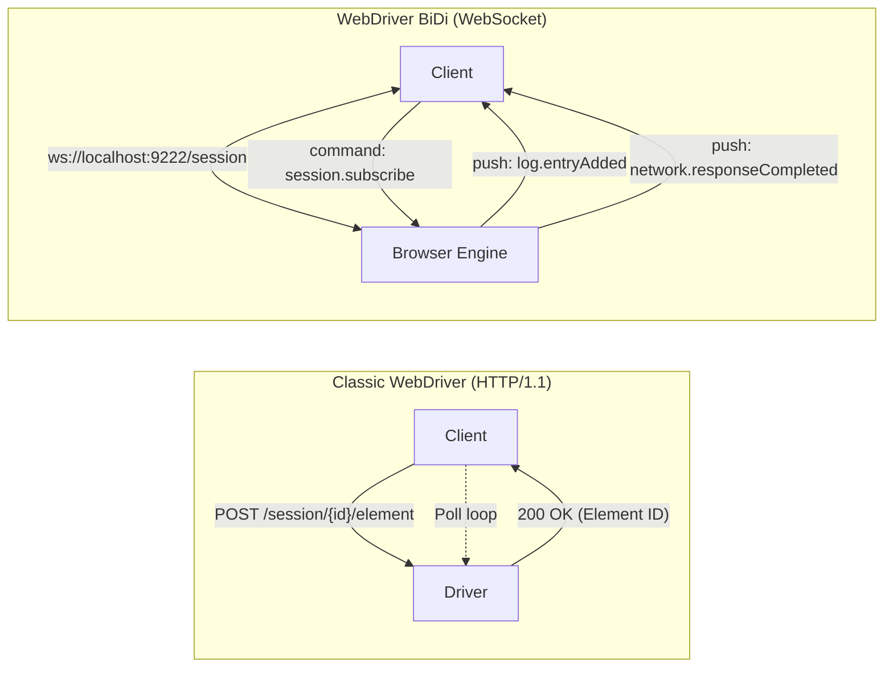

# W3C WebDriver BiDi

WebDriver BiDi (Bidirectional) is the next-generation cross-browser automation protocol standardized by the W3C. While classic WebDriver operates as a request-response HTTP protocol, WebDriver BiDi establishes a persistent, full-duplex WebSocket connection between the test harness and the browser.

---

## Why BiDi Matters

Classic WebDriver required continuous client-side polling to detect page changes, navigate frames, or check network idle states. This introduced latency, high CPU overhead, and made observing transient events (like console logs or network failures) notoriously fragile.

WebDriver BiDi resolves these architectural limitations:

1. **Push Notifications Without Polling**: Browsers push console logs (`log.entryAdded`), runtime exceptions, DOM mutations, and network progress directly to the client as asynchronous JSON-RPC events.
2. **Cross-Browser Standard**: Unlike Chrome DevTools Protocol (CDP), which is Chromium-specific, WebDriver BiDi is natively implemented by Chromium, Firefox (Gecko), and Safari (WebKit).
3. **BiDi + Classic Interoperability**: BiDi runs alongside existing classic WebDriver sessions negotiated via the standard `webSocketUrl: true` capability.

---

## Architectural Comparison: Classic vs. BiDi vs. CDP

| Feature | Classic WebDriver | W3C WebDriver BiDi | Chrome DevTools Protocol (CDP) |
| :--- | :--- | :--- | :--- |
| **Transport** | HTTP/1.1 REST | WebSocket | WebSocket |
| **Communication** | Unidirectional Request/Response | Full-Duplex Bidirectional | Full-Duplex Bidirectional |
| **Browser Support** | All Browsers | All Modern Browsers (W3C standard) | Chromium-only |
| **Log Observation** | None / Driver Logs after run | Real-time push (`log.entryAdded`) | Real-time push (`Runtime.consoleAPICalled`) |
| **Network Interception** | None (requires external proxy) | Native (`network.beforeRequestSent`) | Native (`Network.setRequestInterception`) |
| **Connection Multiplexing** | One session per port | Multiple subscriptions per socket | Target-based multiple sessions |

---

## How seleniumbase-rs Leverages BiDi

In `seleniumbase-rs`, WebDriver BiDi is accessed seamlessly via:

- `config.session.bidi = true` or `BrowserConfigBuilder::bidi(true)`.
- `sb.bidi_listen_logs().await?`: Receives a tokio `EventStream<LogEntryAdded>` for real-time console streaming.
- `sb.bidi_forward_logs(channel_tx).await?`: Pumps live browser diagnostics directly into an asynchronous worker task without blocking test execution.
- `sb.bidi_listen_network().await?`: Observes network request lifecycle events across Chromium and Firefox without requiring vendor-specific flags.
