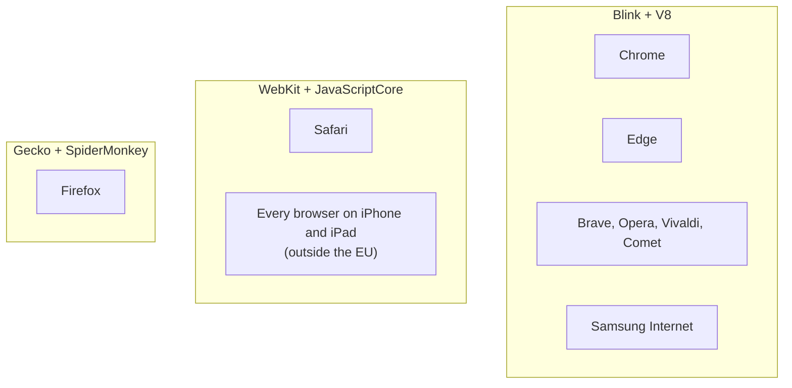
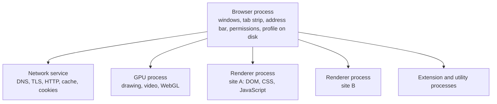

<Info>

**In short:** a browser is a window and some menus wrapped around two
**engines**: the **rendering engine** turns HTML and CSS into pixels, and the
**JavaScript engine** runs the page's scripts. Almost every browser uses one of
three families: Blink, WebKit or Gecko. It is also not one program but a small
family of them: one **browser process** owns the windows and the tab list, one
**renderer process** per site runs the page inside a **sandbox**, and separate
processes handle graphics and the network. Automation talks to that family from
outside, picks a tab (a **target**), and starts the whole thing with **flags**
that make it controllable. Tests that pass in one engine can fail in another,
and the library supports several browsers, with the most features on
Chromium-based ones.

</Info>

## What an engine is

When you type a web address, a lot of code runs between the network and your
screen. The part that understands the web, the **browser engine**, is separate
from the part that draws tabs, bookmarks and the address bar (the "browser
chrome"). One engine can sit inside many browsers. That is why two browsers with
different logos, menus and privacy settings can show a page in exactly the same
way.

A browser engine is really two engines that work together:

| Engine | Its job | Examples |
|---|---|---|
| **Rendering (layout) engine** | Parses HTML and CSS, builds the page's structure, works out sizes and positions, paints pixels | Blink, WebKit, Gecko |
| **JavaScript engine** | Parses and runs the page's JavaScript, and manages its memory | V8, JavaScriptCore, SpiderMonkey |

The JavaScript engine does not stand alone. It is given access to the page
(the DOM, timers, the network) by the rendering engine, so each rendering
engine is normally paired with one JavaScript engine. The rest of this page
explains the parts: the browser's processes, the sandbox and what automation
controls. [How a page loads](/concepts/how-a-page-loads) covers the render steps.

## The three families



*Browsers grouped by the engine they are built on.*

<Tabs>

<Tab title="Blink and V8" icon="chrome">

**Blink** is the engine of Chromium, the open-source project behind Google
Chrome. Chrome, Microsoft Edge, Brave, Opera, Vivaldi, Samsung Internet and many
smaller browsers are built on Chromium, so they all use Blink. Blink began in
2013 as a fork of WebKit, and the two have grown apart since.

Its JavaScript engine is **V8**, which also runs outside browsers: Node.js,
Deno and Electron all contain it. V8 reads the script, runs it at once with a
simple interpreter, watches which functions run often, and compiles those into
fast machine code (a *JIT*, just-in-time compiler).

Chromium is also where the Chrome DevTools Protocol lives, which is why
[CDP](/concepts/cdp) works on all of these browsers.

</Tab>

<Tab title="WebKit and JavaScriptCore" icon="apple">

**WebKit** is the engine of Apple's Safari. It is open source, and it grew from
KHTML, the engine of the Linux browser Konqueror. Its JavaScript engine is
**JavaScriptCore**, which has several stages of compilation, from a fast-starting
interpreter to an optimising compiler.

On iPhone and iPad, Apple has long required every browser to be built on WebKit.
Chrome, Firefox and Edge for iOS are therefore WebKit under their own menus.
Rules in the European Union now allow other engines, but WebKit is still by far
the common case. So to test "the iPhone experience" you need WebKit, whatever
browser the user thinks they use.

</Tab>

<Tab title="Gecko and SpiderMonkey" icon="firefox-browser">

**Gecko** is the engine of Mozilla Firefox, and it is the only large engine
that is neither Chromium nor Apple. Its JavaScript engine, **SpiderMonkey**, is
the oldest of the three: it was the first JavaScript engine of all, written for
Netscape. Parts of Gecko are written in Rust, a language Mozilla created, and
some of that work came from the experimental engine Servo.

Gecko matters because it keeps the web from depending on one vendor. A site
that works only in Chromium is a site that Firefox users cannot use.

</Tab>

<Tab title="Others" icon="ellipsis">

- **Internet Explorer** used **Trident** and the old Edge used **EdgeHTML**.
  Both are retired, but old corporate sites still target them.
- **Ladybird** and **Servo** are new engines written from scratch. They are not
  yet used by mainstream browsers.
- **Electron** and mobile web views (Android WebView, Apple's WKWebView) embed an
  engine inside an app. Their engine is Blink or WebKit.

</Tab>

</Tabs>

## Standards: who decides what engines do

Engines follow written standards, but standards are written by people who need
to agree. The main groups are:

- the **WHATWG** keeps the "living standards" for HTML, the DOM, Fetch and URL;
- the **W3C** publishes CSS and many APIs, and the WebDriver standard
  ([WebDriver](/concepts/webdriver));
- **TC39** at Ecma International standardises JavaScript (the language called
  ECMAScript).

A new feature normally appears first in one engine as an experiment, then in the
others once the standard settles. Reference sites track who supports what: the
browser compatibility tables on MDN, [caniuse.com](https://caniuse.com), and the
shared test suite **Web Platform Tests**, which every engine runs against.
[Reading MDN and its compatibility tables](/concepts/javascript-and-events#reading-mdn-and-its-compatibility-tables)
shows how to read a compatibility table, and
[Modern web](/concepts/modern-web) lists newer features.

## Many processes, one browser

Open Chrome's Task Manager (Shift+Esc) and you will see far more than one
entry. The split is deliberate: a crash in one web page must not take down the
others, and a page that has been taken over by an attacker must not be able to
read the rest of your computer.



*The main processes of Chrome. Arrows mean "starts and talks to".*

| Process | What it does | Why it matters when you automate |
|---|---|---|
| Browser | The one trusted process: draws the window and address bar, owns the tab list, decides what a page may do, reads and writes the profile folder | The debugging port (`--remote-debugging-port`) is served from here, so this is what you connect to |
| Renderer | Runs one site's pages: parses HTML and CSS, builds the DOM, runs JavaScript, lays out the page | `Runtime.evaluate` and the DOM commands end up here; if it crashes, the tab shows "Aw, Snap!" and the others carry on |
| Network service | Does the actual network work for every renderer: DNS, TLS, HTTP/1.1, HTTP/2 and HTTP/3, the HTTP cache | [Interception, proxies and HAR](/concepts/network) hook in at this layer; TLS fingerprints come from here |
| GPU | Turns the page into pixels and runs WebGL and video decoding | Without a GPU (a container, a CI machine), Chrome falls back to software rendering, which the page can notice |
| Utility and extension | Short-lived helpers (audio, decoding) and one process per extension | [Browser extensions](/concepts/browser-extensions) run here, not in the page |

## Site isolation and the sandbox

Two ideas protect the user, and both shape what automation sees. The
**sandbox** puts the code that handles a web page in a cage, and **site
isolation** puts each website in its own cage. This section goes from the
problem to the details, and ends with the switch that test runners reach for.

### The problem a sandbox solves

A web page is a program written by someone you may not trust. Your browser
downloads it, parses its HTML, runs its JavaScript, decodes its images and plays
its video. All of that code, and the browser's own code that handles it, has
bugs, and some bugs let a crafted page take over the process that is running it.

The sandbox assumes this will happen and limits what the taken-over process can
do. Think of a cook who works in a room with no door to the rest of the house:
if the cook goes rogue, the damage stays in the kitchen.

### Processes: where the cages are

The browser process is the trusted one, with the full rights of the user (see
the diagram in [Many processes, one browser](#many-processes-one-browser)). The
renderers hold the page code and are the ones put in cages.

A **renderer** has almost no rights of its own. It cannot open a file, cannot
open a network socket and cannot start a program. When a page needs something
(load an image, save a download, read a cookie) the renderer asks the browser
process through a message, and the browser process decides. This is the same
idea as a hotel clerk who fetches things for guests but never hands out the
master key.

### The operating system sandbox

The cage is built by the operating system, not by Chrome's own checks, so a bug
in Chrome's code cannot simply switch it off. Each system has its own tools:

| System | What Chrome uses | What it means |
|---|---|---|
| Linux | User namespaces or a setuid helper, plus a **seccomp-BPF** filter | The process gets an empty view of the file system and network, and the kernel refuses most system calls |
| macOS | Seatbelt profiles | A written list of what the process may touch; everything else is denied |
| Windows | Restricted tokens, job objects and a low integrity level | The process runs as a user with almost no rights and cannot create other processes |

The result: a renderer exploit alone is not enough to read your documents. An
attacker needs a **second** bug, one that escapes the cage. Chain two bugs and
the attack works, which is why browsers are patched so often. See
[web security](/concepts/web-security) for the other attacks a browser has to
withstand.

### Site isolation

The sandbox keeps a page away from your computer. **Site isolation** keeps one
website away from another.

Without it, two sites that happen to be open in the same tab, for example a
page and an advertisement frame inside it, could live in one renderer process.
A flaw in the CPU itself, such as Spectre, lets code read memory it should not
reach inside its own process. If a hostile site shares a process with your bank,
it could read the bank's data out of memory.

With site isolation, Chrome gives every **site** (scheme plus registrable domain,
such as `https://example.com`) its own renderer process, and even puts a
cross-site iframe in a different process from the page that embeds it (an
"out-of-process iframe"). It is on by default in desktop Chrome.

It has a visible effect on automation. A page and its cross-site iframe are
different **targets** in the [DevTools Protocol](/concepts/cdp), and a client
must attach to the iframe's target to talk to it. A test tool that treats the
page as one big document will not see inside such a frame unless it handles
this. A same-site iframe, by contrast, stays in the same process and is part of
its parent's target (see
[the DevTools Protocol](/concepts/cdp#targets-and-sessions)).

### Containers and virtual machines

The browser's sandbox is only the inner cage. Test suites usually run inside a
second one.

- **A container** (Docker and similar) is a group of ordinary processes that the
  Linux kernel gives a private view of files, processes, users and network.
  Containers share the host's kernel, so they are light and fast, but a kernel
  bug can reach out of one.
- **A virtual machine** runs a whole second operating system on virtual
  hardware. It is heavier and a much stronger wall, because an attacker must
  break the hypervisor rather than the shared kernel.
- Services that run tests for strangers often use a **micro virtual machine** or a
  user-space kernel to get close to virtual machine strength with container speed.

These layers add up. A good setup has the browser's sandbox **inside** a
container **inside** a machine that holds nothing valuable. See
[containers](/concepts/containers-and-deployment#containers-and-virtual-machines) for images, layers and Compose.

### Why --no-sandbox is risky

Chrome's sandbox needs help from the kernel. In a container two things often get
in the way:

1. Chrome refuses to start as the **root** user with its sandbox on, and many
   container images run everything as root.
2. The default container security profile can forbid the system calls the
   sandbox uses to build its cage, so it cannot start even as a normal user.

The quick fix found everywhere on the internet is the switch `--no-sandbox`.
It works, and it removes the cage entirely: a renderer exploit now runs with
every right of the user that started Chrome.

<Warning>

Never browse untrusted sites with `--no-sandbox` on a machine that holds secrets.
The container is then your only wall. Keep the container itself locked down:
no mounted home folder, no Docker socket, no cloud credentials in its
environment, and a fresh instance for every run.

</Warning>

Safer fixes, in order of preference:

<Steps>

<Step title="Run as a normal user" icon="user">

Add a non-root user to the image and start the tests as that user. This removes
the first of the two causes.

</Step>

<Step title="Allow what the sandbox needs" icon="unlock">

Use a container security profile (seccomp profile) that permits the namespace
calls the sandbox uses, or enable unprivileged user namespaces on the host.
The sandbox then works inside the container.

</Step>

<Step title="Accept it, and shrink the blast radius" icon="box">

If the sandbox cannot run, treat the browser as fully trusted by its attacker.
Visit only your own application and test sites, run on a throwaway machine
or a micro virtual machine, and keep secrets out of reach.

</Step>

</Steps>

When your tests only open the application you are building, the practical risk of
`--no-sandbox` in a clean container is small. When they follow links on the open
internet, scrape unknown sites or open files from strangers, it is not.

### Isolation inside the browser, for tests

Isolation also matters between two tests. A leftover cookie from test one can
make test two pass for the wrong reason. The tools are the same ideas in smaller
form:

- A **fresh profile** per run (a new user data folder), so no cookies, cache or
  logins carry over.
- An **incognito** or **guest** profile, which Chrome keeps in memory.
- A **browser context**, the protocol's name for an incognito-like partition
  that shares nothing with the others. See
  [sessions, cookies and storage](/concepts/sessions-and-state).

## Tabs, frames and workers: the things you can control

Automation does not say "the browser", it says "this tab" or "this frame". The
browser lists what can be controlled as **targets**:

| Target | What it is | Notes |
|---|---|---|
| `browser` | The browser process itself | Used for new tabs, windows, permissions and browser contexts |
| `page` | A tab (or a popup window) | What `Browser::default_page()` returns as a `Page` |
| `iframe` | A cross-site frame with its own process | A same-site frame is not a target of its own |
| `service_worker` | A background script that outlives a tab and can answer its requests | See [modern web technologies](/concepts/modern-web#service-workers-and-pwas) |
| `shared_worker`, `worker` | JavaScript running beside a page, with no DOM | Workers have no `window` and no `document` |
| `background_page` or extension service worker | An extension's own script | See [browser extensions](/concepts/browser-extensions) |

A **frame** is a document inside a document: the top page is the main frame, and
every `iframe` element holds another. A **browser context** is a separate
profile-like bucket (cookies, storage, cache) inside one running browser, the
protocol's name for what Chrome shows as an incognito window. See
[sessions, cookies and storage](/concepts/sessions-and-state). In
seleniumbase-rs `Browser::new_context()` creates one and `Browser::default_page()`
returns the first tab.

## Headed and headless

A **headed** browser has a window you can see. A **headless** browser runs
the same engine with no window and no need for a display. That is why CI
machines and containers use it.

<Steps>

<Step title="Old headless: a separate program" icon="gears">

For years `--headless` started a stripped-down implementation of the browser
that shared the rendering engine but not the rest. It was fast and small, and it
behaved differently: no extensions, a different default window, and its own
telltale signs for sites that look.

</Step>

<Step title="New headless: the real browser, with no window" icon="eye-slash">

Since Chrome 112 `--headless` means **new headless**: the same code as headed
Chrome, with the window hidden. It supports extensions, behaves like the headed
browser and is much harder to tell apart from it. You can ask for it by name with
`--headless=new`.

</Step>

<Step title="The old one lives on as chrome-headless-shell" icon="box-archive">

The old implementation was removed from the main Chrome binary in version 132.
It is still published as a separate download, **chrome-headless-shell**, for
people who want the small and fast one for screenshots and PDF. See the
[glossary](/glossary#chrome-headless-shell).

</Step>

</Steps>

<Tip>

Headless and headed runs are not identical in timing, in how big the viewport is
or in what the page can detect. If a test passes headed and fails headless, check
the window size first, then the [detection page](/concepts/detection).

</Tip>

In seleniumbase-rs, `LaunchOptions::builder().headless(true)` or `.headless(false)`
chooses explicitly, and `LaunchOptions::is_headless()` tells you what was chosen.
When you do not choose, a launch is headless only on Linux, where there is often
no display. On a machine with no display at all, a virtual one (`Xvfb`) lets a
headed browser run; see [Headless and headed](/tutorials/headless).

## Chrome, Chromium and Chrome for Testing

Three things are all called "Chrome", and automation cares which one it has.

| | What it is | Updates | Good for |
|---|---|---|---|
| **Chrome** | Google's branded browser, built from Chromium | Updates itself in the background | Everyday use; what real users have |
| **Chromium** | The open-source project Chrome is built from; also Edge, Brave and Opera | You or your Linux distribution | Servers and containers |
| **Chrome for Testing** | A Chrome build for automation, published for every release | Never updates itself; every version stays downloadable | Repeatable tests: the browser and its driver can be pinned to match |

Two details trip people up. First, branded Chrome stopped honouring the
`--load-extension` flag in version 137, which is why automation that loads an
extension uses a different route (see
[browser extensions](/concepts/browser-extensions#how-automation-loads-an-extension)).
Second, a driver such as chromedriver must match the browser's major version;
Chrome for Testing publishes both side by side. See
[WebDriver and drivers](/concepts/webdriver) and the glossary entry
[Chrome for Testing](/glossary#chrome-for-testing).

## Profiles: where a browser keeps its state

Everything a browser remembers lives in one folder, the **user data directory**
(the profile): cookies, local storage, IndexedDB, the HTTP cache, saved
passwords, preferences and installed extensions. Chrome uses a subfolder
(`Default`, `Profile 1`) for each user inside it.

- One folder can be used by **one running Chrome at a time**. A second start on
  the same folder hands its request to the first and exits. A launcher that
  does not know this seems to "hang" or open a window in the wrong browser.
- Automation almost always uses a **fresh temporary folder**, so each run starts
  with no cookies and no history. That is also what makes a run look unlike a
  person's browser: no history, no logins, an empty cache.
- To keep a login between runs, point the next launch at the same folder.
  seleniumbase-rs keeps this in its own types (`SessionStore`, `Identity`; see
  [sessions, cookies and storage](/concepts/sessions-and-state)).

## Why automation starts the browser with flags

A browser started by double-clicking an icon cannot be controlled by another
program. Automation starts it with **command-line flags**, switches the browser
reads at launch. These are the usual ones:

| Flag | What it does |
|---|---|
| `--remote-debugging-port=0` | Opens the DevTools Protocol on a free local port and writes it to the `DevToolsActivePort` file in the profile; this is how [CDP](/concepts/cdp#connecting) starts |
| `--user-data-dir=PATH` | Uses this profile folder instead of your own |
| `--headless=new` | Runs with no window, as the real browser |
| `--window-size=W,H` | Sets the first window's size (a headless default is small) |
| `--no-first-run`, `--no-default-browser-check` | Skips the welcome screens that would block a script |
| `--disable-dev-shm-usage` | Uses `/tmp` instead of the small shared memory of a container |
| `--enable-automation` | Marks the browser as automated: it sets `navigator.webdriver` and shows the "controlled by automated software" bar. Stealth modes leave it out |

<Warning>

`--no-sandbox` turns off the sandbox described above. It is needed in some
containers that run as root, but while it is on, a malicious page in the browser
has far more reach. Use it only for pages you trust, and prefer a container
with a non-root user.

</Warning>

A flag is also a fingerprint: a few of them change how the browser looks to a
page. [Detection and spoofing](/concepts/detection) explains which, and why
seleniumbase-rs chooses its default flags with that in mind.

## Why cross-browser testing exists

Three engines implement the same standards, but they are separate programs with
separate bugs and different priorities. Differences show up in a few places:

| Area | Typical difference |
|---|---|
| **CSS and layout** | A property or value arrives later in one engine, or two engines round a size differently, so a button is two pixels off |
| **Form controls** | Date pickers, select lists, scrollbars and validation messages look and behave differently |
| **JavaScript APIs** | A newer API is missing or behind a flag in one engine |
| **Scrolling and input** | Touch scrolling, momentum, focus rings and pointer events differ, especially on iOS |
| **Media and fonts** | Codecs, autoplay rules and font smoothing differ |
| **Privacy rules** | Safari and Firefox block third-party cookies and tracking more strictly than Chrome ([sessions and state](/concepts/sessions-and-state)) |
| **Speed** | The same script takes a different time in each JavaScript engine, which changes what a test must wait for |

Cross-browser testing means running the same checks against each engine you
promise to support, to find the places where your page relies on something only
one of them does. Because the web is built to degrade gracefully, many such bugs
are invisible until a real person on Safari or Firefox hits them.

<Tip>

The three engines are what matter, not the dozens of browsers. Testing Chrome,
Firefox and Safari covers Blink, Gecko and WebKit, and with them nearly every
browser people use. Edge and Brave rarely behave differently from Chrome except
in privacy settings and built-in extensions.

</Tip>

## Browsers need a driver

Every browser must be told what to do through a control protocol, and in the
WebDriver standard each one has its own **driver**, a small program that
translates the commands into that browser's private interface.

| Browser | Engine | Driver |
|---|---|---|
| Chrome, Chromium, Brave, Comet, Chrome for Testing | Blink | `chromedriver` |
| Edge | Blink | `msedgedriver` |
| Opera | Blink | `operadriver` |
| Firefox | Gecko | `geckodriver` |
| Safari | WebKit | `safaridriver` (comes with macOS) |
| Internet Explorer | Trident | `IEDriverServer` (Windows) |

Chromium browsers also speak [CDP](/concepts/cdp) directly, with no driver.
Firefox and Safari have no CDP in the same sense, so what they can do depends on
WebDriver, and on [WebDriver BiDi](/concepts/webdriver#webdriver-bidi) as it
spreads. This is why some library features exist only for Chromium.

## How seleniumbase-rs uses it

### Starting, pooling and closing browsers

- **Starting a browser.** `Browser::launch(LaunchOptions)` starts Chrome with
  its flags and a debugging port, then waits for the port to appear (20 seconds
  by default; `startup_timeout` changes that). `LaunchOptionsBuilder::debugging_port`
  fixes the port.
- **Many browsers.** `BrowserPool` (with `PoolOptions`) runs several browsers at
  once, each with its own profile, for parallel work.
- **Closing.** `Browser::close()` ends the browser and its child processes; the
  library also registers a graceful-shutdown hook so that an interrupted run
  does not leave processes behind.
- **WebDriver engine.** `BaseCase` and `BrowserConfig` start the browser through
  a driver instead; the same processes are underneath.

### Supported browsers and drivers

The browsers the WebDriver engine can start are the variants of the `Browser`
enum in `src/browser/config.rs` (`seleniumbase_rs::browser::config::Browser`).

| Variant | Name (`--browser=NAME`) | Engine | Driver |
|---|---|---|---|
| `Chrome` (the default) | `chrome` | Blink | chromedriver |
| `Chromium` | `chromium` | Blink | chromedriver |
| `ChromeForTesting` | `cft` | Blink | chromedriver |
| `ChromeHeadlessShell` | `chs` | Blink | chromedriver |
| `Edge` | `edge` | Blink | msedgedriver |
| `Brave` | `brave` | Blink | chromedriver |
| `Comet` | `comet` | Blink | chromedriver |
| `Opera` | `opera` | Blink | operadriver |
| `Firefox` | `firefox` | Gecko | geckodriver |
| `Safari` | `safari` | WebKit | safaridriver (macOS only) |
| `InternetExplorer` | `ie` | Trident | IEDriverServer (Windows only) |

- **Drivers are found or downloaded.** Chromedriver, geckodriver and
  msedgedriver are looked for in `downloaded_drivers/` and on the `PATH`, and
  downloaded when missing; Chrome for Testing and `chrome-headless-shell` are
  downloaded too. Opera, Safari and Internet Explorer need their own driver
  already installed, and Safari needs `sudo safaridriver --enable` once. See
  [Building](/building) and [customising test runs](/help/customizing_test_runs).
- **Chromium gets the extras.** `Browser::is_chromium_based` is true for
  everything except Firefox, Safari and Internet Explorer. The
  [CDP mode](/tutorials/cdp_mode), the undetected (UC) mode, the pure CDP engine
  ([Pure CDP](/tutorials/pure_cdp)), Chrome extensions and mobile emulation need
  a Chromium browser. A Firefox session gets its options as `moz:firefoxOptions`
  (headless, arguments, preferences, the user agent and locale), and Chrome-only
  settings are not sent to it.
- **The optional `playwright` feature** uses the `rustwright` CDP engine and
  launches Chromium, not WebKit or Gecko.
- **One user agent is not an engine.** A fingerprint can claim to be Safari by
  changing the `User-Agent` text, but the engine that runs is still Blink, and
  a site can tell by checking behaviour. See
  [Detection and spoofing](/concepts/detection).

<Note>

There is no WebKit or Gecko option in the pure CDP engine, because
[CDP](/concepts/cdp) belongs to Chromium. To test on Safari, run the WebDriver
engine with `Browser::Safari` on a Mac. To test on iOS, use a real device or a
cloud device service: Chrome's phone emulation is Blink pretending to be small,
as Mobile web explains.

</Note>

### The sandbox switch and confined files

The library does not build any sandbox itself. It decides **whether to switch
Chrome's sandbox off**, and it confines the files its own tools write.

<Tabs>

<Tab title="The sandbox switch" icon="shield">

- A WebDriver session is configured through `BrowserConfig`.
  `BrowserConfig::with_no_sandbox(true)` asks for `--no-sandbox`. The doc comment
  of that method says that sessions on Linux already do it, because the sandbox
  commonly cannot start there, so the switch is only added on other systems to
  avoid sending it twice.
- The pure CDP engine ([DevTools Protocol](/concepts/cdp)) builds its launch
  options with `LaunchOptions::builder()`. The builder's `no_sandbox(bool)` passes
  `--no-sandbox`, "which Chrome needs when run as root in a container". Setting
  the `SB_NO_SANDBOX` environment variable turns it on as well.
- The same options have an incognito and a guest profile mode, which pass
  `--incognito` and `--guest` to Chrome.

```rust,ignore src/main.rs
use seleniumbase_rs::sb_cdp::{Browser, LaunchOptions};

// In a container that runs Chrome as root, and only for your own test site:
let options = LaunchOptions::builder().headless(true).no_sandbox(true).build()?;
let browser = Browser::launch(options).await?;
```

</Tab>

<Tab title="MCP output folder" icon="folder">

The MCP servers ([MCP](/concepts/mcp)) give an AI assistant tools such as
"take a screenshot" or "save the page". A tool that writes a file has to be kept
from writing anywhere an assistant, or a page that fooled the assistant, might
ask.

The MCP `Settings` type (in `src/mcp/host.rs`) holds one output folder, set with the
environment variable `SB_MCP_OUTPUT_DIR` (the `sbrs-mcp install` command takes
`--output-dir` and registers it). `Settings::output_path(folder, file)` builds the
path of an output file inside it. That function returns
`ToolError::Refused` when the folder or the file name is absolute or climbs out of the
output folder, and when the file name is empty, so a tool cannot be talked into
writing to `/etc` or to `../../.ssh`. A test in the same file,
`output_paths_stay_inside_the_output_directory`, checks the allowed cases.

</Tab>

<Tab title="Saved cookie names" icon="cookie">

`BaseCase::save_cookies(name)` writes to `saved_cookies/` in the working folder.
Only the last part of `name` is used, so a name such as `../../x` cannot leave
the folder. `BaseCase::save_cookies_to_path(path)` is the explicit form for a
file somewhere else, where the caller chooses the place.

</Tab>

</Tabs>

<Note>

What this does **not** cover: a confined output folder says nothing about what
the **browser** can do. A page loaded in an unsandboxed Chrome still runs with the
user's rights. The library also does not start the browser inside a container or
virtual machine for you; that is a job for your test infrastructure.

</Note>

<Tip>

The debugging port that [CDP](/concepts/cdp) uses is open to every program on the
same machine, and anyone who can reach it can control the browser. Do not
publish it on a network interface, and in a shared container host keep the
browser's port inside the container.

</Tip>

## Where to go next

<Columns cols={2}>

<Card title="The DevTools Protocol" icon="bolt" color="#1a85d4" href="/concepts/cdp">
  How a program talks to the browser process, and attaches to targets.
</Card>

<Card title="Browser extensions" icon="puzzle-piece" color="#199f43" href="/concepts/browser-extensions">
  The extra processes and scripts a browser can run for you.
</Card>

<Card title="Sessions, cookies and storage" icon="database" color="#d47628" href="/concepts/sessions-and-state">
  What a profile and a browser context hold.
</Card>

<Card title="Selectors and the DOM" icon="code" color="#a631be" href="/concepts/selectors-and-the-dom">
  What a renderer builds from the page, and how to point at a part of it.
</Card>

<Card title="WebDriver and drivers" icon="plug" color="#d47628" href="/concepts/webdriver">
  The standard protocol every browser's driver speaks.
</Card>

<Card title="Web security" icon="lock" color="#1a85d4" href="/concepts/web-security">
  The rules the browser enforces between sites: same-origin policy, CORS and CSP.
</Card>

<Card title="Glossary" icon="book" color="#a631be" href="/glossary">
  Short definitions of every term used in these pages.
</Card>

</Columns>
