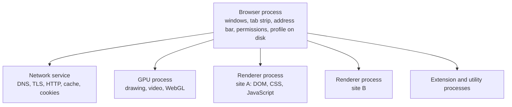

<Info>

**In short:** a modern browser is not one program but a small family of
programs. One **browser process** owns the windows and the tab list, one
**renderer process** per site runs the page's HTML, CSS and JavaScript, and
separate processes handle graphics and the network. Automation talks to that
family from outside, picks a tab (a **target**), and starts the whole thing with
**flags** that make it controllable.

</Info>

## Many processes, one browser

Open Chrome's Task Manager (Shift+Esc) and you will see far more than one
entry. The split is deliberate: a crash in one web page must not take down the
others, and a page that has been taken over by an attacker must not be able to
read the rest of your computer.

*The main processes of Chrome. Arrows mean "starts and talks to".*

| Process | What it does | Why it matters when you automate |
|---|---|---|
| Browser | The one trusted process: draws the window and address bar, owns the tab list, decides what a page may do, reads and writes the profile folder | The debugging port (`--remote-debugging-port`) is served from here, so this is what you connect to |
| Renderer | Runs one site's pages: parses HTML and CSS, builds the DOM, runs JavaScript, lays out the page | `Runtime.evaluate` and the DOM commands end up here; if it crashes, the tab shows "Aw, Snap!" and the others carry on |
| Network service | Does the actual network work for every renderer: DNS, TLS, HTTP/1.1, HTTP/2 and HTTP/3, the HTTP cache | [Interception, proxies and HAR](/concepts/network) hook in at this layer; TLS fingerprints come from here |
| GPU | Turns the page into pixels and runs WebGL and video decoding | Without a GPU (a container, a CI machine), Chrome falls back to software rendering, which the page can notice |
| Utility and extension | Short-lived helpers (audio, decoding) and one process per extension | [Browser extensions](/concepts/browser-extensions) run here, not in the page |

## Site isolation and the sandbox

Two ideas protect the user, and both shape what automation sees.

**The sandbox.** A renderer process is started with almost no rights. It cannot
open files or sockets itself: to read a file or reach the network it must ask the
browser process, which checks. A bug in the JavaScript engine therefore gives an
attacker a process that can still do very little.

**Site isolation.** Chrome puts pages from different **sites** (roughly, the
registrable domain such as `example.com`) into different renderer processes. A
page on `evil.test` cannot share memory with the bank in another tab, even when
it embeds the bank in an iframe. That embedded bank frame is then drawn from a
different process than the page around it, which is called an **out-of-process
iframe**.

<Note>

Site isolation is why a cross-site iframe is its own **target** for automation:
it lives in a different process, so a tool has to attach to it separately. A
same-site iframe stays in the same process and is part of its parent's target.
See [the DevTools Protocol](/concepts/cdp#targets-and-sessions).

</Note>

## Tabs, frames and workers: the things you can control

Automation does not say "the browser", it says "this tab" or "this frame". The
browser lists what can be controlled as **targets**:

| Target | What it is | Notes |
|---|---|---|
| `browser` | The browser process itself | Used for new tabs, windows, permissions and browser contexts |
| `page` | A tab (or a popup window) | What `Browser::default_page()` returns as a `Page` |
| `iframe` | A cross-site frame with its own process | A same-site frame is not a target of its own |
| `service_worker` | A background script that outlives a tab and can answer its requests | See [modern web technologies](/concepts/modern-web#service-workers-and-pwas) |
| `shared_worker`, `worker` | JavaScript running beside a page, with no DOM | Workers have no `window` and no `document` |
| `background_page` or extension service worker | An extension's own script | See [browser extensions](/concepts/browser-extensions) |

A **frame** is a document inside a document: the top page is the main frame, and
every `iframe` element holds another. A **browser context** is a separate
profile-like bucket (cookies, storage, cache) inside one running browser, the
protocol's name for what Chrome shows as an incognito window. See
[sessions, cookies and storage](/concepts/sessions-and-state). In
seleniumbase-rs `Browser::new_context()` creates one and `Browser::default_page()`
returns the first tab.

## Headed and headless

A **headed** browser has a window you can see. A **headless** browser runs
the same engine with no window and no need for a display. That is why CI
machines and containers use it.

<Steps>

<Step title="Old headless: a separate program" icon="gears">

For years `--headless` started a stripped-down implementation of the browser
that shared the rendering engine but not the rest. It was fast and small, and it
behaved differently: no extensions, a different default window, and its own
telltale signs for sites that look.

</Step>

<Step title="New headless: the real browser, with no window" icon="eye-slash">

Since Chrome 112 `--headless` means **new headless**: the same code as headed
Chrome, with the window hidden. It supports extensions, behaves like the headed
browser and is much harder to tell apart from it. You can ask for it by name with
`--headless=new`.

</Step>

<Step title="The old one lives on as chrome-headless-shell" icon="box-archive">

The old implementation was removed from the main Chrome binary in version 132.
It is still published as a separate download, **chrome-headless-shell**, for
people who want the small and fast one for screenshots and PDF. See the
[glossary](/glossary#chrome-headless-shell).

</Step>

</Steps>

<Tip>

Headless and headed runs are not identical in timing, in how big the viewport is
or in what the page can detect. If a test passes headed and fails headless, check
the window size first, then the [detection page](/concepts/detection).

</Tip>

In seleniumbase-rs, `LaunchOptions::builder().headless(true)` or `.headless(false)`
chooses explicitly, and `LaunchOptions::is_headless()` tells you what was chosen.
When you do not choose, a launch is headless only on Linux, where there is often
no display. On a machine with no display at all, a virtual one (`Xvfb`) lets a
headed browser run; see [Headless and headed](/tutorials/headless).

## Chrome, Chromium and Chrome for Testing

Three things are all called "Chrome", and automation cares which one it has.

| | What it is | Updates | Good for |
|---|---|---|---|
| **Chrome** | Google's branded browser, built from Chromium | Updates itself in the background | Everyday use; what real users have |
| **Chromium** | The open-source project Chrome is built from; also Edge, Brave and Opera | You or your Linux distribution | Servers and containers |
| **Chrome for Testing** | A Chrome build for automation, published for every release | Never updates itself; every version stays downloadable | Repeatable tests: the browser and its driver can be pinned to match |

Two details trip people up. First, branded Chrome stopped honouring the
`--load-extension` flag in version 137, which is why automation that loads an
extension uses a different route (see
[browser extensions](/concepts/browser-extensions#how-automation-loads-an-extension)).
Second, a driver such as chromedriver must match the browser's major version;
Chrome for Testing publishes both side by side. See
[WebDriver and drivers](/concepts/webdriver) and the glossary entry
[Chrome for Testing](/glossary#chrome-for-testing).

## Profiles: where a browser keeps its state

Everything a browser remembers lives in one folder, the **user data directory**
(the profile): cookies, local storage, IndexedDB, the HTTP cache, saved
passwords, preferences and installed extensions. Chrome uses a subfolder
(`Default`, `Profile 1`) for each user inside it.

- One folder can be used by **one running Chrome at a time**. A second start on
  the same folder hands its request to the first and exits. A launcher that
  does not know this seems to "hang" or open a window in the wrong browser.
- Automation almost always uses a **fresh temporary folder**, so each run starts
  with no cookies and no history. That is also what makes a run look unlike a
  person's browser: no history, no logins, an empty cache.
- To keep a login between runs, point the next launch at the same folder.
  seleniumbase-rs keeps this in its own types (`SessionStore`, `Identity`; see
  [sessions, cookies and storage](/concepts/sessions-and-state)).

## Why automation starts the browser with flags

A browser started by double-clicking an icon cannot be controlled by another
program. Automation starts it with **command-line flags**, switches the browser
reads at launch. These are the usual ones:

| Flag | What it does |
|---|---|
| `--remote-debugging-port=0` | Opens the DevTools Protocol on a free local port and writes it to the `DevToolsActivePort` file in the profile; this is how [CDP](/concepts/cdp#connecting) starts |
| `--user-data-dir=PATH` | Uses this profile folder instead of your own |
| `--headless=new` | Runs with no window, as the real browser |
| `--window-size=W,H` | Sets the first window's size (a headless default is small) |
| `--no-first-run`, `--no-default-browser-check` | Skips the welcome screens that would block a script |
| `--disable-dev-shm-usage` | Uses `/tmp` instead of the small shared memory of a container |
| `--enable-automation` | Marks the browser as automated: it sets `navigator.webdriver` and shows the "controlled by automated software" bar. Stealth modes leave it out |

<Warning>

`--no-sandbox` turns off the sandbox described above. It is needed in some
containers that run as root, but while it is on, a malicious page in the browser
has far more reach. Use it only for pages you trust, and prefer a container
with a non-root user.

</Warning>

A flag is also a fingerprint: a few of them change how the browser looks to a
page. [Detection and spoofing](/concepts/detection) explains which, and why
seleniumbase-rs chooses its default flags with that in mind.

## How seleniumbase-rs uses it

- **Starting a browser.** `Browser::launch(LaunchOptions)` starts Chrome with
  its flags and a debugging port, then waits for the port to appear (20 seconds
  by default; `startup_timeout` changes that). `LaunchOptionsBuilder::debugging_port`
  fixes the port.
- **Many browsers.** `BrowserPool` (with `PoolOptions`) runs several browsers at
  once, each with its own profile, for parallel work.
- **Closing.** `Browser::close()` ends the browser and its child processes; the
  library also registers a graceful-shutdown hook so that an interrupted run
  does not leave processes behind.
- **WebDriver engine.** `BaseCase` and `BrowserConfig` start the browser through
  a driver instead; the same processes are underneath.

## Where to go next

<Columns cols={2}>

<Card title="The DevTools Protocol" icon="bolt" color="#1a85d4" href="/concepts/cdp">
  How a program talks to the browser process, and attaches to targets.
</Card>

<Card title="Browser extensions" icon="puzzle-piece" color="#199f43" href="/concepts/browser-extensions">
  The extra processes and scripts a browser can run for you.
</Card>

<Card title="Sessions, cookies and storage" icon="database" color="#d47628" href="/concepts/sessions-and-state">
  What a profile and a browser context hold.
</Card>

<Card title="Selectors and the DOM" icon="code" color="#a631be" href="/concepts/selectors-and-the-dom">
  What a renderer builds from the page, and how to point at a part of it.
</Card>

</Columns>
