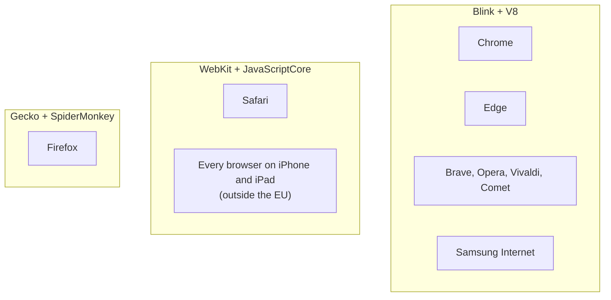

<Info>

**In short:** a browser is a window and some menus wrapped around two engines.
The **rendering engine** turns HTML and CSS into pixels; the **JavaScript
engine** runs the page's scripts. Almost every browser you can name uses one of
three families: Blink, WebKit or Gecko. Tests that pass in one engine can fail
in another, and the library supports several browsers, with the most features on
Chromium-based ones.

</Info>

## What an engine is

When you type a web address, a lot of code runs between the network and your
screen. The part that understands the web, the **browser engine**, is separate
from the part that draws tabs, bookmarks and the address bar (the "browser
chrome"). One engine can sit inside many browsers. That is why two browsers with
different logos, menus and privacy settings can show a page in exactly the same
way.

A browser engine is really two engines that work together:

| Engine | Its job | Examples |
|---|---|---|
| **Rendering (layout) engine** | Parses HTML and CSS, builds the page's structure, works out sizes and positions, paints pixels | Blink, WebKit, Gecko |
| **JavaScript engine** | Parses and runs the page's JavaScript, and manages its memory | V8, JavaScriptCore, SpiderMonkey |

The JavaScript engine does not stand alone. It is given access to the page
(the DOM, timers, the network) by the rendering engine, so each rendering
engine is normally paired with one JavaScript engine. The next pages explain
the parts in detail: [how a page loads](/concepts/how-a-page-loads), the
[browser's processes](/concepts/browser-architecture) and
the render steps.

## The three families

*Browsers grouped by the engine they are built on.*

<Tabs>

<Tab title="Blink and V8" icon="chrome">

**Blink** is the engine of Chromium, the open-source project behind Google
Chrome. Chrome, Microsoft Edge, Brave, Opera, Vivaldi, Samsung Internet and many
smaller browsers are built on Chromium, so they all use Blink. Blink began in
2013 as a fork of WebKit, and the two have grown apart since.

Its JavaScript engine is **V8**, which also runs outside browsers: Node.js,
Deno and Electron all contain it. V8 reads the script, runs it at once with a
simple interpreter, watches which functions run often, and compiles those into
fast machine code (a *JIT*, just-in-time compiler).

Chromium is also where the Chrome DevTools Protocol lives, which is why
[CDP](/concepts/cdp) works on all of these browsers.

</Tab>

<Tab title="WebKit and JavaScriptCore" icon="apple">

**WebKit** is the engine of Apple's Safari. It is open source, and it grew from
KHTML, the engine of the Linux browser Konqueror. Its JavaScript engine is
**JavaScriptCore**, which has several stages of compilation, from a fast-starting
interpreter to an optimising compiler.

On iPhone and iPad, Apple has long required every browser to be built on WebKit.
Chrome, Firefox and Edge for iOS are therefore WebKit under their own menus.
Rules in the European Union now allow other engines, but WebKit is still by far
the common case. So to test "the iPhone experience" you need WebKit, whatever
browser the user thinks they use.

</Tab>

<Tab title="Gecko and SpiderMonkey" icon="firefox-browser">

**Gecko** is the engine of Mozilla Firefox, and it is the only large engine
that is neither Chromium nor Apple. Its JavaScript engine, **SpiderMonkey**, is
the oldest of the three: it was the first JavaScript engine of all, written for
Netscape. Parts of Gecko are written in Rust, a language Mozilla created, and
some of that work came from the experimental engine Servo.

Gecko matters because it keeps the web from depending on one vendor. A site
that works only in Chromium is a site that Firefox users cannot use.

</Tab>

<Tab title="Others" icon="ellipsis">

- **Internet Explorer** used **Trident** and the old Edge used **EdgeHTML**.
  Both are retired, but old corporate sites still target them.
- **Ladybird** and **Servo** are new engines written from scratch. They are not
  yet used by mainstream browsers.
- **Electron** and mobile web views (Android WebView, Apple's WKWebView) embed an
  engine inside an app. Their engine is Blink or WebKit.

</Tab>

</Tabs>

## Standards: who decides what engines do

Engines follow written standards, but standards are written by people who need
to agree. The main groups are:

- the **WHATWG** keeps the "living standards" for HTML, the DOM, Fetch and URL;
- the **W3C** publishes CSS and many APIs, and the WebDriver standard
  ([WebDriver](/concepts/webdriver));
- **TC39** at Ecma International standardises JavaScript (the language called
  ECMAScript).

A new feature normally appears first in one engine as an experiment, then in the
others once the standard settles. Reference sites track who supports what: the
browser compatibility tables on MDN, [caniuse.com](https://caniuse.com), and the
shared test suite **Web Platform Tests**, which every engine runs against.
Web APIs shows how to read a compatibility table, and
[Modern web](/concepts/modern-web) lists newer features.

## Why cross-browser testing exists

Three engines implement the same standards, but they are separate programs with
separate bugs and different priorities. Differences show up in a few places:

| Area | Typical difference |
|---|---|
| **CSS and layout** | A property or value arrives later in one engine, or two engines round a size differently, so a button is two pixels off |
| **Form controls** | Date pickers, select lists, scrollbars and validation messages look and behave differently |
| **JavaScript APIs** | A newer API is missing or behind a flag in one engine |
| **Scrolling and input** | Touch scrolling, momentum, focus rings and pointer events differ, especially on iOS |
| **Media and fonts** | Codecs, autoplay rules and font smoothing differ |
| **Privacy rules** | Safari and Firefox block third-party cookies and tracking more strictly than Chrome ([sessions and state](/concepts/sessions-and-state)) |
| **Speed** | The same script takes a different time in each JavaScript engine, which changes what a test must wait for |

Cross-browser testing means running the same checks against each engine you
promise to support, to find the places where your page relies on something only
one of them does. Because the web is built to degrade gracefully, many such bugs
are invisible until a real person on Safari or Firefox hits them.

<Tip>

The three engines are what matter, not the dozens of browsers. Testing Chrome,
Firefox and Safari covers Blink, Gecko and WebKit, and with them nearly every
browser people use. Edge and Brave rarely behave differently from Chrome except
in privacy settings and built-in extensions.

</Tip>

## Browsers need a driver

Every browser must be told what to do through a control protocol, and in the
WebDriver standard each one has its own **driver**, a small program that
translates the commands into that browser's private interface.

| Browser | Engine | Driver |
|---|---|---|
| Chrome, Chromium, Brave, Comet, Chrome for Testing | Blink | `chromedriver` |
| Edge | Blink | `msedgedriver` |
| Opera | Blink | `operadriver` |
| Firefox | Gecko | `geckodriver` |
| Safari | WebKit | `safaridriver` (comes with macOS) |
| Internet Explorer | Trident | `IEDriverServer` (Windows) |

Chromium browsers also speak [CDP](/concepts/cdp) directly, with no driver.
Firefox and Safari have no CDP in the same sense, so what they can do depends on
WebDriver, and on [WebDriver BiDi](/concepts/webdriver#webdriver-bidi) as it
spreads. This is why some library features exist only for Chromium.

## How seleniumbase-rs uses it

The browsers the WebDriver engine can start are the variants of the `Browser`
enum in `src/browser/config.rs` (`seleniumbase_rs::browser::config::Browser`).

| Variant | Name (`--browser=NAME`) | Engine | Driver |
|---|---|---|---|
| `Chrome` (the default) | `chrome` | Blink | chromedriver |
| `Chromium` | `chromium` | Blink | chromedriver |
| `ChromeForTesting` | `cft` | Blink | chromedriver |
| `ChromeHeadlessShell` | `chs` | Blink | chromedriver |
| `Edge` | `edge` | Blink | msedgedriver |
| `Brave` | `brave` | Blink | chromedriver |
| `Comet` | `comet` | Blink | chromedriver |
| `Opera` | `opera` | Blink | operadriver |
| `Firefox` | `firefox` | Gecko | geckodriver |
| `Safari` | `safari` | WebKit | safaridriver (macOS only) |
| `InternetExplorer` | `ie` | Trident | IEDriverServer (Windows only) |

- **Drivers are found or downloaded.** Chromedriver, geckodriver and
  msedgedriver are looked for in `downloaded_drivers/` and on the `PATH`, and
  downloaded when missing; Chrome for Testing and `chrome-headless-shell` are
  downloaded too. Opera, Safari and Internet Explorer need their own driver
  already installed, and Safari needs `sudo safaridriver --enable` once. See
  [Building](/building) and [customising test runs](/help/customizing_test_runs).
- **Chromium gets the extras.** `Browser::is_chromium_based` is true for
  everything except Firefox, Safari and Internet Explorer. The
  [CDP mode](/tutorials/cdp_mode), the undetected (UC) mode, the pure CDP engine
  ([Pure CDP](/tutorials/pure_cdp)), Chrome extensions and mobile emulation need
  a Chromium browser. A Firefox session gets its options as `moz:firefoxOptions`
  (headless, arguments, preferences, the user agent and locale), and Chrome-only
  settings are not sent to it.
- **The optional `playwright` feature** uses the `rustwright` CDP engine and
  launches Chromium, not WebKit or Gecko.
- **One user agent is not an engine.** A fingerprint can claim to be Safari by
  changing the `User-Agent` text, but the engine that runs is still Blink, and
  a site can tell by checking behaviour. See
  [Detection and spoofing](/concepts/detection).

<Note>

There is no WebKit or Gecko option in the pure CDP engine, because
[CDP](/concepts/cdp) belongs to Chromium. To test on Safari, run the WebDriver
engine with `Browser::Safari` on a Mac. To test on iOS, use a real device or a
cloud device service: Chrome's phone emulation is Blink pretending to be small,
as Mobile web explains.

</Note>

## Where to go next

<Columns cols={2}>

<Card title="Browser architecture" icon="sitemap" color="#1a85d4" href="/concepts/browser-architecture">
  The processes, the sandbox and the tabs around an engine.
</Card>

<Card title="WebDriver and drivers" icon="plug" color="#d47628" href="/concepts/webdriver">
  The standard protocol every browser's driver speaks.
</Card>

</Columns>
