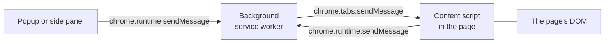

<Info>

**In short:** an extension is a small program written with web technology
(HTML, CSS and JavaScript) plus a `manifest.json` that says what it is and what
it may do. It runs inside the browser in a few separate places: a background
**service worker**, **content scripts** inside pages, and its own pages such as
a popup. Automation loads one by starting the browser a particular way. The
seleniumbase-rs companion extension is one; the `crx` plugin is how a test
loads a packed one.

</Info>

## What an extension is

An extension is a folder (or a zip, packed as a `.crx` file) with a
`manifest.json` and some files. The browser reads the manifest and wires the
parts up. There is no installer and no native code: everything is web code, run
by the browser with the permissions the manifest asks for.

```json
{
  "manifest_version": 3,
  "name": "Example",
  "version": "1.0",
  "permissions": ["activeTab", "scripting", "storage"],
  "background": { "service_worker": "background.js" },
  "action": { "default_popup": "popup.html" }
}
```

## Manifest V3

**Manifest V3** (MV3) is the current format for Chrome, Edge and other Chromium
browsers. Firefox supports it too, with some differences. It replaced Manifest V2
with rules aimed at safety and at saving resources:

| Manifest V2 | Manifest V3 |
|---|---|
| A **background page** that stayed alive all the time | A **service worker** that the browser starts when an event arrives and stops when idle |
| Remote code and `eval` were possible | Only code packaged in the extension runs; a strict content security policy (`script-src 'self'`) |
| `webRequest` could block and rewrite any request | `declarativeNetRequest`: the extension hands the browser **rules** and the browser applies them |
| Host access granted at install | Host access can be requested later and by the user (`optional_host_permissions`, `activeTab`) |

The most important change for anyone writing one is the service worker: it can be
stopped at any moment, so it **must not keep state in memory**. It keeps what it
needs in `chrome.storage` and reads it again on the next event.

## The parts

<Steps>

<Step title="The manifest" icon="file-code">

Names the extension, lists its permissions and points to everything else. The
browser refuses to load an extension whose manifest is wrong.

</Step>

<Step title="The background service worker" icon="gears">

Event-driven code that is not tied to any tab: it reacts to a click on the
toolbar button, to a message, to a tab opening. It can use the extension APIs
(`chrome.tabs`, `chrome.scripting`, `chrome.storage`) but has no page and no DOM.
In Firefox the same job is done by a background script (`background.scripts`).

</Step>

<Step title="Content scripts" icon="code">

JavaScript that is **injected into a web page**, either declared in the manifest
for sites that match, or injected on demand with `chrome.scripting`. A content
script sees the page's DOM, but it runs in an **isolated world**: it has its own
JavaScript globals, so it cannot see the page's variables, and the page cannot
see its. They share the DOM and events, not the objects.

</Step>

<Step title="Extension pages" icon="window-maximize">

HTML pages that belong to the extension: the popup that opens from the toolbar
button, the side panel (Chrome's `sidePanel`, Firefox's sidebar), an options
page, a page in the DevTools window. They have a `chrome-extension://` address
(`moz-extension://` in Firefox) and the extension's permissions.

</Step>

</Steps>

## Permissions

Everything an extension may do is declared. The browser shows the user the
powerful ones when it is installed.

| Setting | What it grants |
|---|---|
| `permissions` | Access to extension APIs: `storage`, `tabs`, `scripting`, `sidePanel`, `activeTab` |
| `host_permissions` | Reading and changing pages on given sites; `<all_urls>` means every site |
| `optional_host_permissions` | The same, but asked for **later**, at a moment the extension chooses |
| `activeTab` | Temporary access to the one tab the user just invoked the extension on, until it navigates or closes |

<Warning>

An extension with access to all sites can read every page you visit, including
passwords as you type them. Load only extensions you trust, and give them the
least access they need. A good one asks for `activeTab` first.

</Warning>

## Messaging: how the parts talk

The parts live in different places and cannot call each other directly. They send
**messages**.



*Messages between the parts of an extension. The content script shares the page's
DOM and nothing else.*

A message is plain data (anything JSON can carry). The receiver should **check
what it gets**, because a message may come from a page the extension does not
control. For a long conversation, two sides can open a `Port`.

## How automation loads an extension

<Tabs>

<Tab title="A folder, on the command line" icon="terminal">

Start Chromium with `--load-extension=/path/to/unpacked`. This is the oldest
way and still works in Chromium and in Chrome for Testing, but **branded Chrome
ignores `--load-extension` since version 137**.

</Tab>

<Tab title="Through the DevTools Protocol" icon="bolt">

Start the browser with `--enable-unsafe-extension-debugging`, then send the
`Extensions.loadUnpacked` command over [CDP](/concepts/cdp) with the folder's
path. The companion extension's own end-to-end tests load it this way, through
the pure CDP engine.

</Tab>

<Tab title="A packed .crx file" icon="box">

Chrome only takes unpacked folders from the command line, so the
[`crx` plugin](/plugins/crx) reads a `.crx` file (CRX3 or the older CRX2),
strips its header, unpacks the zip into a temporary folder and adds that folder
to the browser's start-up settings.

</Tab>

<Tab title="Firefox" icon="firefox-browser">

Firefox installs an extension as a **temporary add-on** that lasts until the
browser closes. Through WebDriver, geckodriver has a command for it; by hand it
is `about:debugging`, "Load Temporary Add-on".

</Tab>

</Tabs>

Some things to know when you do:

- **Headless.** New headless Chrome supports extensions; the old headless mode
  did not (see [browser architecture](/concepts/browser-architecture#headed-and-headless)).
- **Incognito.** An extension does not run in a private window unless it is
  allowed to; a fresh [browser context](/concepts/sessions-and-state) is similar.
- **Timing.** The service worker starts on its first event. A test should wait
  until the extension answers (the companion's end-to-end tests wait for the
  background to reply) before it starts to depend on it.
- **Visibility.** An extension changes the browser. Pages can probe for known
  extensions through the resources they expose, so an extension can show up in
  a [fingerprint](/concepts/detection).

## The companion extension

The seleniumbase-rs **companion extension** is a Manifest V3 extension for
Chrome, Edge and Firefox written in strict TypeScript and bundled with Bun. It is
a good small example of everything above:

- Its **manifest** asks for `activeTab`, `scripting` and `storage`, and for all
  sites only as an *optional* host permission, asked at the moment you press
  **Start recording**. It declares no static `content_scripts` and no static host
  permissions.
- Its **background** is a service worker in Chrome and a background script in
  Firefox. It keeps its state in `chrome.storage` because the browser may stop it.
- The **recorder** is a content script injected into the tab you point it at. It
  listens for trusted events only (`isTrusted`; see
  [JavaScript, events and waiting](/concepts/javascript-and-events#trusted-and-synthetic-events)),
  builds a selector for each (see
  [selectors](/concepts/selectors-and-the-dom)) and sends each step to the
  background. The panel (a popup, a side panel or a sidebar) shows the steps.
- It **exports** a recording as a seleniumbase-rs pure CDP Rust test, a `BaseCase`
  test, or a Chrome DevTools Recorder JSON file.

Its messages use a small versioned format, `{ v: 1, type: "recorder/step", ... }`,
and a router that refuses a message from the wrong kind of sender. The full
guide, with how to build and load it, is [Browser extension](/ecosystem/browser-extension).

## The crx plugin in a test

The `crx` plugin is a seleniumbase-rs plugin that loads packed extensions into a
Chromium browser the plugin set starts. It works at launch only, and it does
**not** check the signature in the header, so load only files you trust. Its
unpacked folders (named with the prefix `sbrs-crx-`) are deleted when the browser
closes.

```rust,ignore src/main.rs
use seleniumbase_rs_plugin::PluginSet;
use seleniumbase_rs_plugin_crx::CrxExtensions;

let plugins = PluginSet::new().with(CrxExtensions::new(["extensions/dark-reader.crx"]))?;
```

The library also bundles a few extensions of its own (`src/utils/extensions`),
used by features such as ad blocking. See [Plugins](/tutorials/plugins) for how a
plugin set is built, and the glossary entry [crx](/glossary#crx).

## Where to go next

<Columns cols={2}>

<Card title="Browser extension (companion)" icon="puzzle-piece" color="#1a85d4" href="/ecosystem/browser-extension">
  Record a test, inspect selectors, export Rust.
</Card>

<Card title="crx plugin" icon="box" color="#199f43" href="/plugins/crx">
  Load packed Chrome extensions in a test.
</Card>

<Card title="Browser architecture" icon="sitemap" color="#d47628" href="/concepts/browser-architecture">
  The processes an extension runs in.
</Card>

<Card title="The DevTools Protocol" icon="bolt" color="#a631be" href="/concepts/cdp">
  The channel that loads an unpacked extension.
</Card>

</Columns>
