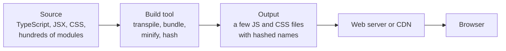
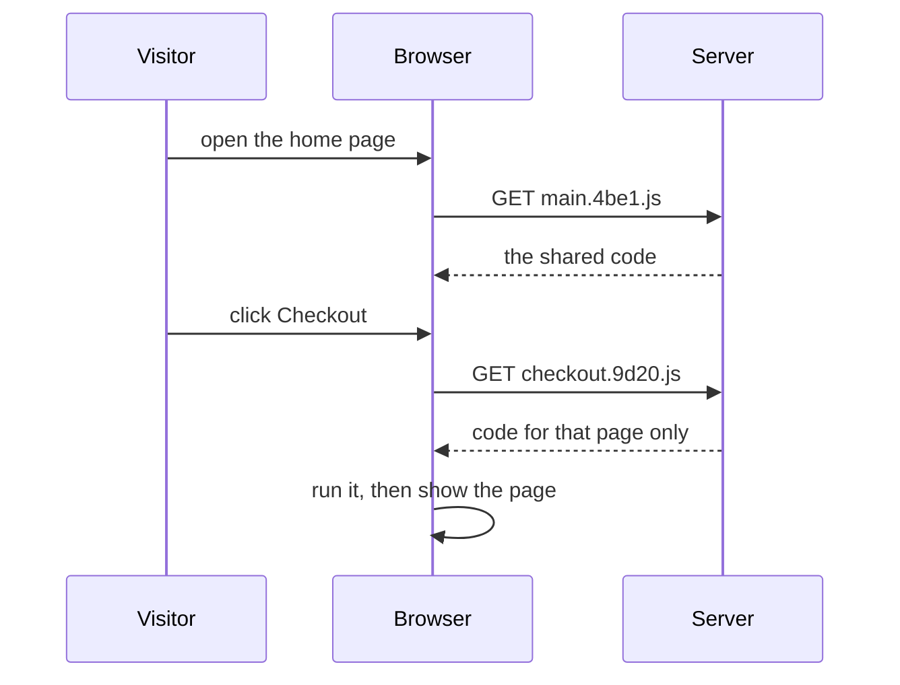

<Info>

**In short:** Most modern sites are not served as the files their developers
wrote. A *build step* turns many source files into a few small, unreadable ones
with names like `app.3f9a1c.js`. For a test this changes two things: class names
and file names stop being stable, and the page keeps loading code after the
first paint. Aim at stable attributes and wait for what you need, not for a name
you saw yesterday.

</Info>

## Why there is a build step at all

A browser understands three languages: HTML, CSS and JavaScript. Developers want
more than that: types, components, newer syntax, hundreds of small files, and
packages from the npm registry. A **build step** closes the gap. It reads the
source tree and writes out files the browser can run, tuned for download size
and speed.



*What a build does. The browser never sees the source tree.*

If you open the developer tools on a big site, the *Sources* tab shows what the
build produced. That is what a test is running against, too.

## ES modules

A **module** is a JavaScript file that declares what it needs and what it offers.
The standard syntax is **ES modules** (ESM):

```js
// price.js
export function withTax(amount) { return amount * 1.2; }

// cart.js
import { withTax } from "./price.js";
```

A page loads a module with `script type="module"`. The browser then follows each
`import` itself and fetches the files one by one. That works, but a real app has
thousands of modules, and every import is another request, discovered only after
the importing file arrived. A **bundler** avoids that by joining the modules
into a few files before the browser ever sees them.

<Note>

Older code used other module formats (CommonJS with `require`, AMD). Build tools
convert between them, which is part of why the output looks so different from the
input.

</Note>

## Bundlers

A bundler starts at one or more *entry points*, follows every `import` to build
a graph of all the modules, and writes out **bundles**: files that contain many
modules each.

| Tool | Written in | What it is known for |
|---|---|---|
| webpack | JavaScript | The long-time standard. Very configurable, with a large plugin world. |
| Rollup | JavaScript | Clean, small output for libraries. It popularised tree shaking. |
| esbuild | Go | Very fast. Often used inside other tools. |
| Vite | JavaScript, with Rollup and esbuild or Rolldown | A dev server that serves modules unbundled, plus a bundled production build. |
| Turbopack | Rust | The incremental bundler of Next.js, built for large projects. |
| Parcel, rspack, Bun | Mixed | Other fast, mostly zero-configuration choices. |

The details differ, but they all do the same few jobs, described next.

## What happens to your code

<Steps>

<Step title="Transpile" icon="language">

**TypeScript** adds types to JavaScript; the compiler checks them and then
erases them. **Babel** (and tools such as SWC and esbuild) rewrite new syntax
into forms older browsers know, and turn **JSX** (HTML-like tags inside
JavaScript) into plain function calls. After this step the types and the JSX are
gone.

</Step>

<Step title="Bundle" icon="boxes-stacked">

The modules are joined into bundles, and each `import` becomes a lookup inside
the bundle. Names of variables stay inside their module, so two modules can both
have a variable called `total`.

</Step>

<Step title="Tree shake" icon="scissors">

**Tree shaking** drops exports that nothing imports. If you import one function
from a big library, the rest of the library does not ship. It relies on ES
modules, because their imports can be read without running the code.

</Step>

<Step title="Minify" icon="compress">

**Minification** removes whitespace and comments and shortens local names, so
`function calculateTotal(items)` becomes something like `function a(t)`. The file
shrinks, and the result is hard for a person to read.

</Step>

<Step title="Split and hash" icon="file-signature">

The output is cut into pieces and each piece is named after a fingerprint of its
content, as described below.

</Step>

</Steps>

## Code splitting

Shipping the whole app on the first visit wastes time. **Code splitting** cuts
the bundle into **chunks** that load when needed. A dynamic `import()` is the
usual marker: the checkout page's code only downloads when someone opens
checkout.



*A chunk loads when the visitor needs it, not at the start.*

For a test, that means the code behind a button may not exist yet when the page
has finished loading. The element can be missing for a moment, then appear.

## Source maps

Minified code is unreadable in an error message. A **source map** is a separate
file (`app.3f9a1c.js.map`) that records how each position in the output maps back
to a position in the original source. The developer tools use it to show the real
file, line and variable names. Production sites often leave source maps out, or
upload them only to an error-tracking service, so a stack trace from a test
against production can show `a.js:1:48213`. That is normal, not a sign of a
broken test.

## Hashed file names and cache busting

Browsers keep downloaded files in a cache. A file that never changes can be kept
for a year, but if a developer changes it, visitors must get the new version
anyway. The trick is to put a **hash** of the file's content in its name:

```text
main.3f9a1c.js       before the change
main.77be20.js       after the change: a new name, so no cache holds it
```

The HTML page, which is always fetched fresh, points at the current names. This
is **cache busting**. The same idea applies to CSS, and it is why a
class name can be unstable too: CSS Modules and CSS-in-JS libraries generate class
names such as `button_primary__x7Qa2` or `css-1k9d3m` from the file and its
content. They change when the style changes.

## Dev servers and hot reload

While a developer works, a **dev server** (the one that comes with Vite, webpack
or Next.js) serves the app on a local address such as `localhost:5173`. It
rebuilds only what changed. **Hot module replacement** (HMR) keeps a WebSocket open
to the page, sends the changed module when a file is saved, and swaps it in
without a reload.

Two things matter to a tester who points a browser at a dev server:

- The page holds a connection open for as long as it lives. A test that waits for
  "no network activity" never sees it end.
- A development build is not the production build: no minification, different
  chunking, extra overlay elements when an error occurs. A test can pass in one
  and fail in the other.

## Why bundled code makes automation harder

| What changes | What goes wrong in a test | What to do |
|---|---|---|
| Class names are generated and hashed | A selector like `.css-1k9d3m` breaks after the next deploy | Use `data-testid`, an `id`, the visible text or an ARIA role |
| File names carry hashes | A rule that blocks or mocks `main.js` matches nothing | Match on a pattern such as `*/main.*.js`, or on the resource type |
| Chunks load on demand | The element appears late, after a click | Wait for the element, not for a fixed time |
| Components render on the client | The HTML from the server is nearly empty | Wait until the framework has built the DOM; see [frameworks and the DOM](/concepts/frameworks-and-the-dom) |
| Code is minified | A page error points at `a.js:1:48213` | Read the message, not the position; use the source map if one exists |

<Tip>

The most reliable fix is on the application side: ask the developers to add a
test attribute such as `data-testid="place-order"` to the controls a test needs.
It survives every rename, redesign and rebuild. See
[Selectors and the DOM](/concepts/selectors-and-the-dom) for the other options.

</Tip>

## How seleniumbase-rs deals with it

The library does not build or bundle a page; it only meets the result in a
browser. These are the real connections.

- **Stable selectors.** When an element is not found, the error's `hint()` advises
  a stable attribute such as an id or `data-testid`. The page script behind the
  MCP developer tools (`src/mcp/devtools.js`) lists the attributes that tests
  hang their hooks on, best first, starting with `data-testid`, `data-test-id`
  and `data-test`. See [the MCP server](/concepts/mcp).
- **Waiting for a late chunk.** `Page::wait_for_function` in the pure CDP engine
  waits until a script expression is truthy, which suits "the checkout form has
  rendered", and it fails with a timeout error if that never happens. A
  `Locator` also waits for its element each time it acts.
- **Skipping what a test does not need.** `Page::intercept` takes `Rule`
  values; `Rule::block().resource_type(ResourceType::Image)` blocks every
  request of one kind without naming a hashed file, and `.url("*/api/*")` limits
  a rule to a pattern. See [the network](/concepts/network).
- **Running JavaScript.** `Page::evaluate` and `Page::evaluate_as` run an
  expression in the page, for example to read a value the bundle keeps in a
  global variable.

<Warning>

Do not rely on a global variable or a library object that a bundle happens to
expose. Bundlers keep module contents private by default, and a rebuild can
rename or remove what you read. The attributes in the DOM are the contract with
the page.

</Warning>

## The same ideas in Rust

Rust has build tooling of its own, and the words map across.

| In the JavaScript world | In Rust |
|---|---|
| `package.json` | `Cargo.toml` |
| A package from npm | A crate from crates.io |
| `node_modules` | Compiled dependencies under `target` |
| A lock file (`package-lock.json`) | `Cargo.lock` |
| Tree shaking, conditional builds | Cargo **features**, plus the linker dropping unused code |
| The bundler | `cargo build` and `rustc`, which produce one binary |

A **feature** is a named switch in `Cargo.toml` that turns optional code and
optional dependencies on. This crate leaves its default features empty and lets
you opt in to `gui`, `tui`, `turso`, `playwright`, `plugins`, `ocr` and `visual`,
so a program that does not need them does not compile them. Compare that with
tree shaking: both end with a smaller artifact that has only what the program
uses. The difference is that Rust decides at compile time, on your machine, and
nothing is shipped to a browser.

## Where to go next

<Columns cols={2}>

<Card title="Frameworks and the DOM" icon="layer-group" color="#a631be" href="/concepts/frameworks-and-the-dom">
  How React, Vue and the like turn the bundle into the page you test.
</Card>

<Card title="Selectors and the DOM" icon="code" color="#1a85d4" href="/concepts/selectors-and-the-dom">
  Choosing a selector that survives a rebuild.
</Card>

<Card title="Modern web" icon="globe" color="#199f43" href="/concepts/modern-web">
  The platform features these tools build on.
</Card>

<Card title="How a page loads" icon="bolt" color="#d47628" href="/concepts/how-a-page-loads">
  Where the scripts, the cache and the load event fit in.
</Card>

</Columns>
