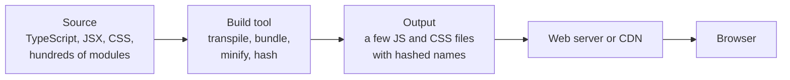
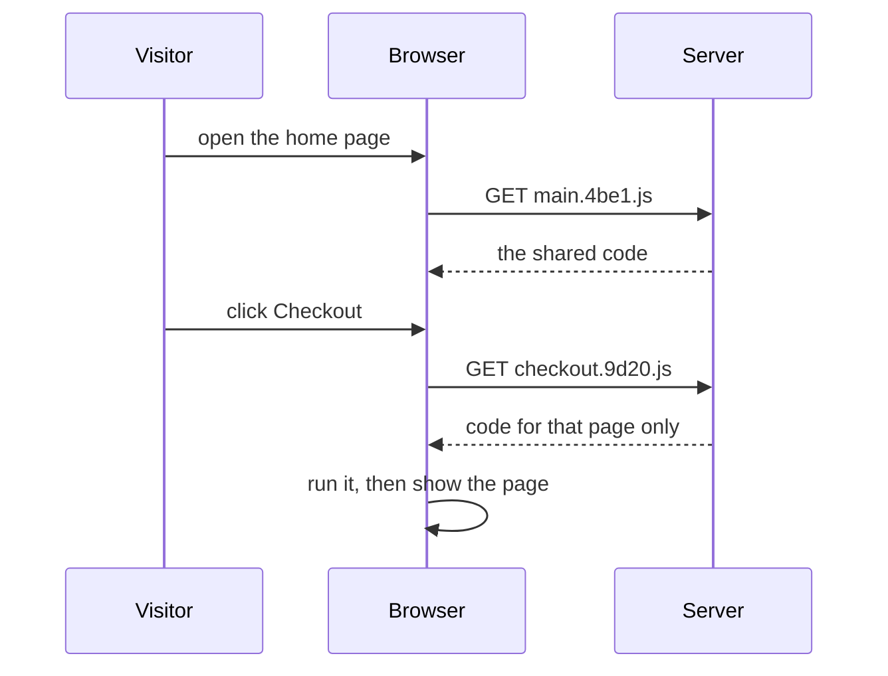
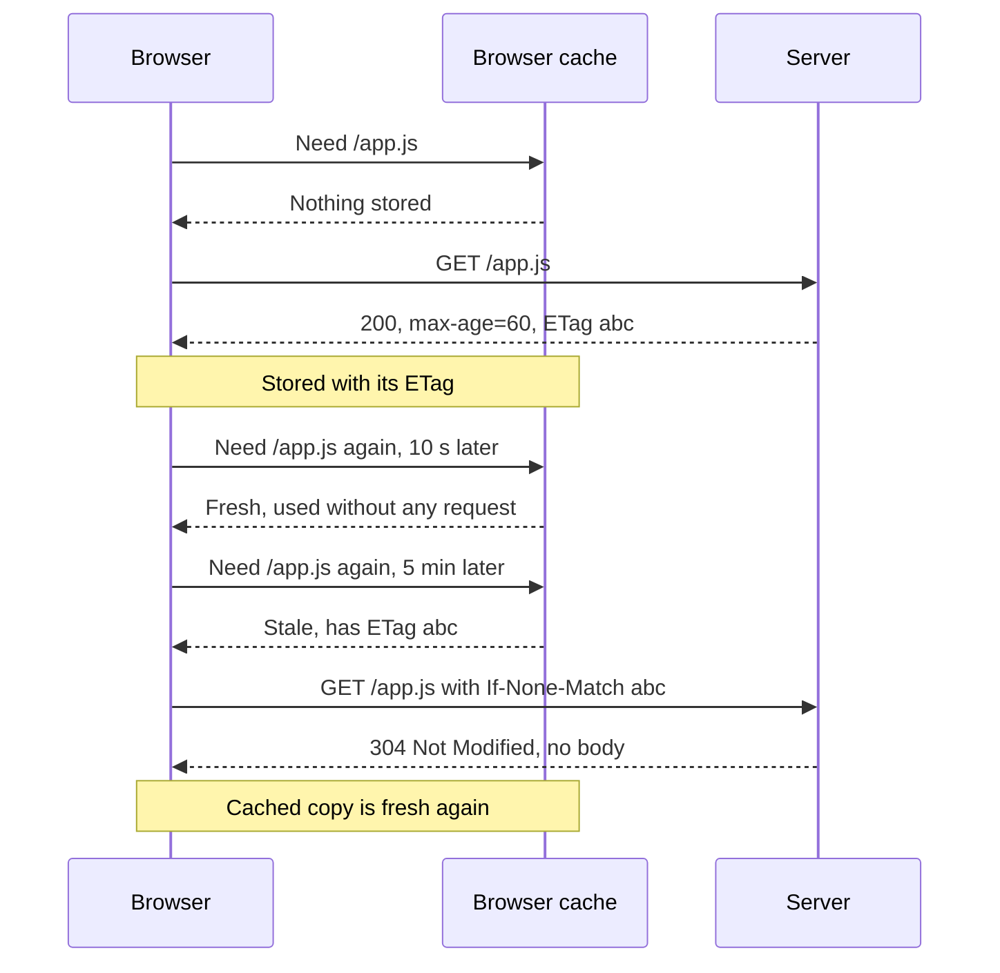

<Info>

**In short:** the fastest byte is the one never sent, and most modern sites are
not served as the files their developers wrote. A *build step* turns many source
files into a few small, unreadable ones with names like `app.3f9a1c.js`; servers
shrink them further with compression; and browsers avoid asking again by keeping
caches. All of it is invisible when it works, and it is behind many "it fails
only on CI" bugs: class names and file names stop being stable, the page keeps
loading code after the first paint, and a test reads an old script or an old
answer that a cache kept. Aim at stable attributes, wait for what you need, and
start from a clean cache. seleniumbase-rs can clear the cache, and turn it off
with the DevTools command `Network.setCacheDisabled`.

</Info>

## Why there is a build step at all

A browser understands three languages: HTML, CSS and JavaScript. Developers want
more than that: types, components, newer syntax, hundreds of small files, and
packages from the npm registry. A **build step** closes the gap. It reads the
source tree and writes out files the browser can run, tuned for download size
and speed.



*What a build does. The browser never sees the source tree.*

If you open the developer tools on a big site, the *Sources* tab shows what the
build produced. That is what a test is running against, too.

## ES modules

A **module** is a JavaScript file that declares what it needs and what it offers.
The standard syntax is **ES modules** (ESM):

```js
// price.js
export function withTax(amount) { return amount * 1.2; }

// cart.js
import { withTax } from "./price.js";
```

A page loads a module with `script type="module"`. The browser then follows each
`import` itself and fetches the files one by one. That works, but a real app has
thousands of modules, and every import is another request, discovered only after
the importing file arrived. A **bundler** avoids that by joining the modules
into a few files before the browser ever sees them.

<Note>

Older code used other module formats (CommonJS with `require`, AMD). Build tools
convert between them, which is part of why the output looks so different from the
input.

</Note>

## Bundlers

A bundler starts at one or more *entry points*, follows every `import` to build
a graph of all the modules, and writes out **bundles**: files that contain many
modules each.

| Tool | Written in | What it is known for |
|---|---|---|
| webpack | JavaScript | The long-time standard. Very configurable, with a large plugin world. |
| Rollup | JavaScript | Clean, small output for libraries. It popularised tree shaking. |
| esbuild | Go | Very fast. Often used inside other tools. |
| Vite | JavaScript, with Rollup and esbuild or Rolldown | A dev server that serves modules unbundled, plus a bundled production build. |
| Turbopack | Rust | The incremental bundler of Next.js, built for large projects. |
| Parcel, rspack, Bun | Mixed | Other fast, mostly zero-configuration choices. |

The details differ, but they all do the same few jobs, described next.

## What happens to your code

<Steps>

<Step title="Transpile" icon="language">

**TypeScript** adds types to JavaScript; the compiler checks them and then
erases them. **Babel** (and tools such as SWC and esbuild) rewrite new syntax
into forms older browsers know, and turn **JSX** (HTML-like tags inside
JavaScript) into plain function calls. After this step the types and the JSX are
gone.

</Step>

<Step title="Bundle" icon="boxes-stacked">

The modules are joined into bundles, and each `import` becomes a lookup inside
the bundle. Names of variables stay inside their module, so two modules can both
have a variable called `total`.

</Step>

<Step title="Tree shake" icon="scissors">

**Tree shaking** drops exports that nothing imports. If you import one function
from a big library, the rest of the library does not ship. It relies on ES
modules, because their imports can be read without running the code.

</Step>

<Step title="Minify" icon="compress">

**Minification** removes whitespace and comments and shortens local names, so
`function calculateTotal(items)` becomes something like `function a(t)`. The file
shrinks, and the result is hard for a person to read.

</Step>

<Step title="Split and hash" icon="file-signature">

The output is cut into pieces and each piece is named after a fingerprint of its
content, as described below.

</Step>

</Steps>

## Code splitting

Shipping the whole app on the first visit wastes time. **Code splitting** cuts
the bundle into **chunks** that load when needed. A dynamic `import()` is the
usual marker: the checkout page's code only downloads when someone opens
checkout.



*A chunk loads when the visitor needs it, not at the start.*

For a test, that means the code behind a button may not exist yet when the page
has finished loading. The element can be missing for a moment, then appear.

## Source maps

Minified code is unreadable in an error message. A **source map** is a separate
file (`app.3f9a1c.js.map`) that records how each position in the output maps back
to a position in the original source. The developer tools use it to show the real
file, line and variable names. Production sites often leave source maps out, or
upload them only to an error-tracking service, so a stack trace from a test
against production can show `a.js:1:48213`. That is normal, not a sign of a
broken test.

## Making the bytes smaller

### Compression

Text compresses very well. The browser and the server agree on a method in the
request and the response (see [network](/concepts/network) for the headers in
general):

```http
GET /app.js HTTP/2
Accept-Encoding: gzip, deflate, br, zstd

HTTP/2 200
Content-Type: text/javascript
Content-Encoding: br
Vary: Accept-Encoding
```

`Accept-Encoding` lists what the browser can unpack. The server picks one, says
so in `Content-Encoding`, and sends the compressed bytes. `Vary: Accept-Encoding`
tells caches that the answer depends on that header, so a client that cannot
read Brotli is not handed Brotli. The browser unpacks the body before the page,
or a test, ever sees it.

| Method | Header value | Notes |
|---|---|---|
| gzip | `gzip` | Works everywhere. The safe default |
| Brotli | `br` | Usually smaller than gzip for text, especially when compressed ahead of time. Browsers use it on HTTPS only |
| zstd | `zstd` | Very fast to compress, so good for answers made on the fly. Newer, supported by recent Chromium versions |

Compression helps **text**: HTML, CSS, JavaScript, JSON, SVG. It does nothing
for JPEG, PNG, WebP, MP4 or fonts such as WOFF2, which are already compressed.
In the browser's network panel, the **transferred** size is what crossed the
wire and the **resource** size is the size after unpacking.

### Minification and bundling

The build step also makes files smaller: minifying, tree shaking and splitting
are explained in [What happens to your code](#what-happens-to-your-code). That is
why the script you read in the browser looks unreadable, and why class names such
as `css-1x2y3z` change on every build (see
[frameworks and the DOM](/concepts/selectors-and-the-dom#one-page-three-doms)).

### Images

Images are usually the biggest part of a page.

| Format | Best for | Note |
|---|---|---|
| JPEG | Photos | Lossy, no transparency |
| PNG | Screenshots, sharp edges, transparency | Lossless, large for photos |
| WebP | Photos and graphics | Smaller than JPEG and PNG, supported everywhere current |
| AVIF | Photos | Often smallest, slower to encode |
| SVG | Icons, logos, diagrams | Text, so it scales and compresses well |
| GIF | Avoid for animation | Huge; use a video |

The `srcset` and `sizes` attributes let the browser pick the file that fits the
screen and the pixel density (see [mobile web](/concepts/mobile-and-accessibility#what-is-different-on-a-phone)), and
`loading="lazy"` delays images below the fold until they are about to scroll
into view.

## Not asking again: HTTP caching

When the server sends a file, it can say how long it may be reused. The browser
keeps a copy on disk (and in memory) and, on the next visit, may skip the
request.

### Cache-Control

| Directive | Meaning |
|---|---|
| `max-age=3600` | Fresh for 3600 seconds. Use it without asking the server |
| `no-cache` | May be **stored**, but must be **checked** with the server before every use |
| `no-store` | Do not keep it at all (for private data) |
| `public` / `private` | A shared cache (CDN, proxy) may or may not keep it |
| `s-maxage=600` | Like `max-age`, but for shared caches only |
| `immutable` | It will never change; do not even check on a reload |
| `stale-while-revalidate=60` | After expiry, show the old copy for a while and refresh in the background |

`no-cache` is badly named: it does not mean "do not cache".

### Revalidation

A copy that is no longer fresh is not always thrown away. The browser asks the
server whether it changed, using a **validator** it saved with the file:

- `ETag`, an identifier of the content, comes back as `If-None-Match`.
- `Last-Modified`, a date, comes back as `If-Modified-Since`.

If nothing changed, the server answers `304 Not Modified` with no body, which is
tiny. Otherwise it answers `200` with the new file.



*One file over time: fetched, reused, then revalidated.*

Without any `Cache-Control`, browsers guess ("heuristic freshness"), typically a
fraction of the time since `Last-Modified`. That guess is a classic source of
stale content, so servers should always send an explicit policy.

## Caches in layers

A request can be answered at many levels before it reaches the origin server.

| Layer | Where | Typical lifetime | Controlled by |
|---|---|---|---|
| Memory and disk cache | In the browser | Hours to a year | `Cache-Control`, validators |
| Back/forward cache | In the browser, the whole page frozen in memory | Until the tab moves on | The browser; a page with `unload` handlers or `no-store` may be excluded |
| Service worker and the Cache API | A script on the page that answers requests itself | Until the script deletes it | The site's JavaScript |
| CDN or edge cache | A server near the user | Seconds to days | `s-maxage`, the CDN's own rules, purges |
| Reverse proxy and application cache | In front of or inside the origin | Short | The operator |

A **service worker** is the layer that surprises people most. It can answer a
page from its own cache even when the network is fine, and it keeps doing so
across reloads until a new version of it is installed and activated (see
[sessions and state](/concepts/sessions-and-state) for what else lives in the
browser). A **CDN** can serve yesterday's file from a server in another country
while the origin already has today's. Headers such as `Age` and vendor headers
like `X-Cache` show that a copy came from a cache.

## Cache busting

A long cache lifetime is good for speed and bad for updates. The standard answer
is to put a **fingerprint of the content into the file name**:

```text
/assets/app.3f9a1c.js     Cache-Control: public, max-age=31536000, immutable
/index.html               Cache-Control: no-cache
```

When the code changes, the name changes, so the browser fetches the new file at
once, and the old one can stay cached for a year without harm. The HTML that
names the files must be checked every time (`no-cache`), or it would keep pointing
at old names. A query string (`app.js?v=2`) works with most caches, but some
proxies ignore it.

The same idea applies to CSS, and it is why a class name can be unstable too:
CSS Modules and CSS-in-JS libraries generate class names such as
`button_primary__x7Qa2` or `css-1k9d3m` from the file and its content, and they
change when the style changes.

## Dev servers and hot reload

While a developer works, a **dev server** (the one that comes with Vite, webpack
or Next.js) serves the app on a local address such as `localhost:5173`. It
rebuilds only what changed. **Hot module replacement** (HMR) keeps a WebSocket open
to the page, sends the changed module when a file is saved, and swaps it in
without a reload.

Two things matter to a tester who points a browser at a dev server:

- The page holds a connection open for as long as it lives. A test that waits for
  "no network activity" never sees it end.
- A development build is not the production build: no minification, different
  chunking, extra overlay elements when an error occurs. A test can pass in one
  and fail in the other.

## Why bundled code makes automation harder

| What changes | What goes wrong in a test | What to do |
|---|---|---|
| Class names are generated and hashed | A selector like `.css-1k9d3m` breaks after the next deploy | Use `data-testid`, an `id`, the visible text or an ARIA role |
| File names carry hashes | A rule that blocks or mocks `main.js` matches nothing | Match on a pattern such as `*/main.*.js`, or on the resource type |
| Chunks load on demand | The element appears late, after a click | Wait for the element, not for a fixed time |
| Components render on the client | The HTML from the server is nearly empty | Wait until the framework has built the DOM; see [frameworks and the DOM](/concepts/selectors-and-the-dom#one-page-three-doms) |
| Code is minified | A page error points at `a.js:1:48213` | Read the message, not the position; use the source map if one exists |

<Tip>

The most reliable fix is on the application side: ask the developers to add a
test attribute such as `data-testid="place-order"` to the controls a test needs.
It survives every rename, redesign and rebuild. See
[Selectors and the DOM](/concepts/selectors-and-the-dom) for the other options.

</Tip>

## Stale content in tests

A cache never lies on purpose, but a test can believe it. Typical symptoms:

- A deploy shipped a fix, yet the test still hits the **old bundle**.
- An API answer is **stale** because a CDN or the browser reuses it.
- A **service worker** from an earlier test keeps serving the old app shell.
- It passes in a clean browser and fails with a reused profile, or the other way
  round.
- It works in a private window and fails in the normal one.

<Tip>

Start from a clean state. A new, empty browser profile has an empty cache, so
every run begins as a first visit. Reusing a profile (to keep a login, for
instance) also keeps its caches and service workers. When a test is odd, look at
the response headers first: is the file fresh from the origin, a `304`, or "from
memory cache" or "from service worker"?

</Tip>

Clearing is not the same as disabling. **Clearing** the cache empties it once.
**Disabling** the cache makes the browser fetch everything fresh for as long as
the setting lasts. Chrome's "Disable cache" checkbox in DevTools does the second,
but only while DevTools is open. Automation does the same through the
[DevTools Protocol](/concepts/cdp): `Network.setCacheDisabled` with
`cacheDisabled: true` turns the cache off for that tab's session, and
`Network.setBypassServiceWorker` sends requests past service workers.

<Warning>

A test with the cache off measures a slower page than any real visitor has, and
hides bugs in the cache behaviour itself (a file that is never revalidated, an
`immutable` that should not be). Disable the cache to make a test deterministic,
and keep a few tests with the real cache for performance and cache-header checks
(see [rendering and performance](/concepts/how-a-page-loads#from-bytes-to-pixels)).

</Warning>

## How seleniumbase-rs uses it

### Clearing and disabling the cache

The library does not decide cache policy; it gives you the browser's controls.

- **Clear it.** `BaseCase::clear_browser_cache()` clears the browser cache through
  the DevTools Protocol. `clear_browser_cookies()` clears cookies, which are a
  separate store.
- **Disable it.** Send the command by name: `BaseCase::execute_cdp_with_params`
  on the WebDriver engine, `Page::execute` on the pure CDP engine, or the
  command line.

<Tabs>

<Tab title="WebDriver engine" icon="plug">

```rust,ignore src/main.rs
use serde_json::json;

sb.clear_browser_cache().await?;
sb.execute_cdp_with_params("Network.setCacheDisabled", json!({ "cacheDisabled": true }))
    .await?;
sb.open("https://example.com/").await?;
```

</Tab>

<Tab title="Pure CDP engine" icon="bolt">

```rust,ignore src/main.rs
use serde_json::json;

page.execute("Network.setCacheDisabled", json!({ "cacheDisabled": true }))
    .await?;
page.execute("Network.setBypassServiceWorker", json!({ "bypass": true }))
    .await?;
page.goto("https://example.com/").await?;
```

</Tab>

<Tab title="Command line" icon="terminal">

```bash
sbrs --cdp cdp --cmd Network.setCacheDisabled --params '{"cacheDisabled":true}'
```

</Tab>

</Tabs>

- **Look at the headers.** Interception and HAR recording show the headers and
  sizes of every request, including `Cache-Control`, `ETag` and
  `Content-Encoding`. See [network](/concepts/network).
- **Compression is invisible to a test.** The browser unpacks `gzip`, `br` and
  `zstd` before a script or a locator reads the page, so assertions never see
  compressed bytes.

<Note>

`Network.setCacheDisabled` is a DevTools command, so it works on Chromium
browsers. A cached response is also per browser profile: a second browser
launched with a different profile does not share it.

</Note>

### Bundled sites

The library does not build or bundle a page; it only meets the result in a
browser. These are the real connections.

- **Stable selectors.** When an element is not found, the error's `hint()` advises
  a stable attribute such as an id or `data-testid`. The page script behind the
  MCP developer tools (`src/mcp/devtools.js`) lists the attributes that tests
  hang their hooks on, best first, starting with `data-testid`, `data-test-id`
  and `data-test`. See [the MCP server](/concepts/mcp).
- **Waiting for a late chunk.** `Page::wait_for_function` in the pure CDP engine
  waits until a script expression is truthy, which suits "the checkout form has
  rendered", and it fails with a timeout error if that never happens. A
  `Locator` also waits for its element each time it acts.
- **Skipping what a test does not need.** `Page::intercept` takes `Rule`
  values; `Rule::block().resource_type(ResourceType::Image)` blocks every
  request of one kind without naming a hashed file, and `.url("*/api/*")` limits
  a rule to a pattern. See [the network](/concepts/network).
- **Running JavaScript.** `Page::evaluate` and `Page::evaluate_as` run an
  expression in the page, for example to read a value the bundle keeps in a
  global variable.

<Warning>

Do not rely on a global variable or a library object that a bundle happens to
expose. Bundlers keep module contents private by default, and a rebuild can
rename or remove what you read. The attributes in the DOM are the contract with
the page.

</Warning>

### The same ideas in Rust

Rust has build tooling of its own, and the words map across.

| In the JavaScript world | In Rust |
|---|---|
| `package.json` | `Cargo.toml` |
| A package from npm | A crate from crates.io |
| `node_modules` | Compiled dependencies under `target` |
| A lock file (`package-lock.json`) | `Cargo.lock` |
| Tree shaking, conditional builds | Cargo **features**, plus the linker dropping unused code |
| The bundler | `cargo build` and `rustc`, which produce one binary |

A **feature** is a named switch in `Cargo.toml` that turns optional code and
optional dependencies on. This crate leaves its default features empty and lets
you opt in to `gui`, `tui`, `turso`, `playwright`, `plugins`, `ocr` and `visual`,
so a program that does not need them does not compile them. Compare that with
tree shaking: both end with a smaller artifact that has only what the program
uses. The difference is that Rust decides at compile time, on your machine, and
nothing is shipped to a browser.

## Where to go next

<Columns cols={2}>

<Card title="Selectors and the DOM" icon="layer-group" color="#a631be" href="/concepts/selectors-and-the-dom">
  How React, Vue and the like turn the bundle into the page you test.
</Card>

<Card title="Modern web" icon="globe" color="#199f43" href="/concepts/modern-web">
  The platform features these tools build on.
</Card>

<Card title="How a page loads" icon="bolt" color="#d47628" href="/concepts/how-a-page-loads">
  Where the scripts, the cache and the load event fit in.
</Card>

<Card title="Network" icon="network-wired" color="#a631be" href="/concepts/network">
  Requests, headers, interception and HAR recording.
</Card>

<Card title="Sessions and state" icon="cookie-bite" color="#d47628" href="/concepts/sessions-and-state">
  Cookies, storage and the other data a browser keeps.
</Card>

<Card title="The DevTools Protocol" icon="bolt" color="#1a85d4" href="/concepts/cdp">
  How commands such as Network.setCacheDisabled are sent.
</Card>

</Columns>
