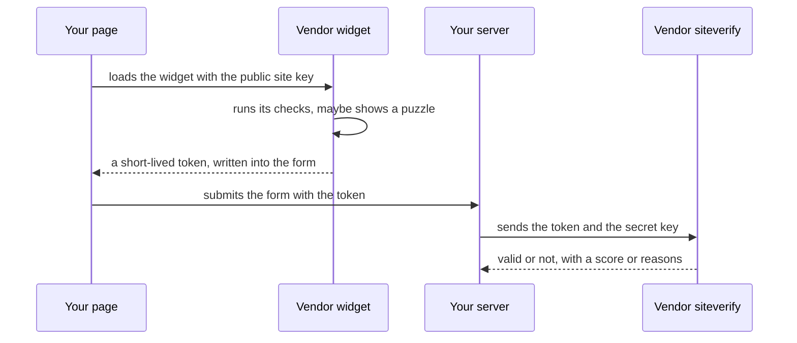

<Info>

**In short:** a CAPTCHA is a test that a site gives a visitor to tell people from
programs. Today most of the "test" is invisible: the vendor scores the visit
from many signals, and only a doubtful score shows a puzzle. The honest way to
test a page with a CAPTCHA is to use the vendor's **test keys** or a test
environment where the challenge is off. The library's `solve_captcha` presses
widgets that ask for a click or a drag, along a human pointer path, and checks
that the page shows them cleared. It is not a solver of puzzles, and it works
only when the site accepts the press.

</Info>

## What a CAPTCHA is for

**CAPTCHA** stands for "Completely Automated Public Turing test to tell
Computers and Humans Apart". A site cannot see who is on the other end of a
connection, and some actions are worth abusing at scale: creating thousands of
accounts, guessing passwords, buying out limited stock, posting spam, copying a
catalogue. A CAPTCHA adds a cost for a program that a person does not mind
paying.

It is one layer among several, next to rate limits, login protection and
[bot detection](/concepts/detection). No CAPTCHA stops a determined attacker,
and none is meant to; the aim is to make abuse expensive enough that it stops
paying.

## The kinds

| Kind | What the visitor does | Notes |
|---|---|---|
| **Distorted text** | Types the warped letters | The original form. Computers read it well now, so it has mostly disappeared |
| **Image selection** | Clicks all the pictures with traffic lights, buses, crosswalks | A few seconds of work. Also used to label data for machine learning |
| **Audio** | Types what a voice says | The accessibility alternative to the image tests, and itself easy for software to transcribe |
| **Checkbox** ("I am not a robot") | Clicks one box | The click is not the test. The vendor looks at the page's signals and the pointer's path, and shows a picture puzzle only if it is unsure |
| **Invisible or score-based** | Nothing | The page asks the vendor for a verdict silently. reCAPTCHA v3 returns a score from 0.0 (likely a bot) to 1.0 (likely a person), and the site decides what to do with it |
| **Slider or drag puzzle** | Drags a piece into place | Used by some vendors, for example DataDome and GeeTest |
| **Proof of work** | Nothing; the browser computes for a moment | Friendly Captcha makes the visitor's device solve a small calculation, which costs a bot operator CPU on every request |
| **Challenge page** | Waits, sometimes ticks a box | Cloudflare's "Just a moment..." interstitial runs checks in the browser before it lets the request through |

The vendors you meet most:

- **reCAPTCHA** (Google): v2 with the checkbox or an invisible variant, and v3
  with scores. An Enterprise edition adds more signals.
- **hCaptcha**: image challenges with a stronger focus on privacy and a business
  model built on paying sites.
- **Cloudflare Turnstile**: a CAPTCHA replacement that runs small non-interactive
  checks in the browser and rarely asks for anything. A site can pick
  *managed*, *non-interactive* or *invisible* modes.
- **Cloudflare challenge pages**: not a widget on your page but a page that
  stands in front of it. See [Challenge](/glossary#challenge),
  [Interstitial](/glossary#interstitial) and [Clearance](/glossary#clearance).
- **Friendly Captcha** and **DataDome**: a proof-of-work widget, and a bot
  management service that can show a slider.

## How the pieces fit

Almost every vendor uses the same three steps:



*The token is the proof. The browser never decides the result; only the vendor's
server does, when your server asks.*

This is why a script cannot simply "set the CAPTCHA to solved": the token must be
issued by the vendor for this site, and your server checks it with the vendor.
It is also why testing works so well with test keys (below): you change which
vendor key pair the site uses, and the rest of the code stays the same.

## Bot-management scoring in general terms

The widget is the visible end of a scoring system. Without describing any
vendor's internals, the signals fall into a few groups:

- **Network.** The IP address and its reputation (a home line, a data centre, a
  proxy exit), how many visits come from it, its country compared with the
  browser's time zone and language. See [Network](/concepts/network).
- **Connection fingerprints.** How the TLS and HTTP/2 handshakes look compared
  with real browsers. See [Network: TLS and HTTP/2 fingerprints](/concepts/network#tls-and-http2-fingerprints).
- **Browser environment.** Whether the JavaScript environment looks like an
  ordinary browser, and whether it fits together. See
  [Detection](/concepts/detection).
- **Behaviour.** Timing between actions, pointer movement, scrolling, typing
  rhythm, and whether input is "trusted".
- **History.** Cookies from earlier visits, a clearance cookie from an earlier
  successful challenge, an account's age.

The system combines these into a risk score. Low risk passes silently, middle
risk gets a challenge, high risk is refused. The thresholds belong to the site
and its vendor, and they change. That is why the same script can pass today and
fail next week without any change in the script.

## Accessibility and privacy

A CAPTCHA that needs good eyesight, fine motor control or a certain kind of
thinking excludes people. Picture puzzles lock out many blind and low-vision
users, and audio puzzles can lock out people with hearing or language
difficulties. WCAG 2.2 has a success criterion on **accessible authentication**
(3.3.8) that says a login must not depend on a cognitive test unless there is an
alternative. Good practice is to offer more than one way through, to prefer
invisible or low-friction checks, and to keep a human route (a support address)
for people who are blocked.

CAPTCHAs also collect data. They read browser and behaviour signals, often set
cookies and load code from another company, which matters under privacy law.
Some newer approaches, such as Private Access Tokens and Privacy Pass, let a
trusted device or service vouch for a visitor without showing a puzzle or
identifying the person.

## Testing a page that has a CAPTCHA

A CAPTCHA exists to stop automation, so a test that tries to beat a real one is
fighting its own product. Testing teams handle it in one of four honest ways:

<Steps>

<Step title="Use the vendor's test keys" icon="key">

Google, hCaptcha and Cloudflare publish site and secret keys for testing. With
them the widget always passes (or, for the other keys, always fails) and the
vendor's server agrees. You run the application under test with those keys, so
the code you test is the code you ship. The page
[Testing pages with a CAPTCHA](/tutorials/captcha_testing) shows the keys, the
steps and the failure cases.

</Step>

<Step title="Turn the challenge off in a test environment" icon="toggle-off">

Put a switch in the application ("captcha enabled" is false in staging, or the
test build uses a stub), so the form works without a widget. Keep one test with
the real widget and the test keys, to prove the wiring.

</Step>

<Step title="Allow your own test traffic" icon="list-check">

Ask whoever runs the bot management (your team or your CDN) for a rule that
lets known test traffic through: a fixed address range, a secret header that
only your test runner sends, or a service account. This is the right answer for
a production smoke test.

</Step>

<Step title="Skip the form with the API" icon="plug">

If the test is about what happens after the form, create the account or the
session through the backend's API and start the browser test already signed in
(see [Sessions, cookies and storage](/concepts/sessions-and-state)).

</Step>

</Steps>

reCAPTCHA v3 has no published test key, and its score depends on live signals.
Test the code on either side of the threshold by making the server's score
check configurable, not by trying to win a score.

## How seleniumbase-rs handles CAPTCHAs

The library has one narrow feature. It is described here as it is in the code
(`src/sb_cdp/captcha.rs` and the folder beside it).

`Page::solve_captcha()` in the pure CDP engine and `BaseCase::solve_captcha()`
in the WebDriver engine (in its `cdp` or `uc` mode, which have the DevTools
connection the pointer events go over) run **the same solver**, one step after
the other:

1. **Locate.** One script looks for the first visible widget among five kinds,
   in this order: Cloudflare Turnstile, reCAPTCHA, hCaptcha, Friendly Captcha
   and DataDome (the `Captcha` enum). It looks in the page, in open shadow
   roots and in the frames whose content the page may read. A frame from
   another origin is a box: it is found and measured, but its inside is not
   read. A frame is recognised by its address and, for Turnstile, by the id and
   title Cloudflare gives it, so a page that serves the frame from elsewhere is
   still found; a container class is the next choice. A form checkbox that is
   not part of a challenge is never a candidate. A page that carries the signs
   of a Cloudflare challenge (its `orchestrate` script, `#challenge-stage`, the
   challenge frame, the title "Just a moment...") and has not drawn the widget
   yet is waited for, 6 s by default; a page with no sign of one answers `None`
   at once.
2. **Settle.** The widget is scrolled to the middle of the viewport and read
   again and again until it has stood still, in view, for 240 ms. A page that
   animates a widget in, or lays it out late, moves a widget that was read once.
3. **Press.** The pointer travels from where it was along a curved path whose
   speed rises and falls (the time is Fitts's law: far and small targets take
   longer), rests on the box for a moment, holds the button for a few tens of
   milliseconds, and lands within a few pixels of the checkbox, which these
   widgets draw against the left edge. For the DataDome slider it presses the
   handle and drags with the button held. The events are trusted, the same path
   as `Page::mouse()`.
4. **Check.** The widgets live in frames whose insides cannot be read, so the
   solver reads what the page can show: a token in the widget's response field
   (`cf-turnstile-response`, `g-recaptcha-response`, `h-captcha-response`, ...),
   the vendor's clearance cookie (`cf_clearance`, `datadome`), a page that was
   replaced by one with no widget, a widget that stayed gone for two readings, a
   success state in a widget the page may read, or an expression you give with
   `SolveOptions::success_marker`.
5. **Retry.** If the page could show a result (it has a response field, or a
   marker was given) and did not within 5 s, the widget is pressed again after a
   wait that starts at 600 ms, doubles, is spread by a quarter either way and is
   capped at 8 s: up to three presses. Then `SeleniumBaseError::Captcha` says
   what was seen. A page that cannot show a result is pressed once and reported
   as not verified, because pressing a widget that has already worked can reset
   it. The widget is never pressed again while it is still verifying.

It returns the kind it tried, or `None` if the page shows no supported widget.
`solve_captcha_with(&SolveOptions)` returns a `Solved` instead: the widget, the
number of presses, the `Evidence` that showed it cleared (`None` when nothing
could), and the time it took.

```rust,ignore src/main.rs
use seleniumbase_rs::sb_cdp::Captcha;

use std::time::Duration;
use seleniumbase_rs::sb_cdp::SolveOptions;

match page.solve_captcha().await? {
    Some(kind) => println!("cleared a {kind} widget"), // Display gives "Cloudflare Turnstile", "reCAPTCHA", ...
    None => println!("no supported widget on the page"),
}

// The same, saying how the page showed it worked, with the site's own marker:
let options = SolveOptions::new()
    .locate_timeout(Duration::from_secs(10))
    .success_marker("document.querySelector('#welcome')");
if let Some(solved) = page.solve_captcha_with(&options).await? {
    println!("{solved}"); // "cleared after 1 press: the success marker became true"
}
```

What it does **not** do, and says so in its own documentation:

- It does not read or answer a puzzle. It never looks at pictures or audio.
- It cannot see inside a widget that lives in a cross-origin frame or a closed
  shadow root. It presses where the widget normally draws its control, and
  reads what the page shows afterwards.
- It cannot tell that a click was accepted when the page shows nothing: with no
  response field and no marker, the answer is `Solved::evidence == None`, which
  means "pressed once, not verified". The vendor and the site decide what the
  press means, and "a harder challenge may follow".
- It does not change the page. Python's version rewrites `center` and `right` in
  the page's classes and styles to `left`; this one only looks.

The same solver is the MCP tool `solve_captcha` in both the `cdp` and the
WebDriver servers. Its description says the same: it tries to pass a widget "by
clicking its checkbox (Cloudflare Turnstile, reCAPTCHA, hCaptcha, FriendlyCaptcha)
or dragging its slider (DataDome)", does nothing if none is found, and success is
not guaranteed. It answers `Attempted to solve a ... CAPTCHA: ` and what happened
(`cleared after 1 press: the response field holds a token`, or `pressed (1 press);
nothing on the page shows whether it cleared`), or `No supported CAPTCHA was
found on the page.` From the command line, `sbrs solve-captcha` does the same on
the page that `--url` opens.

### How it is tested, and how to check it on a live site

The solver is tested against imitation widgets served from two loopback origins
(`tests/fixtures/captcha/`): a widget in a frame from another origin, one in a
shadow root, one that appears late, one that is still moving when it first shows,
a checkbox at the left edge of a 300x65 box with an ordinary form checkbox
beside it, a widget that clears only after a second, verified check, a page that
judges the pointer's path and the pause before the press, and an interstitial
that answers a `cf_clearance` cookie and the site's own page. The headless
Chrome tests are `tests/sb_cdp_captcha_chrome.rs` and, for the WebDriver engine,
`tests/captcha_basecase_chrome.rs`; the logic (the retries, the waiting, the
evidence) is also tested without a browser, against a scripted tab.

A fixture can show that a path works, not that a real site accepts it. Whether
the solver passes a real Cloudflare page is for a person to check, on purpose:
[nowsecure.nl](https://nowsecure.nl) is a public bot-detection test page. The
check passes when the site's own page loads (not merely when no challenge is
seen), a Turnstile on the way is cleared, and a `cf_clearance` cookie is held
afterwards. It is an `#[ignore]`d test that also does nothing unless
`SB_LIVE_SITES=1`, for the pure CDP engine and for the UC (WebDriver) engine:

```bash
SB_LIVE_SITES=1 cargo test --test captcha_live_chrome -- --ignored --test-threads=1 --nocapture
```

or one command line with the `sbrs` binary (the UC engine):

```bash
sbrs --uc --url https://nowsecure.nl solve-captcha --expect-text nowsecure --expect-cookie cf_clearance
```

The test runs headless unless `SB_HEADED=1`; add `--headed` to the command
line to watch a window. `SB_LIVE_URL` replaces the address, and `SB_LIVE_MARKER` (a script
expression that is true on the site's own page) replaces the default marker if
the page changes. If a run fails, keep the printed report: it is what to turn
into a fixture that reproduces the gap.

The other parts of the library that bear on CAPTCHAs are the general ones: a
real, trusted browser with a coherent fingerprint is judged better than an
inconsistent one (see [Detection](/concepts/detection)), and a saved session can
carry a clearance cookie over to a later run (see
[Sessions, cookies and storage](/concepts/sessions-and-state)). Neither
promises to avoid a challenge.

<Warning>

**Responsible use.** Use `solve_captcha` on sites and applications you own or
have permission to test, with test keys or in a test environment. Getting past
a CAPTCHA on someone else's site may break that site's terms of service and, in
some places, the law, and it takes away a protection the owner chose. The
library does not promise to beat any vendor, and this page does not describe
ways to evade them. If a real site blocks your legitimate work, ask the owner
for an API, a feed or an allowlist.

</Warning>

## Where to go next

<Columns cols={2}>

<Card title="Testing pages with a CAPTCHA" icon="vial" color="#199f43" href="/tutorials/captcha_testing">
  Vendor test keys, the widget steps and the failure paths.
</Card>

<Card title="Detection and spoofing" icon="user-secret" color="#a631be" href="/concepts/detection">
  The signals a bot-management system reads.
</Card>

<Card title="Network" icon="network-wired" color="#1a85d4" href="/concepts/network">
  IP addresses, proxies and the TLS fingerprint.
</Card>

<Card title="Frontends, backends and APIs" icon="server" color="#d47628" href="/concepts/frontends-backends-and-apis">
  Where the edge proxy that shows a challenge sits.
</Card>

<Card title="Glossary" icon="book" color="#1a85d4" href="/glossary">
  Challenge, clearance, interstitial and more.
</Card>

</Columns>
