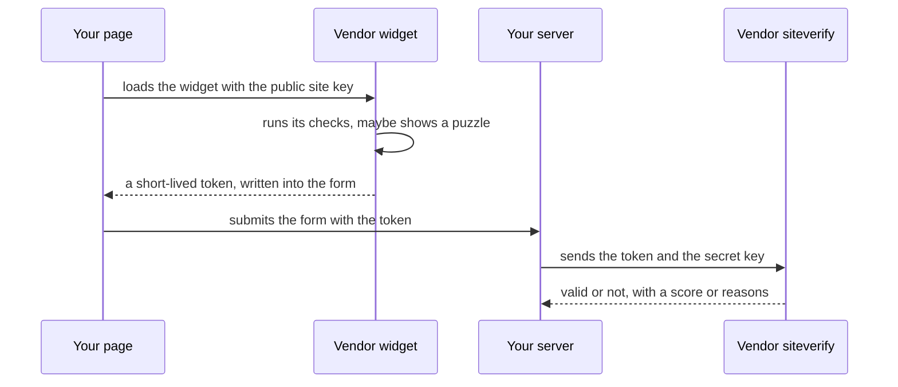

<Info>

**In short:** a CAPTCHA is a test that a site gives a visitor to tell people from
programs. Today most of the "test" is invisible: the vendor scores the visit
from many signals, and only a doubtful score shows a puzzle. The honest way to
test a page with a CAPTCHA is to use the vendor's **test keys** or a test
environment where the challenge is off. The library's `solve_captcha` is a
click helper for widgets that ask for a click or a drag. It is not a solver, and
it works only when the site accepts the click.

</Info>

## What a CAPTCHA is for

**CAPTCHA** stands for "Completely Automated Public Turing test to tell
Computers and Humans Apart". A site cannot see who is on the other end of a
connection, and some actions are worth abusing at scale: creating thousands of
accounts, guessing passwords, buying out limited stock, posting spam, copying a
catalogue. A CAPTCHA adds a cost for a program that a person does not mind
paying.

It is one layer among several, next to rate limits, login protection and
[bot detection](/concepts/detection). No CAPTCHA stops a determined attacker,
and none is meant to; the aim is to make abuse expensive enough that it stops
paying.

## The kinds

| Kind | What the visitor does | Notes |
|---|---|---|
| **Distorted text** | Types the warped letters | The original form. Computers read it well now, so it has mostly disappeared |
| **Image selection** | Clicks all the pictures with traffic lights, buses, crosswalks | A few seconds of work. Also used to label data for machine learning |
| **Audio** | Types what a voice says | The accessibility alternative to the image tests, and itself easy for software to transcribe |
| **Checkbox** ("I am not a robot") | Clicks one box | The click is not the test. The vendor looks at the page's signals and the pointer's path, and shows a picture puzzle only if it is unsure |
| **Invisible or score-based** | Nothing | The page asks the vendor for a verdict silently. reCAPTCHA v3 returns a score from 0.0 (likely a bot) to 1.0 (likely a person), and the site decides what to do with it |
| **Slider or drag puzzle** | Drags a piece into place | Used by some vendors, for example DataDome and GeeTest |
| **Proof of work** | Nothing; the browser computes for a moment | Friendly Captcha makes the visitor's device solve a small calculation, which costs a bot operator CPU on every request |
| **Challenge page** | Waits, sometimes ticks a box | Cloudflare's "Just a moment..." interstitial runs checks in the browser before it lets the request through |

The vendors you meet most:

- **reCAPTCHA** (Google): v2 with the checkbox or an invisible variant, and v3
  with scores. An Enterprise edition adds more signals.
- **hCaptcha**: image challenges with a stronger focus on privacy and a business
  model built on paying sites.
- **Cloudflare Turnstile**: a CAPTCHA replacement that runs small non-interactive
  checks in the browser and rarely asks for anything. A site can pick
  *managed*, *non-interactive* or *invisible* modes.
- **Cloudflare challenge pages**: not a widget on your page but a page that
  stands in front of it. See [Challenge](/glossary#challenge),
  [Interstitial](/glossary#interstitial) and [Clearance](/glossary#clearance).
- **Friendly Captcha** and **DataDome**: a proof-of-work widget, and a bot
  management service that can show a slider.

## How the pieces fit

Almost every vendor uses the same three steps:



*The token is the proof. The browser never decides the result; only the vendor's
server does, when your server asks.*

This is why a script cannot simply "set the CAPTCHA to solved": the token must be
issued by the vendor for this site, and your server checks it with the vendor.
It is also why testing works so well with test keys (below): you change which
vendor key pair the site uses, and the rest of the code stays the same.

## Bot-management scoring in general terms

The widget is the visible end of a scoring system. Without describing any
vendor's internals, the signals fall into a few groups:

- **Network.** The IP address and its reputation (a home line, a data centre, a
  proxy exit), how many visits come from it, its country compared with the
  browser's time zone and language. See [Network](/concepts/network).
- **Connection fingerprints.** How the TLS and HTTP/2 handshakes look compared
  with real browsers. See [Network: TLS and HTTP/2 fingerprints](/concepts/network#tls-and-http2-fingerprints).
- **Browser environment.** Whether the JavaScript environment looks like an
  ordinary browser, and whether it fits together. See
  [Detection](/concepts/detection).
- **Behaviour.** Timing between actions, pointer movement, scrolling, typing
  rhythm, and whether input is "trusted".
- **History.** Cookies from earlier visits, a clearance cookie from an earlier
  successful challenge, an account's age.

The system combines these into a risk score. Low risk passes silently, middle
risk gets a challenge, high risk is refused. The thresholds belong to the site
and its vendor, and they change. That is why the same script can pass today and
fail next week without any change in the script.

## Accessibility and privacy

A CAPTCHA that needs good eyesight, fine motor control or a certain kind of
thinking excludes people. Picture puzzles lock out many blind and low-vision
users, and audio puzzles can lock out people with hearing or language
difficulties. WCAG 2.2 has a success criterion on **accessible authentication**
(3.3.8) that says a login must not depend on a cognitive test unless there is an
alternative. Good practice is to offer more than one way through, to prefer
invisible or low-friction checks, and to keep a human route (a support address)
for people who are blocked.

CAPTCHAs also collect data. They read browser and behaviour signals, often set
cookies and load code from another company, which matters under privacy law.
Some newer approaches, such as Private Access Tokens and Privacy Pass, let a
trusted device or service vouch for a visitor without showing a puzzle or
identifying the person.

## Testing a page that has a CAPTCHA

A CAPTCHA exists to stop automation, so a test that tries to beat a real one is
fighting its own product. Testing teams handle it in one of four honest ways:

<Steps>

<Step title="Use the vendor's test keys" icon="key">

Google, hCaptcha and Cloudflare publish site and secret keys for testing. With
them the widget always passes (or, for the other keys, always fails) and the
vendor's server agrees. You run the application under test with those keys, so
the code you test is the code you ship. The page
[Testing pages with a CAPTCHA](/tutorials/captcha_testing) shows the keys, the
steps and the failure cases.

</Step>

<Step title="Turn the challenge off in a test environment" icon="toggle-off">

Put a switch in the application ("captcha enabled" is false in staging, or the
test build uses a stub), so the form works without a widget. Keep one test with
the real widget and the test keys, to prove the wiring.

</Step>

<Step title="Allow your own test traffic" icon="list-check">

Ask whoever runs the bot management (your team or your CDN) for a rule that
lets known test traffic through: a fixed address range, a secret header that
only your test runner sends, or a service account. This is the right answer for
a production smoke test.

</Step>

<Step title="Skip the form with the API" icon="plug">

If the test is about what happens after the form, create the account or the
session through the backend's API and start the browser test already signed in
(see [Sessions, cookies and storage](/concepts/sessions-and-state)).

</Step>

</Steps>

reCAPTCHA v3 has no published test key, and its score depends on live signals.
Test the code on either side of the threshold by making the server's score
check configurable, not by trying to win a score.

## How seleniumbase-rs handles CAPTCHAs

The library has one narrow feature. It is described here as it is in the code
(`src/sb_cdp/captcha.rs`).

`Page::solve_captcha()` in the pure CDP engine (and `BaseCase::solve_captcha()`
in the WebDriver engine) does the following:

1. It runs a short script that looks for the first visible widget among five
   kinds, in this order: Cloudflare Turnstile, reCAPTCHA, hCaptcha, Friendly
   Captcha and DataDome. Each kind is recognised by the address of its frame or
   by its container class. That is the `Captcha` enum.
2. It scrolls the widget to the middle of the viewport.
3. With trusted mouse events (the same path as `Page::mouse()`), it moves the
   pointer to where these widgets draw their control, waits 150 ms, and either
   **clicks** (a checkbox, a fixed distance from the widget's left edge, at
   half its height) or, for the DataDome slider, **drags** across the widget's
   width.
4. It returns the kind it tried, or `None` if the page shows no supported widget.

```rust,ignore src/main.rs
use seleniumbase_rs::sb_cdp::Captcha;

match page.solve_captcha().await? {
    Some(kind) => println!("tried a {kind} widget"), // Display gives "Cloudflare Turnstile", "reCAPTCHA", ...
    None => println!("no supported widget on the page"),
}
// Then check the page: did the token field fill, did the form move on?
```

What it does **not** do, and says so in its own documentation:

- It does not read or answer a puzzle. It never looks at pictures or audio.
- It cannot see inside the widget, because these widgets live in cross-origin
  frames. It presses where the widget normally draws its control.
- It does not know whether the click was accepted. That is up to the vendor and
  the site, and "a harder challenge may follow". The caller must check the page
  afterwards.

The same function is the MCP tool `solve_captcha` in both the `cdp` and the
WebDriver servers. Its description says the same: it tries to pass a widget "by
clicking its checkbox (Cloudflare Turnstile, reCAPTCHA, hCaptcha, FriendlyCaptcha)
or dragging its slider (DataDome)", does nothing if none is found, and success is
not guaranteed. It answers `Attempted to solve a ... CAPTCHA.` or `No supported
CAPTCHA was found on the page.`

The other parts of the library that bear on CAPTCHAs are the general ones: a
real, trusted browser with a coherent fingerprint is judged better than an
inconsistent one (see [Detection](/concepts/detection)), and a saved session can
carry a clearance cookie over to a later run (see
[Sessions, cookies and storage](/concepts/sessions-and-state)). Neither
promises to avoid a challenge.

<Warning>

**Responsible use.** Use `solve_captcha` on sites and applications you own or
have permission to test, with test keys or in a test environment. Getting past
a CAPTCHA on someone else's site may break that site's terms of service and, in
some places, the law, and it takes away a protection the owner chose. The
library does not promise to beat any vendor, and this page does not describe
ways to evade them. If a real site blocks your legitimate work, ask the owner
for an API, a feed or an allowlist.

</Warning>

## Where to go next

<Columns cols={2}>

<Card title="Testing pages with a CAPTCHA" icon="vial" color="#199f43" href="/tutorials/captcha_testing">
  Vendor test keys, the widget steps and the failure paths.
</Card>

<Card title="Detection and spoofing" icon="user-secret" color="#a631be" href="/concepts/detection">
  The signals a bot-management system reads.
</Card>

<Card title="Network" icon="network-wired" color="#1a85d4" href="/concepts/network">
  IP addresses, proxies and the TLS fingerprint.
</Card>

<Card title="Frontends, backends and APIs" icon="server" color="#d47628" href="/concepts/frontends-backends-and-apis">
  Where the edge proxy that shows a challenge sits.
</Card>

<Card title="Glossary" icon="book" color="#1a85d4" href="/glossary">
  Challenge, clearance, interstitial and more.
</Card>

</Columns>
