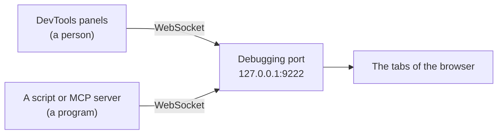
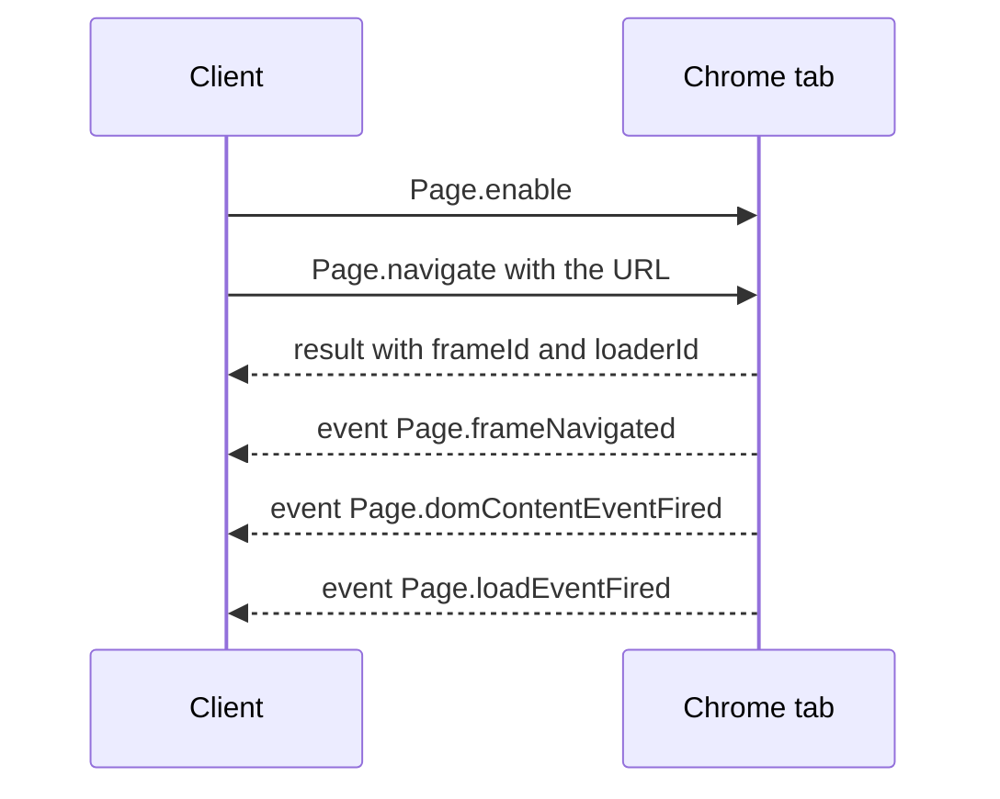
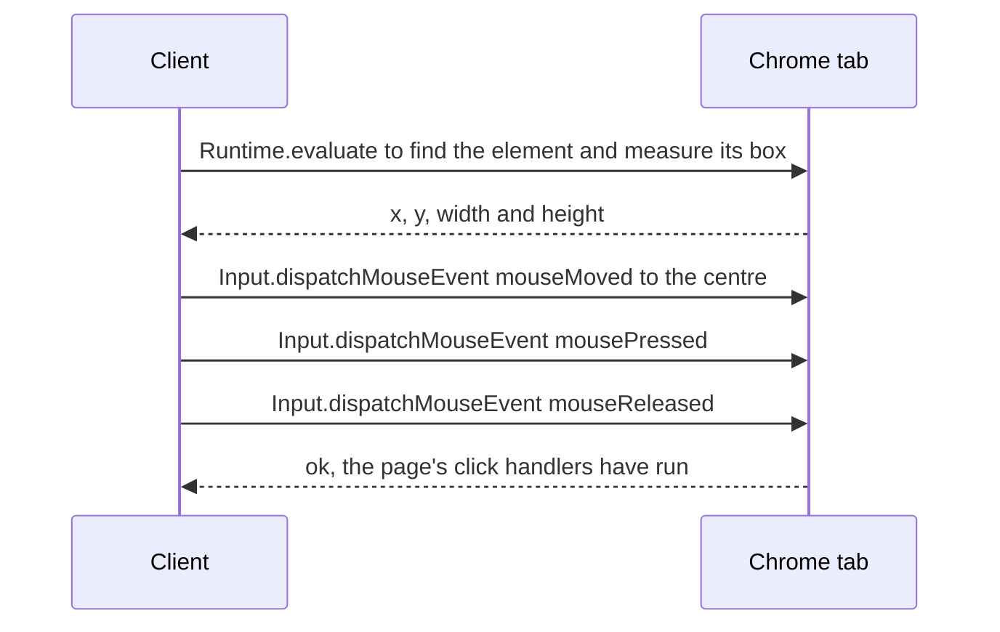
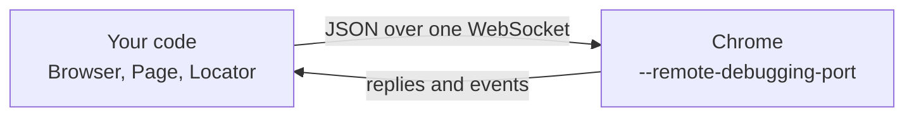

<Info>

**In short:** the developer tools (DevTools) are a set of panels built into
Chrome, Edge, Firefox and Safari that show what a page is made of and what it is
doing. In Chrome they are a client of the **Chrome DevTools Protocol** (CDP):
JSON messages over a WebSocket, with no driver in between. Any program can speak
the same protocol. The pure CDP engine (`seleniumbase_rs::sb_cdp`) does, and CDP
mode adds it to a [WebDriver](/concepts/webdriver) session. This page has both
halves: the panels you open by hand when a test misbehaves, and the protocol
behind every one of them.

</Info>

## Opening the tools

Press **F12**, or **Ctrl+Shift+I** (Windows and Linux) or
**Cmd+Option+I** (macOS), or right-click an element and choose **Inspect**. A
panel opens beside or below the page. In Chrome, the tools are themselves a web
page that talks to the page you inspect over the
Chrome DevTools Protocol, so anything the panels can do, a
program can do too.

## The panels

| Panel | What it shows | A use in testing |
|---|---|---|
| **Elements** | The live [DOM](/concepts/selectors-and-the-dom) and the CSS rules that apply to each node | Find a stable selector, see why an element is hidden |
| **Console** | Messages from the page, and a prompt that runs JavaScript | Try a selector, read errors, run a one-line check |
| **Sources** | The page's scripts, with breakpoints and stepping | Find out which script changes a value |
| **Network** | Every request and response, with timing, headers and bodies | Find the API call behind a button, see a failure |
| **Performance** | A recording of what the browser did, frame by frame | Explain a page that is slow to become ready |
| **Memory** | Heap snapshots | Hunt a leak in a long-running page |
| **Application** | Cookies, local storage, IndexedDB, service workers | Check login state, see [what a session keeps](/concepts/sessions-and-state) |
| **Security** | Certificate and mixed-content information | Understand a certificate error |
| **Lighthouse** | An audit for speed, accessibility and best practice | A quick quality check |
| **Recorder** | Records clicks and typing as a replayable flow | A first draft of a test |

Most of this page is about two of them, Console and Network, because they are
the two you will open most often when a test misbehaves.

## The Console in depth

The Console has two jobs: it **shows** what the page logs, and it **runs**
what you type, in the page's own context, with the page's own variables.

### Levels

Every message has a level. The filter menu at the top of the panel shows or
hides each level.

| JavaScript call | Level in the filter | Looks like |
|---|---|---|
| `console.debug(...)` | Verbose | Grey text, hidden by default |
| `console.log(...)` and `console.info(...)` | Info | Plain text |
| `console.warn(...)` | Warnings | Yellow, with a warning icon |
| `console.error(...)` | Errors | Red, with a stack trace |

The browser also writes to the Console by itself, always at the Error or Warning
level: an **uncaught exception** in a script, a **promise rejected** with nothing
to handle it, a **failed request** (`Failed to load resource`), a
mixed-content or CORS block, and a deprecation notice. For a test these are
valuable: a page that renders fine but logs a red error is often the first sign
of a bug.

### Helpers that only exist in the Console

The Console has a few shortcuts that are **not** part of the page. A script on
the page cannot use them, only the prompt can.

| Helper | What it does |
|---|---|
| `$0` | The element currently selected in the Elements panel. `$1` to `$4` are the ones selected before |
| `$_` | The value of the last expression you ran |
| `$('css')` | Shortcut for `document.querySelector('css')`: the first match |
| `$$('css')` | Shortcut for `document.querySelectorAll('css')`, but returns a real **array**, so `map` and `filter` work |
| `$x('//xpath')` | Evaluates an XPath expression and returns an array of nodes |
| `copy(value)` | Puts a value on the clipboard, handy for a large JSON |
| `inspect(node)` | Selects a node in the Elements panel |
| `getEventListeners(node)` | Lists the event listeners attached to a node |
| `monitorEvents(node, 'click')` | Logs every event of that type on the node |

A typical selector check takes ten seconds. Select the button in the Elements
panel, then type:

```js
$0.outerHTML                      // what exactly did I select?
$$('button.primary').length       // how many elements will my selector match?
$$('button.primary').map(b => b.textContent.trim())
```

If the length is `0` or `2`, the selector is wrong for a test whatever it looks
like on screen. Remember that the Console runs in the **top frame** by default;
a selector for something inside an `iframe` needs the context menu at the top
of the panel switched to that frame, just as automation must switch to the
frame first.

### Other useful calls

`console.table(array)` prints an array of objects as a table,
`console.group` and `console.groupEnd` indent related lines,
`console.time('x')` with `console.timeEnd('x')` measures a duration,
`console.assert(condition, 'message')` logs only when the condition is false,
and `console.trace()` prints the call stack at that point. Tick **Preserve log**
to keep messages across a page navigation, which is what you want while
debugging a login flow.

## Network and Copy as cURL

The Network panel lists every request the page makes. Click one to see its
request headers, response headers, payload and response body. The filter row
narrows the list to `Fetch/XHR` (the API calls of a modern app, see
[frontends, backends and APIs](/concepts/frontends-backends-and-apis)),
documents, scripts or images.

Right-click a request and **Copy** offers several forms. **Copy as cURL**
produces a command you can paste into a terminal and run, with the method, URL,
headers, cookies and body of that exact request:

```bash
curl 'https://example.com/api/items?page=2' \
  -H 'accept: application/json' \
  -H 'authorization: Bearer REDACTED' \
  -H 'cookie: session=REDACTED' \
  --compressed
```

<Warning>

A copied request includes your **cookies and authorization headers**. They are
real credentials for your account. Do not paste them into a ticket, a chat or a
repository. Replace them with a placeholder, or log in with a throwaway test
account when you build a request you plan to share.

</Warning>

Reproducing a request with `curl` answers a useful question: does the call work
without the browser? If it does, a test may not need a browser for that step at
all; if it fails, the difference between the browser's request and yours (a
header, a cookie, a token) is the thing to find. **Copy as fetch** gives the
same request as JavaScript, and **Save all as HAR** writes the whole list to a
file that other tools can read, as described in [Network](/concepts/network).

## Where CDP comes from

The developer tools above are a web page that is **not** built into the
browser's engine: they talk to the page you are inspecting over a protocol, the
Chrome DevTools Protocol. They read the DOM, list network requests, set
breakpoints and take screenshots by sending that protocol's messages.

Because the protocol is just messages over a network connection, any program
can be the "developer tools". Puppeteer, Playwright and the pure CDP engine of
seleniumbase-rs are such programs. The protocol belongs to Chromium (Chrome,
Edge, Brave, Opera), is versioned with the browser and is not a web standard.
Its definition is public (the "protocol viewer" on the Chrome DevTools site),
and some of its parts are marked experimental or deprecated and do change.

## Connecting

<Steps>

<Step title="Chrome opens a debugging port" icon="door-open">

Started with `--remote-debugging-port`, Chrome listens for connections on that
port, on the local machine only by default. With the port set to `0`, Chrome
picks a free one and writes it to a file in its profile folder
(`DevToolsActivePort`). No other program is needed.

</Step>

<Step title="Ask where to connect" icon="magnifying-glass">

A plain HTTP request to the port returns what the client needs:
`GET /json/version` gives the browser's version and its
`webSocketDebuggerUrl`; `GET /json/list` lists the open tabs, each with its own
WebSocket address.

</Step>

<Step title="Open a WebSocket" icon="plug">

The client connects to that `ws://` address. From now on everything, in both
directions, is JSON text frames on that one connection.

</Step>

</Steps>

## The remote debugging port

The tools above are a client. What they connect to is a **debugging port** that
the browser itself opens. When the tools are built into the same browser you
barely notice it, but you can start Chrome with a port and connect to it
from another program, or from the DevTools of another Chrome:

```bash
chrome --remote-debugging-port=9222 --user-data-dir=/tmp/debug-profile
```

Then open `http://127.0.0.1:9222/json/version` in any browser to see the
version and the WebSocket address, or open `chrome://inspect` in another Chrome
to attach to the tabs. The messages on that connection are the ones described in
[The messages](#the-messages) below.



*Several clients can attach to the same tab at once, so a person can watch the
panels while a program drives the page.*

<Warning>

Whoever can reach the debugging port controls the whole browser: its pages, its
cookies and its logins. Chrome listens on the local machine only by default,
and recent versions refuse the port for the browser's default profile, which is
why the command above names a separate `--user-data-dir`. Use a throwaway
profile and never expose the port to a network.

</Warning>

## The messages

There are exactly three kinds of message.

```jsonc
// 1. A command, client to Chrome. It has an id that the client chooses.
{"id": 7, "method": "Page.navigate", "params": {"url": "https://example.com"}}

// 2. The reply, Chrome to client. It repeats the id, so replies can arrive in any order.
{"id": 7, "result": {"frameId": "A1B2", "loaderId": "C3D4"}}

// 2b. Or, when the command fails, an error instead of a result.
{"id": 7, "error": {"code": -32000, "message": "Cannot navigate to invalid URL"}}

// 3. An event, Chrome to client. It has no id: nobody asked for it.
{"method": "Page.loadEventFired", "params": {"timestamp": 41203.5}}
```

A command is a `method` named `Domain.command` plus its `params`. The `id`
lets a client keep many commands in flight at once and match each reply to its
caller. Events are how the browser **tells** the client something happened.
Most events arrive only after the client turns the domain on with an `enable`
command, such as `Network.enable`, so a busy page does not flood a client that
did not ask.

## Domains

The protocol is split into **domains**, one for each part of the browser. These
are the ones that matter for automation:

| Domain | What it controls | Examples |
|---|---|---|
| `Browser` | The browser process: version, windows, permissions | `Browser.getVersion`, `Browser.grantPermissions` |
| `Target` | Tabs, iframes and workers, and attaching to them | `Target.createTarget`, `Target.attachToTarget`, `Target.createBrowserContext` |
| `Page` | Navigation, the page lifecycle, screenshots, PDF | `Page.navigate`, `Page.captureScreenshot`, `Page.addScriptToEvaluateOnNewDocument`; events `Page.frameNavigated`, `Page.loadEventFired` |
| `Runtime` | Running JavaScript, and handles to objects in the page | `Runtime.evaluate`, `Runtime.callFunctionOn`; event `Runtime.consoleAPICalled` |
| `DOM` | The document tree | `DOM.getDocument`, `DOM.querySelector`, `DOM.getBoxModel` |
| `Input` | Trusted mouse, keyboard and touch events | `Input.dispatchMouseEvent`, `Input.dispatchKeyEvent` |
| `Network` | Requests, responses, cookies, throttling | `Network.enable`, `Network.emulateNetworkConditions`; events `Network.requestWillBeSent`, `Network.responseReceived` |
| `Fetch` | Pausing and rewriting requests | `Fetch.enable`, `Fetch.fulfillRequest`; events `Fetch.requestPaused`, `Fetch.authRequired` |
| `Emulation` | Pretending to be another device or place | `Emulation.setDeviceMetricsOverride`, `Emulation.setTimezoneOverride`, `Emulation.setUserAgentOverride` |
| `Storage` | Cookies and storage of an origin | `Storage.getCookies`, `Storage.clearDataForOrigin` |

## Targets and sessions

A running Chrome is not one thing to talk to but many. Each tab, each
cross-site iframe, each service worker and shared worker, and the browser
itself is a **target**. To command one, the client **attaches** to it:

```jsonc
{"id": 1, "method": "Target.attachToTarget", "params": {"targetId": "T-42", "flatten": true}}
// reply: {"id": 1, "result": {"sessionId": "S-9"}}

// From now on, a command for that tab carries its sessionId, on the SAME WebSocket:
{"id": 2, "sessionId": "S-9", "method": "Page.navigate", "params": {"url": "https://example.com"}}
```

With `flatten: true`, the sessions of all tabs share the one connection, and the
`sessionId` field says whom a message is for or from. A session is a private
conversation with one target: enabling `Network` in one tab does not start
network events in another.

The browser also has **browser contexts**, the protocol's name for what Chrome
shows as an incognito window. `Target.createBrowserContext` makes one; targets
created inside it share cookies and storage with each other and with nothing
else. See [Sessions, cookies and storage](/concepts/sessions-and-state).

## What a page load looks like



*Navigation in CDP: the reply to `Page.navigate` only says the navigation
started. The page is loaded when the events arrive.*

That is why a good client **subscribes before it navigates**: the load event
can arrive before the reply to the command does. If a navigation fails (no
network, a bad certificate), the reply carries an `errorText` such as
`net::ERR_NAME_NOT_RESOLVED`. See [how a page loads](/concepts/how-a-page-loads)
for what those events mean.

## What a click looks like

CDP has no "click this element" command. A click is built from smaller pieces:



*A typical click. Many clients also scroll the element into view first.*

`Input.dispatchMouseEvent` goes through the browser's real input path, so the
page sees ordinary events whose `isTrusted` property is `true`. A script that
only calls `element.click()` produces an untrusted event, which some sites
refuse.

JavaScript results come back as **remote objects**: `Runtime.evaluate` returns
a description (type and value), or, for an object that cannot be copied, an
`objectId` the client can pass to later commands such as
`Runtime.callFunctionOn`. With `returnByValue` the browser copies the value
into the reply.

## CDP compared with WebDriver

| | WebDriver | CDP |
|---|---|---|
| Between test and browser | A driver process (chromedriver) | Nothing |
| Transport | One HTTP request per command | One WebSocket for everything |
| Who starts the browser | The driver | You (or your library) start Chrome with a debugging port |
| Events from the page | None (classic); some with BiDi | Network, console, page loads, targets |
| Level | High: "click this element", "get the title" | Low: mouse events, DOM nodes, raw requests |
| Standard | W3C, the same for every browser | Chromium only, versioned with the browser |
| Browsers | Every major browser | Chromium-based browsers |
| In seleniumbase-rs | `BaseCase` | `sb_cdp::Browser`, `Page`, `Locator` |

CDP can do things the classic WebDriver protocol cannot: pause and rewrite
requests, set the time zone, emulate a phone, print to PDF, record a HAR. The
price is that every higher-level behaviour (waiting for an element, scrolling
before a click) is the client's job.
[WebDriver BiDi](/concepts/webdriver#webdriver-bidi) is the standards-based
effort to bring the event-style features to every browser.

## How seleniumbase-rs uses it

### The pure CDP engine

The pure CDP engine lives in `seleniumbase_rs::sb_cdp`.



*The pure CDP engine and Chrome*

- **One connection.** The client in `src/sb_cdp/client.rs` keeps one WebSocket
  for every tab. A background task reads it, completes the pending request that
  matches each reply `id`, and broadcasts everything else as an event, so
  commands from different tabs never block one another. A command that gets no
  reply is abandoned after 30 seconds.
- **Launching.** `Browser::launch(LaunchOptions)` starts Chrome with a
  debugging port and waits for it to publish its endpoint (20 seconds by
  default; `startup_timeout` changes that). `LaunchOptionsBuilder::debugging_port`
  fixes the port instead of letting Chrome choose.
- **Tabs and contexts.** `Browser::default_page()` returns the first tab as a
  `Page`; `Browser::new_context()` creates an isolated `BrowserContext`.
- **Raw commands.** `Page::execute(method, params)` sends any command to one
  tab, `Browser::execute` sends one to the browser itself, and
  `Page::events()` gives an `Events` handle for the tab's protocol events.
- **Navigation.** `Page::goto` follows the order described above: it listens
  first, sends `Page.navigate`, reads `errorText` and `loaderId` from the reply,
  and waits for the load event. A change of only the `#fragment` has no
  `loaderId` and fires no load event, so it returns at once.
- **Input.** `Page::mouse()` and `Page::keyboard()` send `Input.dispatchMouseEvent`
  and `Input.dispatchKeyEvent`, so clicks and keystrokes are trusted events. A
  `Locator` uses them for you.
- **Other domains.** Interception uses `Fetch`
  ([Network](/concepts/network)), `Page::apply_fingerprint` uses
  `Page.addScriptToEvaluateOnNewDocument` and `Emulation`
  ([Detection and spoofing](/concepts/detection)), and `Page::emulation()`
  exposes time zone, locale, geolocation, user agent and offline mode.

<Tabs>

<Tab title="Pure CDP engine" icon="bolt">

A `Locator` is lazy: it finds the element again each time it acts, and waits
for it. That removes the stale-reference problem of
[WebDriver](/concepts/webdriver#element-references).

```rust,ignore src/main.rs
use seleniumbase_rs::sb_cdp::{Browser, LaunchOptions};

let browser = Browser::launch(LaunchOptions::builder().headless(true).build()?).await?;
let page = browser.default_page().await?;
page.goto("example.com").await?;
page.locator("h1").expect().to_contain_text("Example").await?;
browser.close().await?;
```

</Tab>

<Tab title="Any CDP command" icon="terminal">

Whatever the typed API does not cover, you can send by name. The reply's
`result` comes back as JSON.

```rust,ignore src/main.rs
use serde_json::json;

let reply = page
    .execute("Runtime.evaluate", json!({ "expression": "document.title", "returnByValue": true }))
    .await?;
println!("title = {}", reply["result"]["value"]);

// For plain JavaScript there is a shortcut:
let title = page.evaluate("document.title").await?;
```

</Tab>

<Tab title="CDP mode in WebDriver" icon="code">

`DriverMode::Cdp` keeps a normal `BaseCase` WebDriver session and opens a CDP
connection next to it, for what WebDriver cannot do, such as printing to PDF or
setting the time zone. See [CDP mode](/tutorials/cdp_mode).

</Tab>

</Tabs>

<Note>

The pure CDP engine also has a mock transport (`Browser::new_mocked`, which
returns the browser and a `MockCtrl`; it needs the `test-util` feature), so
code that drives pages can be tested without starting Chrome.

</Note>

### DevTools from the command line, Rust and MCP

The project does not draw its own tools. It starts a browser the real DevTools
can reach and gives programs and AI assistants the same information.

<Tabs>

<Tab title="sbrs devtools" icon="terminal">

`sbrs devtools` launches Chrome with the pure CDP engine, listening on
`127.0.0.1` port 9222 (`--port 0` lets Chrome pick a free one). It prints the
HTTP endpoint, the browser WebSocket address and ready-to-paste configurations
for Google's `chrome-devtools-mcp` and Microsoft's Playwright MCP, then keeps
the browser open until you press Ctrl+C. `--json` prints the same information as
one line of JSON.

```bash
sbrs devtools --port 9222
sbrs devtools --headless --json
```

While it runs, open `chrome://inspect` in another Chrome, or point an MCP
client at the endpoint, and look at the very same tab.

</Tab>

<Tab title="sbrs cdp" icon="bolt">

`sbrs cdp --cmd METHOD` runs one raw
CDP command and prints the reply, with `--params` taking a JSON
object. It is the command-line equivalent of typing into the protocol monitor.

```bash
sbrs cdp --cmd Browser.getVersion
sbrs cdp --cmd Target.getTargets
```

The global `--cdp` switch is different: it turns on CDP mode for a command, so
the session uses the DevTools Protocol next to WebDriver. It cannot be combined
with `--uc`.

</Tab>

<Tab title="From Rust" icon="code">

A browser started by the pure CDP engine knows where its endpoint is.
`Browser::devtools_endpoint()` returns a `DevToolsEndpoint`, whose
`http_url()`, `websocket_url()` and `version_url()` give the three addresses
above, and which can write the client configurations for the two MCP servers.

```rust,ignore src/main.rs
use seleniumbase_rs::sb_cdp::{Browser, LaunchOptions};

let browser = Browser::launch(LaunchOptions::builder().headless(true).build()?).await?;
let endpoint = browser.devtools_endpoint();
println!("attach DevTools to {}", endpoint.http_url());
println!("version document: {}", endpoint.version_url());
```

</Tab>

</Tabs>

#### Debugging tools for MCP clients

The MCP servers of `sbrs-mcp` (see [MCP](/concepts/mcp)) offer the pieces of the
panels as tools, so an assistant can look at a page the way you would:

| Tool | Panel it stands in for |
|---|---|
| `get_console_messages` | Console. `start` begins recording, `level` filters (for example `error`), `limit` and `clear` bound and reset the list |
| `get_failed_requests` | Network. Lists requests that failed or returned 400 and up; `watch` records every failure on the pure CDP engine |
| `inspect_page` | Elements. An outline of the page |
| `diagnose_selector` | Console `$$`. Says why a selector matches nothing or too much |
| `capture_debug_bundle` | Several panels at once, saved for a bug report |
| `get_devtools_endpoint` | The debugging port. Returns the same addresses and configs as `sbrs devtools` |

<Tip>

When a test fails and you do not know why, work from cheap to costly. First read
the console errors and the failed requests, because they often name the cause.
Then check the selector with `$$` in a headed browser. Only then reach for
sources, breakpoints and the performance recording.

</Tip>

## Where to go next

<Columns cols={2}>

<Card title="Pure CDP" icon="bolt" color="#1a85d4" href="/tutorials/pure_cdp">
  The engine's guide: pages, locators, interception and pools.
</Card>

<Card title="WebDriver and drivers" icon="plug" color="#199f43" href="/concepts/webdriver">
  The other engine, and how drivers are found and started.
</Card>

<Card title="How a page loads" icon="globe" color="#d47628" href="/concepts/how-a-page-loads">
  What the lifecycle events of a navigation mean.
</Card>

<Card title="Network" icon="network-wired" color="#a631be" href="/concepts/network">
  Interception, HAR recording and proxies, built on the Fetch and Network domains.
</Card>

<Card title="Headless and headed" icon="eye-slash" color="#d52c36" href="/tutorials/headless">
  Running Chrome without a window.
</Card>

<Card title="Taking advantage of Rust" icon="gears" color="#1a85d4" href="/rust-advantages">
  Many CDP browsers at once with BrowserPool.
</Card>

<Card title="Selectors and the DOM" icon="crosshairs" href="/concepts/selectors-and-the-dom">
  What the Elements panel shows and how to pick a stable selector.
</Card>

<Card title="JavaScript and events" icon="code" href="/concepts/javascript-and-events">
  What runs in the page and what the Console can reach.
</Card>

</Columns>
