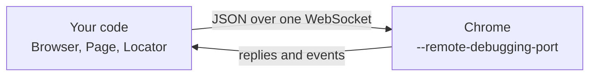

<Info>

**In short:** Chrome has its own control protocol, the Chrome DevTools Protocol
(CDP), the one its developer tools use. It runs over a WebSocket, with no driver
in between. The pure CDP engine (`seleniumbase_rs::sb_cdp`) speaks it directly;
CDP mode adds it to a [WebDriver](/concepts/webdriver) session.

</Info>

## The protocol

<Steps>

<Step title="Chrome opens a debugging port" icon="door-open">

Started with `--remote-debugging-port`, Chrome listens for a WebSocket
connection. No other program is needed.

</Step>

<Step title="Commands go out" icon="arrow-right">

The client sends JSON commands with an id, grouped in
<Tooltip tip="Page, Runtime, Network, Input, DOM, Emulation, ...">domains</Tooltip>:
`Page.navigate`, `Runtime.evaluate`, `Input.dispatchMouseEvent`.

</Step>

<Step title="Results and events come back" icon="arrow-left">

Each command gets a reply with the same id. Chrome also pushes events, such as a
finished page load or a network request, without being asked.

</Step>

</Steps>

<Frame caption="The pure CDP engine and Chrome">



</Frame>

## CDP compared with WebDriver

| | WebDriver | CDP |
|---|---|---|
| Between test and browser | A driver process (chromedriver) | Nothing |
| Transport | One HTTP request per command | One WebSocket for everything |
| Events from the page | None | Network, console, page loads |
| Browsers | Every major browser | Chromium-based browsers |
| In seleniumbase-rs | `BaseCase` | `sb_cdp::Browser`, `Page`, `Locator` |

## The two ways to use it here

<Tabs>

<Tab title="Pure CDP engine" icon="bolt">

`seleniumbase_rs::sb_cdp` launches Chrome and drives it over CDP alone: no
chromedriver to download, version or start. A `Locator` is lazy: it finds the
element again each time it acts, and waits for it.

```rust,ignore src/main.rs
use seleniumbase_rs::sb_cdp::{Browser, LaunchOptions};

let browser = Browser::launch(LaunchOptions::builder().headless(true).build()?).await?;
let page = browser.default_page().await?;
page.goto("example.com").await?;
page.locator("h1").expect().to_contain_text("Example").await?;
browser.close().await?;
```

</Tab>

<Tab title="CDP mode in WebDriver" icon="code">

`DriverMode::Cdp` keeps a normal `BaseCase` WebDriver session and opens a CDP
connection next to it, for what WebDriver cannot do, such as printing to PDF or
setting the time zone. See [CDP mode](/tutorials/cdp_mode).

</Tab>

</Tabs>

<Note>

The pure CDP engine also has a mock transport (`Browser::new_mocked`), so code
that drives pages can be tested without starting Chrome.

</Note>

## Where to go next

<Columns cols={2}>

<Card title="Pure CDP" icon="bolt" color="#1a85d4" href="/tutorials/pure_cdp">
  The engine's guide: pages, locators, interception and pools.
</Card>

<Card title="WebDriver and drivers" icon="plug" color="#199f43" href="/concepts/webdriver">
  The other engine, and how drivers are found and started.
</Card>

<Card title="Headless and headed" icon="eye-slash" color="#d47628" href="/tutorials/headless">
  Running Chrome without a window.
</Card>

<Card title="Taking advantage of Rust" icon="gears" color="#a631be" href="/rust-advantages">
  Many CDP browsers at once with BrowserPool.
</Card>

</Columns>
