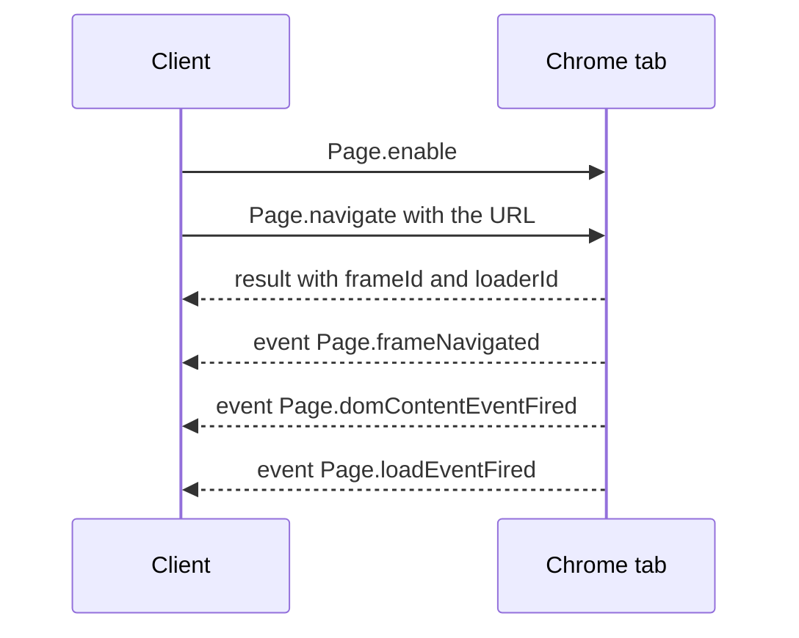
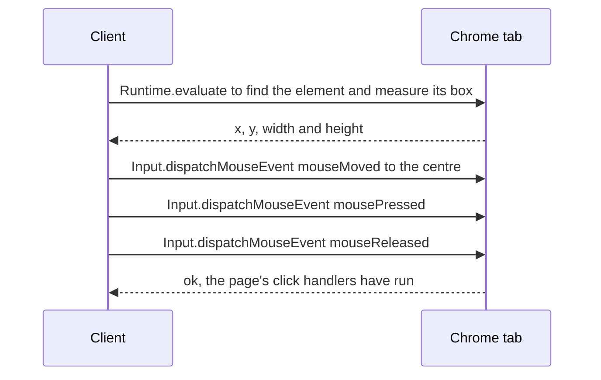
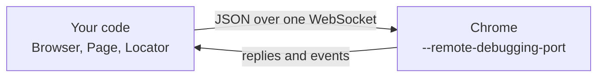

<Info>

**In short:** Chrome has its own control protocol, the Chrome DevTools Protocol
(CDP), the one its developer tools use. It runs over a WebSocket, with no driver
in between. The pure CDP engine (`seleniumbase_rs::sb_cdp`) speaks it directly;
CDP mode adds it to a [WebDriver](/concepts/webdriver) session.

</Info>

## Where CDP comes from

Press F12 in Chrome and the developer tools open. Those tools are a web page
that is **not** built into the browser's engine: they talk to the page you are
inspecting over a protocol, the Chrome DevTools Protocol. They read the DOM,
list network requests, set breakpoints and take screenshots by sending that
protocol's messages.

Because the protocol is just messages over a network connection, any program
can be the "developer tools". Puppeteer, Playwright and the pure CDP engine of
seleniumbase-rs are such programs. The protocol belongs to Chromium (Chrome,
Edge, Brave, Opera), is versioned with the browser and is not a web standard.
Its definition is public (the "protocol viewer" on the Chrome DevTools site),
and some of its parts are marked experimental or deprecated and do change.

## Connecting

<Steps>

<Step title="Chrome opens a debugging port" icon="door-open">

Started with `--remote-debugging-port`, Chrome listens for connections on that
port, on the local machine only by default. With the port set to `0`, Chrome
picks a free one and writes it to a file in its profile folder
(`DevToolsActivePort`). No other program is needed.

</Step>

<Step title="Ask where to connect" icon="magnifying-glass">

A plain HTTP request to the port returns what the client needs:
`GET /json/version` gives the browser's version and its
`webSocketDebuggerUrl`; `GET /json/list` lists the open tabs, each with its own
WebSocket address.

</Step>

<Step title="Open a WebSocket" icon="plug">

The client connects to that `ws://` address. From now on everything, in both
directions, is JSON text frames on that one connection.

</Step>

</Steps>

## The messages

There are exactly three kinds of message.

```jsonc
// 1. A command, client to Chrome. It has an id that the client chooses.
{"id": 7, "method": "Page.navigate", "params": {"url": "https://example.com"}}

// 2. The reply, Chrome to client. It repeats the id, so replies can arrive in any order.
{"id": 7, "result": {"frameId": "A1B2", "loaderId": "C3D4"}}

// 2b. Or, when the command fails, an error instead of a result.
{"id": 7, "error": {"code": -32000, "message": "Cannot navigate to invalid URL"}}

// 3. An event, Chrome to client. It has no id: nobody asked for it.
{"method": "Page.loadEventFired", "params": {"timestamp": 41203.5}}
```

A command is a `method` named `Domain.command` plus its `params`. The `id`
lets a client keep many commands in flight at once and match each reply to its
caller. Events are how the browser **tells** the client something happened.
Most events arrive only after the client turns the domain on with an `enable`
command, such as `Network.enable`, so a busy page does not flood a client that
did not ask.

## Domains

The protocol is split into **domains**, one for each part of the browser. These
are the ones that matter for automation:

| Domain | What it controls | Examples |
|---|---|---|
| `Browser` | The browser process: version, windows, permissions | `Browser.getVersion`, `Browser.grantPermissions` |
| `Target` | Tabs, iframes and workers, and attaching to them | `Target.createTarget`, `Target.attachToTarget`, `Target.createBrowserContext` |
| `Page` | Navigation, the page lifecycle, screenshots, PDF | `Page.navigate`, `Page.captureScreenshot`, `Page.addScriptToEvaluateOnNewDocument`; events `Page.frameNavigated`, `Page.loadEventFired` |
| `Runtime` | Running JavaScript, and handles to objects in the page | `Runtime.evaluate`, `Runtime.callFunctionOn`; event `Runtime.consoleAPICalled` |
| `DOM` | The document tree | `DOM.getDocument`, `DOM.querySelector`, `DOM.getBoxModel` |
| `Input` | Trusted mouse, keyboard and touch events | `Input.dispatchMouseEvent`, `Input.dispatchKeyEvent` |
| `Network` | Requests, responses, cookies, throttling | `Network.enable`, `Network.emulateNetworkConditions`; events `Network.requestWillBeSent`, `Network.responseReceived` |
| `Fetch` | Pausing and rewriting requests | `Fetch.enable`, `Fetch.fulfillRequest`; events `Fetch.requestPaused`, `Fetch.authRequired` |
| `Emulation` | Pretending to be another device or place | `Emulation.setDeviceMetricsOverride`, `Emulation.setTimezoneOverride`, `Emulation.setUserAgentOverride` |
| `Storage` | Cookies and storage of an origin | `Storage.getCookies`, `Storage.clearDataForOrigin` |

## Targets and sessions

A running Chrome is not one thing to talk to but many. Each tab, each
cross-site iframe, each service worker and shared worker, and the browser
itself is a **target**. To command one, the client **attaches** to it:

```jsonc
{"id": 1, "method": "Target.attachToTarget", "params": {"targetId": "T-42", "flatten": true}}
// reply: {"id": 1, "result": {"sessionId": "S-9"}}

// From now on, a command for that tab carries its sessionId, on the SAME WebSocket:
{"id": 2, "sessionId": "S-9", "method": "Page.navigate", "params": {"url": "https://example.com"}}
```

With `flatten: true`, the sessions of all tabs share the one connection, and the
`sessionId` field says whom a message is for or from. A session is a private
conversation with one target: enabling `Network` in one tab does not start
network events in another.

The browser also has **browser contexts**, the protocol's name for what Chrome
shows as an incognito window. `Target.createBrowserContext` makes one; targets
created inside it share cookies and storage with each other and with nothing
else. See [Sessions, cookies and storage](/concepts/sessions-and-state).

## What a page load looks like



*Navigation in CDP: the reply to `Page.navigate` only says the navigation
started. The page is loaded when the events arrive.*

That is why a good client **subscribes before it navigates**: the load event
can arrive before the reply to the command does. If a navigation fails (no
network, a bad certificate), the reply carries an `errorText` such as
`net::ERR_NAME_NOT_RESOLVED`. See [how a page loads](/concepts/how-a-page-loads)
for what those events mean.

## What a click looks like

CDP has no "click this element" command. A click is built from smaller pieces:



*A typical click. Many clients also scroll the element into view first.*

`Input.dispatchMouseEvent` goes through the browser's real input path, so the
page sees ordinary events whose `isTrusted` property is `true`. A script that
only calls `element.click()` produces an untrusted event, which some sites
refuse.

JavaScript results come back as **remote objects**: `Runtime.evaluate` returns
a description (type and value), or, for an object that cannot be copied, an
`objectId` the client can pass to later commands such as
`Runtime.callFunctionOn`. With `returnByValue` the browser copies the value
into the reply.

## CDP compared with WebDriver

| | WebDriver | CDP |
|---|---|---|
| Between test and browser | A driver process (chromedriver) | Nothing |
| Transport | One HTTP request per command | One WebSocket for everything |
| Who starts the browser | The driver | You (or your library) start Chrome with a debugging port |
| Events from the page | None (classic); some with BiDi | Network, console, page loads, targets |
| Level | High: "click this element", "get the title" | Low: mouse events, DOM nodes, raw requests |
| Standard | W3C, the same for every browser | Chromium only, versioned with the browser |
| Browsers | Every major browser | Chromium-based browsers |
| In seleniumbase-rs | `BaseCase` | `sb_cdp::Browser`, `Page`, `Locator` |

CDP can do things the classic WebDriver protocol cannot: pause and rewrite
requests, set the time zone, emulate a phone, print to PDF, record a HAR. The
price is that every higher-level behaviour (waiting for an element, scrolling
before a click) is the client's job.
[WebDriver BiDi](/concepts/webdriver#webdriver-bidi) is the standards-based
effort to bring the event-style features to every browser.

## How seleniumbase-rs uses it

The pure CDP engine lives in `seleniumbase_rs::sb_cdp`.



*The pure CDP engine and Chrome*

- **One connection.** The client in `src/sb_cdp/client.rs` keeps one WebSocket
  for every tab. A background task reads it, completes the pending request that
  matches each reply `id`, and broadcasts everything else as an event, so
  commands from different tabs never block one another. A command that gets no
  reply is abandoned after 30 seconds.
- **Launching.** `Browser::launch(LaunchOptions)` starts Chrome with a
  debugging port and waits for it to publish its endpoint (20 seconds by
  default; `startup_timeout` changes that). `LaunchOptionsBuilder::debugging_port`
  fixes the port instead of letting Chrome choose.
- **Tabs and contexts.** `Browser::default_page()` returns the first tab as a
  `Page`; `Browser::new_context()` creates an isolated `BrowserContext`.
- **Raw commands.** `Page::execute(method, params)` sends any command to one
  tab, `Browser::execute` sends one to the browser itself, and
  `Page::events()` gives an `Events` handle for the tab's protocol events.
- **Navigation.** `Page::goto` follows the order described above: it listens
  first, sends `Page.navigate`, reads `errorText` and `loaderId` from the reply,
  and waits for the load event. A change of only the `#fragment` has no
  `loaderId` and fires no load event, so it returns at once.
- **Input.** `Page::mouse()` and `Page::keyboard()` send `Input.dispatchMouseEvent`
  and `Input.dispatchKeyEvent`, so clicks and keystrokes are trusted events. A
  `Locator` uses them for you.
- **Other domains.** Interception uses `Fetch`
  ([Network](/concepts/network)), `Page::apply_fingerprint` uses
  `Page.addScriptToEvaluateOnNewDocument` and `Emulation`
  ([Detection and spoofing](/concepts/detection)), and `Page::emulation()`
  exposes time zone, locale, geolocation, user agent and offline mode.

<Tabs>

<Tab title="Pure CDP engine" icon="bolt">

A `Locator` is lazy: it finds the element again each time it acts, and waits
for it. That removes the stale-reference problem of
[WebDriver](/concepts/webdriver#element-references).

```rust,ignore src/main.rs
use seleniumbase_rs::sb_cdp::{Browser, LaunchOptions};

let browser = Browser::launch(LaunchOptions::builder().headless(true).build()?).await?;
let page = browser.default_page().await?;
page.goto("example.com").await?;
page.locator("h1").expect().to_contain_text("Example").await?;
browser.close().await?;
```

</Tab>

<Tab title="Any CDP command" icon="terminal">

Whatever the typed API does not cover, you can send by name. The reply's
`result` comes back as JSON.

```rust,ignore src/main.rs
use serde_json::json;

let reply = page
    .execute("Runtime.evaluate", json!({ "expression": "document.title", "returnByValue": true }))
    .await?;
println!("title = {}", reply["result"]["value"]);

// For plain JavaScript there is a shortcut:
let title = page.evaluate("document.title").await?;
```

</Tab>

<Tab title="CDP mode in WebDriver" icon="code">

`DriverMode::Cdp` keeps a normal `BaseCase` WebDriver session and opens a CDP
connection next to it, for what WebDriver cannot do, such as printing to PDF or
setting the time zone. See [CDP mode](/tutorials/cdp_mode).

</Tab>

</Tabs>

<Note>

The pure CDP engine also has a mock transport (`Browser::new_mocked`, which
returns the browser and a `MockCtrl`; it needs the `test-util` feature), so
code that drives pages can be tested without starting Chrome.

</Note>

## Where to go next

<Columns cols={2}>

<Card title="Pure CDP" icon="bolt" color="#1a85d4" href="/tutorials/pure_cdp">
  The engine's guide: pages, locators, interception and pools.
</Card>

<Card title="WebDriver and drivers" icon="plug" color="#199f43" href="/concepts/webdriver">
  The other engine, and how drivers are found and started.
</Card>

<Card title="How a page loads" icon="globe" color="#d47628" href="/concepts/how-a-page-loads">
  What the lifecycle events of a navigation mean.
</Card>

<Card title="Network" icon="network-wired" color="#a631be" href="/concepts/network">
  Interception, HAR recording and proxies, built on the Fetch and Network domains.
</Card>

<Card title="Headless and headed" icon="eye-slash" color="#d52c36" href="/tutorials/headless">
  Running Chrome without a window.
</Card>

<Card title="Taking advantage of Rust" icon="gears" color="#1a85d4" href="/rust-advantages">
  Many CDP browsers at once with BrowserPool.
</Card>

</Columns>
