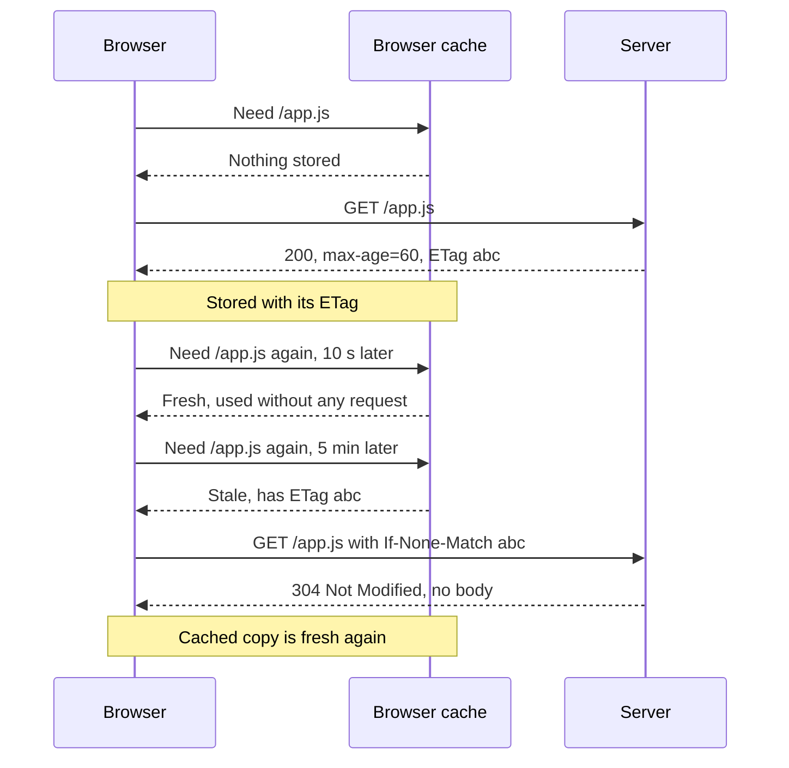

<Info>

**In short:** the fastest byte is the one never sent. Servers make the bytes
smaller (compression, minification, better image formats) and browsers avoid
asking again (caches). Both are invisible when they work, and they are a top
reason for "it fails only on CI" bugs: a test reads an old script or an old
answer that a cache kept. seleniumbase-rs can clear the cache, and can turn it
off with the DevTools command `Network.setCacheDisabled`.

</Info>

## Making the bytes smaller

### Compression

Text compresses very well. The browser and the server agree on a method in the
request and the response (see [network](/concepts/network) for the headers in
general):

```http
GET /app.js HTTP/2
Accept-Encoding: gzip, deflate, br, zstd

HTTP/2 200
Content-Type: text/javascript
Content-Encoding: br
Vary: Accept-Encoding
```

`Accept-Encoding` lists what the browser can unpack. The server picks one, says
so in `Content-Encoding`, and sends the compressed bytes. `Vary: Accept-Encoding`
tells caches that the answer depends on that header, so a client that cannot
read Brotli is not handed Brotli. The browser unpacks the body before the page,
or a test, ever sees it.

| Method | Header value | Notes |
|---|---|---|
| gzip | `gzip` | Works everywhere. The safe default |
| Brotli | `br` | Usually smaller than gzip for text, especially when compressed ahead of time. Browsers use it on HTTPS only |
| zstd | `zstd` | Very fast to compress, so good for answers made on the fly. Newer, supported by recent Chromium versions |

Compression helps **text**: HTML, CSS, JavaScript, JSON, SVG. It does nothing
for JPEG, PNG, WebP, MP4 or fonts such as WOFF2, which are already compressed.
In the browser's network panel, the **transferred** size is what crossed the
wire and the **resource** size is the size after unpacking.

### Minification and bundling

**Minifying** rewrites code to be smaller with the same behaviour: whitespace and
comments go, local names become one letter. A **bundler** joins many modules
into a few files and drops unused code ("tree shaking"). A **source map** keeps
the way back to the original, so a stack trace in a minified file still points at
the real line. This is why the script you read in the browser looks unreadable,
and why class names such as `css-1x2y3z` change on every build (see
[frameworks and the DOM](/concepts/frameworks-and-the-dom)).

### Images

Images are usually the biggest part of a page.

| Format | Best for | Note |
|---|---|---|
| JPEG | Photos | Lossy, no transparency |
| PNG | Screenshots, sharp edges, transparency | Lossless, large for photos |
| WebP | Photos and graphics | Smaller than JPEG and PNG, supported everywhere current |
| AVIF | Photos | Often smallest, slower to encode |
| SVG | Icons, logos, diagrams | Text, so it scales and compresses well |
| GIF | Avoid for animation | Huge; use a video |

The `srcset` and `sizes` attributes let the browser pick the file that fits the
screen and the pixel density (see [mobile web](/concepts/mobile-web)), and
`loading="lazy"` delays images below the fold until they are about to scroll
into view.

## Not asking again: HTTP caching

When the server sends a file, it can say how long it may be reused. The browser
keeps a copy on disk (and in memory) and, on the next visit, may skip the
request.

### Cache-Control

| Directive | Meaning |
|---|---|
| `max-age=3600` | Fresh for 3600 seconds. Use it without asking the server |
| `no-cache` | May be **stored**, but must be **checked** with the server before every use |
| `no-store` | Do not keep it at all (for private data) |
| `public` / `private` | A shared cache (CDN, proxy) may or may not keep it |
| `s-maxage=600` | Like `max-age`, but for shared caches only |
| `immutable` | It will never change; do not even check on a reload |
| `stale-while-revalidate=60` | After expiry, show the old copy for a while and refresh in the background |

`no-cache` is badly named: it does not mean "do not cache".

### Revalidation

A copy that is no longer fresh is not always thrown away. The browser asks the
server whether it changed, using a **validator** it saved with the file:

- `ETag`, an identifier of the content, comes back as `If-None-Match`.
- `Last-Modified`, a date, comes back as `If-Modified-Since`.

If nothing changed, the server answers `304 Not Modified` with no body, which is
tiny. Otherwise it answers `200` with the new file.



*One file over time: fetched, reused, then revalidated.*

Without any `Cache-Control`, browsers guess ("heuristic freshness"), typically a
fraction of the time since `Last-Modified`. That guess is a classic source of
stale content, so servers should always send an explicit policy.

## Caches in layers

A request can be answered at many levels before it reaches the origin server.

| Layer | Where | Typical lifetime | Controlled by |
|---|---|---|---|
| Memory and disk cache | In the browser | Hours to a year | `Cache-Control`, validators |
| Back/forward cache | In the browser, the whole page frozen in memory | Until the tab moves on | The browser; a page with `unload` handlers or `no-store` may be excluded |
| Service worker and the Cache API | A script on the page that answers requests itself | Until the script deletes it | The site's JavaScript |
| CDN or edge cache | A server near the user | Seconds to days | `s-maxage`, the CDN's own rules, purges |
| Reverse proxy and application cache | In front of or inside the origin | Short | The operator |

A **service worker** is the layer that surprises people most. It can answer a
page from its own cache even when the network is fine, and it keeps doing so
across reloads until a new version of it is installed and activated (see
[sessions and state](/concepts/sessions-and-state) for what else lives in the
browser). A **CDN** can serve yesterday's file from a server in another country
while the origin already has today's. Headers such as `Age` and vendor headers
like `X-Cache` show that a copy came from a cache.

## Cache busting

A long cache lifetime is good for speed and bad for updates. The standard answer
is to put a **fingerprint of the content into the file name**:

```text
/assets/app.3f9a1c.js     Cache-Control: public, max-age=31536000, immutable
/index.html               Cache-Control: no-cache
```

When the code changes, the name changes, so the browser fetches the new file at
once, and the old one can stay cached for a year without harm. The HTML that
names the files must be checked every time (`no-cache`), or it would keep pointing
at old names. A query string (`app.js?v=2`) works with most caches, but some
proxies ignore it.

## Stale content in tests

A cache never lies on purpose, but a test can believe it. Typical symptoms:

- A deploy shipped a fix, yet the test still hits the **old bundle**.
- An API answer is **stale** because a CDN or the browser reuses it.
- A **service worker** from an earlier test keeps serving the old app shell.
- It passes in a clean browser and fails with a reused profile, or the other way
  round.
- It works in a private window and fails in the normal one.

<Tip>

Start from a clean state. A new, empty browser profile has an empty cache, so
every run begins as a first visit. Reusing a profile (to keep a login, for
instance) also keeps its caches and service workers. When a test is odd, look at
the response headers first: is the file fresh from the origin, a `304`, or "from
memory cache" or "from service worker"?

</Tip>

Clearing is not the same as disabling. **Clearing** the cache empties it once.
**Disabling** the cache makes the browser fetch everything fresh for as long as
the setting lasts. Chrome's "Disable cache" checkbox in DevTools does the second,
but only while DevTools is open. Automation does the same through the
[DevTools Protocol](/concepts/cdp): `Network.setCacheDisabled` with
`cacheDisabled: true` turns the cache off for that tab's session, and
`Network.setBypassServiceWorker` sends requests past service workers.

<Warning>

A test with the cache off measures a slower page than any real visitor has, and
hides bugs in the cache behaviour itself (a file that is never revalidated, an
`immutable` that should not be). Disable the cache to make a test deterministic,
and keep a few tests with the real cache for performance and cache-header checks
(see [rendering and performance](/concepts/rendering-and-performance)).

</Warning>

## How seleniumbase-rs uses it

The library does not decide cache policy; it gives you the browser's controls.

- **Clear it.** `BaseCase::clear_browser_cache()` clears the browser cache through
  the DevTools Protocol. `clear_browser_cookies()` clears cookies, which are a
  separate store.
- **Disable it.** Send the command by name: `BaseCase::execute_cdp_with_params`
  on the WebDriver engine, `Page::execute` on the pure CDP engine, or the
  command line.

<Tabs>

<Tab title="WebDriver engine" icon="plug">

```rust,ignore src/main.rs
use serde_json::json;

sb.clear_browser_cache().await?;
sb.execute_cdp_with_params("Network.setCacheDisabled", json!({ "cacheDisabled": true }))
    .await?;
sb.open("https://example.com/").await?;
```

</Tab>

<Tab title="Pure CDP engine" icon="bolt">

```rust,ignore src/main.rs
use serde_json::json;

page.execute("Network.setCacheDisabled", json!({ "cacheDisabled": true }))
    .await?;
page.execute("Network.setBypassServiceWorker", json!({ "bypass": true }))
    .await?;
page.goto("https://example.com/").await?;
```

</Tab>

<Tab title="Command line" icon="terminal">

```bash
sbrs --cdp cdp --cmd Network.setCacheDisabled --params '{"cacheDisabled":true}'
```

</Tab>

</Tabs>

- **Look at the headers.** Interception and HAR recording show the headers and
  sizes of every request, including `Cache-Control`, `ETag` and
  `Content-Encoding`. See [network](/concepts/network).
- **Compression is invisible to a test.** The browser unpacks `gzip`, `br` and
  `zstd` before a script or a locator reads the page, so assertions never see
  compressed bytes.

<Note>

`Network.setCacheDisabled` is a DevTools command, so it works on Chromium
browsers. A cached response is also per browser profile: a second browser
launched with a different profile does not share it.

</Note>

## Where to go next

<Columns cols={2}>

<Card title="Network" icon="network-wired" color="#a631be" href="/concepts/network">
  Requests, headers, interception and HAR recording.
</Card>

<Card title="Sessions and state" icon="cookie-bite" color="#d47628" href="/concepts/sessions-and-state">
  Cookies, storage and the other data a browser keeps.
</Card>

<Card title="The DevTools Protocol" icon="bolt" color="#1a85d4" href="/concepts/cdp">
  How commands such as Network.setCacheDisabled are sent.
</Card>

<Card title="Rendering and performance" icon="gauge-high" color="#199f43" href="/concepts/rendering-and-performance">
  What smaller and fewer files buy in load time.
</Card>

</Columns>
