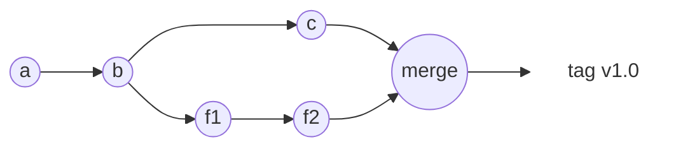
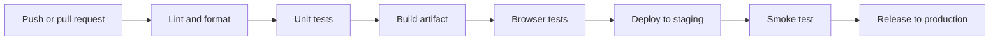
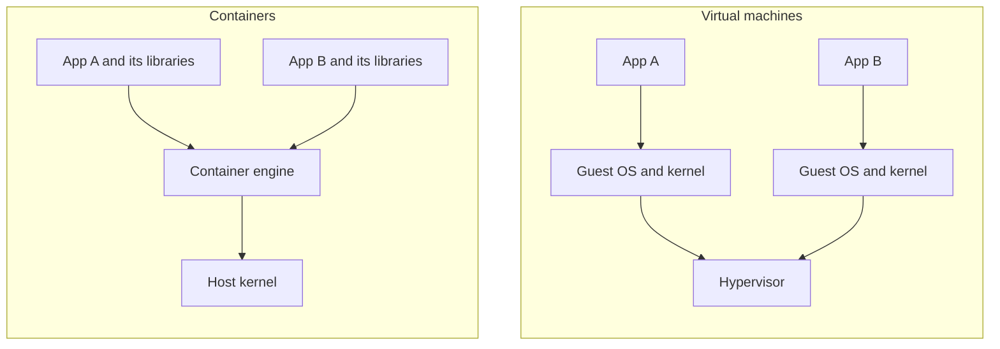
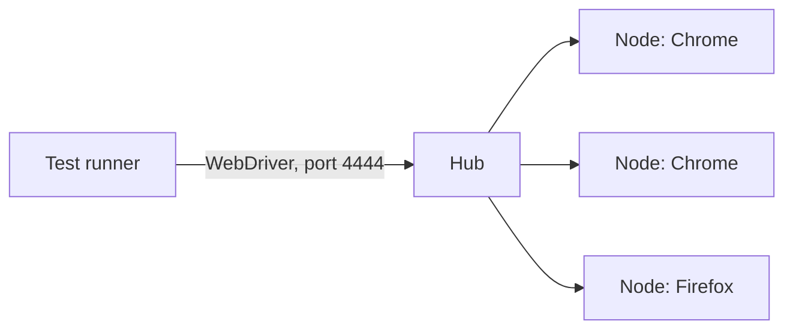

<Info>

**In short:** Git records every change to the code. A CI system (continuous
integration) builds and tests each change automatically, and a CD system
(continuous delivery or deployment) moves the tested result to servers or to
users. A **container** is a normal process that runs in its own small world, and
an **image** is the packaged recipe for that world: because it carries the
operating system libraries with it, a test that runs in a container behaves the
same on your laptop, on a colleague's machine and in CI, as long as you respect
a few rules that browsers need. Browser tests are one of the checks in that
chain, and they behave best when the chain is predictable.

</Info>

## Git in five ideas

**Git** is a version control system: it keeps the history of a project and lets
many people change it at once.

- A **commit** is a snapshot of all files plus a message and the identity of the
  parent commit. Its id is a hash of its content, so history cannot be changed
  without every later id changing.
- A **branch** is a movable name for a commit. Work on a feature happens on its
  own branch, so `main` stays working.
- A **merge** joins two branches. A **fast-forward** merge just moves a name
  ahead when there is nothing to combine; a **rebase** replays your commits on
  top of a newer base.
- A **remote** is a copy of the repository on another machine, usually called
  `origin`. You **fetch** to learn what is new, and **push** to publish.
- A **tag** is a permanent name for one commit, such as `v0.6.0`. Releases are
  tags.



*Two lines of work, `main` along the top and a feature branch below, joined by a
merge and then tagged.*

| Task | Command |
|---|---|
| See what changed | `git status`, `git diff` |
| Start a branch | `git switch -c fix-login` |
| Save work | `git add FILE`, then `git commit -m "fix(login): ..."` |
| Get the news | `git fetch origin` |
| Update `main` safely | `git merge --ff-only origin/main` |
| Publish | `git push origin fix-login` |
| Read history | `git log --oneline` |

Good habits make the history useful: commits that are **small and about one
thing**, messages in a fixed style such as *Conventional Commits*
(`feat(browser): ...`, `fix(cli): ...`, `docs: ...`), a **pull request** for
review before a branch reaches `main`, and a rule never to rewrite history that
others have already pulled. Secrets such as passwords and tokens never go into a
commit: once pushed, they must be treated as leaked even after deletion.

**Versions** usually follow *semantic versioning*, `MAJOR.MINOR.PATCH`: a patch
fixes bugs, a minor adds features, and a major may break users' code. While the
major number is 0, as for this project, the minor number is allowed to break
things. A **changelog** lists what changed in each version for humans.

## Continuous integration

**Continuous integration (CI)** means that every push or pull request is built
and tested by a machine, so a mistake shows up within minutes instead of at
release time. **Continuous delivery** adds a pipeline that keeps the result ready
to release; **continuous deployment** goes further and releases every passing
change by itself.



*A typical pipeline. Each stage must pass before the next starts.*

### GitHub Actions as the example

GitHub Actions is the CI system built into GitHub. A **workflow** is a YAML file
in `.github/workflows/`. Its words:

- **Event** (`on:`): what starts it, such as `push`, `pull_request` or a
  `schedule` in cron syntax.
- **Job**: a group of steps that runs on one fresh machine. Jobs run in parallel
  unless one lists another under `needs`.
- **Runner** (`runs-on`): the machine, such as `ubuntu-latest`, `macos-latest`
  or `windows-latest`.
- **Step**: one command (`run`) or one reusable **action** (`uses`).
- **Matrix**: the same job repeated for each combination, such as three
  operating systems.
- **Cache** and **artifact**: a cache keeps downloads for the next run; an
  artifact keeps a result, such as screenshots, after the machine is gone.
- **Secret**: a stored value, such as a token, handed to the job as an
  environment variable and hidden in logs.

```yaml
name: CI
on:
  push:
    branches: [main]
  pull_request:
jobs:
  browser-tests:
    runs-on: ubuntu-latest
    steps:
      - uses: actions/checkout@v4
      - run: google-chrome --version
      - run: cargo test -- --ignored
      - uses: actions/upload-artifact@v4
        if: failure()
        with:
          name: screenshots
          path: artifacts/
```

## Containers and virtual machines

A **virtual machine** (VM) pretends to be a whole computer. It boots its own
operating system kernel on emulated hardware. A **container** does not boot
anything: it is an ordinary process of the host, which the Linux kernel isolates
with two features, **namespaces** (what the process can see) and **cgroups**
(how much CPU and memory it may use).



*Virtual machines carry a kernel each. Containers share the host's kernel.*

| | Virtual machine | Container |
|---|---|---|
| Start time | Tens of seconds | A fraction of a second |
| Size | Gigabytes | Megabytes to a few hundred megabytes |
| Isolation | Strong: separate kernel | Good, but one kernel is shared |
| Runs | Any operating system | Programs for the host's kernel type |

On macOS and Windows a container needs a Linux kernel, so the tools (Docker
Desktop, OrbStack) run one small Linux VM and put the containers inside it.

## Images, layers and registries

An **image** is a read-only package of files plus the command to start. It is
built from **layers**: each step of a build adds a layer that records the files
it changed. Layers are identified by a hash of their content, so two images that
begin the same way share those layers on disk and in downloads, and a build
re-uses every layer whose inputs did not change.

When a container starts, the engine puts a thin **writable layer** on top of the
image. Whatever the program writes lands there and **disappears when the
container is removed**. Data that must stay goes into a **volume** or a folder
mounted from the host.

A **registry** stores images. Docker Hub is the default; GitHub Container
Registry (`ghcr.io`) and cloud providers have their own. An image name looks like
`registry/owner/name:tag`. A **tag** such as `1.4` or `latest` is a movable
label; the **digest** (`sha256:...`) names exact content and never changes, so a
pinned digest is the reproducible choice.

## The Dockerfile

A **Dockerfile** is the recipe. Each instruction makes one layer:

```dockerfile
# The base image.
FROM debian:bookworm-slim
# Run a command at build time.
RUN apt-get update && apt-get install -y --no-install-recommends chromium \
    && rm -rf /var/lib/apt/lists/*
WORKDIR /home/app
# Copy a file from the build folder.
COPY run-tests.sh .
# An environment variable.
ENV SB_HEADLESS=true
# Do not run as root.
USER nobody
# The program of the container, and its default arguments.
ENTRYPOINT ["./run-tests.sh"]
CMD ["--all"]
```

Two habits matter for fast builds. **Order by change:** put what changes rarely
(dependencies) before what changes often (your source), so the cache stays
valid. **Use multi-stage builds:** build in a large image full of compilers, then
copy only the result into a small runtime image, so compilers never ship.

The commands you will use most:

```bash
docker build -t myapp .                       # build an image from ./Dockerfile
docker run --rm -p 8080:80 -v "$PWD":/data myapp   # run, map a port, mount a folder
docker ps                                     # running containers
docker logs CONTAINER                         # what the program printed
docker exec -it CONTAINER sh                  # a shell inside a running one
```

`-p 8080:80` maps port 8080 of the host to port 80 of the container, because
the container's network is otherwise private (see
[TCP and sockets](/concepts/network#addresses-and-ports)).

## Compose: several containers together

A real test setup has several parts: the application, its database and the
browser. **Docker Compose** describes them in a `compose.yaml` file and starts
them together on a private network, where each service can reach the others
**by its service name**.

```yaml
services:
  web:
    build: .
    ports: ["3000:3000"]
  db:
    image: postgres:16
    environment:
      POSTGRES_PASSWORD: test-only
    healthcheck:
      test: ["CMD", "pg_isready"]
  tests:
    image: my-test-runner
    depends_on:
      db:
        condition: service_healthy
    environment:
      BASE_URL: http://web:3000      # the name "web" is the other container
```

`docker compose up --abort-on-container-exit` runs the whole set and stops when
the tests finish. The `healthcheck` matters: `depends_on` alone waits for the
container to *start*, not for the database inside it to be *ready*.

## A little Kubernetes

Compose runs containers on one machine. **Kubernetes** runs them on many. You
describe the state you want ("three copies of this image, reachable on port 80")
and Kubernetes keeps it true. Its main words are **pod** (one or more containers
that run together), **deployment** (the wish for a number of identical pods, with
rolling updates), **service** (a stable address in front of changing pods) and
**node** (a machine in the cluster). For testing, its main use is to run a large
[Selenium Grid](#selenium-grid-images) that starts browsers on demand.

## Environments and deployment

Code passes through **environments**, copies of the system that differ in
purpose: **development** (your machine), **staging** or *pre-production* (a copy
that looks like production, for the last checks) and **production** (the real
one). They should be as similar as possible; what differs, such as addresses
and keys, is kept in **configuration** (environment variables or secret stores)
and never written into the code. Many teams also create a short-lived **preview
environment** for each pull request.

A **deployment strategy** says how a new version replaces the old one.

| Strategy | How it works | Good | Watch out for |
|---|---|---|---|
| **Recreate** | Stop the old version, start the new | Simplest | Downtime |
| **Rolling** | Replace servers a few at a time | No downtime, little extra cost | Old and new run together for a while |
| **Blue-green** | Run the new version (green) beside the old (blue), then switch the traffic at once | Instant switch and instant rollback | Twice the servers during the switch |
| **Canary** | Send a small share of users (say 5 percent) to the new version, watch, then widen | Limits the damage of a bad release | Needs good monitoring |
| **Feature flag** | Ship the code switched off, turn it on later or for some users | Separates deploy from release | Old flags must be removed |

Whatever the strategy, plan the **rollback**: how to return to the last good
version, and whether a database change can be undone. Changes to a database
schema should be written so that both the old and the new code can use them
during the rollout.

## Browsers in containers

Chrome was made for a desktop with a display, plenty of shared memory and a
logged-in user. A container takes all four away, and each gap has a known fix.

| Problem | Why it happens | Fix |
|---|---|---|
| Tabs crash with "Aw, Snap" | `/dev/shm`, the shared memory Chrome uses between its processes, is only 64 MB in a container | `--shm-size=1g` on `docker run`, or the Chrome flag `--disable-dev-shm-usage`, which uses `/tmp` and is slower |
| "No usable sandbox" | Chrome's sandbox needs kernel features that the default container profile blocks, and it refuses to run as root | `--no-sandbox`, or run as non-root with a security profile that allows user namespaces |
| Text is boxes, layouts differ | Slim images have no fonts | Install a font package, such as `fonts-liberation` or `fonts-noto` |
| "Cannot open display" | The container has no screen | Run headless, or start a virtual display (Xvfb) for a headed browser |
| Slow or odd rendering | No GPU | Chrome falls back to software rendering; add `--disable-gpu` if it complains |
| Leftover processes | The first process of a container does not collect finished children | `docker run --init` |
| Time and language differ | Images default to UTC and a generic locale | Set `TZ` and the locale, or emulate them in the browser |

<Warning>

`--no-sandbox` removes a security layer. It is acceptable for a short-lived
container that only opens pages you trust, such as your own application. Do not
use it to browse the open web, and do not turn it on in a browser that also holds
real logins.

</Warning>

Fonts also decide what a **screenshot** looks like, so compare screenshots only
between runs in the same image.

## Selenium Grid images

The Selenium project publishes ready-made images for browsers. Their usual
shape:

- `selenium/standalone-chrome` has the browser, the driver and a Grid in one
  container. It listens for [WebDriver](/concepts/webdriver) on port 4444, and
  on port 7900 it serves a web viewer, so you can watch the browser.
- `selenium/hub` plus one or more `selenium/node-chrome` containers form a real
  Grid: tests talk to the hub, and the hub hands each new session to a node.



*A test asks the hub for a browser and gets one from a free node.*

```bash
docker run --rm -p 4444:4444 -p 7900:7900 --shm-size=2g selenium/standalone-chrome
```

Give every browser container enough shared memory, or its tabs will crash under
load, exactly as in the table above.

## Where browser tests run

Browser tests are slower and less stable than unit tests, so they get their own
place in the pipeline.

1. **On every pull request**: a small set of *smoke tests* that open the key
   pages and check they work. Keep this under a few minutes.
2. **Nightly**: the full end-to-end suite, on a schedule, since it takes too long
   for every push.
3. **After a deployment**: a few read-only checks against staging or production
   to prove the release is alive.

Practical points:

- GitHub-hosted Linux runners already have Chrome and chromedriver installed;
  elsewhere, use a [container](#browsers-in-containers) with the browser in it.
- A CI machine has no screen, so run the browser **headless**.
- Save **screenshots, page source and console logs** as artifacts when a test
  fails, because you cannot attach a debugger to a machine that is gone (see
  [developer tools](/concepts/cdp#opening-the-tools)).
- Keep tests independent so they can run in parallel, and treat a retry as a
  warning about a flaky test, not as a cure.
- Make a test wait for a condition rather than for a fixed time; CI machines are
  slower than yours.

<Warning>

Tests that run against production must not change real data. Use read-only
checks or a dedicated test account, and never place real credentials in the
repository. Pass them as secrets.

</Warning>

## How seleniumbase-rs uses it

### The Dockerfile and container images

The repository has a **`Dockerfile`** at its root, and it shows the pattern in
practice.

- **Two stages.** The first stage, `rust:1.99-bookworm`, compiles the `sbrs`
  binary with `cargo build --release --locked`. It copies the manifests first and
  builds the dependencies from a skeleton, so the dependency layer is cached until
  `Cargo.toml` changes. The second stage, `debian:bookworm-slim`, receives only
  the finished binary.
- **What the runtime image holds.** `chromium`, `chromium-driver` and
  `ca-certificates`. Chromium is all the pure CDP engine needs; the driver is for
  the WebDriver engine. The driver is linked into `downloaded_drivers`, so the
  image needs no network to start a browser.
- **Non-root, no port.** The image creates a user `sbrs` and runs as it. Nothing
  inside listens on a port, so there is no `EXPOSE`. The entry point is `sbrs`
  with `--help` as the default argument.

```bash
docker build -t seleniumbase-rs .
docker run --rm seleniumbase-rs --help
```

For a browser run, the table above applies. The pure CDP launcher has
`LaunchOptionsBuilder::no_sandbox(true)`, and it is switched on by the
`SB_NO_SANDBOX` environment variable too, which suits a container where the
sandbox cannot start. Pass `--shm-size` to `docker run` for the shared memory.

`docker/verify-linux.sh` is a second example: the script used to run this
project's tests in a Linux container. Its notes record the settings that were
needed: `--shm-size=1g`, a memory limit, `SB_NO_SANDBOX=1`, `CI=true`, and, for
a test that needs a headed browser, `SBRS_XVFB=1`, which starts an Xvfb virtual
display before the command runs.

For a Selenium Grid, the library has the client side in
`utilities::selenium_grid`: `GridUrl` parses and writes a Grid address,
`GridStatus` reads the Grid's `/status` reply, and `wait_until_ready` polls it,
which helps when a Compose file starts the hub and the tests together. The
address goes into `BrowserConfig::with_webdriver_url`.

```rust,ignore src/main.rs
use seleniumbase_rs::utilities::selenium_grid::GridUrl;
use seleniumbase_rs::BrowserConfig;

let grid: GridUrl = "localhost".parse()?;      // becomes http://localhost:4444
let config = BrowserConfig::default().with_webdriver_url(grid.to_string());
```

<Tip>

Inside Compose, the grid is reached by its service name, for example
`http://selenium-hub:4444`, not by `localhost`. Pass it to the tests with an
environment variable.

</Tip>

### CI and releases

**CI.** The workflow `.github/workflows/ci.yml` runs on every push and pull
request to `main` (or `master`), and also every day at 06:00 UTC. A
`concurrency` setting cancels an older run of the same branch when a newer push
arrives. Its jobs:

| Job | What it checks |
|---|---|
| `browser-smoke` | On Ubuntu, with the Chrome and chromedriver that the runner has installed, runs the real-browser tests of the `browser_smoke` test binary (`cargo test -p seleniumbase-rs --test browser_smoke -- --ignored`) |
| `check` | A matrix of Ubuntu, macOS and Windows with several feature sets: build, test, `clippy -D warnings` and `cargo fmt --check` |
| `library` | The library alone with its default features, and the command line without its default features. It also fails if a command-line crate sneaks into the library's dependencies |
| `msrv` | Compiles with Rust 1.99, the version declared in `Cargo.toml` and used in the Dockerfile |
| `tauri-example` | Builds and tests the example that has its own manifest |
| `supply-chain` | `cargo-deny`: advisories, licenses, bans and sources |
| `docs` | Builds the documentation with `mdbook`; only a push to `main` publishes it to GitHub Pages |

The real-browser tests are marked `#[ignore]`, so a plain `cargo test` stays
fast and needs no browser; the CI job (and a developer, one test binary at a time)
asks for them with `--ignored`. There are also workflows for the Docker image
(`docker.yml`) and the shell completions (`completions.yml`).

**Releases.** The steps are in `docs/contributing/releasing.md`. They are done
**by hand** from `main` at the moment, because GitHub Actions cannot run for the
repository (a billing limit), so no workflow builds the release binaries:

<Steps>

<Step title="Start from a current main" icon="code-branch">

`git fetch`, then a fast-forward-only merge of `origin/main`.

</Step>

<Step title="Set the version and close the changelog" icon="tag">

`cargo set-version` changes both packages; the `[Unreleased]` block of the
changelog becomes the new version, and generated files (the CLI completions, the
API index and the parity tables) are written again. One commit, titled
`chore(release): X.Y.Z`.

</Step>

<Step title="Gate the exact commit" icon="shield-halved">

The same checks as CI, run locally: `cargo fmt --check`, `clippy -D warnings`,
`cargo nextest run`, the doc tests, `cargo audit` and `cargo deny check`,
`trufflehog` and `ripsecrets` for secrets, `just mdx` and `mdbook build`.

</Step>

<Step title="Publish and tag" icon="upload">

Check that `origin/main` is an ancestor of the commit, push **that commit** to
`main` with no force, and push an annotated tag `vX.Y.Z`.

</Step>

<Step title="Build, release, distribute" icon="box">

Build the macOS arm64 binary, create the GitHub release with `gh release create`
and the changelog block as notes, and update the Homebrew formula in the tap
repository with the new source archive and its SHA-256. Other platforms install
from source with `cargo install --git ... --tag vX.Y.Z`.

</Step>

</Steps>

The idea is the one from the pipeline above: one commit goes through the gate,
and **that same commit** is tagged, built and published, so what users receive is
what was tested.

<Note>

The library has no API for CI or Git; it is a thing that CI runs. What it offers
for CI is a choice of headless runs, screenshots and page sources for failure
artifacts, and a container image (see [the Dockerfile](#the-dockerfile-and-container-images)).

</Note>

## Where to go next

<Columns cols={2}>

<Card title="The DevTools Protocol" icon="wrench" href="/concepts/cdp">
  Inspecting a failure once you have its logs.
</Card>

<Card title="Browser architecture" icon="sitemap" href="/concepts/browser-architecture">
  Why a browser needs memory and how headless differs.
</Card>

<Card title="WebDriver" icon="plug" href="/concepts/webdriver">
  The protocol a Grid speaks, and how drivers are found.
</Card>

<Card title="Telemetry and observability" icon="chart-line" color="#199f43" href="/concepts/telemetry-and-observability">
  The logs, metrics and traces that a failed run leaves behind.
</Card>

</Columns>
