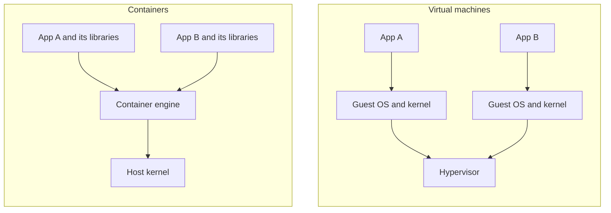
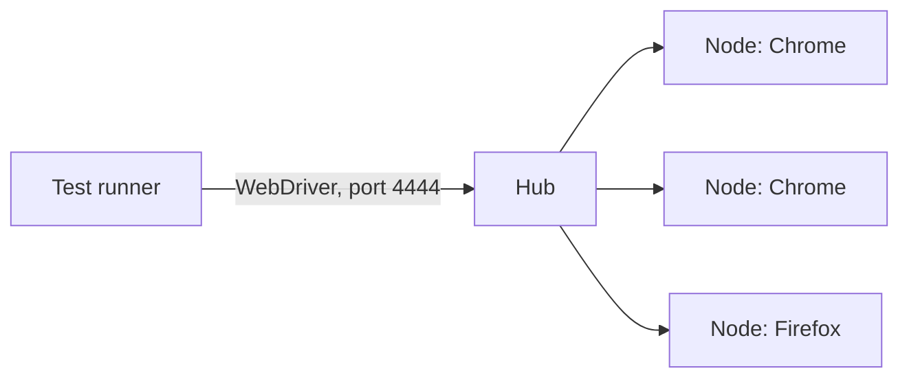

<Info>

**In short:** a container is a normal process that runs in its own small
world: its own files, its own network and its own view of the process list. An
**image** is the packaged recipe for that world. Because the image carries the
operating system libraries with it, a test that runs in a container behaves the
same on your laptop, on a colleague's machine and in CI, as long as you respect
a few rules that browsers need.

</Info>

## Containers and virtual machines

A **virtual machine** (VM) pretends to be a whole computer. It boots its own
operating system kernel on emulated hardware. A **container** does not boot
anything: it is an ordinary process of the host, which the Linux kernel isolates
with two features, **namespaces** (what the process can see) and **cgroups**
(how much CPU and memory it may use).



*Virtual machines carry a kernel each. Containers share the host's kernel.*

| | Virtual machine | Container |
|---|---|---|
| Start time | Tens of seconds | A fraction of a second |
| Size | Gigabytes | Megabytes to a few hundred megabytes |
| Isolation | Strong: separate kernel | Good, but one kernel is shared |
| Runs | Any operating system | Programs for the host's kernel type |

On macOS and Windows a container needs a Linux kernel, so the tools (Docker
Desktop, OrbStack) run one small Linux VM and put the containers inside it.

## Images, layers and registries

An **image** is a read-only package of files plus the command to start. It is
built from **layers**: each step of a build adds a layer that records the files
it changed. Layers are identified by a hash of their content, so two images that
begin the same way share those layers on disk and in downloads, and a build
re-uses every layer whose inputs did not change.

When a container starts, the engine puts a thin **writable layer** on top of the
image. Whatever the program writes lands there and **disappears when the
container is removed**. Data that must stay goes into a **volume** or a folder
mounted from the host.

A **registry** stores images. Docker Hub is the default; GitHub Container
Registry (`ghcr.io`) and cloud providers have their own. An image name looks like
`registry/owner/name:tag`. A **tag** such as `1.4` or `latest` is a movable
label; the **digest** (`sha256:...`) names exact content and never changes, so a
pinned digest is the reproducible choice.

## The Dockerfile

A **Dockerfile** is the recipe. Each instruction makes one layer:

```dockerfile
# The base image.
FROM debian:bookworm-slim
# Run a command at build time.
RUN apt-get update && apt-get install -y --no-install-recommends chromium \
    && rm -rf /var/lib/apt/lists/*
WORKDIR /home/app
# Copy a file from the build folder.
COPY run-tests.sh .
# An environment variable.
ENV SB_HEADLESS=true
# Do not run as root.
USER nobody
# The program of the container, and its default arguments.
ENTRYPOINT ["./run-tests.sh"]
CMD ["--all"]
```

Two habits matter for fast builds. **Order by change:** put what changes rarely
(dependencies) before what changes often (your source), so the cache stays
valid. **Use multi-stage builds:** build in a large image full of compilers, then
copy only the result into a small runtime image, so compilers never ship.

The commands you will use most:

```bash
docker build -t myapp .                       # build an image from ./Dockerfile
docker run --rm -p 8080:80 -v "$PWD":/data myapp   # run, map a port, mount a folder
docker ps                                     # running containers
docker logs CONTAINER                         # what the program printed
docker exec -it CONTAINER sh                  # a shell inside a running one
```

`-p 8080:80` maps port 8080 of the host to port 80 of the container, because
the container's network is otherwise private (see
[TCP and sockets](/concepts/tcp-and-streams)).

## Compose: several containers together

A real test setup has several parts: the application, its database and the
browser. **Docker Compose** describes them in a `compose.yaml` file and starts
them together on a private network, where each service can reach the others
**by its service name**.

```yaml
services:
  web:
    build: .
    ports: ["3000:3000"]
  db:
    image: postgres:16
    environment:
      POSTGRES_PASSWORD: test-only
    healthcheck:
      test: ["CMD", "pg_isready"]
  tests:
    image: my-test-runner
    depends_on:
      db:
        condition: service_healthy
    environment:
      BASE_URL: http://web:3000      # the name "web" is the other container
```

`docker compose up --abort-on-container-exit` runs the whole set and stops when
the tests finish. The `healthcheck` matters: `depends_on` alone waits for the
container to *start*, not for the database inside it to be *ready*.

## A little Kubernetes

Compose runs containers on one machine. **Kubernetes** runs them on many. You
describe the state you want ("three copies of this image, reachable on port 80")
and Kubernetes keeps it true. Its main words are **pod** (one or more containers
that run together), **deployment** (the wish for a number of identical pods, with
rolling updates), **service** (a stable address in front of changing pods) and
**node** (a machine in the cluster). For testing, its main use is to run a large
[Selenium Grid](#selenium-grid-images) that starts browsers on demand.

## Browsers in containers

Chrome was made for a desktop with a display, plenty of shared memory and a
logged-in user. A container takes all four away, and each gap has a known fix.

| Problem | Why it happens | Fix |
|---|---|---|
| Tabs crash with "Aw, Snap" | `/dev/shm`, the shared memory Chrome uses between its processes, is only 64 MB in a container | `--shm-size=1g` on `docker run`, or the Chrome flag `--disable-dev-shm-usage`, which uses `/tmp` and is slower |
| "No usable sandbox" | Chrome's sandbox needs kernel features that the default container profile blocks, and it refuses to run as root | `--no-sandbox`, or run as non-root with a security profile that allows user namespaces |
| Text is boxes, layouts differ | Slim images have no fonts | Install a font package, such as `fonts-liberation` or `fonts-noto` |
| "Cannot open display" | The container has no screen | Run headless, or start a virtual display (Xvfb) for a headed browser |
| Slow or odd rendering | No GPU | Chrome falls back to software rendering; add `--disable-gpu` if it complains |
| Leftover processes | The first process of a container does not collect finished children | `docker run --init` |
| Time and language differ | Images default to UTC and a generic locale | Set `TZ` and the locale, or emulate them in the browser |

<Warning>

`--no-sandbox` removes a security layer. It is acceptable for a short-lived
container that only opens pages you trust, such as your own application. Do not
use it to browse the open web, and do not turn it on in a browser that also holds
real logins.

</Warning>

Fonts also decide what a **screenshot** looks like, so compare screenshots only
between runs in the same image.

## Selenium Grid images

The Selenium project publishes ready-made images for browsers. Their usual
shape:

- `selenium/standalone-chrome` has the browser, the driver and a Grid in one
  container. It listens for [WebDriver](/concepts/webdriver) on port 4444, and
  on port 7900 it serves a web viewer, so you can watch the browser.
- `selenium/hub` plus one or more `selenium/node-chrome` containers form a real
  Grid: tests talk to the hub, and the hub hands each new session to a node.



*A test asks the hub for a browser and gets one from a free node.*

```bash
docker run --rm -p 4444:4444 -p 7900:7900 --shm-size=2g selenium/standalone-chrome
```

Give every browser container enough shared memory, or its tabs will crash under
load, exactly as in the table above.

## How seleniumbase-rs uses it

The repository has a **`Dockerfile`** at its root, and it shows the pattern in
practice.

- **Two stages.** The first stage, `rust:1.99-bookworm`, compiles the `sbrs`
  binary with `cargo build --release --locked`. It copies the manifests first and
  builds the dependencies from a skeleton, so the dependency layer is cached until
  `Cargo.toml` changes. The second stage, `debian:bookworm-slim`, receives only
  the finished binary.
- **What the runtime image holds.** `chromium`, `chromium-driver` and
  `ca-certificates`. Chromium is all the pure CDP engine needs; the driver is for
  the WebDriver engine. The driver is linked into `downloaded_drivers`, so the
  image needs no network to start a browser.
- **Non-root, no port.** The image creates a user `sbrs` and runs as it. Nothing
  inside listens on a port, so there is no `EXPOSE`. The entry point is `sbrs`
  with `--help` as the default argument.

```bash
docker build -t seleniumbase-rs .
docker run --rm seleniumbase-rs --help
```

For a browser run, the table above applies. The pure CDP launcher has
`LaunchOptionsBuilder::no_sandbox(true)`, and it is switched on by the
`SB_NO_SANDBOX` environment variable too, which suits a container where the
sandbox cannot start. Pass `--shm-size` to `docker run` for the shared memory.

`docker/verify-linux.sh` is a second example: the script used to run this
project's tests in a Linux container. Its notes record the settings that were
needed: `--shm-size=1g`, a memory limit, `SB_NO_SANDBOX=1`, `CI=true`, and, for
a test that needs a headed browser, `SBRS_XVFB=1`, which starts an Xvfb virtual
display before the command runs.

For a Selenium Grid, the library has the client side in
`utilities::selenium_grid`: `GridUrl` parses and writes a Grid address,
`GridStatus` reads the Grid's `/status` reply, and `wait_until_ready` polls it,
which helps when a Compose file starts the hub and the tests together. The
address goes into `BrowserConfig::with_webdriver_url`.

```rust,ignore src/main.rs
use seleniumbase_rs::utilities::selenium_grid::GridUrl;
use seleniumbase_rs::BrowserConfig;

let grid: GridUrl = "localhost".parse()?;      // becomes http://localhost:4444
let config = BrowserConfig::default().with_webdriver_url(grid.to_string());
```

<Tip>

Inside Compose, the grid is reached by its service name, for example
`http://selenium-hub:4444`, not by `localhost`. Pass it to the tests with an
environment variable.

</Tip>

## Where to go next

<Columns cols={2}>

<Card title="WebDriver" icon="plug" href="/concepts/webdriver">
  The protocol a Grid speaks, and how drivers are found.
</Card>

<Card title="Browser architecture" icon="sitemap" href="/concepts/browser-architecture">
  Why Chrome has many processes and needs shared memory.
</Card>

<Card title="Browser engines" icon="gears" href="/concepts/browser-engines">
  Chromium, Gecko and WebKit, and which images carry them.
</Card>

<Card title="Version control and deployment" icon="code-branch" href="/concepts/version-control-and-deployment">
  How images are built and released in CI.
</Card>

</Columns>
