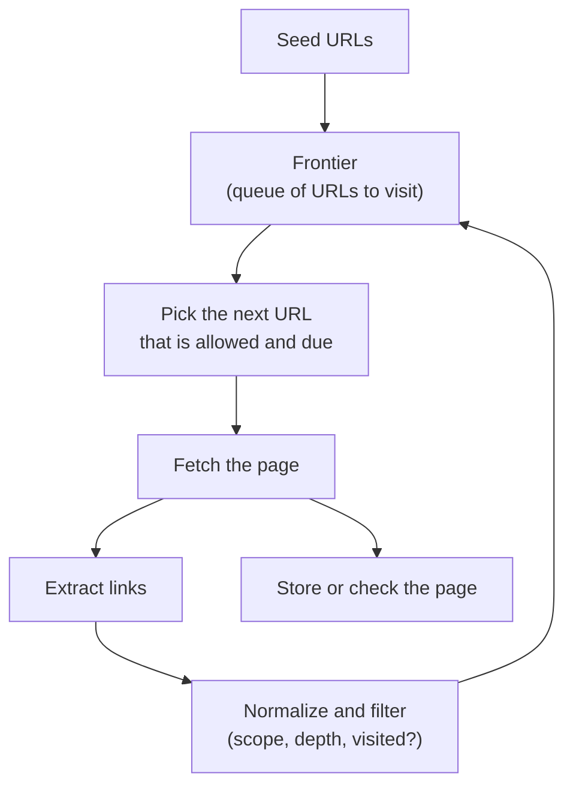
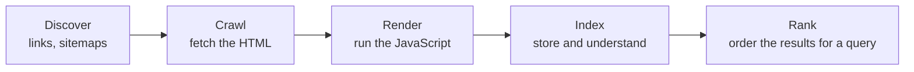

<Info>

**In short:** a crawler (also called a spider or bot) is a program that visits a
page, collects the links on it, and visits those, again and again. Search
engines do this to build their index and then rank the stored pages for each
query; testers do it to find broken links on their own site. The technique is
simple, and doing it politely, and on pages that need JavaScript, is the hard
part. Search engine optimisation (SEO) is making the crawl and the index easy and
the page worth showing in the ranking. Most of the basics are plain facts in the
HTML, such as the title, the canonical link and the robots tag, so a browser
test can check them and catch the expensive mistakes before they ship.

</Info>

## Crawling, scraping and testing

The three words are often mixed up. They differ in what the program is for.

| | Crawling | Scraping | Testing |
|---|---|---|---|
| Goal | Discover pages by following links | Extract specific data from pages | Check that a site works as intended |
| Output | A list of URLs, and often the pages | A table of values: prices, titles | Pass or fail, with evidence |
| Scope | Wide: many pages of many sites | Narrow: known pages and fields | Your own site, or one you have permission for |
| Example | A search engine's bot | A price comparison | A link checker in CI |

Many tools do two of them. A link checker crawls to find pages and tests each
one. A scraper often crawls to find the pages it will read.

## How a crawler works

A crawler is a loop around a queue, the **crawl frontier**, which holds the URLs
that are known but not yet visited.



*The crawl loop. It stops when the frontier is empty or a limit is reached.*

<Steps>

<Step title="Start with seeds" icon="seedling">

The frontier begins with one or more **seed URLs**: a home page, or the list in a
sitemap.

</Step>

<Step title="Fetch" icon="download">

The crawler requests the next URL. It records the status code, follows redirects
up to a limit and keeps the body.

</Step>

<Step title="Extract links" icon="link">

It reads the page and collects the targets of links. Relative links such as
`../about` are resolved against the page's own address, or against a `base`
element if the page has one.

</Step>

<Step title="Normalize and filter" icon="filter">

Each URL is brought to one form so that the same page is not visited twice. Links
outside the wanted scope (another domain, too deep, a file type that is not
wanted) are dropped, and the rest go into the frontier if not yet seen.

</Step>

</Steps>

### The order of the frontier

A **queue** (first in, first out) visits pages **breadth first**: everything one
click from the seed, then two clicks away. A **stack** goes **depth first**, deep
into one branch. A **priority queue** visits the pages that matter most first,
such as those with many incoming links, and is what large crawlers use.

### Normalization and traps

Two addresses can show the same page, and a crawler has to see through that:
`#section` fragments are removed, the host name is lower-cased, tracking
parameters such as `utm_source` are dropped, and parameters are put in a fixed
order. A page can also declare its preferred address with
`link rel="canonical"`. Without this work a crawler finds a **trap**: a calendar
with a "next month" link forever, a faceted search with millions of combinations,
or a session id in every URL. A depth limit, a page limit and a rule on the
number of parameters keep a crawl finite.

### What counts as a link

Mostly `a href`. But not every `href` is a page: `mailto:`, `tel:` and
`javascript:` are not crawled, and `#` points to the same page. Links can also
sit in `area`, in forms that use GET, in `iframe src`, and, in modern apps,
only in JavaScript click handlers that never appear in the HTML. A link marked
`rel="nofollow"` asks crawlers not to count it.

<Accordion title="What should a crawler do with each status code?">

- **200:** read the page.
- **301 and 308:** the page moved for good. Follow, and record the new address.
- **302 and 307:** moved for now. Follow, but keep the old address.
- **404 and 410:** gone. For a link checker this is the finding; for a search
  crawler it means drop the URL.
- **429 and 503:** the server asks you to slow down. Wait for the time in
  `Retry-After` if there is one, then try again with a longer pause.
- **403 and 401:** access is refused. A crawler records it and moves on; it does
  not try to get around it.

</Accordion>

## robots.txt and sitemaps

A site tells well-behaved crawlers what it wants in two small files at known
addresses.

**robots.txt** lives at `/robots.txt` and follows the Robots Exclusion Protocol.
A crawler fetches it first, and checks every URL against it before requesting
the page:

```text
User-agent: *
Disallow: /admin/
Disallow: /search
Allow: /search/help

User-agent: BadBot
Disallow: /

Sitemap: https://example.com/sitemap.xml
```

Rules are grouped by `User-agent`, the most specific path wins, and `Sitemap`
points to the next file. Some crawlers also read a non-standard `Crawl-delay`.
Two points matter: robots.txt is a **request, not a lock**, because nothing
stops a program that ignores it, and a page you do not want in a search index
needs a `noindex` meta tag or an `X-Robots-Tag` header, since a disallowed URL
can still be listed if others link to it.

**A sitemap** is an XML list of the URLs a site wants found, with optional
last-change dates. One file may hold up to 50,000 URLs, and a sitemap index
lists several files.

```xml
<urlset xmlns="http://www.sitemaps.org/schemas/sitemap/0.9">
  <url>
    <loc>https://example.com/products/1</loc>
    <lastmod>2026-09-30</lastmod>
  </url>
</urlset>
```

For a test of your own site, the sitemap is the best seed list, because it names
the pages that are meant to exist.

## Politeness

A crawler uses someone else's server, so it follows the rules of a good guest.

- **Identify yourself.** Set a `User-Agent` that names the program and gives a
  contact, so an operator can reach you instead of blocking you.
- **Limit the rate per host.** One request a second or slower is a common
  default, with a small, fixed number of simultaneous connections to one host.
  Fast crawling is done by visiting many hosts, not by pressing one hard.
- **Back off.** On a 429, a 503 or slow answers, wait longer, and double the wait
  after each failure.
- **Do not fetch twice.** Keep the `ETag` and `Last-Modified` of a page and ask
  again with `If-None-Match` or `If-Modified-Since`; the server can answer 304
  with no body.
- **Respect robots.txt**, and run big crawls when the site is quiet.

## Pages that need JavaScript

A plain HTTP client gets the HTML the server sends. On a
[modern single-page app](/concepts/selectors-and-the-dom#one-page-three-doms) that HTML is almost
empty, and the links and content appear only after the scripts run. For those
pages the crawler needs a browser.

| | HTTP client and HTML parser | Headless browser |
|---|---|---|
| Speed and cost | Fast, tiny memory | Many times slower, hundreds of MB per instance |
| Sees JavaScript content | No | Yes |
| Sees links built by click handlers | No | Only by clicking |
| Typical use | Static sites, sitemaps, API calls | Single-page apps, tests |

A common design is **hybrid**: fetch with the cheap client, notice that the page
is a shell with no useful text, and render only those pages. With a browser, the
crawler must also decide **when the page is ready** (see
[how a page loads](/concepts/how-a-page-loads)), scroll for lazy-loaded
content, and close the page afterwards so memory does not grow.

## Responsible use

<Warning>

Crawl only what you may. Your own site is always fine. For anyone else's, read
the terms of service and `robots.txt` first, keep the rate low, and ask when in
doubt. Data about people is covered by privacy law in many countries. A page that
sits behind a login, a paywall or a [CAPTCHA](/concepts/captchas) is a sign that
the owner does not want automated access, and an official API, if one exists, is
the better path. Never design a crawler to hide itself from a site that has
refused it.

</Warning>

## Crawl, index, rank



*The path of a page into search results.*

<Steps>

<Step title="Discover and crawl" icon="spider">

The bot starts from known pages, follows their links, and reads the URLs in
your **sitemap**. It fetches each page with an ordinary HTTP request, as a
browser would (see [how a page loads](/concepts/how-a-page-loads)), and obeys
your `robots.txt`.

</Step>

<Step title="Render" icon="display">

Modern search bots run a Chromium-based browser to execute the page's
JavaScript, so content that scripts add can be seen. This happens after the
crawl, in a queue, and costs the engine resources. Not every bot does it.

</Step>

<Step title="Index" icon="database">

The engine reads the text, the title, the headings, the links, the language and
the structured data, decides which URL is the main copy of the content (the
**canonical**), and stores the result. A page can be crawled and still not be
indexed, because it is a duplicate, thin or told not to be.

</Step>

<Step title="Rank" icon="ranking-star">

For each query the engine picks matching pages and orders them by relevance and
quality: how well the content answers the question, how many trusted sites link
to it, and signals about the page experience such as speed and mobile
friendliness. Nobody outside the engine knows the exact recipe, and no setting
guarantees a position.

</Step>

</Steps>

## What a page must say

Almost everything below is in the `head` of the HTML.

| Element | What it is for | Rules of thumb |
|---|---|---|
| `title` | The headline in results and in the browser tab. The strongest on-page signal | Unique on each page, specific, about 50 to 60 characters (longer is cut off) |
| `meta name="description"` | The summary under the headline. Not a ranking factor, but it changes whether people click | About 150 to 160 characters, written for a person. The engine may rewrite it |
| `h1` and the other headings | The outline of the page | One `h1`; levels in order |
| `html lang` | The language of the text | Always set |
| `link rel="canonical"` | The preferred URL for this content | Absolute, one per page, normally pointing to itself |
| `meta name="robots"` | Whether to index and follow | Absent means "index, follow" |
| `meta name="viewport"` | Mobile layout | `width=device-width`; the engine ranks the mobile version first (see [mobile web](/concepts/mobile-and-accessibility#what-is-different-on-a-phone)) |
| `img alt` | Describes an image | Meaningful, not stuffed with keywords |
| Open Graph tags (`og:title`, `og:image`) | The preview card when a link is shared | Not for search, but part of the same checklist |

Also part of the page: readable URLs (`/shoes/trail-runner`, not `/p?id=88213`),
links with descriptive text, not "click here", and content that is useful to
read. Headings, alt text and a good title also help assistive technology (see
[accessibility](/concepts/mobile-and-accessibility#who-the-web-has-to-work-for)).

### Canonical URLs

The same page often has many addresses: with and without `www`, `http` and
`https`, a trailing slash, tracking parameters (`?utm_source=...`), a sort order.
Search engines would treat them as separate pages and split the credit. The
canonical link names the main one:

```html
<link rel="canonical" href="https://example.com/shoes/trail-runner">
```

It is a strong **hint**, not an order. A permanent redirect (status 301) is the
stronger tool when an address should simply disappear.

### Structured data (JSON-LD)

**Structured data** states facts in a form a machine can read, using the
vocabulary of schema.org. The usual format is **JSON-LD**, a script block that
holds JSON and is not displayed:

```html
<script type="application/ld+json">
{
  "@context": "https://schema.org",
  "@type": "Product",
  "name": "Trail Runner",
  "offers": { "@type": "Offer", "price": "89.00", "priceCurrency": "EUR" }
}
</script>
```

It can earn **rich results** (stars, prices, recipe times, FAQ entries) in the
listing. Common types are `Product`, `Article`, `Recipe`, `Event`,
`BreadcrumbList` and `Organization`. The data must match what the visitor can
see; invalid or misleading markup is ignored or penalised. Google's Rich Results
Test and the Schema Markup Validator check it.

### Robots, sitemaps and status codes

Three tools look alike and do different jobs.

| Tool | Where | Controls | Careful |
|---|---|---|---|
| `robots.txt` | `/robots.txt` at the site root | **Crawling**: which paths bots may fetch | A blocked page can still be indexed from links to it, without its content |
| `meta name="robots"` or the `X-Robots-Tag` header | In the page, or in its HTTP response | **Indexing**: `noindex` keeps it out of results, `nofollow` ignores its links | The bot must be able to crawl the page to see the tag, so do not block it in `robots.txt` as well |
| Sitemap | `/sitemap.xml`, named in `robots.txt` with `Sitemap:` | **Discovery**: lists the URLs you want found, with `lastmod` | A hint to find pages, not a promise to index them |

The HTTP status code is read too: `200` is a page, `301` a permanent move,
`302` a temporary one, `404` and `410` mean gone, `5xx` means the server failed
and the bot should come back later. A page that says "not found" but answers
`200` (a **soft 404**) confuses engines. Links can carry `rel="nofollow"`,
`rel="sponsored"` or `rel="ugc"` to withhold credit, and `hreflang` points to the
translations of a page.

## Server rendering or client rendering

Compare what a bot receives with what a browser shows (see
[frameworks and the DOM](/concepts/selectors-and-the-dom#one-page-three-doms) and
[modern web](/concepts/modern-web)).

| How the page is made | First HTML response | For search |
|---|---|---|
| **Client-side rendering** (CSR) | An almost empty shell, such as `div id="root"`, plus scripts | The bot must run the scripts to see anything. It is slower to index, can fail on an error or a timeout, and is invisible to bots that do not run JavaScript |
| **Server-side rendering** (SSR) | Complete HTML built per request | Visible at once. The best choice for pages that change |
| **Static generation** (SSG) | Complete HTML built ahead of time | Visible at once and fast |
| **Hydration** | SSR or SSG HTML, then scripts make it interactive | Visible at once, interactive soon after |

Search engines are better at JavaScript than they were, but other consumers are
not: the preview card for a shared link, some smaller search engines and many AI
crawlers read the first HTML only. The simplest check is to compare **View
Source** (the response as sent) with the **Elements panel** (the DOM after the
scripts). If the title, the headings and the text are missing in the first,
you depend on rendering.

### Core Web Vitals

Speed and stability are a ranking signal, grouped as **page experience** and
measured by the Core Web Vitals (LCP, INP and CLS; see
[rendering and performance](/concepts/how-a-page-loads#from-bytes-to-pixels)). They matter
most as a tie-breaker between pages of similar relevance: a fast page with poor
content will not beat a slow page that answers the question.

## Checking SEO in automated tests

SEO bugs are quiet: nothing crashes, the traffic just goes. The most expensive
ones are easy to test.

- **Production carries `noindex`.** A staging setting leaks into the release and
  the whole site drops out of search. Assert that the robots tag does *not*
  contain `noindex` on production, and that it *does* on staging.
- **The canonical is wrong**: it points to staging, to a relative path, or to the
  home page for every page.
- **The title or the description is missing, empty or duplicated** by a template
  bug.
- **No single `h1`**, or the text appears only after a script runs.
- **JSON-LD is broken** and no longer parses.
- **`robots.txt` blocks everything**, left over from development.
- **A redirect chain or a `404`** on a page that is in the sitemap.

Check the **rendered** page (what the browser shows) and, for the content that
must not depend on scripts, the **raw** HTML as an ordinary HTTP client such as
`curl` gets it.

## How seleniumbase-rs uses it

### Link checks and crawling

The library does **not** have a crawler today: no frontier, no depth limit, no
robots.txt parser. What it has are the building blocks of a link check, on
`BaseCase`:

- `get_all_links()` returns the `href` of every `a` element on the current page.
- `get_link_status_code(url)` returns the HTTP status of a link. It sends a
  `HEAD` request, repeats it as `GET` when the server answers 405 or 501, and
  does **not** follow redirects, so a moved page shows as 301 or 302. This
  matches Python SeleniumBase.
- `assert_link_status_code_is_not_404(url)` fails when the answer is 404.
- `print_unique_links_with_status_codes()` prints `link -> code` for each unique
  link on the page, checking eight at a time, and lists non-HTTP links such as
  `mailto:` as skipped.

```rust,ignore src/main.rs
sb.open("https://example.com").await?;

// Check one page: every same-site link must not be a 404.
let links = sb.get_all_links().await?;
for link in links.iter().filter(|l| l.starts_with("https://example.com")) {
    sb.assert_link_status_code_is_not_404(link).await?;
}

// Or just print a report.
sb.print_unique_links_with_status_codes().await?;
```

To check a whole site, you write the outer loop yourself: read the sitemap, open
each page, and run the check, keeping the politeness rules above.

<Note>

A **crawler plugin** is one of the seven example plugins in the plugin design
(a "testing" plugin). It is planned and not built yet, so nothing in a current
release crawls for you.

</Note>

Pages that need JavaScript work with the ordinary engines, because the link list
comes from the live [DOM](/concepts/selectors-and-the-dom) after the scripts
have run.

### SEO checks in tests

The library has no SEO audit, and nothing to check a canonical link, a meta
description, the robots tag or JSON-LD directly. It gives you the pieces to read
them from the live page.

- **Title.** `BaseCase::get_title`, `assert_title(expected)` and
  `assert_title_contains(expected)`. The pure CDP engine has `Page::title()` and
  page expectations `to_have_title` and `to_contain_title`.
- **Tags in the head.** `BaseCase::get_attribute(css, attribute)` returns the
  attribute of an element as an `Option<String>`. It first waits for the element
  to be present, so it suits tags that must exist. For a tag that may be absent,
  read it with `execute_script`, or `Page::evaluate` on the pure CDP engine.
- **Basic structure.** `HtmlInspector::inspect(html)` has rules that double as SEO
  checks: `document-title` (no title, or an empty one), `document-lang`,
  `meta-viewport`, `page-h1` (no `h1`, or more than one), `image-alt`,
  `heading-order` and `link-text`. The MCP tool `audit_page` runs the same rules
  on the open page (see [accessibility](/concepts/mobile-and-accessibility#who-the-web-has-to-work-for) and
  [MCP](/concepts/mcp)).

<Tabs>

<Tab title="WebDriver engine" icon="plug">

```rust,ignore src/main.rs
use seleniumbase_rs::api::html_inspector::HtmlInspector;

sb.open("https://example.com/shoes/trail-runner").await?;
sb.assert_title_contains("Trail Runner").await?;

// Tags that must exist: get_attribute waits for them.
let description = sb.get_attribute("meta[name=description]", "content").await?;
assert!(description.is_some_and(|text| (50..=160).contains(&text.len())));
let canonical = sb.get_attribute("link[rel=canonical]", "href").await?;
assert_eq!(canonical.as_deref(), Some("https://example.com/shoes/trail-runner"));

// A tag that may be absent: read it with a script instead.
let robots = sb
    .execute_script("return document.querySelector('meta[name=robots]')?.content ?? '';")
    .await?;
assert!(!robots.as_str().unwrap_or_default().contains("noindex"));

// The structural rules, on the DOM as it is now.
let html = sb.execute_script("return document.documentElement.outerHTML;").await?;
let result = HtmlInspector::inspect(html.as_str().unwrap_or_default())?;
let seo_rules = ["document-title", "page-h1", "document-lang"];
assert!(result.issues.iter().all(|issue| !seo_rules.contains(&issue.rule.as_str())));
```

</Tab>

<Tab title="Pure CDP engine" icon="bolt">

```rust,ignore src/main.rs
use serde_json::Value;

page.goto("https://example.com/shoes/trail-runner").await?;
assert!(page.title().await?.contains("Trail Runner"));

// Every JSON-LD block must parse and have a type.
let blocks: Vec<Value> = page
    .evaluate_as(
        "[...document.querySelectorAll('script[type=\"application/ld+json\"]')]
           .map(script => JSON.parse(script.textContent))",
    )
    .await?;
assert!(!blocks.is_empty() && blocks.iter().all(|block| block["@type"].is_string()));
```

</Tab>

</Tabs>

<Tip>

Keep these checks in a small smoke test that runs against every environment,
with the expected canonical host and the expected robots value as parameters.
That one test would have caught most "we disappeared from Google" incidents.

</Tip>

<Note>

A browser test sees the page after its scripts ran, which is what the rendering
step of a search engine sees. It cannot tell you how the engine ranks the page,
or whether a page is indexed. For that, use the engine's own tools, such as
Search Console.

</Note>

## Where to go next

<Columns cols={2}>

<Card title="How a page loads" icon="globe" href="/concepts/how-a-page-loads">
  When a page is ready to read.
</Card>

<Card title="Frontends, backends and APIs" icon="server" href="/concepts/frontends-backends-and-apis">
  Often the data you want is available from an API.
</Card>

<Card title="CAPTCHAs" icon="shield-halved" href="/concepts/captchas">
  What they signal and how automation meets them.
</Card>

<Card title="Network" icon="network-wired" href="/concepts/network">
  Requests, status codes, proxies and HAR files.
</Card>

<Card title="Selectors and the DOM" icon="layer-group" color="#1a85d4" href="/concepts/selectors-and-the-dom">
  How client-side rendering builds the page that a bot must wait for.
</Card>

<Card title="Modern web" icon="rocket" color="#199f43" href="/concepts/modern-web">
  SSR, SSG and hydration in the context of today's stacks.
</Card>

<Card title="Mobile web and accessibility" icon="universal-access" color="#a631be" href="/concepts/mobile-and-accessibility">
  The checks that overlap with good SEO markup.
</Card>

</Columns>
