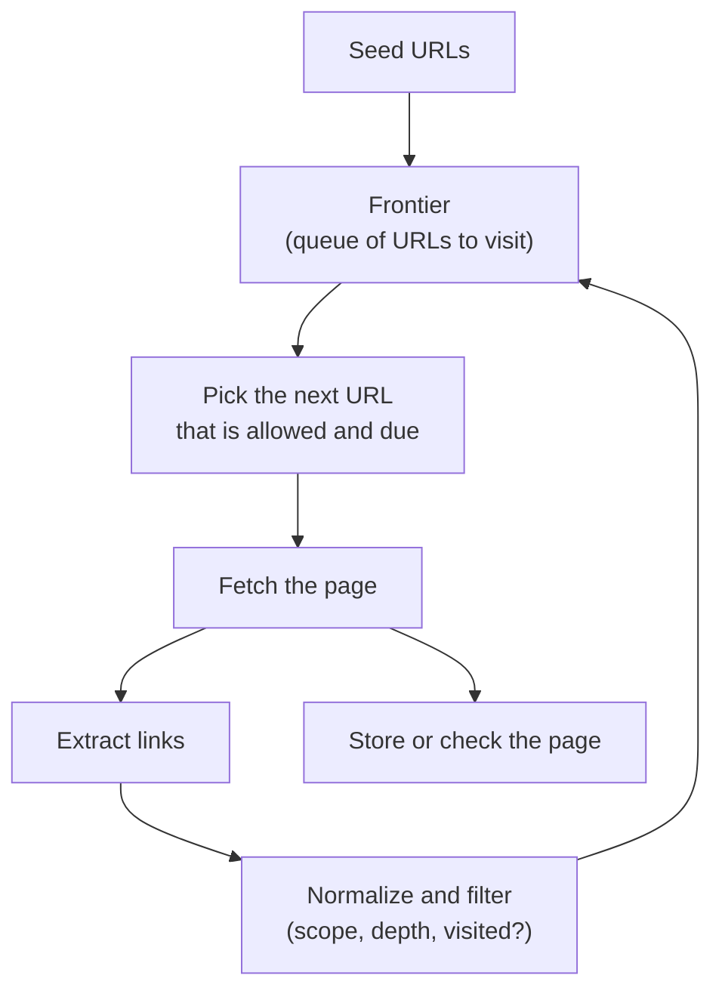

<Info>

**In short:** a crawler (also called a spider or bot) is a program that visits a
page, collects the links on it, and visits those, again and again. Search
engines do this to build their index. Testers do it to find broken links on their
own site. The technique is simple; doing it politely, and on pages that need
JavaScript, is the hard part.

</Info>

## Crawling, scraping and testing

The three words are often mixed up. They differ in what the program is for.

| | Crawling | Scraping | Testing |
|---|---|---|---|
| Goal | Discover pages by following links | Extract specific data from pages | Check that a site works as intended |
| Output | A list of URLs, and often the pages | A table of values: prices, titles | Pass or fail, with evidence |
| Scope | Wide: many pages of many sites | Narrow: known pages and fields | Your own site, or one you have permission for |
| Example | A search engine's bot | A price comparison | A link checker in CI |

Many tools do two of them. A link checker crawls to find pages and tests each
one. A scraper often crawls to find the pages it will read.

## How a crawler works

A crawler is a loop around a queue, the **crawl frontier**, which holds the URLs
that are known but not yet visited.



*The crawl loop. It stops when the frontier is empty or a limit is reached.*

<Steps>

<Step title="Start with seeds" icon="seedling">

The frontier begins with one or more **seed URLs**: a home page, or the list in a
sitemap.

</Step>

<Step title="Fetch" icon="download">

The crawler requests the next URL. It records the status code, follows redirects
up to a limit and keeps the body.

</Step>

<Step title="Extract links" icon="link">

It reads the page and collects the targets of links. Relative links such as
`../about` are resolved against the page's own address, or against a `base`
element if the page has one.

</Step>

<Step title="Normalize and filter" icon="filter">

Each URL is brought to one form so that the same page is not visited twice. Links
outside the wanted scope (another domain, too deep, a file type that is not
wanted) are dropped, and the rest go into the frontier if not yet seen.

</Step>

</Steps>

### The order of the frontier

A **queue** (first in, first out) visits pages **breadth first**: everything one
click from the seed, then two clicks away. A **stack** goes **depth first**, deep
into one branch. A **priority queue** visits the pages that matter most first,
such as those with many incoming links, and is what large crawlers use.

### Normalization and traps

Two addresses can show the same page, and a crawler has to see through that:
`#section` fragments are removed, the host name is lower-cased, tracking
parameters such as `utm_source` are dropped, and parameters are put in a fixed
order. A page can also declare its preferred address with
`link rel="canonical"`. Without this work a crawler finds a **trap**: a calendar
with a "next month" link forever, a faceted search with millions of combinations,
or a session id in every URL. A depth limit, a page limit and a rule on the
number of parameters keep a crawl finite.

### What counts as a link

Mostly `a href`. But not every `href` is a page: `mailto:`, `tel:` and
`javascript:` are not crawled, and `#` points to the same page. Links can also
sit in `area`, in forms that use GET, in `iframe src`, and, in modern apps,
only in JavaScript click handlers that never appear in the HTML. A link marked
`rel="nofollow"` asks crawlers not to count it.

<Accordion title="What should a crawler do with each status code?">

- **200:** read the page.
- **301 and 308:** the page moved for good. Follow, and record the new address.
- **302 and 307:** moved for now. Follow, but keep the old address.
- **404 and 410:** gone. For a link checker this is the finding; for a search
  crawler it means drop the URL.
- **429 and 503:** the server asks you to slow down. Wait for the time in
  `Retry-After` if there is one, then try again with a longer pause.
- **403 and 401:** access is refused. A crawler records it and moves on; it does
  not try to get around it.

</Accordion>

## robots.txt and sitemaps

A site tells well-behaved crawlers what it wants in two small files at known
addresses.

**robots.txt** lives at `/robots.txt` and follows the Robots Exclusion Protocol.
A crawler fetches it first, and checks every URL against it before requesting
the page:

```text
User-agent: *
Disallow: /admin/
Disallow: /search
Allow: /search/help

User-agent: BadBot
Disallow: /

Sitemap: https://example.com/sitemap.xml
```

Rules are grouped by `User-agent`, the most specific path wins, and `Sitemap`
points to the next file. Some crawlers also read a non-standard `Crawl-delay`.
Two points matter: robots.txt is a **request, not a lock**, because nothing
stops a program that ignores it, and a page you do not want in a search index
needs a `noindex` meta tag or an `X-Robots-Tag` header, since a disallowed URL
can still be listed if others link to it.

**A sitemap** is an XML list of the URLs a site wants found, with optional
last-change dates. One file may hold up to 50,000 URLs, and a sitemap index
lists several files.

```xml
<urlset xmlns="http://www.sitemaps.org/schemas/sitemap/0.9">
  <url>
    <loc>https://example.com/products/1</loc>
    <lastmod>2026-09-30</lastmod>
  </url>
</urlset>
```

For a test of your own site, the sitemap is the best seed list, because it names
the pages that are meant to exist.

## Politeness

A crawler uses someone else's server, so it follows the rules of a good guest.

- **Identify yourself.** Set a `User-Agent` that names the program and gives a
  contact, so an operator can reach you instead of blocking you.
- **Limit the rate per host.** One request a second or slower is a common
  default, with a small, fixed number of simultaneous connections to one host.
  Fast crawling is done by visiting many hosts, not by pressing one hard.
- **Back off.** On a 429, a 503 or slow answers, wait longer, and double the wait
  after each failure.
- **Do not fetch twice.** Keep the `ETag` and `Last-Modified` of a page and ask
  again with `If-None-Match` or `If-Modified-Since`; the server can answer 304
  with no body.
- **Respect robots.txt**, and run big crawls when the site is quiet.

## Pages that need JavaScript

A plain HTTP client gets the HTML the server sends. On a
[modern single-page app](/concepts/frameworks-and-the-dom) that HTML is almost
empty, and the links and content appear only after the scripts run. For those
pages the crawler needs a browser.

| | HTTP client and HTML parser | Headless browser |
|---|---|---|
| Speed and cost | Fast, tiny memory | Many times slower, hundreds of MB per instance |
| Sees JavaScript content | No | Yes |
| Sees links built by click handlers | No | Only by clicking |
| Typical use | Static sites, sitemaps, API calls | Single-page apps, tests |

A common design is **hybrid**: fetch with the cheap client, notice that the page
is a shell with no useful text, and render only those pages. With a browser, the
crawler must also decide **when the page is ready** (see
[how a page loads](/concepts/how-a-page-loads)), scroll for lazy-loaded
content, and close the page afterwards so memory does not grow.

## Responsible use

<Warning>

Crawl only what you may. Your own site is always fine. For anyone else's, read
the terms of service and `robots.txt` first, keep the rate low, and ask when in
doubt. Data about people is covered by privacy law in many countries. A page that
sits behind a login, a paywall or a [CAPTCHA](/concepts/captchas) is a sign that
the owner does not want automated access, and an official API, if one exists, is
the better path. Never design a crawler to hide itself from a site that has
refused it.

</Warning>

## How seleniumbase-rs uses it

The library does **not** have a crawler today: no frontier, no depth limit, no
robots.txt parser. What it has are the building blocks of a link check, on
`BaseCase`:

- `get_all_links()` returns the `href` of every `a` element on the current page.
- `get_link_status_code(url)` returns the HTTP status of a link. It sends a
  `HEAD` request, repeats it as `GET` when the server answers 405 or 501, and
  does **not** follow redirects, so a moved page shows as 301 or 302. This
  matches Python SeleniumBase.
- `assert_link_status_code_is_not_404(url)` fails when the answer is 404.
- `print_unique_links_with_status_codes()` prints `link -> code` for each unique
  link on the page, checking eight at a time, and lists non-HTTP links such as
  `mailto:` as skipped.

```rust,ignore src/main.rs
sb.open("https://example.com").await?;

// Check one page: every same-site link must not be a 404.
let links = sb.get_all_links().await?;
for link in links.iter().filter(|l| l.starts_with("https://example.com")) {
    sb.assert_link_status_code_is_not_404(link).await?;
}

// Or just print a report.
sb.print_unique_links_with_status_codes().await?;
```

To check a whole site, you write the outer loop yourself: read the sitemap, open
each page, and run the check, keeping the politeness rules above.

<Note>

A **crawler plugin** is one of the seven example plugins in the plugin design
(a "testing" plugin). It is planned and not built yet, so nothing in a current
release crawls for you.

</Note>

Pages that need JavaScript work with the ordinary engines, because the link list
comes from the live [DOM](/concepts/selectors-and-the-dom) after the scripts
have run.

## Where to go next

<Columns cols={2}>

<Card title="How a page loads" icon="globe" href="/concepts/how-a-page-loads">
  When a page is ready to read.
</Card>

<Card title="Frontends, backends and APIs" icon="server" href="/concepts/frontends-backends-and-apis">
  Often the data you want is available from an API.
</Card>

<Card title="CAPTCHAs" icon="shield-halved" href="/concepts/captchas">
  What they signal and how automation meets them.
</Card>

<Card title="Network" icon="network-wired" href="/concepts/network">
  Requests, status codes, proxies and HAR files.
</Card>

</Columns>
