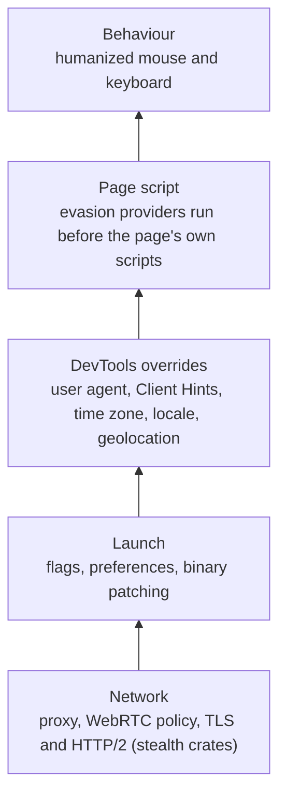

<Info>

**In short:** a site checks many small signals: what JavaScript reports, how the
page renders, how the browser was started, how the user moves, and what the
network connection looks like. One odd signal can be explained; signals that
disagree with each other give a browser away. seleniumbase-rs answers each
signal at the layer where it is read, and keeps the answers consistent.

</Info>

## The signals, layer by layer

| Layer | What a site reads | Example of a giveaway |
|---|---|---|
| Network | IP address and its reputation, TLS ClientHello, HTTP/2 settings, header order | A datacenter IP; a <Tooltip tip="A fingerprint of the TLS handshake: versions, ciphers, extensions">JA3/JA4</Tooltip> hash no real Chrome sends |
| Launch | Flags and the browser binary | Automation flags; chromedriver's `cdc_` markers in the page |
| JavaScript | `navigator`, Client Hints, permissions, plugins, the `toString` of functions | `navigator.webdriver` is true; `HeadlessChrome` in the user agent |
| Rendering | Canvas, WebGL vendor and renderer, audio, fonts, screen size | A software renderer; a screen size no monitor has |
| Behaviour | Mouse paths, typing rhythm, timing | Instant straight-line moves; perfectly even keystrokes |
| Coherence | Whether all of the above agree | A Berlin IP with a New York time zone and an English-only locale |

## What detection code looks like

A detection script runs in the page like any other script. It asks the browser
questions and sends the answers home. These are simplified versions of real
checks.

<Tabs>

<Tab title="Automation flags" icon="robot">

```javascript detect.js
const signs = [];
if (navigator.webdriver) signs.push("webdriver flag");            // true under WebDriver unless hidden
if (/HeadlessChrome/.test(navigator.userAgent)) signs.push("headless UA");
if (navigator.plugins.length === 0) signs.push("no plugins");      // real Chrome lists PDF viewers
if (!window.chrome) signs.push("no window.chrome");
// chromedriver leaves global variables whose names start with cdc_
if (Object.keys(window).some((k) => k.startsWith("cdc_"))) signs.push("chromedriver marker");
```

seleniumbase-rs hides `navigator.webdriver`, replaces `HeadlessChrome` in the
user agent (UC mode), fills `plugins` and `window.chrome`, and binary patching
removes the `cdc_` markers.

</Tab>

<Tab title="Patched functions" icon="code">

```javascript detect.js
// A native function prints "[native code]"; a JavaScript replacement prints its source.
const getter = Object.getOwnPropertyDescriptor(Navigator.prototype, "webdriver").get;
const patched = !Function.prototype.toString.call(getter).includes("[native code]");
```

With native spoofing on, replaced functions keep a native-looking `toString`,
so the replacement itself does not show.

</Tab>

<Tab title="Coherence" icon="scale-balanced">

```javascript detect.js
const tz = Intl.DateTimeFormat().resolvedOptions().timeZone;  // e.g. "America/New_York"
const lang = navigator.language;                              // e.g. "de-DE"
// The server compares these with the country of the IP address it saw.
// A German locale, a New York time zone and a Dutch datacenter IP do not fit.
```

A `Fingerprint` draws random values together (operating system, region,
locale), so they agree; keep the proxy's country in line with them.

</Tab>

</Tabs>

## How a fingerprint is generated

A fingerprint is not stored in your browser: the site computes it each visit
from how your device renders and reports things, then hashes the results into
one identifier that survives clearing cookies.

<Steps>

<Step title="Canvas" icon="paintbrush">

```javascript fingerprint.js
const c = document.createElement("canvas");
const ctx = c.getContext("2d");
ctx.font = "16px Arial";
ctx.fillText("Cwm fjordbank glyphs vext quiz 😃", 2, 20);
const canvasData = c.toDataURL(); // the pixels differ slightly by GPU, driver and fonts
```

</Step>

<Step title="WebGL" icon="microchip">

```javascript fingerprint.js
const gl = document.createElement("canvas").getContext("webgl");
const info = gl.getExtension("WEBGL_debug_renderer_info");
const gpu = gl.getParameter(info.UNMASKED_RENDERER_WEBGL); // e.g. "ANGLE (Apple, Apple M2, ...)"
```

</Step>

<Step title="Audio" icon="volume-high">

```javascript fingerprint.js
const ctx = new OfflineAudioContext(1, 44100, 44100);
const osc = ctx.createOscillator();
osc.connect(ctx.destination);
osc.start();
const samples = (await ctx.startRendering()).getChannelData(0);
const audioSum = samples.slice(4500, 5000).reduce((a, b) => a + Math.abs(b), 0); // tiny float differences
```

</Step>

<Step title="Fonts and screen" icon="font">

```javascript fingerprint.js
// A font is installed if text in it has a different width than in a fallback font.
const has = (font) => { /* measure "mmmmmlli" in `${font}, monospace` vs monospace */ };
const screenInfo = [screen.width, screen.height, devicePixelRatio, screen.colorDepth];
```

</Step>

<Step title="Hash it together" icon="hashtag">

```javascript fingerprint.js
const raw = [canvasData, gpu, audioSum, screenInfo, navigator.hardwareConcurrency,
             navigator.deviceMemory, tz, lang].join("|");
const digest = await crypto.subtle.digest("SHA-256", new TextEncoder().encode(raw));
// the hex of `digest` is the visitor id
```

</Step>

</Steps>

What seleniumbase-rs changes: canvas and audio noise (set in `StealthPolicy`)
make the canvas and audio results differ per identity; the WebGL vendor and
renderer, screen size, pixel ratio, hardware values, fonts, time zone and locale
come from the `Fingerprint`. With `.seed(..)` the same identity gives the same
results every run, so a site sees one consistent returning visitor instead of a
new one each time.
## Where seleniumbase-rs answers



*Each layer has its own way to change what the site sees*

<AccordionGroup>

<Accordion title="Launch flags and binary patching" icon="rocket">

The browser is started with flags that leave out automation markers, and the
Chrome and chromedriver binaries can be patched so their tell-tale strings are
gone. UC mode sets up the session to avoid common bot checks, and replaces
`HeadlessChrome` in the user agent when running headless. See
[Binary patching](/tutorials/binary_patching) and [UC mode](/tutorials/uc_mode).

</Accordion>

<Accordion title="DevTools overrides" icon="bolt">

Through the DevTools Protocol the crate sets the user agent, Client Hints, time
zone, locale and geolocation for a page, so what JavaScript asks for comes from
the browser itself, not from a patched function. See
[The DevTools Protocol](/concepts/cdp).

</Accordion>

<Accordion title="Page script" icon="code">

Evasion providers inject script that runs before the page's own scripts, for
values with no DevTools override (WebGL vendor, canvas and audio noise, plugins,
permissions). With native spoofing on, patched functions keep a native-looking
`toString`, so the patch itself is not a signal.

</Accordion>

<Accordion title="Behaviour" icon="computer-mouse">

Humanized input moves the mouse along curved paths and types with uneven
timing, instead of jumping and typing instantly.

</Accordion>

<Accordion title="Network" icon="network-wired">

A proxy changes the IP the site sees, and the WebRTC policy keeps the real IP
from leaking through WebRTC. A real Chrome already sends a Chrome TLS
fingerprint; for plain HTTP requests made outside the browser, the
[stealth crates](/stealth/overview) reproduce the same TLS and HTTP/2
fingerprint (see the [codec API](/stealth/api/codec)).

</Accordion>

</AccordionGroup>

## Keeping the answers consistent

One `Fingerprint` describes the whole identity, and each setting is one `Spoof`:
`Natural` (the browser's own value), `Random`, `Value(..)` or `Off`. A `Random`
value is drawn together with the rest (the same operating system, region and
locale), so a random locale agrees with a time zone you set. How the claims are
delivered (canvas and audio noise, native spoofing, WebRTC policy, granted
permissions) is a separate `StealthPolicy`. See
[Fingerprints](/tutorials/fingerprint_stealth) and
[Design: fingerprint API v2](/design/fingerprint-api-v2).

<Warning>

No layer makes a browser undetectable. Each closes known signals; a site can
look for new ones. The stealth scraping layer is experimental; see its
[limits](/stealth/limits).

</Warning>

## Where to go next

<Columns cols={2}>

<Card title="Fingerprints" icon="fingerprint" color="#1a85d4" href="/tutorials/fingerprint_stealth">
  Build and apply a fingerprint and a policy.
</Card>

<Card title="UC mode" icon="user-secret" color="#199f43" href="/tutorials/uc_mode">
  A WebDriver session that avoids common bot checks.
</Card>

<Card title="Headless and stealth" icon="eye-slash" color="#d47628" href="/tutorials/headless#headless-and-stealth">
  What gives a headless browser away.
</Card>

<Card title="Stealth scraping" icon="spider" color="#a631be" href="/stealth/overview">
  The experimental crates for network-level fingerprints.
</Card>

</Columns>
