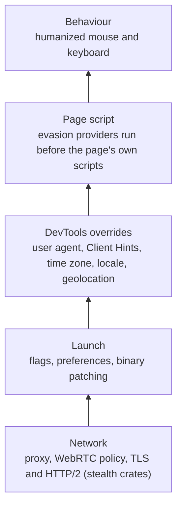

<Info>

**In short:** a site checks many small signals: what JavaScript reports, how the
page renders, how the browser was started, how the user moves, and what the
network connection looks like. One odd signal can be explained; signals that
disagree with each other give a browser away. seleniumbase-rs answers each
signal at the layer where it is read, and keeps the answers consistent.

</Info>

## Why sites check at all

Many websites want to know whether a visitor is a person with a browser or a
program. The reasons are mostly defensive: stopping credential stuffing (bots
trying leaked passwords), card testing, ticket and stock hoarding, fake
accounts, ad fraud and mass scraping that costs real money to serve. The same
techniques can also catch an honest test suite, which is why you meet them when
testing your own site behind a bot-protection service.

A site has two kinds of evidence. It **sees** what your connection shows
(the IP address, the TLS handshake, the headers). And it **runs code** in your
browser that asks questions and sends the answers back. The answers are
combined into a score; a low score gets a challenge (a CAPTCHA), a block, or
simply worse prices.

## The signals, layer by layer

| Layer | What a site reads | Example of a giveaway |
|---|---|---|
| Network | IP address and its reputation, TLS ClientHello, HTTP/2 settings, header order | A datacenter IP; a <Tooltip tip="A fingerprint of the TLS handshake: versions, ciphers, extensions">JA3/JA4</Tooltip> hash no real Chrome sends |
| Launch | Flags and the browser binary | Automation flags; chromedriver's `cdc_` markers in the page |
| JavaScript | `navigator`, Client Hints, permissions, plugins, the `toString` of functions | `navigator.webdriver` is true; `HeadlessChrome` in the user agent |
| Rendering | Canvas, WebGL vendor and renderer, audio, fonts, screen size | A software renderer; a screen size no monitor has |
| Behaviour | Mouse paths, typing rhythm, timing | Instant straight-line moves; perfectly even keystrokes |
| Coherence | Whether all of the above agree | A Berlin IP with a New York time zone and an English-only locale |

The rest of this page goes through them in that order.

## The user agent and Client Hints

Every request names the software making it in the `User-Agent` header, and
JavaScript can read the same string as `navigator.userAgent`:

```text
Mozilla/5.0 (Windows NT 10.0; Win64; x64) AppleWebKit/537.36 (KHTML, like Gecko) Chrome/154.0.0.0 Safari/537.36
```

It is a mess of history (every browser claims to be "Mozilla"), but it still
says the operating system and the Chrome version. Two details matter:

- **Headless leaks.** Old headless Chrome sent `HeadlessChrome/154...` in place
  of `Chrome/154...`. That one word is the cheapest bot check there is.
- **Chrome is freezing the string.** The detailed version and platform now come
  from **Client Hints**: the browser sends short `Sec-CH-UA`,
  `Sec-CH-UA-Platform` and `Sec-CH-UA-Mobile` headers by default, and a page
  asks for more (full version, CPU architecture, device model) through
  `navigator.userAgentData.getHighEntropyValues([...])`.

So a user agent is really **three** claims: the `User-Agent` header, the Client
Hints headers, and what `navigator.userAgentData` and `navigator.platform` say.
A script compares them. Claiming "Windows" in one and "Linux" in another is a
bigger giveaway than any single value.

## Automation tells

A detection script runs in the page like any other script. It asks the browser
questions and sends the answers home. These are simplified versions of real
checks.

<Tabs>

<Tab title="Automation flags" icon="robot">

```javascript detect.js
const signs = [];
if (navigator.webdriver) signs.push("webdriver flag");            // true under WebDriver unless hidden
if (/HeadlessChrome/.test(navigator.userAgent)) signs.push("headless UA");
if (navigator.plugins.length === 0) signs.push("no plugins");      // real Chrome lists PDF viewers
if (!window.chrome) signs.push("no window.chrome");
// chromedriver leaves global variables whose names start with cdc_
if (Object.keys(window).some((k) => k.startsWith("cdc_"))) signs.push("chromedriver marker");
```

`navigator.webdriver` is defined by the WebDriver standard: a browser under
automatic control must report `true`. The other lines look for things real
Chrome has and a stripped-down automated one often lacks.

seleniumbase-rs hides `navigator.webdriver`, replaces `HeadlessChrome` in the
user agent (UC mode), fills `plugins` and `window.chrome`, and binary patching
removes the `cdc_` markers.

</Tab>

<Tab title="Patched functions" icon="code">

```javascript detect.js
// A native function prints "[native code]"; a JavaScript replacement prints its source.
const getter = Object.getOwnPropertyDescriptor(Navigator.prototype, "webdriver").get;
const patched = !Function.prototype.toString.call(getter).includes("[native code]");
```

This is the second-order check: a tool that fakes a value in JavaScript can be
found by looking at the fake. Other versions compare the property descriptors,
the order of an object's keys, or what the same property returns inside an
iframe or a Web Worker, where the patch may not have run. With native spoofing
on, replaced functions keep a native-looking `toString`, so the replacement
itself does not show.

</Tab>

<Tab title="Coherence" icon="scale-balanced">

```javascript detect.js
const tz = Intl.DateTimeFormat().resolvedOptions().timeZone;  // e.g. "America/New_York"
const lang = navigator.language;                              // e.g. "de-DE"
// The server compares these with the country of the IP address it saw.
// A German locale, a New York time zone and a Dutch datacenter IP do not fit.
```

A `Fingerprint` draws random values together (operating system, region,
locale), so they agree; keep the proxy's country in line with them.

</Tab>

<Tab title="Permissions" icon="shield-halved">

```javascript detect.js
// In real Chrome these agree. A headless build once disagreed.
const state = await navigator.permissions.query({ name: "notifications" });
const mismatch = Notification.permission === "denied" && state.state === "prompt";
```

Small contradictions between two APIs that should say the same thing are a
classic tell. Each one is easy to fix; there are many of them.

</Tab>

</Tabs>

## Headless tells

A browser without a window is a different build or mode, and the difference
shows:

- the rendering stack: with no GPU, WebGL falls back to a software renderer
  such as SwiftShader, whose name appears in the WebGL renderer string;
- a default window of 800 by 600, and `outerWidth` equal to `innerWidth` (no
  browser frame);
- missing pieces a desktop Chrome has: plugins, codecs, a font list, the
  `window.chrome` object;
- media queries: a headless browser may claim it has no hover or pointer device.

Since Chrome 112, `--headless=new` runs the same code as the headed browser, which
removed most of these. The old, separate headless build lives on as
`chrome-headless-shell`. See [Headless and headed browsers](/tutorials/headless#headless-and-stealth).

## Fingerprint surfaces

A fingerprint is not stored in your browser: the site computes it each visit
from how your device renders and reports things, then hashes the results into
one identifier that survives clearing cookies. No single value is unique; the
**combination** of a dozen mostly-ordinary values is.

<Steps>

<Step title="Canvas" icon="paintbrush">

```javascript fingerprint.js
const c = document.createElement("canvas");
const ctx = c.getContext("2d");
ctx.font = "16px Arial";
ctx.fillText("Cwm fjordbank glyphs vext quiz 😃", 2, 20);
const canvasData = c.toDataURL(); // the pixels differ slightly by GPU, driver and fonts
```

</Step>

<Step title="WebGL" icon="microchip">

```javascript fingerprint.js
const gl = document.createElement("canvas").getContext("webgl");
const info = gl.getExtension("WEBGL_debug_renderer_info");
const gpu = gl.getParameter(info.UNMASKED_RENDERER_WEBGL); // e.g. "ANGLE (Apple, Apple M2, ...)"
```

</Step>

<Step title="Audio" icon="volume-high">

```javascript fingerprint.js
const ctx = new OfflineAudioContext(1, 44100, 44100);
const osc = ctx.createOscillator();
osc.connect(ctx.destination);
osc.start();
const samples = (await ctx.startRendering()).getChannelData(0);
const audioSum = samples.slice(4500, 5000).reduce((a, b) => a + Math.abs(b), 0); // tiny float differences
```

</Step>

<Step title="Fonts and screen" icon="font">

```javascript fingerprint.js
// A font is installed if text in it has a different width than in a fallback font.
const has = (font) => { /* measure "mmmmmlli" in `${font}, monospace` vs monospace */ };
const screenInfo = [screen.width, screen.height, devicePixelRatio, screen.colorDepth];
```

</Step>

<Step title="Hash it together" icon="hashtag">

```javascript fingerprint.js
const raw = [canvasData, gpu, audioSum, screenInfo, navigator.hardwareConcurrency,
             navigator.deviceMemory, tz, lang].join("|");
const digest = await crypto.subtle.digest("SHA-256", new TextEncoder().encode(raw));
// the hex of `digest` is the visitor id
```

</Step>

</Steps>

Other values that join the hash: the time zone and locale (shown above),
`navigator.hardwareConcurrency` (CPU cores) and `navigator.deviceMemory`, the
list of media devices and speech voices, supported codecs, and the
**WebRTC** address leak. WebRTC lets a page discover the addresses of your
network interfaces to set up a direct connection, and it can do so *around* a
proxy, so a page can learn the real IP that the proxy was meant to hide.

## Network-level fingerprints

Before the first script runs, the connection has already said a lot. See
[Network](/concepts/network) for how requests and proxies work; here is what
they reveal.

- **IP address.** The country, the network owner and whether it is a datacenter,
  a home connection, a mobile carrier or a known proxy. Datacenter ranges are
  cheap to recognise and are scored low.
- **TLS (JA3 and JA4).** When a client opens an HTTPS connection it sends a
  `ClientHello` listing the TLS versions, cipher suites and extensions it
  supports. The exact lists and their order identify the TLS library, not just
  the browser: Chrome's differ from Firefox's, from `curl`'s and from Python's
  `requests`. JA3 hashes those fields in the order sent; Chrome now shuffles its
  extensions, so JA4 sorts them first and is stable. A plain HTTP client sending
  a Chrome user agent is caught here before it says a word.
- **HTTP/2.** The first frames of an HTTP/2 connection (the `SETTINGS` values,
  the window update, the order of the pseudo-headers such as `:method` and
  `:path`) form a second fingerprint, often written as an Akamai string.
- **Headers.** Which headers, in which order, with which values
  (`Accept-Language`, `Sec-Fetch-*`, the Client Hints). Each browser has a
  recognisable habit.

A real Chrome sends all of these correctly by itself. They matter when you make
requests **outside** a browser, which is the job of the stealth crates (see
[below](#where-seleniumbase-rs-answers)).

## Behaviour and timing

The hardest signals to fake are the ones about *how* the page is used:

- **Pointer paths.** A person's mouse follows a curve, speeds up and slows down,
  overshoots, and moves *before* it clicks. A script's pointer teleports and
  clicks exactly on the centre of the element.
- **Typing.** Keystrokes with identical gaps, or a whole field filled in one
  millisecond, are not typed by hand.
- **Trusted events.** Events made by a script (`element.click()`) carry
  `isTrusted: false`; events made by the browser's input path carry `true`.
- **Pace and shape of the visit.** Hundreds of pages a minute, no scrolling, no
  time spent on a page, no requests for images or CSS, a perfectly regular
  rhythm, or a form filled in an order no person would use. Hidden form fields
  ("honeypots") that a person never sees but a script fills in.

## Coherence: why a fingerprint must hang together

Detection rarely depends on one value. A site holds a *model* of what real
browsers look like, and it checks whether your values can occur together. Each
of these is individually fine and together impossible:

| One value says | Another value says | Why it gives you away |
|---|---|---|
| `User-Agent`: Windows | `navigator.platform`: Linux | No real browser reports both. |
| `User-Agent`: Chrome 154 | Client Hints: Chrome 150 | One of them was set and the other forgotten. |
| WebGL renderer: Apple M2 | `User-Agent`: Windows | An M2 GPU does not run Windows. |
| Screen: 800 by 600 | A high-end GPU, 16 cores | A real machine with that GPU has a bigger screen. |
| Time zone: America/New_York | IP address in the Netherlands | Possible (a traveller, a VPN), but each odd pair lowers trust. |
| Locale: `de-DE` | `Accept-Language`: `en-US` | The header and the script disagree. |
| A mobile user agent | A mouse, no touch events | A phone has a touch screen. |

This is the main idea of the page: **a coherent fake beats a perfect-looking
but contradictory one.** Setting one value alone, such as only the user agent,
usually makes things worse.

## What spoofing means

To **spoof** a value is to make the browser report something other than what
it would naturally report. Done well, spoofing is not about hiding but about
presenting one complete, consistent identity: a browser on Windows, in Germany,
with a mid-range GPU, a 1080p screen, the German locale, and everything else to
match. There are four ways to change what a site sees, from the outermost layer
in:

1. **Launch flags and preferences.** Chrome itself can be started with
   `--user-agent`, `--lang`, `--window-size`, a proxy, and a preferences file.
   Flags that mark automation can be left out. The binary can even be patched.
2. **DevTools overrides.** CDP has commands that change what the browser
   *itself* reports: `Emulation.setUserAgentOverride` (with Client Hints),
   `Emulation.setTimezoneOverride`, `Emulation.setLocaleOverride`,
   `Emulation.setGeolocationOverride`, `Emulation.setDeviceMetricsOverride`.
   These are the best tool, because the value comes from the browser, not from a
   patched function that a script can inspect.
3. **Injected scripts.** For values with no override (the WebGL renderer, canvas
   and audio noise, `navigator.plugins`, `navigator.webdriver`), a script is
   registered with `Page.addScriptToEvaluateOnNewDocument`, so it runs in every
   page and frame *before* the page's own scripts. Its weakness is the one
   shown in the "Patched functions" tab: a patch can be noticed, so the script
   must make its replacements look native.
4. **Behaviour.** Humanized mouse paths and typing rhythm.

The network layer is separate: a proxy changes the IP, and a TLS-level client
changes the handshake.

## Where seleniumbase-rs answers



*Each layer has its own way to change what the site sees*

<AccordionGroup>

<Accordion title="Launch flags and binary patching" icon="rocket">

The browser is started with flags that leave out automation markers, and the
Chrome and chromedriver binaries can be patched so their tell-tale strings are
gone. In the pure CDP engine, `LaunchOptions::builder()` takes the pieces:
`user_agent(..)`, `lang(..)`, `window_size(..)`, `proxy(..)`,
`user_data_dir(..)`, `arg(..)` for any other Chrome flag, and `preference(..)`.
UC mode sets up a WebDriver session to avoid common bot checks, and replaces
`HeadlessChrome` in the user agent when running headless. See
[Binary patching](/tutorials/binary_patching) and [UC mode](/tutorials/uc_mode).

</Accordion>

<Accordion title="DevTools overrides" icon="bolt">

Through the DevTools Protocol the crate sets the user agent, Client Hints, time
zone, locale and geolocation for a page, so what JavaScript asks for comes from
the browser itself, not from a patched function. `Page::emulation()` exposes
`user_agent`, `timezone`, `locale` and `geolocation` for you to call directly;
`Page::apply_fingerprint` sets the whole set at once. See
[The DevTools Protocol](/concepts/cdp).

</Accordion>

<Accordion title="Page script" icon="code">

Evasion providers inject script that runs before the page's own scripts, for
values with no DevTools override (WebGL vendor, canvas and audio noise, plugins,
permissions). With native spoofing on, patched functions keep a native-looking
`toString`, so the patch itself is not a signal.

</Accordion>

<Accordion title="Behaviour" icon="computer-mouse">

Humanized input moves the mouse along curved paths and types with uneven
timing, instead of jumping and typing instantly. In the pure CDP engine this is
the `Human` type.

</Accordion>

<Accordion title="Network" icon="network-wired">

A proxy changes the IP the site sees, and the WebRTC policy keeps the real IP
from leaking through WebRTC. A real Chrome already sends a Chrome TLS
fingerprint; for plain HTTP requests made outside the browser, the
[stealth crates](/stealth/overview) in the separate
[seleniumbase-rs-stealth](https://github.com/MustCodeAl/seleniumbase-rs-stealth)
repository reproduce the same TLS and HTTP/2 fingerprint (see the
[codec API](/stealth/api/codec) and [JA3 and JA4](/stealth/api/codec-ja4)).

</Accordion>

</AccordionGroup>

## Keeping the answers consistent

One `Fingerprint` describes the whole identity, and each setting is one `Spoof`:
`Natural` (the browser's own value), `Random`, `Value(..)` or `Off`. A `Random`
value is drawn together with the rest (the same operating system, region and
locale), so a random locale agrees with a time zone you set. How the claims are
delivered (canvas and audio noise, native spoofing, WebRTC policy, granted
permissions) is a separate `StealthPolicy`. With `.seed(..)` the same identity
gives the same results every run, so a site sees one consistent returning
visitor instead of a new one each time.

In the pure CDP engine you hand the fingerprint to the launch options, and every
tab the browser opens gets it, or apply it to one tab:

```rust,ignore src/main.rs
use seleniumbase_rs::sb_cdp::{Browser, LaunchOptions};
use seleniumbase_rs::{Fingerprint, OsType};

let fingerprint = Fingerprint::randomized(OsType::Windows, 42);
let browser = Browser::launch(
    LaunchOptions::builder().fingerprint(&fingerprint).build()?,
)
.await?;
let page = browser.default_page().await?;
page.goto("https://example.com").await?;
```

Internally, `Page::apply_fingerprint` registers the page script with
`Page.addScriptToEvaluateOnNewDocument`, turns on `Network`, and sends the
protocol overrides (device metrics, user agent, time zone and so on) for the
tab's own session. See [Fingerprints](/tutorials/fingerprint_stealth) and
[Design: fingerprint API v2](/design/fingerprint-api-v2).

## What UC mode does

UC mode (the name comes from "undetected chromedriver") is the WebDriver
engine's way to avoid common bot checks. It sets the session up so that the
usual WebDriver giveaways are not there: automation flags are left out, the
Chrome and chromedriver binaries are patched so the `cdc_` markers are gone,
and a headless browser's `HeadlessChrome` user agent is replaced. It is the
launch-level layer of the diagram above, applied to a `BaseCase` session. The
details and the options are in the [UC mode guide](/tutorials/uc_mode); the
pure CDP engine reaches the same goal with the fingerprint and launch options
shown above, and needs no driver to hide.

## Using this responsibly

<Warning>

No layer makes a browser undetectable. Each closes known signals; a site can
look for new ones. The stealth scraping layer is experimental; see its
[limits](/stealth/limits).

</Warning>

Knowing how detection works is useful for testing your own sites behind a bot
filter, for checking that a privacy tool works, and for understanding what the
web learns about you. It is not a licence to ignore the rules of the sites you
visit. Respect the terms of service and `robots.txt` of a site, keep your
request rate polite, do not use these techniques to take over accounts, defeat
payment or fraud checks, or collect personal data you have no right to, and
treat a CAPTCHA as a decision by the site owner, not as an obstacle to engineer
around. The laws that apply differ by country and use. You are responsible for
how you use the library.

## Where to go next

<Columns cols={2}>

<Card title="Fingerprints" icon="fingerprint" color="#1a85d4" href="/tutorials/fingerprint_stealth">
  Build and apply a fingerprint and a policy.
</Card>

<Card title="UC mode" icon="user-secret" color="#199f43" href="/tutorials/uc_mode">
  A WebDriver session that avoids common bot checks.
</Card>

<Card title="Headless and stealth" icon="eye-slash" color="#d47628" href="/tutorials/headless#headless-and-stealth">
  What gives a headless browser away.
</Card>

<Card title="Network" icon="network-wired" color="#d52c36" href="/concepts/network">
  Proxies, TLS and the connection a site sees.
</Card>

<Card title="Stealth scraping" icon="spider" color="#a631be" href="/stealth/overview">
  The experimental crates for network-level fingerprints, in the separate seleniumbase-rs-stealth repository.
</Card>

</Columns>
