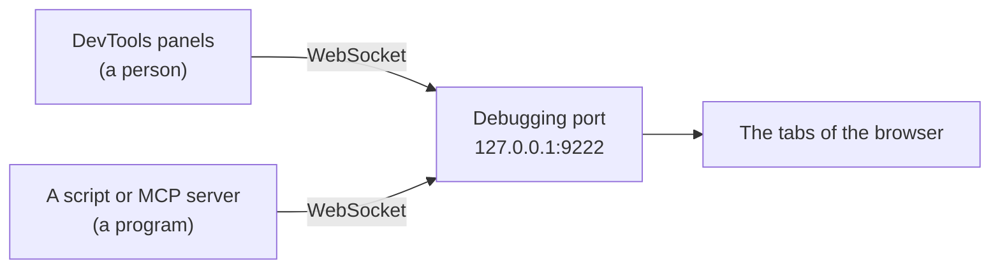

<Info>

**In short:** the developer tools (DevTools) are a set of panels built into
Chrome, Edge, Firefox and Safari that show what a page is made of and what it is
doing. Every automation problem you meet, a selector that matches nothing, a
request that fails, a script that throws, can be looked at there first.
seleniumbase-rs gives you the same view from the command line and from MCP
tools.

</Info>

## Opening the tools

Press **F12**, or **Ctrl+Shift+I** (Windows and Linux) or
**Cmd+Option+I** (macOS), or right-click an element and choose **Inspect**. A
panel opens beside or below the page. In Chrome, the tools are themselves a web
page that talks to the page you inspect over the
[Chrome DevTools Protocol](/concepts/cdp), so anything the panels can do, a
program can do too.

## The panels

| Panel | What it shows | A use in testing |
|---|---|---|
| **Elements** | The live [DOM](/concepts/selectors-and-the-dom) and the CSS rules that apply to each node | Find a stable selector, see why an element is hidden |
| **Console** | Messages from the page, and a prompt that runs JavaScript | Try a selector, read errors, run a one-line check |
| **Sources** | The page's scripts, with breakpoints and stepping | Find out which script changes a value |
| **Network** | Every request and response, with timing, headers and bodies | Find the API call behind a button, see a failure |
| **Performance** | A recording of what the browser did, frame by frame | Explain a page that is slow to become ready |
| **Memory** | Heap snapshots | Hunt a leak in a long-running page |
| **Application** | Cookies, local storage, IndexedDB, service workers | Check login state, see [what a session keeps](/concepts/sessions-and-state) |
| **Security** | Certificate and mixed-content information | Understand a certificate error |
| **Lighthouse** | An audit for speed, accessibility and best practice | A quick quality check |
| **Recorder** | Records clicks and typing as a replayable flow | A first draft of a test |

Most of this page is about two of them, Console and Network, because they are
the two you will open most often when a test misbehaves.

## The Console in depth

The Console has two jobs: it **shows** what the page logs, and it **runs**
what you type, in the page's own context, with the page's own variables.

### Levels

Every message has a level. The filter menu at the top of the panel shows or
hides each level.

| JavaScript call | Level in the filter | Looks like |
|---|---|---|
| `console.debug(...)` | Verbose | Grey text, hidden by default |
| `console.log(...)` and `console.info(...)` | Info | Plain text |
| `console.warn(...)` | Warnings | Yellow, with a warning icon |
| `console.error(...)` | Errors | Red, with a stack trace |

The browser also writes to the Console by itself, always at the Error or Warning
level: an **uncaught exception** in a script, a **promise rejected** with nothing
to handle it, a **failed request** (`Failed to load resource`), a
mixed-content or CORS block, and a deprecation notice. For a test these are
valuable: a page that renders fine but logs a red error is often the first sign
of a bug.

### Helpers that only exist in the Console

The Console has a few shortcuts that are **not** part of the page. A script on
the page cannot use them, only the prompt can.

| Helper | What it does |
|---|---|
| `$0` | The element currently selected in the Elements panel. `$1` to `$4` are the ones selected before |
| `$_` | The value of the last expression you ran |
| `$('css')` | Shortcut for `document.querySelector('css')`: the first match |
| `$$('css')` | Shortcut for `document.querySelectorAll('css')`, but returns a real **array**, so `map` and `filter` work |
| `$x('//xpath')` | Evaluates an XPath expression and returns an array of nodes |
| `copy(value)` | Puts a value on the clipboard, handy for a large JSON |
| `inspect(node)` | Selects a node in the Elements panel |
| `getEventListeners(node)` | Lists the event listeners attached to a node |
| `monitorEvents(node, 'click')` | Logs every event of that type on the node |

A typical selector check takes ten seconds. Select the button in the Elements
panel, then type:

```js
$0.outerHTML                      // what exactly did I select?
$$('button.primary').length       // how many elements will my selector match?
$$('button.primary').map(b => b.textContent.trim())
```

If the length is `0` or `2`, the selector is wrong for a test whatever it looks
like on screen. Remember that the Console runs in the **top frame** by default;
a selector for something inside an `iframe` needs the context menu at the top
of the panel switched to that frame, just as automation must switch to the
frame first.

### Other useful calls

`console.table(array)` prints an array of objects as a table,
`console.group` and `console.groupEnd` indent related lines,
`console.time('x')` with `console.timeEnd('x')` measures a duration,
`console.assert(condition, 'message')` logs only when the condition is false,
and `console.trace()` prints the call stack at that point. Tick **Preserve log**
to keep messages across a page navigation, which is what you want while
debugging a login flow.

## Network and Copy as cURL

The Network panel lists every request the page makes. Click one to see its
request headers, response headers, payload and response body. The filter row
narrows the list to `Fetch/XHR` (the API calls of a modern app, see
[frontends, backends and APIs](/concepts/frontends-backends-and-apis)),
documents, scripts or images.

Right-click a request and **Copy** offers several forms. **Copy as cURL**
produces a command you can paste into a terminal and run, with the method, URL,
headers, cookies and body of that exact request:

```bash
curl 'https://example.com/api/items?page=2' \
  -H 'accept: application/json' \
  -H 'authorization: Bearer REDACTED' \
  -H 'cookie: session=REDACTED' \
  --compressed
```

<Warning>

A copied request includes your **cookies and authorization headers**. They are
real credentials for your account. Do not paste them into a ticket, a chat or a
repository. Replace them with a placeholder, or log in with a throwaway test
account when you build a request you plan to share.

</Warning>

Reproducing a request with `curl` answers a useful question: does the call work
without the browser? If it does, a test may not need a browser for that step at
all; if it fails, the difference between the browser's request and yours (a
header, a cookie, a token) is the thing to find. **Copy as fetch** gives the
same request as JavaScript, and **Save all as HAR** writes the whole list to a
file that other tools can read, as described in [Network](/concepts/network).

## The remote debugging port

The tools above are a client. What they connect to is a **debugging port** that
the browser itself opens. When the tools are built into the same browser you
barely notice it, but you can start Chrome with a port and connect to it
from another program, or from the DevTools of another Chrome:

```bash
chrome --remote-debugging-port=9222 --user-data-dir=/tmp/debug-profile
```

Then open `http://127.0.0.1:9222/json/version` in any browser to see the
version and the WebSocket address, or open `chrome://inspect` in another Chrome
to attach to the tabs. The messages on that connection are the ones described in
[the CDP page](/concepts/cdp).



*Several clients can attach to the same tab at once, so a person can watch the
panels while a program drives the page.*

<Warning>

Whoever can reach the debugging port controls the whole browser: its pages, its
cookies and its logins. Chrome listens on the local machine only by default,
and recent versions refuse the port for the browser's default profile, which is
why the command above names a separate `--user-data-dir`. Use a throwaway
profile and never expose the port to a network.

</Warning>

## How seleniumbase-rs uses it

The project does not draw its own tools. It starts a browser the real DevTools
can reach and gives programs and AI assistants the same information.

<Tabs>

<Tab title="sbrs devtools" icon="terminal">

`sbrs devtools` launches Chrome with the pure CDP engine, listening on
`127.0.0.1` port 9222 (`--port 0` lets Chrome pick a free one). It prints the
HTTP endpoint, the browser WebSocket address and ready-to-paste configurations
for Google's `chrome-devtools-mcp` and Microsoft's Playwright MCP, then keeps
the browser open until you press Ctrl+C. `--json` prints the same information as
one line of JSON.

```bash
sbrs devtools --port 9222
sbrs devtools --headless --json
```

While it runs, open `chrome://inspect` in another Chrome, or point an MCP
client at the endpoint, and look at the very same tab.

</Tab>

<Tab title="sbrs cdp" icon="bolt">

`sbrs cdp --cmd METHOD` runs one raw
[CDP](/concepts/cdp) command and prints the reply, with `--params` taking a JSON
object. It is the command-line equivalent of typing into the protocol monitor.

```bash
sbrs cdp --cmd Browser.getVersion
sbrs cdp --cmd Target.getTargets
```

The global `--cdp` switch is different: it turns on CDP mode for a command, so
the session uses the DevTools Protocol next to WebDriver. It cannot be combined
with `--uc`.

</Tab>

<Tab title="From Rust" icon="code">

A browser started by the pure CDP engine knows where its endpoint is.
`Browser::devtools_endpoint()` returns a `DevToolsEndpoint`, whose
`http_url()`, `websocket_url()` and `version_url()` give the three addresses
above, and which can write the client configurations for the two MCP servers.

```rust,ignore src/main.rs
use seleniumbase_rs::sb_cdp::{Browser, LaunchOptions};

let browser = Browser::launch(LaunchOptions::builder().headless(true).build()?).await?;
let endpoint = browser.devtools_endpoint();
println!("attach DevTools to {}", endpoint.http_url());
println!("version document: {}", endpoint.version_url());
```

</Tab>

</Tabs>

### Debugging tools for MCP clients

The MCP servers of `sbrs-mcp` (see [MCP](/concepts/mcp)) offer the pieces of the
panels as tools, so an assistant can look at a page the way you would:

| Tool | Panel it stands in for |
|---|---|
| `get_console_messages` | Console. `start` begins recording, `level` filters (for example `error`), `limit` and `clear` bound and reset the list |
| `get_failed_requests` | Network. Lists requests that failed or returned 400 and up; `watch` records every failure on the pure CDP engine |
| `inspect_page` | Elements. An outline of the page |
| `diagnose_selector` | Console `$$`. Says why a selector matches nothing or too much |
| `capture_debug_bundle` | Several panels at once, saved for a bug report |
| `get_devtools_endpoint` | The debugging port. Returns the same addresses and configs as `sbrs devtools` |

<Tip>

When a test fails and you do not know why, work from cheap to costly. First read
the console errors and the failed requests, because they often name the cause.
Then check the selector with `$$` in a headed browser. Only then reach for
sources, breakpoints and the performance recording.

</Tip>

## Where to go next

<Columns cols={2}>

<Card title="The DevTools Protocol" icon="bolt" href="/concepts/cdp">
  The messages behind every panel.
</Card>

<Card title="Selectors and the DOM" icon="crosshairs" href="/concepts/selectors-and-the-dom">
  What the Elements panel shows and how to pick a stable selector.
</Card>

<Card title="Network" icon="network-wired" href="/concepts/network">
  Interception, HAR files and proxies.
</Card>

<Card title="JavaScript and events" icon="code" href="/concepts/javascript-and-events">
  What runs in the page and what the Console can reach.
</Card>

</Columns>
