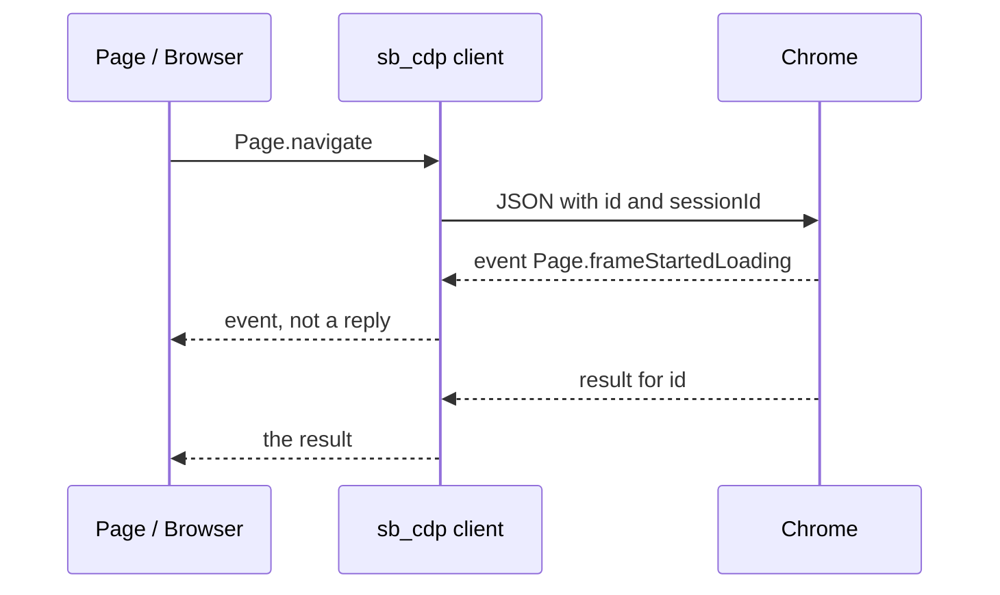

The Chrome DevTools Protocol (CDP) is the JSON protocol Chrome's own developer
tools use. The panels are one client of it. The pure CDP engine
(`seleniumbase_rs::sb_cdp`) is another: it starts Chrome and talks to it
directly, with no chromedriver. The panels themselves, Console helpers and
Copy as cURL, are on [DevTools and CDP](/concepts/cdp). This page is the
protocol and the way this crate speaks it.

<Info>

**In short:** Chrome listens on a debugging port. A client opens one WebSocket,
sends commands (`method`, `params`, `id`) and receives events (`method`,
`params`, no `id`). A **target** is a tab, a worker or the browser. A
**session** is a connection to one target. A **domain** (`Page`, `Runtime`,
`Input`, `Network`, `Fetch`, `Emulation`) is a group of commands and events.

</Info>

## Targets, sessions, domains

Chrome publishes an HTTP endpoint, usually
`http://127.0.0.1:<port>/json/version`, that names the browser WebSocket.
`/json/list` names the targets: each page, iframe target, service worker and
the browser itself, with a target id and, for a page, a WebSocket URL.

A command sent on the browser socket without a session id is a browser
command (`Target.getTargets`, `Target.createTarget`). To drive one tab the
client attaches, and Chrome answers with a **session id**. Later commands for
that tab carry that session id. Events from the tab carry it too, so one
socket can serve every tab without mixing their replies.

Commands and events are grouped into domains. The ones this engine uses most:

| Domain | What it is for here |
| --- | --- |
| `Target` | List, create and attach to tabs and contexts |
| `Page` | Navigate, wait for load, add a script that runs in every new document |
| `Runtime` | Evaluate JavaScript, including `clear_cdc_properties` |
| `Input` | Mouse and key events a page treats as a person's input |
| `DOM` | Describe a node |
| `Network` | Extra headers, cache, user agent |
| `Fetch` | Pause and rewrite a request |
| `Emulation` | Time zone, locale, geolocation, device metrics |

A **command** is a request the client expects an answer to. An **event** is
something the browser sends on its own (`Page.loadEventFired`,
`Target.targetCreated`). Events have no request id.

## How a command and an event look

```json
{ "id": 3, "method": "Page.navigate", "params": { "url": "https://example.com/" }, "sessionId": "ABC" }
```

```json
{ "id": 3, "result": { "frameId": "…", "loaderId": "…" } }
```

```json
{ "method": "Page.loadEventFired", "params": { "timestamp": 12345.6 }, "sessionId": "ABC" }
```

A reply with `error` instead of `result` is the browser refusing the command.
The engine surfaces that text.



*One socket. Replies match an id. Events do not.*

## How this crate speaks it

The client is `src/sb_cdp/client.rs`.

- **One WebSocket per connection.** `Client::connect` opens it. A reader task
  pulls messages off the socket. A reply whose `id` matches a pending command
  completes that command and no other (`dispatch`). A message with no `id` is
  an event and is broadcast. Commands from different tabs do not wait on each
  other.
- **Time limits.** A command with no reply is abandoned after 30 seconds
  (`COMMAND_TIMEOUT`). The WebSocket handshake has the same limit
  (`CONNECT_TIMEOUT`).
- **Events.** `CdpEvent` is `method`, `params` and `session_id`. `Events::next`
  yields the next one for that session. A listener that falls behind does not
  stall the socket; `missed` counts what it skipped. The channel holds 1024
  events (`EVENT_BACKLOG`).
- **Size.** The connection accepts a message up to 256 MiB
  (`MAX_MESSAGE_BYTES`). The WebSocket default of 16 MiB a frame is too small
  for a large `Network.getResponseBody`, and a message over the limit closes
  the connection for every tab.

`Browser` (`src/sb_cdp/browser.rs`) is the browser target. `Browser::launch`
starts Chrome with a debugging port and waits until the endpoint is published
(20 seconds unless `startup_timeout` says otherwise). `Browser::execute` sends
a command with no session id. `Browser::default_page` attaches to the first
page target and returns a `Page`. `Browser::new_context` creates an isolated
browser context and a tab inside it.

`Page` (`src/sb_cdp/page.rs`) is one session. `Page::execute(method, params)`
sends a command on that session. `Page::goto` listens for the load event
before it sends `Page.navigate`, then reads `errorText` and `loaderId` from
the reply. A navigation that only changes the `#fragment` has no `loaderId`
and fires no load event, so it returns at once. `Page::mouse` and
`Page::keyboard` send `Input.dispatchMouseEvent` and `Input.dispatchKeyEvent`.
`Page::events` is the event stream for that session.

`Browser::new_mocked` (feature `test-util`) uses the same `Client` with a
`Link::Mock` instead of a socket, so page-driving code can be tested without
Chrome.

## How this differs from WebDriver

| | WebDriver | This engine |
| --- | --- | --- |
| Extra process | chromedriver | None |
| Transport | One HTTP request per command | One WebSocket |
| Who starts Chrome | The driver | `Browser::launch` |
| Events | None in the classic protocol | First-class (`Page::events`) |
| Addressing | Session id, then an element id the driver minted | Target, then session id, then a DOM node |
| Browsers | The ones with a driver | Chromium |
| In this crate | `BaseCase` | `sb_cdp::Browser`, `Page`, `Locator` |

WebDriver BiDi is not implemented here. [WebDriver](/concepts/webdriver#webdriver-bidi)
says what it would add.

`DriverMode::Cdp` is the other use: a `BaseCase` session keeps chromedriver
and opens a CDP socket beside it. That is [CDP mode](/tutorials/cdp_mode), not
the driverless engine.

## `sbrs devtools`

`sbrs devtools` is not a second protocol. It launches Chrome with the pure CDP
engine, listening on `127.0.0.1` port 9222 (`--port 0` lets Chrome pick a free
port), prints the HTTP endpoint and the browser WebSocket, and prints
configurations for other DevTools clients. The browser stays up until
Ctrl+C. `--json` prints the same facts as JSON. Anything those clients do
after that is ordinary CDP against the same debugging port.

The [CDP page](/concepts/cdp) covers the panels you open by hand, what a page
load and a click look like command by command, and the MCP debugging tools.
