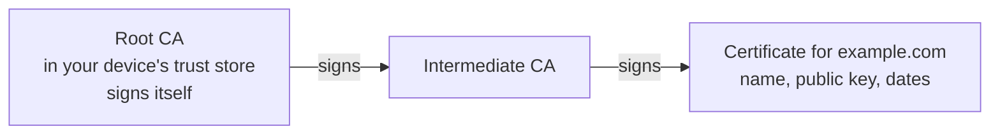
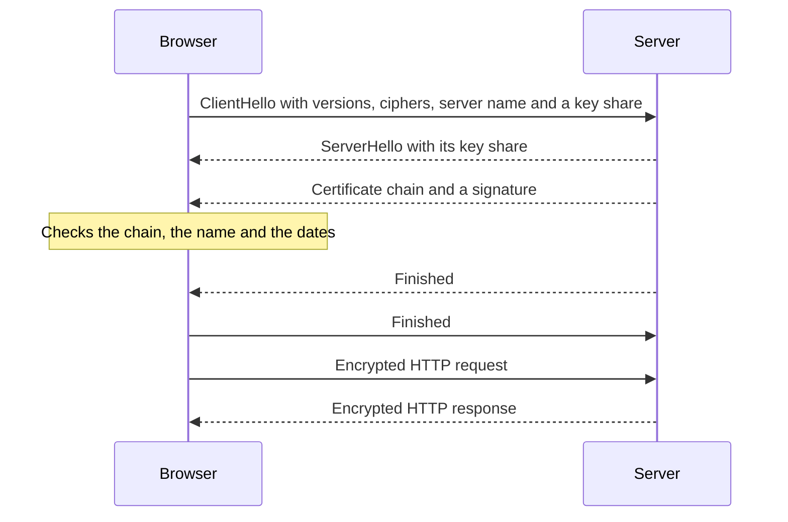

<Info>

**In short:** *encoding* changes how data looks, *hashing* makes a fingerprint
of it, and *encryption* hides it behind a key. They are not interchangeable.
Most real mistakes are one used in place of another, for example Base64 on a
password and a feeling that it is "encrypted". seleniumbase-rs has real
encryption (`sbrs encrypt`, AES-256-GCM) and a separate, clearly labelled
scrambling helper that is **not** encryption.

</Info>

## Three things that are often confused

| | Encoding | Hashing | Encryption |
|---|---|---|---|
| Purpose | Fit data into a format | Make a fixed-size fingerprint | Keep data secret |
| Reversible? | Yes, by anyone | No | Yes, with the key |
| Needs a key? | No | No (HMAC does) | Yes |
| Examples | Base64, URL encoding, hex | SHA-256, bcrypt, Argon2 | AES-GCM, ChaCha20-Poly1305, RSA |
| Hides the data? | **No** | Not meant to | Yes |

An address on an envelope is encoding. A wax seal is closer to a hash (it shows
tampering, it hides nothing). A locked box is encryption.

<Warning>

Base64 is not a secret. `cGFzc3dvcmQ=` is the word `password`, and every
programmer and every tool can decode it. When you see Base64 in a config file, a
URL or a token, it is only how the bytes were written down. The same is true
of ROT13 and of XOR with a short repeating key.

</Warning>

## Symmetric and asymmetric encryption

**Symmetric encryption** uses one key to lock and the same key to unlock. It is
fast, so it carries almost all the data on the internet. The standard cipher is
**AES**, used in a mode such as **GCM** that also adds a tag: if anyone changes
a single bit of the message, decryption fails instead of giving garbage. That
combination is called *authenticated encryption*. GCM needs a **nonce** (a
number used once) for every message under the same key; reusing one breaks it.
The problem: both sides must already share the key.

**Asymmetric encryption** uses a **key pair**. The *public* key can be given to
anyone and only locks; the *private* key stays secret and unlocks. It is like a
mailbox slot: anyone may drop a letter in, only the owner has the key to take it
out. It is slow, so in practice it is used only to **agree on a symmetric key**
(or to sign, below), and the symmetric cipher does the bulk work. RSA and
elliptic-curve systems (ECDH, X25519) are the usual ones.

## Hashes, HMAC and password storage

A **hash function** turns any input into a short fixed-length value. Properties
that matter: the same input always gives the same value, a tiny change gives a
completely different value, and you cannot work backwards.

- **Integrity.** Download a file, hash it, compare with the published hash. A
  browser's *Subresource Integrity* does this for scripts: the page says
  `integrity="sha384-..."` and the browser refuses a script that does not match.
- **HMAC** is a hash mixed with a secret key. Only someone with the key can make
  or check it, so it proves a message is authentic. Webhook signatures, the
  `HS256` kind of JWT and one-time-password codes all use it.

**Passwords** need a special kind of hash. A fast hash such as plain SHA-256 can
be tried billions of times a second by a thief with a stolen database. Password
hashes (**Argon2id**, **scrypt**, **bcrypt**, **PBKDF2**) are made deliberately
slow and memory-hungry, and each password gets its own random **salt**, so equal
passwords give different hashes and one table cannot crack everyone at once.
The same slow design is used for **key derivation**: turning a passphrase a person
can remember into a strong key a cipher can use.

## Signatures

A **digital signature** is the asymmetric idea reversed: the *private* key
makes the signature and the *public* key checks it. Anyone can verify that the
message came from the key's owner and was not changed, and the owner cannot
deny it. Signatures are behind certificates, software updates, signed Git
commits and the `RS256` or `ES256` kind of JWT. RSA, ECDSA and Ed25519 are the
common algorithms.

## Certificates and the chain of trust

If a public key arrives over the network, how do you know it belongs to
`example.com` and not to someone in the middle? A **certificate** answers that:
a small document that says "this public key belongs to this name", signed by a
**certificate authority** (CA) that your device already trusts.



*The chain of trust. The browser follows the signatures from the site's
certificate up to a root it already holds.*

The browser checks four things: the chain leads to a trusted root; the name in
the certificate (its *Subject Alternative Name*) matches the address; today is
inside the validity dates; and the certificate has not been revoked. This system
is the **public key infrastructure** (PKI). Certificates are logged in public
**Certificate Transparency** logs, so a wrongly issued one can be noticed.

## TLS: putting it together

**TLS** is the protocol under `https://`. In a few steps it gets two strangers
to agree on a secret key, checks who the server is and then encrypts everything.



*A simplified TLS 1.3 handshake.*

The key agreement uses temporary keys (ECDHE), which gives **forward secrecy**:
a recording of the traffic cannot be opened later, even if the server's long-term
private key is stolen. The details of the first message are also what
makes a client recognisable; see [network](/concepts/network) for TLS
fingerprints, and [how a page loads](/concepts/how-a-page-loads) for where the
handshake sits in a navigation.

**What tests meet:** a staging server with a self-signed or expired certificate
makes Chrome show a full-page warning (`NET::ERR_CERT_AUTHORITY_INVALID` and
friends), and a test stops there. The right fix is to give the test machine the
staging CA in its trust store. Chrome also has command-line flags that ignore
certificate errors; use them only against hosts you control, never for
browsing in general, because they switch off the protection TLS exists for.

## Secrets in test code

Tests need passwords, API keys and tokens, and the usual mistakes are all the
same mistake: the secret ends up where many people can read it.

- Do not write a secret in source code, in a test file or in a committed
  `.env` file. Git keeps it forever, even after you delete it.
- Read secrets from the **environment** or a secret store at run time, and keep them out
  of command-line arguments (they show up in process lists and shell history).
- Use **dedicated test accounts** with the least rights, not a real person's.
- Keep secrets out of logs, screenshots and saved HTML. A page screenshot of a
  filled login form contains the password if it is shown in the field.
- **Rotate** a secret that was exposed; deleting the file is not enough.
- Run a **secret scanner** over the repository before publishing (tools such as
  TruffleHog and ripsecrets look for key-like strings).

## How seleniumbase-rs uses it

<Tabs>

<Tab title="Real encryption" icon="lock">

The module `seleniumbase_rs::common::encryption` is built on the `ring` library.

- `encrypt_with_passphrase(plaintext, passphrase)` and
  `decrypt_with_passphrase(token, passphrase)` are the ones to use. The key comes
  from **PBKDF2-HMAC-SHA256** with **600,000 iterations** (the source says this
  follows OWASP's 2023 recommendation) and a fresh random 16-byte **salt**. The
  text is then sealed with **AES-256-GCM** and a random 12-byte nonce. The result
  is a printable token `sbenc1:` followed by the iteration count, the salt and
  the sealed text, so the format can change later without old tokens becoming
  ambiguous.
- The same text encrypts differently each time. A wrong passphrase or a changed
  token fails to decrypt, instead of giving garbage. When decrypting, the
  iteration count in the token is treated as untrusted input and is refused
  outside the range 1 to 10,000,000, so a crafted token cannot hang the caller.
- `aes_encrypt(plaintext, key)` and `aes_decrypt(ciphertext, key)` are the
  lower-level pair that take a raw 32-byte key (any other length is an error).

```rust,ignore src/main.rs
use seleniumbase_rs::common::encryption::{decrypt_with_passphrase, encrypt_with_passphrase};

let token = encrypt_with_passphrase("my-password", &passphrase)?;
assert!(token.starts_with("sbenc1:"));
assert_eq!(decrypt_with_passphrase(&token, &passphrase)?, "my-password");
```

</Tab>

<Tab title="The sbrs commands" icon="terminal">

`sbrs encrypt` and `sbrs decrypt` wrap the two functions above. The passphrase
comes from the environment variable `SB_ENCRYPTION_KEY` and is never an
argument, so it stays out of shell history and process listings; the command
fails with a message when it is unset or empty. The text comes from the
argument or, when omitted, from standard input.

```bash
export SB_ENCRYPTION_KEY='a long passphrase from your secret store'
sbrs encrypt 'my secret'               # prints a token that starts with sbenc1:
echo 'my secret' | sbrs encrypt        # the same, from standard input
sbrs decrypt 'sbenc1:...'              # prints the original text
```

Python SeleniumBase has commands named `obfuscate` and `unobfuscate`. In
seleniumbase-rs they are aliases of `encrypt` and `decrypt`. That means the
**tokens are not compatible** with Python's, which is a reversible scrambling with
a fixed key.

</Tab>

<Tab title="Scrambling, not encryption" icon="shuffle">

`seleniumbase_rs::common::obfuscate` and `unobfuscate` hold `rot13`,
`base64_encode` and `obfuscate` (ROT13, then Base64). The module documentation is
blunt: "This is not encryption." Anyone can undo it without a key. For example
`obfuscate("selenium")` gives `ZnJ5cmF2aHo=`. It is meant to keep a value from
being read at a glance, such as a name in a log line or a sample config, and
nothing more. `xor_obfuscate` and `xor_deobfuscate` in the encryption module are
the same kind of thing (a repeating key XOR, then Base64).

</Tab>

<Tab title="TLS in the library" icon="certificate">

The HTTP clients the crate builds use `rustls`, with the `ring` crypto provider.
`install_tls_provider()` installs that provider for the process, if the program
did not install one. Call it before building your own `reqwest` client in a
program that uses the crate, because a client built before any provider is set
panics.

</Tab>

</Tabs>

### What `sbrs encrypt` protects against, and what it does not

| It protects against | It does not protect against |
|---|---|
| Someone reading a committed config file, a repository, a log or a backup that holds the token | Anyone who has the passphrase: the test run must have it, so it has to live in a secret store |
| Quick offline guessing of the passphrase, because every try costs 600,000 hashing rounds | A weak or short passphrase. A slow hash helps, but cannot save "password123" |
| Silent tampering with the token (GCM fails) | The decrypted text once it is in memory, in a form field, or in a screenshot taken after typing it |
| Seeing that two tokens hold the same text (random salt and nonce) | Another process of the same user reading the environment variable |

<Note>

The encryption protects a value **at rest**. The moment a test types it into a
page, the site receives it like any other input. Choose test accounts you can
afford to leak.

</Note>

## Where to go next

<Columns cols={2}>

<Card title="Authentication" icon="key" color="#1a85d4" href="/concepts/authentication">
  Logins, tokens, JWTs and one-time codes.
</Card>

<Card title="Web security" icon="shield-halved" color="#d52c36" href="/concepts/web-security">
  The common attacks and how a supply chain is kept safe.
</Card>

<Card title="Network" icon="network-wired" color="#a631be" href="/concepts/network">
  TLS fingerprints, proxies and what a site sees on the wire.
</Card>

<Card title="Glossary" icon="book" color="#199f43" href="/glossary">
  Short definitions of every term used in these pages.
</Card>

</Columns>
