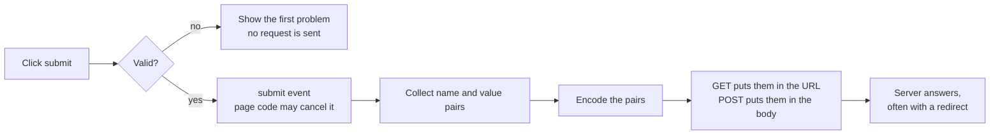

<Info>

**In short:** a form is a list of named fields plus a rule for sending them. When
you press submit, the browser checks the fields, collects the `name` and value of
each one, encodes them and sends one HTTP request. Almost every automation script
touches a form, and most flaky form tests come from one fact: a page reacts to
**events**, not to the value you see in the field.

</Info>

## What a form is

```html
<form action="/signup" method="post">
  <input name="name" type="text" required>
  <select name="plan"><option value="free">Free</option><option value="pro">Pro</option></select>
  <input name="terms" type="checkbox">
  <button type="submit">Create account</button>
</form>
```

The `action` is where to send, the `method` is how. Each control with a `name`
is one entry. Three rules explain surprises in tests:

- A control **without a `name`** is not sent.
- A **disabled** control is not sent, although a read-only one is.
- An **unchecked** checkbox or radio button is not sent at all: the server sees
  no entry, not "off". A checked one with no `value` sends `on`.



*What the browser does between the click and the request.*

## GET and POST

| | GET | POST |
|---|---|---|
| Where the data goes | The address: `/search?q=shoes&page=2` | The request body |
| Visible in history and logs | Yes | No (the body is not in the address) |
| Can be bookmarked and repeated | Yes | No: reloading asks to resubmit |
| Used for | Reading: searches, filters | Changing: sign-up, payment, upload |
| Size | Limited by the address length | Large |

Never put a password or token in a GET form: it lands in the history, the server
log and the `Referer` header. After a successful POST, well-built sites answer
with a **redirect** to a GET page, so a reload does not resubmit the form; a test
should wait for the new address rather than read the page it just left.

## How the body is encoded

The `enctype` attribute chooses the format.

```http
POST /signup HTTP/1.1
Content-Type: application/x-www-form-urlencoded

name=Ada+Lovelace&plan=pro&terms=on
```

`application/x-www-form-urlencoded` is the default: `name=value` pairs joined
by `&`, with spaces as `+` and other characters as `%` and two hex digits.

```http
POST /profile HTTP/1.1
Content-Type: multipart/form-data; boundary=----b0und4ry

------b0und4ry
Content-Disposition: form-data; name="name"

Ada
------b0und4ry
Content-Disposition: form-data; name="photo"; filename="ada.png"
Content-Type: image/png

(the bytes of the file)
------b0und4ry--
```

`multipart/form-data` sends each field as its own part, separated by a
**boundary** string, and is **required for file uploads** because a part can
hold raw bytes. A third type, `text/plain`, is rarely used. Many modern pages
skip all of this: JavaScript reads the fields and sends JSON with `fetch`, and
the form is only a way to collect them. See
[frontends, backends and APIs](/concepts/frontends-backends-and-apis).

## Input types

The `type` attribute decides the keyboard on a phone, the built-in checks and
the widget the browser draws.

| Type | What it is | Test note |
|---|---|---|
| `text`, `search`, `tel` | Free text | Plain typing |
| `password` | Hidden characters | Never log or screenshot what you typed |
| `email`, `url` | Text with a format check | Invalid text blocks the submit |
| `number` | Digits, with up and down arrows | Letters are dropped by the browser |
| `date`, `time`, `datetime-local`, `month`, `week` | A date picker | The value is always `2026-10-23`; the display follows the locale |
| `checkbox`, `radio` | Choices | Often hidden behind a styled label |
| `range`, `color` | Slider, colour chooser | Typing does nothing; the value must be set |
| `file` | File chooser | See below |
| `hidden` | Not shown | Often holds the CSRF token |
| `submit`, `button`, `reset` | Buttons | A `button` inside a form submits by default |

`textarea` is a multi-line text field, `select` a dropdown (with `option`
entries, and `multiple` for several), and `datalist` offers suggestions for a
text field.

## Constraint validation

The browser checks fields before it sends anything, using attributes:
`required`, `pattern` (a regular expression), `min` and `max`, `minlength` and
`maxlength`, `step`, and the `type` itself. A failing field stops the submit and
the browser shows a small message next to it.

For tests that matters twice:

- The message bubble is **drawn by the browser, not part of the page**, so no
  selector finds it. Read the field's `validationMessage` and `validity`
  properties instead, or check that the field matches the `:invalid` selector.
- The `novalidate` attribute on the form turns the checks off, and any script can
  call `checkValidity()` or `reportValidity()` or set its own text with
  `setCustomValidity()`.

<Warning>

Browser validation is a courtesy to the user, not a defence. Anyone can send a
request without a browser. The **server must check every value again**, and a good
suite tests that too, by posting values the form would never allow.

</Warning>

## File uploads

A page cannot choose a file for the user: `input type="file"` lets only the
person pick, through the system's file dialog. That dialog is not part of the
web page, so automation cannot click through it.

The way around it is to skip the dialog: give the **input element itself** the
path of the file.

- With WebDriver, sending the absolute path as "keys" to the file input does it.
- With the [DevTools Protocol](/concepts/cdp), the command `DOM.setFileInputFiles`
  sets the files of the input.

Two practical points: the input is often **hidden** behind a styled button or a
drag-and-drop area, but it is still in the page, so aim at the `input` element and
not at the button; and `accept` and `multiple` attributes are only hints for the
dialog, so the page's own script or the server decides what is really allowed.

## Autofill and password managers

Browsers fill fields from saved data. They decide what a field is from the
`autocomplete` attribute (`username`, `current-password`, `new-password`,
`email`, `one-time-code`, `cc-number`, and others) and from its name and label.
In tests this causes two problems: a saved login filling a field the test
then types into, and a prompt such as "Save password?" in the way. A **fresh
profile** per run avoids both, and a good suite sets the `autocomplete` values
so that the real browser and the test agree on what each field means.

## CSRF tokens

A form that changes data usually contains a **hidden token** (often named
something like `_csrf` or `authenticity_token`) tied to the user's session, which
the server checks on submit. A hostile page cannot read it, so it cannot forge the
form. See [web security](/concepts/web-security) for the attack.

For a test this means: never hard-code the token, because it changes per session
(and often per page load). A test that fills a real page gets a valid token for
free. A test that posts the request directly must first load the form with the
same cookie jar, read the token out of the page, and send it back.

## Custom widgets and framework-controlled inputs

Many sites replace the native controls with their own.

- **Styled dropdowns** are usually a `div` that opens a list, not a `select`.
  A "select an option" command will not work. Click to open, then click the
  option, as a user would. Good widgets expose ARIA roles such as `combobox`,
  `listbox` and `option` that make selectors reliable.
- **Date pickers, rich-text editors** (an element with `contenteditable`) and
  **masked inputs** (a phone number that reformats as you type) have their own code
  behind them.
- **Autocomplete boxes** wait for typing, ask a server and show results
  later. Type, then *wait* for the list, then click.

The hardest case is the **framework-controlled input**. In React, Vue, Angular and
similar frameworks (see [frameworks and the DOM](/concepts/selectors-and-the-dom#one-page-three-doms))
the field's value lives in the framework's **state**; the framework draws it into
the field and listens for `input` and `change` events to learn about edits.

That has a consequence. If a script sets the field's `value` property directly,
the screen shows the new text, but no event fired, the state still holds the old
value, and the next redraw puts the old text back (or the submit button stays
disabled). The fix is to produce the **events the page waits for**:

1. **Type like a user**: key by key. Each key gives the page `keydown`, `input`
   and `keyup`, and masks and live validation work.
2. **Insert text in one step**: faster, and the page still receives a genuine
   `input` event, but not the per-key events. Fine for plain fields, not for
   masks.
3. **Set the value and dispatch events**: for controls that ignore the keyboard,
   such as a range slider, set the value and then dispatch bubbling `input` and
   `change` events. Some frameworks need the browser's own value setter used first.

Also remember **blur**: many forms validate when you leave a field. After typing,
move the focus (press Tab, or click elsewhere) before you expect the error text.
For more on events and waiting, see
[JavaScript, events and waiting](/concepts/javascript-and-events).

## How seleniumbase-rs uses it

<Tabs>

<Tab title="BaseCase (WebDriver)" icon="plug">

Each method waits for its element first.

- `type_text(css, text)` types into the field (it waits until the element is
  visible), and `clear(css)` empties it.
- `select_option_by_text(css, text)` and `select_option_by_value(css, value)`
  choose an `option` of a real `select`; `get_select_options` lists them (their
  text, or `.attribute("value")` or `.attribute("index")`), and
  `get_attribute(css, "value")` gives the chosen value.
- `check_if_unchecked(css)` and `uncheck_if_checked(css)` click a checkbox only
  when needed, and `is_checked(css)` reads its state.
- `choose_file(css, file_path)` waits for the element (up to 10 seconds), turns
  the path into an absolute one and sends it to the `input type="file"`. A path
  that does not exist is an error, `File not found`, before anything is sent.
- `submit(css)` submits the form that contains the selected element.
- `set_value(css, value)` sets the value with a script, with no key events, as in
  Python. A value that ends with a newline presses Enter in the field (the newline is
  not part of the value), and on a range input a `mousemove` event follows, which is
  what moves a progress bar that listens to the slider.


```rust,ignore src/main.rs
sb.type_text("#email", "ada@example.com").await?;
sb.select_option_by_text("#plan", "Pro").await?;
sb.check_if_unchecked("#terms").await?;
sb.choose_file("input[type=file]", "fixtures/photo.png").await?;
sb.submit("#email").await?;           // submits the form that holds #email
```

</Tab>

<Tab title="Locator (pure CDP)" icon="bolt">

The `Locator` of the [DevTools Protocol](/concepts/cdp) engine has one method
for each of the three ways of producing events described above:

| Method | What it does | Events the page sees |
|---|---|---|
| `type_text(text)` | Empties the field, then types one key at a time | Key events and `input` for each character |
| `fill(text)` | Empties the field, then inserts the text in one step | A genuine `input` event, no per-key events |
| `send_keys(text)` | Types one key at a time **after** what is there | Key events and `input` |
| `set_value(value)` | Sets the value directly | `input` and `change`; for controls that ignore keys, such as range sliders |

`select_option(SelectBy::Text(..))` (or `Value(..)` or `Index(..)`) chooses an
option and returns `InvalidSelector` if there is none. `check()` and `uncheck()`
click a checkbox or radio button only if needed, and `press(key)` presses a
key on the focused field.

```rust,ignore src/main.rs
page.locator("#email").fill("ada@example.com").await?;
page.locator("#phone").type_text("5551234567").await?;        // a masked field: per-key
page.locator("#volume").set_value("70").await?;                 // a range slider
page.locator("#terms").check().await?;
```

</Tab>

<Tab title="What is not covered" icon="circle-info">

- There is no dedicated upload method on the pure CDP `Locator` that I could
  find. The protocol command `DOM.setFileInputFiles` can be sent by name with
  `Page::execute`.
- Styled dropdowns, date pickers and rich-text editors have no special
  helpers: drive them with clicks and typing, like a user.
- Browser validation bubbles are not in the DOM; read the field's
  `validationMessage` with a script instead.

</Tab>

</Tabs>

<Tip>

The pure CDP engine starts Chrome with `--password-store=basic` and
`--use-mock-keychain`, which stops macOS from asking for keychain access on
launch. It also turns off Chrome's leaked-password check, its password manager
and the offer to save a login (the preferences
`profile.password_manager_leak_detection`, `profile.password_manager_enabled`
and `credentials_enable_service`), as Python SeleniumBase does, and a
WebDriver session asks for the same. Without that, logging in with a password
on Chrome's list of leaked ones (saucedemo.com's `secret_sauce` is one) makes
the browser show a "data breach" prompt of its own, and while it is up the
browser takes the keyboard: `type_text` returns `Ok` and the field stays empty,
however long you wait. A profile you name with `user_data_dir` keeps its own
preferences; turn those off there with `LaunchOptions::builder().preference(..)`.
Autofill prompts still depend on the profile, so use a fresh one.

</Tip>

## Where to go next

<Columns cols={2}>

<Card title="Selectors and the DOM" icon="crosshairs" color="#1a85d4" href="/concepts/selectors-and-the-dom">
  Finding the field you want to fill, including inside iframes.
</Card>

<Card title="JavaScript and events" icon="bolt" color="#d47628" href="/concepts/javascript-and-events">
  Why a page reacts to events, and how waiting works.
</Card>

<Card title="Glossary" icon="book" color="#199f43" href="/glossary">
  Short definitions of every term used in these pages.
</Card>

</Columns>
