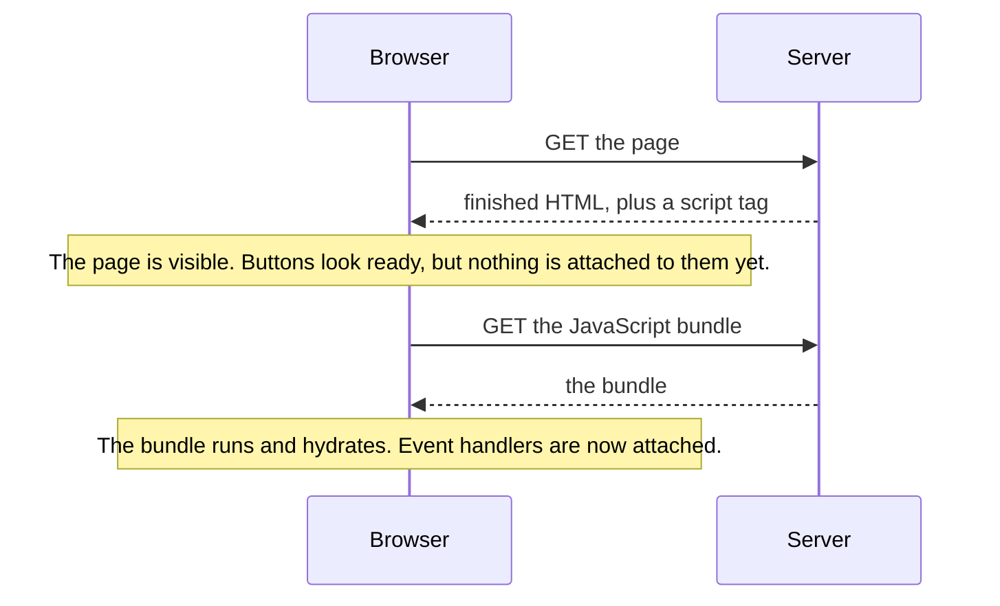

<Info>

**In short:** a test never sees the source code of a site, only the **DOM** the
browser built from it. Different frameworks build different DOMs from the same
design: some add generated class names that change every build, some add
attributes you must ignore, some fill the page in only after JavaScript runs.
Selectors that name what a user sees or what the team marked on purpose
(`data-testid`, roles, labels, text) survive all of that. Selectors that copy
what the framework happened to generate do not.

</Info>

## One page, three DOMs

The **DOM** (Document Object Model) is the live tree of elements the browser
keeps for a page. Tests, scripts and developer tools all work on it, not on the
HTML file. How it comes to exist is the first difference between sites.

<Tabs>

<Tab title="Server-rendered" icon="server">

The backend sends finished HTML. The DOM is what the HTML said, plus whatever
small scripts change afterwards. Every element is there when the load event
fires, so "page loaded" nearly means "content ready". PHP, Rails, Django and
most static sites work like this.

</Tab>

<Tab title="Client-rendered (SPA)" icon="window-maximize">

The backend sends an almost empty shell, for example one empty `div` with the id
`root`, and a JavaScript bundle. The bundle runs, fetches data as JSON and
**creates the DOM in the browser**. The load event fires while the page is still
empty, so a test has to wait for the content, not for the load. Clicking a link
may change the URL without loading a new document.

</Tab>

<Tab title="Server-rendered, then hydrated" icon="droplet">

The server sends finished HTML **and** the same JavaScript bundle. The page
looks ready at once, then the bundle runs and *hydrates* it: it attaches event
handlers to the existing elements. Next.js and Nuxt do this by default. Between
the two moments the page is visible but not yet interactive.

</Tab>

</Tabs>

See [how a page loads](/concepts/how-a-page-loads) for the events involved, and
[Frontends, backends and APIs](/concepts/frontends-backends-and-apis) for where
the HTML comes from.

## What each framework leaves in the DOM

Frameworks are libraries that keep the screen in step with the application's
data. To do that they add their own markers, and these markers are the first
thing a copied selector latches on to. This table shows what you will meet; the
exact names depend on the version and the build.

| Framework | How it updates the page | What it leaves in the DOM |
|---|---|---|
| **Plain HTML** | Nothing; scripts change the DOM by hand | Exactly what the author wrote, including stable `id` values |
| **React** | Keeps a *virtual DOM* (a light copy in memory), compares the old and new copy on each change and applies only the difference | No attributes of its own in production. Class names are often generated: `Button_primary__3xYz` (CSS Modules), `css-1x2y3z` (Emotion), `sc-bdfBwQ` (styled-components). Ids from `useId` look like `:r1:` |
| **Vue** | Reactive data triggers updates; templates compile to render functions | Scoped styles add an attribute such as `data-v-7ba5bd90` to every element of a component. A false `v-if` leaves a comment node in the DOM |
| **Angular** | Components with templates; *zones* (a library that wraps browser timers and events) tell it when to check for changes | Attributes such as `_ngcontent-abc-c123` on elements and `_nghost-abc-c123` on component hosts, an `ng-version` attribute on the root, and in development builds `ng-reflect-*` |
| **Svelte** | A *compiler*: it turns components into plain DOM code at build time, with no virtual DOM at run time | Scoped class names such as `svelte-1abc23x` added to your selectors' targets |
| **Next.js** (React) and **Nuxt** (Vue) | Server rendering plus hydration, and often routing without full page loads | A root such as `__next` or `__nuxt`, and a script tag holding the data the server used (`__NEXT_DATA__` in Next.js) |
| **Web Components** | The browser's own custom elements, with optional private DOM | Custom tags such as `my-card`, and *shadow roots* that hide their insides from ordinary selectors |

A few details that matter in practice:

- **Generated names change.** The hash in `Button_primary__3xYz` is derived from
  the file and its contents. Rename a file or upgrade the build tool and every
  such selector breaks, though nothing a user sees has changed.
- **Structure shifts.** A framework may wrap a component in extra `div`
  elements, and an A/B test may reorder a page. A selector that counts
  `div > div > div:nth-child(3)` breaks with it.
- **Portals and teleports.** A modal is often moved to the end of `body`, away
  from the button that opened it. A selector that starts at the button's parent
  will not find the dialog.
- **Virtualised lists.** Long lists (and "infinite scroll") may keep only the
  visible rows in the DOM. Row 80 does not exist until you scroll.
- **Controlled inputs.** React and similar frameworks watch input events, not
  the field's value. Setting `input.value = "x"` from a script changes what is on
  screen but not what the framework knows, so the next render may erase it. Real,
  trusted keystrokes fire the events the framework listens for.

## Hydration and why clicks get lost



*Server rendering with hydration. The gap between the two notes is where a very
early click does nothing.*

A test that clicks as soon as the button is visible can click inside that gap.
The click is delivered, but no handler is attached, so nothing happens and the
test fails for no visible reason. Remedies, from best to worst:

1. **Wait for the effect, not for the clock.** Click, then wait for the thing the
   click should cause. If it does not appear, click again, a few times at most.
2. Wait for a signal the app gives when it is ready, if the team can add one (an
   attribute set after hydration, or a network request that the page makes only
   once it is interactive).
3. Do not add a fixed `sleep`. It is slow when the page is fast and still fails
   when the page is slow.

**Hydration mismatches** are a related bug. If the HTML the server made differs
from what the browser would build (a date formatted in two time zones, a random
id, a value that depends on `window`), the framework warns in the console and may
rebuild the part of the page, discarding what a test just typed. A `Console`
error about hydration in a test run is worth reading (see
Developer tools).

## Web Components and the shadow DOM

**Web Components** are the browser's native way to make reusable elements:
custom tags such as `my-card`, defined with JavaScript. A component can attach a
**shadow root**, a private DOM tree inside the element. Styles and selectors from
outside do not reach into it, which is the point: the component's insides cannot
be damaged by the page around it.

- An **open** shadow root can be entered by script (`element.shadowRoot`).
- A **closed** shadow root cannot be entered from page script.
- Content passed in from outside appears through **slots**.

A plain CSS selector such as `my-card button` stops at the shadow boundary and
finds nothing. Tools therefore offer a way to cross it. In `BaseCase` this is the
`::shadow` combinator, as in `sb.shadow_click("my-app ::shadow button")`; see
[Shadow DOM](/tutorials/shadow_dom) and the
[Selectors guide](/tutorials/selectors#shadow-dom). Closed roots cannot be
entered by WebDriver or CDP either.

## Why a selector works on one site and not on another

A selector is a question asked of the DOM. It fails when the answer changes, and
the usual reasons are these:

| Symptom | Likely cause |
|---|---|
| Worked yesterday, fails after a deploy | A generated class name or attribute changed with the build |
| Finds nothing, though you see the element | It is in an iframe, in a shadow root, in a portal, or not rendered yet |
| Finds the wrong element | The selector is too loose: the same class is used in several places, or a list reorders |
| Works in the console, fails in the test | The test ran before the content was created (client rendering), or clicked before hydration |
| Works on staging, fails in production | Different build, different feature flags, or an A/B variant |
| Fails only at some window sizes | The site shows different markup on small screens |

`diagnose_selector` (an MCP tool) answers this question for a given selector: it
reports invalid syntax, no match, matches that are hidden, off screen, disabled
or covered, matches inside an iframe or a shadow root, and near misses such as a
similar id. `suggest_selectors` proposes ones that work and `inspect_page` outlines the
page. See Developer tools.

## Stable strategies

Choose selectors by what is **meaningful and intended**, in this order:

1. **A test attribute the team owns**: `data-testid`, `data-test` or `data-qa`.
   They exist only for tests, so nobody changes them by accident. If the
   application has none, ask for them; it is the cheapest fix.
2. **Role and accessible name.** A "Sign in" button has the role `button` and
   the name "Sign in" whatever markup produced it. These are the same facts that
   screen readers use, so a selector built on them also checks that the page is
   accessible.
3. **Label or visible text.** A field is "the one labelled Email". A button is
   "the one that says Add to cart". Users find the page this way, so tests
   written this way follow what users see, and they survive restyling.
4. **A stable `id` or `name`**, if the application writes them by hand. Ignore
   ids a framework generates.
5. **Short CSS structure** only as a last resort, and never a long chain or a
   position (`nth-child`).

Avoid anything copied from a framework's output: hashed class names, `data-v-*`,
`_ngcontent-*`, `svelte-*`, and `css-*` classes.

<Tip>

Browser developer tools can copy a selector or XPath for the element you
inspect. Treat the result as a starting point: it usually names a long path of
generated classes. Replace it with a test attribute or a role before you keep it.

</Tip>

## How seleniumbase-rs reads a selector

Every method that takes a selector reads a plain string and works out its kind
from how it begins (`Selector::auto` in `src/utils/selectors.rs`):

| The string begins with | Kind |
|---|---|
| `/`, `./`, `../`, `(`, or an XPath axis such as `parent::` | XPath |
| `link=`, `link_text=` or `text=` | Link text, exactly |
| `partial_link=`, `partial_link_text=`, `partial_text=`, `p_link=`, `p_link_text=` or `p_text=` | Link text, containing |
| Anything else | CSS |

The prefixes are matched exactly, so `LINK=Home` is CSS. To state the kind
yourself, use the `Selector` enum (`Css`, `XPath`, `LinkText`, `PartialLinkText`
and `Id`; an `Id` needs no escaping, which helps with ids such as `:r1:`) or the
owning type `SelectorBuf`, which the pure CDP engine takes in `Page::locator`.

`SelectorBuf` also has constructors for the stable strategies above. They build
XPath for you, as approximations of Playwright's `getByText`, `getByLabel` and
`getByRole`:

| Constructor | Finds |
|---|---|
| `SelectorBuf::text(text, exact)` | The innermost elements that show the text, ignoring ASCII case unless `exact`; `input` buttons match by their value |
| `SelectorBuf::label(text, exact)` | Form controls by their `label`, wrapping `label` or `aria-label` |
| `SelectorBuf::role(role, name, exact)` | Elements with the ARIA role, set explicitly or implied by the tag (`button`, `a` with `href` for `link`, `h1` to `h6` for `heading`), and optionally an accessible name taken from `aria-label`, text, `value`, `title`, `alt` or a label |
| `SelectorBuf::containing_text(text, tag)` | Elements of a tag whose text contains the text |
| `SelectorBuf::has_text(text)` | Keeps the matches of a previous selector whose text contains the text |

Their limits are written in their documentation: `aria-labelledby` is not
followed, and roles that depend on context, hidden elements and states such as
`checked` are not covered.

<Tabs>

<Tab title="Pure CDP engine" icon="bolt">

```rust,ignore src/main.rs
use seleniumbase_rs::utils::selectors::SelectorBuf;

// A test attribute: the most stable choice.
page.locator("[data-testid='checkout']").click().await?;

// By role and accessible name, whatever markup the framework made.
page.locator(SelectorBuf::role("button", Some("Sign in"), false)).click().await?;

// By the text a user reads.
page.locator(SelectorBuf::text("Add to cart", true)).click().await?;
```

A `Locator` is lazy: it looks the element up again each time it acts, and waits
for it, so a re-render in between does not leave it holding a stale element.

</Tab>

<Tab title="BaseCase" icon="flask">

```rust,ignore src/main.rs
// The prefix says what kind of selector this is.
sb.click("[data-testid='checkout']").await?;
sb.click("link=Sign up").await?;
sb.assert_text_visible("$42.00", "[data-testid='total']").await?;
```

See the [Selectors guide](/tutorials/selectors) for every form and for
shadow DOM, and [Best practices](/best-practices) for the habits around them.

</Tab>

</Tabs>

<Note>

The library cannot make a selector stable for you. It can tell you why one
failed (`diagnose_selector`), suggest others (`suggest_selectors`) and run
`audit_page`, which reports missing labels and names; those are the same
problems that make role- and label-based selectors fail.

</Note>

## Where to go next

<Columns cols={2}>

<Card title="Selectors guide" icon="crosshairs" color="#1a85d4" href="/tutorials/selectors">
  Every selector form, shadow DOM and XPath to CSS.
</Card>

<Card title="Selectors and the DOM" icon="sitemap" color="#199f43" href="/concepts/selectors-and-the-dom">
  CSS, XPath and the DOM tree from first principles.
</Card>

<Card title="JavaScript and events" icon="bolt" color="#d47628" href="/concepts/javascript-and-events">
  How the page runs code, and why trusted input matters.
</Card>

<Card title="Modern web" icon="rocket" color="#a631be" href="/concepts/modern-web">
  Service workers, WebAssembly, WebSockets and more.
</Card>

<Card title="Developer tools" icon="terminal" color="#d52c36" href="/concepts/developer-tools">
  Inspect the live DOM and test a selector in the console.
</Card>

<Card title="How a page loads" icon="globe" color="#1a85d4" href="/concepts/how-a-page-loads">
  The load events that client rendering and hydration come after.
</Card>

</Columns>
