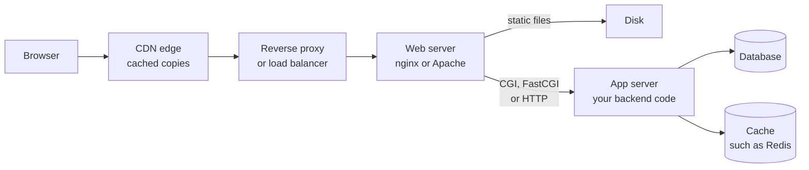
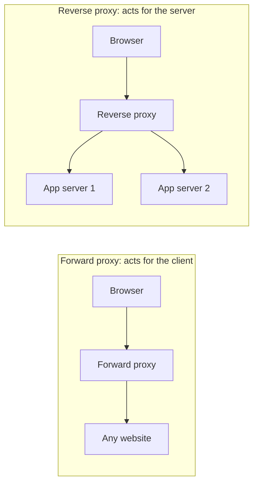
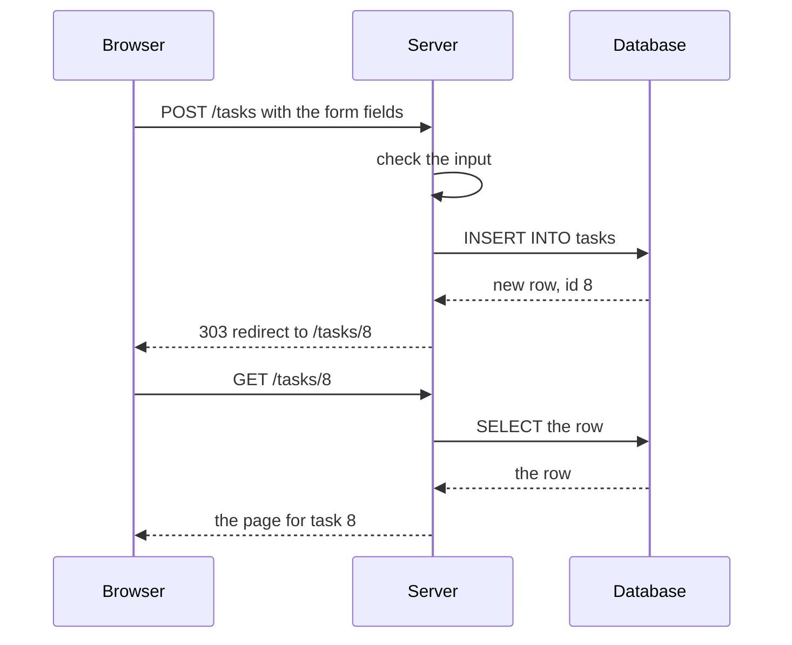
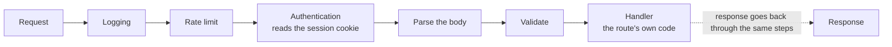
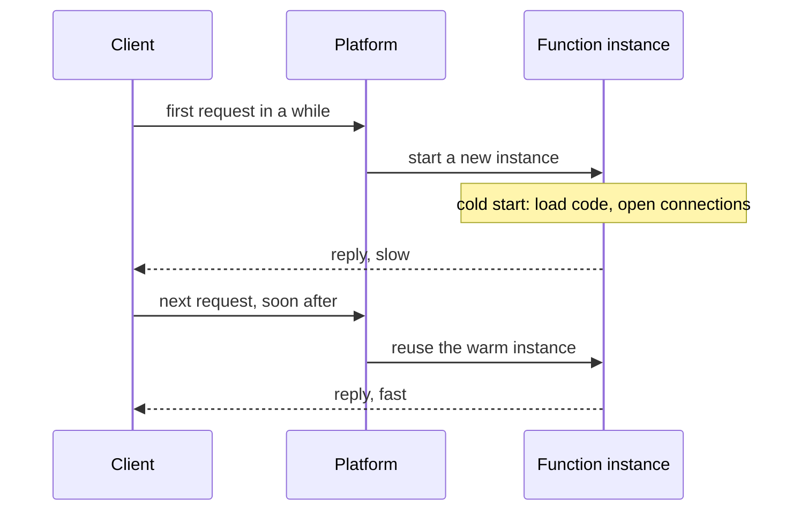
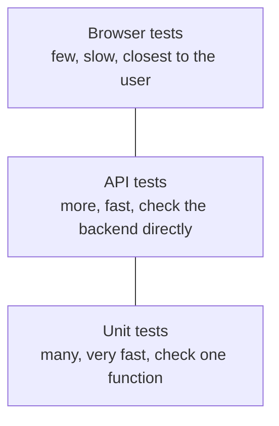

<Info>

**In short:** the page you see in a browser is the **frontend**. It gets its
data and its rules from a **backend**: programs on servers that talk to a
database. Between the two sit web servers, reverse proxies and CDNs, and inside
the box labelled "server" the same few patterns repeat: create-read-update-delete
screens, a chain of middleware around each request and, more and more, small
functions that run only when called. A browser test drives the frontend, so it
passes through all of them. Knowing what is in the path explains most surprises:
a stale page, a `502`, a slow first request, an IP address that is not yours, a
challenge page that your app never sent.

</Info>

## Frontend and backend

When you open a shop page, two kinds of program work for you.

| | Frontend | Backend |
|---|---|---|
| Where it runs | In your browser | On servers the shop controls |
| Written in | HTML, CSS and JavaScript (often through a framework, see [Frameworks and the DOM](/concepts/selectors-and-the-dom#one-page-three-doms)) | Any language: Rust, Python, Java, PHP, Go, JavaScript |
| Its job | Show the page, react to clicks, ask the backend for data | Keep the data, check the rules, log users in, take payments |
| Can you trust it? | No. A user can change anything in their own browser | Yes, if it checks every request itself |

The last row is the reason for the split. Anything that must be true, such as a
price or a permission, has to be enforced by the backend, because the frontend
is code running on someone else's machine.

There are two common ways to build the frontend:

- **Server-rendered.** The backend builds the finished HTML for every page and
  the browser only displays it. Classic PHP, Rails and Django sites work like
  this.
- **Single-page application (SPA).** The backend sends a small HTML shell and a
  large bundle of JavaScript. The JavaScript runs in the browser, asks the
  backend for data as JSON and builds the page itself. React, Vue and Angular
  apps usually work like this. Many sites mix both.

A test sees the difference at once. After a server-rendered click, a whole new
page loads. After an SPA click, the URL may change and the content may be
replaced while the browser never loads a new document. See
[how a page loads](/concepts/how-a-page-loads).

## Web servers, app servers and the path of a request

A **web server** listens on a port and answers HTTP. Nginx, Apache httpd and
Caddy are web servers. They are very good at serving files (images, CSS,
JavaScript) straight from disk, at TLS, at compression and at passing requests
on.

An **application server** runs the code that makes pages and answers API calls:
Node.js, Gunicorn or Uvicorn for Python, Puma for Ruby, Tomcat for Java, or a
Rust program built on a web framework. Many application servers speak HTTP
themselves, so a "web server" in front is optional, but it is common.



*One request from a browser to the data. Small sites skip most of the boxes;
large sites have more of them.*

### CGI and FastCGI

The oldest way for a web server to run a program is **CGI** (Common Gateway
Interface). For every request, the web server starts the program, hands it the
request through environment variables (`REQUEST_METHOD`, `QUERY_STRING`) and
standard input, and sends back whatever the program prints: headers, a blank
line, then the body. It is simple and any language works. It is also slow,
because a new process starts for every request.

**FastCGI** keeps the program running. A pool of long-lived worker processes
waits for work. The web server connects to them over a socket (a Unix socket
file or a TCP port) with a small binary protocol, gives one a request, and gets
the response back. **PHP-FPM** (FastCGI Process Manager) is the best-known
example: nginx or Apache sends `.php` requests to a pool of PHP workers.

```text nginx.conf
server {
  listen 443 ssl;
  server_name shop.example.com;

  # Files straight from disk.
  location /static/ { root /var/www/shop; }

  # A reverse proxy to an application server that speaks HTTP.
  location /api/ { proxy_pass http://127.0.0.1:3000; }

  # PHP through FastCGI.
  location ~ \.php$ {
    include fastcgi_params;
    fastcgi_pass unix:/run/php/php-fpm.sock;
  }
}
```

Other ecosystems have their own version of the same idea: WSGI and ASGI in
Python, Rack in Ruby, servlets in Java. The pattern is always "a web server in
front, a long-lived worker pool behind". The browser cannot tell which one is
used, but the error pages can: a bare `502 Bad Gateway` or `504 Gateway
Timeout` means the worker pool did not answer, not that the page is missing.

## Reverse proxies

A **proxy** is a server that makes requests for someone else. There are two
kinds, and they stand on opposite sides.



*A forward proxy hides the client from the site. A reverse proxy hides the
servers from the client.*

- A **forward proxy** is chosen by the client (or its network). The site sees
  the proxy's address instead of the client's. This is what
  [Network: Proxies](/concepts/network#proxies) describes, and what the
  `--proxy` option of the library uses.
- A **reverse proxy** is chosen by the site. The client believes it talks to
  `shop.example.com`; in fact it talks to a proxy, which forwards the request to
  one of several servers behind it. The client never learns how many servers
  there are or where they are.

### What a reverse proxy does

| Job | What it means |
|---|---|
| Load balancing | Spreads requests over several app servers and stops sending to one that is down |
| TLS termination | Handles the encrypted connection with the browser, then talks plain HTTP (or a fresh TLS connection) to the app servers |
| Caching | Keeps answers it can repeat, so the app server is asked less |
| Compression | Compresses responses (gzip, Brotli) on the way out |
| Routing | Sends `/api/` to one service, `/blog/` to another, or `admin.example.com` to a different app, by path or by host name |
| Protection | Rate limits, blocks bad requests, hides internal addresses, upgrades HTTP to HTTPS |
| One door for many | Gives one public address and one certificate to a whole fleet |

### Common reverse proxies

- **nginx** is both a web server and a reverse proxy, and probably the most
  common one.
- **Caddy** is a web server and reverse proxy that gets and renews TLS
  certificates by itself. It is a good way to give a local test app a real
  HTTPS address.
- **HAProxy** is a specialist load balancer and proxy for TCP and HTTP, known
  for speed and detailed health checks.
- **Edge networks such as Cloudflare, Fastly, Akamai and Amazon CloudFront** are
  reverse proxies run by someone else, in hundreds of locations. A site points
  its DNS name at them, and every request goes through them first. Much of the
  bot protection on the web runs there (see
  [Captchas](/concepts/captchas) and [Detection](/concepts/detection)).

### Who is the client? The forwarding headers

Once a proxy sits in the middle, the app server's connection comes from the
proxy, not from the user. To keep the real address, the proxy adds headers:

```http
GET /account HTTP/1.1
Host: shop.example.com
X-Forwarded-For: 203.0.113.9, 198.51.100.4
X-Forwarded-Proto: https
X-Forwarded-Host: shop.example.com
Forwarded: for=203.0.113.9;proto=https;host=shop.example.com
```

- `X-Forwarded-For` lists the addresses the request came through, the original
  client first. Every proxy appends the address it received the request from.
- `X-Forwarded-Proto` says whether the browser used `http` or `https`, which
  matters because the proxy-to-app hop may be plain HTTP.
- `Forwarded` is the standardised version (RFC 7239) of the same facts.
  Individual vendors add their own, such as Cloudflare's `CF-Connecting-IP`.

<Warning>

Anyone can send an `X-Forwarded-For` header of their own. An application must
trust only the entries its own proxies added, never the whole header. This is a
classic way to dodge IP-based rate limits and blocks.

</Warning>

### Why a reverse proxy matters for automation

- **The edge decides first.** A challenge page ("Just a moment..."), a block or
  a `429` often comes from the edge proxy before the site's own code sees the
  request. The site's logs may show nothing at all. Look at the response
  headers (`Server`, `Via`, `CF-Ray`, `CF-Cache-Status`) to see who answered.
- **The IP a site sees is the one that reaches the edge.** From a CI runner that
  is the runner's address; behind a forward proxy it is the proxy's exit
  address. Many people behind one company network share one address, so
  address-based limits hit them together.
- **TLS ends at the edge.** The handshake that a bot-management system
  inspects is your browser's handshake with the proxy. That is why the TLS and
  HTTP/2 fingerprints in [Network](/concepts/network#tls-and-http2-fingerprints)
  are judged where they are.
- **Gateway status codes.** `502`, `503` and `504` come from a proxy and mean the
  server behind it failed, was overloaded or was too slow. A test that retries
  on these, and fails fast on `404` or `403`, is more useful than one that
  treats every non-200 the same.
- **WebSockets need to be allowed through.** A reverse proxy must forward the
  `Upgrade` header for [WebSocket](/glossary#websocket) connections; if it does
  not, a page can load and its live part still never works.

## APIs

An **API** (application programming interface) is a way for one program to ask
another for something. On the web the word usually means an HTTP API: a set of
URLs that return data instead of pages. The frontend of an SPA is a client of
its own backend's API, and you can call the same API without a browser.

### REST and JSON

**REST** is a style, not a standard: URLs name things (`/orders/42`), the HTTP
method says what to do (`GET` reads, `POST` creates, `PUT` or `PATCH` changes,
`DELETE` removes), and the status code says how it went (`200`, `201`, `204`,
`400`, `401`, `403`, `404`, `409`, `422`, `500`). The body is almost always
**JSON**:

```http
POST /orders HTTP/1.1
Host: api.shop.example.com
Content-Type: application/json
Authorization: Bearer eyJhbGciOi...

{"sku": "TSHIRT-M", "quantity": 2}
```

```http
HTTP/1.1 201 Created
Content-Type: application/json
Location: /orders/42

{"id": 42, "status": "pending", "total": 39.98}
```

### GraphQL

**GraphQL** has one URL (often `/graphql`) and the client sends a *query* that
names exactly the fields it wants. The reply has the same shape as the query.

```graphql
query {
  order(id: 42) { status, total, items { sku, quantity } }
}
```

Two things matter for testing. Requests are usually `POST` to the same URL, so
the URL alone says nothing about what was asked; read the body. And a GraphQL
server often answers `200 OK` even when something failed, with an `errors` list
in the body, so the status code is not the result.

### gRPC

**gRPC** uses HTTP/2 and a compact binary format (Protocol Buffers), and
supports streaming in both directions. It is mostly used between servers.
Browsers cannot speak plain gRPC, so a web page uses *gRPC-Web* through a proxy
(often Envoy). In the network log of a page you see ordinary `POST` requests
with a content type such as `application/grpc-web+proto`, whose bodies are
binary and not readable without the schema.

### Webhooks

A **webhook** turns the API around: instead of you asking, the other service
*calls your URL* when something happens (a payment succeeded, a build finished).
A browser test cannot see a webhook, because it is a server-to-server call. To
test one, the app under test needs a reachable address for the sender (a public
tunnel, or a test double that plays the sender), and a test usually checks the
result afterwards through the page or the API. Real webhooks carry a signature
header the receiver must verify, and tests should check that an unsigned call is
refused.

## Data formats: JSON and XML

**JSON** is text made of objects (`{"name": "Ada"}`), arrays, strings, numbers,
booleans and `null`. It is small, easy for JavaScript to read and the default for
APIs. It has no comments and no trailing commas.

**XML** is the older, more formal sibling: tags, attributes, namespaces and
strict rules for well-formed documents.

```xml
<order id="42">
  <status>pending</status>
  <item sku="TSHIRT-M" quantity="2"/>
</order>
```

Most new APIs use JSON, but XML is far from gone. You meet it in:

- **SOAP** web services, an XML envelope sent by `POST`, still common in banks,
  insurance, government and ERP systems.
- **RSS and Atom** feeds, the XML lists of recent posts that readers and
  podcast apps poll.
- **Sitemaps** (`sitemap.xml`), the XML list of a site's URLs that search
  engines read (see Crawlers and spiders).
- **SVG** images. An SVG is XML, and when it is inlined in a page its elements
  (`svg`, `path`, `circle`) become part of the DOM, in their own XML namespace.
- **XHTML**, HTML written as strict XML and served as `application/xhtml+xml`.
- Office documents, build files, Android layouts and many configuration formats.

For browser automation, XML matters in two ways. XPath, one of the selector
languages, was designed for XML and works on the DOM as well (see
[Frameworks and the DOM](/concepts/selectors-and-the-dom#one-page-three-doms)). And an API test
that gets XML back needs an XML parser, not a JSON one, and often has to handle
namespaces.

## Databases behind the backend

A backend that remembers anything keeps it in a **database**.

- **SQL (relational) databases** such as PostgreSQL, MySQL and SQLite store rows
  in tables with a fixed structure, link them by keys, and offer
  **transactions**: a group of changes happens completely or not at all.
- **NoSQL databases** is a family name for the rest: *document* stores (MongoDB)
  keep JSON-like documents, *key-value* stores (Redis, DynamoDB) map a key to a
  value very fast, *wide-column* stores (Cassandra) spread huge tables over many
  machines, and *graph* databases (Neo4j) store relationships. Each trades some
  of SQL's guarantees for speed, scale or flexibility.
- **Caches and search indexes** (Redis, Memcached, Elasticsearch) sit beside the
  main database and are rebuilt from it.

Why this matters for tests: a browser test shows the *effect* of data, so the
data has to be known. A test that expects "the cart has 2 items" fails if
another test, or yesterday's run, left a third item behind. Teams therefore
**seed and reset** data:

- start each run from a fresh database in a container, or a copy of a template
  database;
- load a known set of rows (a *seed* or *fixture* script) before the test, or
  create what the test needs through the backend's API;
- use unique values per test (a random e-mail address) so tests can run in
  parallel without colliding;
- clean up afterwards, by deleting what the test made or by truncating tables
  between runs.

Rolling a transaction back after each test is the cheapest reset in a unit
test, but it does not work for a browser test: the application runs in another
process with its own database connection, so it never sees the uncommitted
data. Never point such tests at production data.

## CRUD: the pattern behind most apps

Most business software lets people do four things to a kind of record: **C**reate
it, **R**ead it, **U**pdate it and **D**elete it. A to-do list, a shop's product
catalogue, an admin panel and a profile page are all CRUD. The four actions
line up with four layers that you already know:

| Action | The user sees | The HTTP request | The database |
|---|---|---|---|
| Create | A form and a Save button | `POST /tasks` | `INSERT` a row |
| Read | A list, and a detail page | `GET /tasks` and `GET /tasks/7` | `SELECT` rows |
| Update | An edit form | `PUT` or `PATCH /tasks/7` | `UPDATE` a row |
| Delete | A Delete button | `DELETE /tasks/7` | `DELETE` a row |

The routes in that table follow a convention called **REST**: the URL names a
*thing* (`/tasks/7` is task number 7) and the HTTP method names the action. Not
every site follows it strictly, but the idea of "a URL per thing, a verb per
action" shows up everywhere. Some APIs use one URL for everything and put the
action in the body (GraphQL and RPC styles). The database layer is the same
either way.

### From a form to a row

An HTML form is the oldest way to reach a back end, and many pages still use it.



*A form submit. After the write, the server answers with a redirect, so a reload
does not send the form again.*

That "write, then redirect, then read" order is called **post/redirect/get**. For
a test it means a click on Save causes **two** page loads, and the thing to wait
for is the final URL or the new content, not the first reply.

Single-page apps skip the form post. Their JavaScript sends the same `POST` with
`fetch`, gets JSON back and updates the page itself, without navigating. The
back end is the same; what a test can observe is different, because the URL may
not change at all. See [frameworks and the DOM](/concepts/selectors-and-the-dom#one-page-three-doms).

## Middleware: a pipeline around every request

Real servers do many things for each request before the code you care about runs:
log it, read cookies, check who the caller is, parse the body, limit how often one
client may call, and compress the reply. Frameworks organise this as
**middleware**: a list of small steps that each get the request, may change it,
and pass it on. The reply travels back through the same steps in reverse.



*Each box can end the request early: a failed check returns an error and the
handler never runs.*

Why this matters outside the server:

- A **401** or **403** often comes from an authentication or permission step, not
  from the page you asked for. See [sessions, cookies and storage](/concepts/sessions-and-state).
- A **429 Too Many Requests** comes from a rate-limit step. A test suite that
  hammers a staging server can trigger it, and the fix is to slow down or ask for
  a higher limit, not to retry in a tight loop.
- A **400** or **422** comes from validation. The reply body usually says which
  field failed; read it.
- Steps run **in order**. A request blocked by the first step never reaches the
  later ones, so a failure in one place does not prove the others are fine.

## Serverless and edge functions

A classic server is a program that stays running and waits. A **serverless
function** is the opposite: your code is a single function that the platform
starts when a request arrives and may stop again afterwards. You do not manage the
machine, and you pay for the time it runs.



*A cold start adds delay to the first request after a quiet period.*

Three ideas follow from that model.

<AccordionGroup>

<Accordion title="Cold starts" icon="snowflake">

The first call after a pause has to load the code and open its connections before
it can answer, which can add from tens of milliseconds to several seconds. Later
calls reuse the warm instance and are fast. A test that runs once in the morning
against a quiet environment is the one most likely to meet a cold start.

</Accordion>

<Accordion title="Statelessness" icon="eraser">

Two requests may reach two different instances, and an instance can be thrown
away at any time. So the function must not keep anything in its own memory or
disk that the next call needs. Everything durable goes into a database, a cache
or object storage, and the identity of the caller travels with each request in a
cookie or token. This is the same rule as the stateless processes of a
twelve-factor app.

</Accordion>

<Accordion title="Edge functions" icon="earth-europe">

An **edge function** is a serverless function that runs in many small data centres
close to the visitor, often at the same network points as a CDN. It suits quick
work on the request itself: a redirect, an A/B test assignment, a header, a
cookie, a check of the country. It has tighter limits on time, memory and the
libraries it may use. Because the answer can depend on where the request comes
from, two people can see different results from the same URL.

</Accordion>

</AccordionGroup>

## CDNs and caching layers

A **CDN** (content delivery network) keeps copies of your files on servers near
your users, called **edge** locations. A request for `app.js` is answered from
the closest edge instead of travelling to your origin server. CDNs also absorb
traffic spikes and attacks, terminate TLS and, nowadays, run small programs at
the edge.

A response can be reused by many layers, each with its own copy:

| Layer | Who holds the copy | Typical lifetime |
|---|---|---|
| Browser cache | The browser, per user | Until the headers say it is stale, or the user clears it |
| CDN edge cache | The CDN, shared by many users | Seconds to a year, until purged |
| Reverse proxy cache | nginx or a similar proxy in front of the app | Short |
| Application cache | Redis or memory inside the backend | Short, controlled by code |
| Database cache | The database engine itself | Automatic |

The server controls the first three with **cache headers**:

| Header | Meaning |
|---|---|
| `Cache-Control: max-age=3600` | Any cache may reuse this for 3600 seconds |
| `Cache-Control: s-maxage=600` | Shared caches (CDN, proxy) may reuse it for 600 seconds, overriding `max-age` for them |
| `Cache-Control: no-cache` | Cache it, but ask the server before every use |
| `Cache-Control: no-store` | Do not keep it at all (use for private data) |
| `Cache-Control: public` or `private` | Shared caches may keep it, or only the user's own browser may |
| `ETag` and `If-None-Match` | A fingerprint of the content. The browser asks "do you still have `abc`?", and the server may answer `304 Not Modified` with no body |
| `Last-Modified` and `If-Modified-Since` | The same idea using a date |
| `Vary: Accept-Encoding` | The answer depends on this request header, so keep a copy for each value |
| `Age` | How many seconds the copy has already been in a shared cache |

A common deploy trick is to put a hash in the file name (`app.3f9a1c.js`) and
send `Cache-Control: max-age=31536000, immutable`. The name changes when the
file does, so a cached copy can never be wrong, while the HTML page that points
to it is sent with a short lifetime.

For tests this explains two kinds of flakiness. A page may show an old
version after a deploy because an edge still holds the old HTML. And a test that
runs twice may behave differently the second time because the browser cache
is warm. Browser developer tools have a "Disable cache" box for this (see
Developer tools), CDP has `Network.setCacheDisabled`, and a
fresh browser context starts with an empty cache (see
[Sessions, cookies and storage](/concepts/sessions-and-state)). Response headers such as `Age`,
`X-Cache` or `CF-Cache-Status` tell you whether an answer came from a cache.

## Where browser tests fit



*The test pyramid, from the top: the higher a test sits, the more of the system
it covers, the slower it runs and the harder a failure is to explain.*

- A **unit test** calls one function. An **API test** sends HTTP requests to the
  backend and checks the status, headers and JSON. It needs no browser, runs in
  milliseconds and is the right tool for rules such as validation, permissions
  and error codes.
- A **browser test** checks what only a browser does: that the JavaScript runs,
  that the right thing is on screen, that a click leads to the next page, that
  the pieces work together.
- Use each for what it is good at. Check the rule "an order over the limit is
  refused" with an API test. Check "the user sees the error and can correct it"
  with a browser test.
- Use the API to **set up** a browser test. Creating a user and an order through
  the backend takes milliseconds; clicking through the sign-up form takes
  seconds and is a second thing that can fail. Log in once, keep the cookies and
  reuse them (see [Sessions, cookies and storage](/concepts/sessions-and-state)).

## What changes for testing

| Pattern | The risk for a test | What to do |
|---|---|---|
| CRUD with a shared database | Data left by one run changes the next; two parallel runs fight over one record | Create the records a test needs, use unique names, and clean up or reset the environment |
| Post/redirect/get | The first reply is a redirect, not the page | Wait for the final URL or content |
| Middleware auth | A session that expired, or a missing cookie, looks like a broken page | Log in as part of the test, or restore a saved session |
| Rate limits | 429 replies in a fast suite | Slow the suite, spread runs, or use a test key with a higher limit |
| Cold start | The first request is slow and may time out | Warm the environment with one request before the run, and give the wait for the first element enough time |
| Stateless instances | A value set by one request is not visible to the next unless it is stored | Test through the database or the API, not through memory |
| Eventual consistency | A write is visible on one replica before another, so a read right after a write can show old data | Wait for the new content to appear instead of reading once |
| Edge logic | The result depends on country, headers or cookies | Set the location, language and cookies explicitly |

<Tip>

When a front end is hard to test because its back end is slow, flaky or has
side effects (it sends an email, takes a payment), stub that one API call in the
browser and test the page against a fixed answer. Keep a smaller set of
end-to-end tests that use the real back end.

</Tip>

<Warning>

Do not run destructive tests against a shared or production back end. A "delete
all" button works exactly as well when a robot presses it. Test against an
environment built for it, with data you can throw away.

</Warning>

## How seleniumbase-rs uses it

### Frontends, backends and APIs

The library drives the frontend. It has no model of your backend, database or
CDN; it sees them only through the browser. Three places where they meet:

- **Mock the backend.** With request interception, a test can answer an API call
  itself and never contact the server, so a frontend can be tested without its
  backend. In the pure CDP engine, `Rule::fulfill(Response::json(200, &body))`
  with a URL pattern such as `*/api/items*` does it, and `Rule::modify()` can
  add a header to calls that do go out. See
  [Network: interception](/concepts/network#seeing-and-changing-requests-interception).
- **See the API calls the page makes.** `Page::start_har()` records every
  request, response header and timing as a HAR file, including cache headers and
  the headers an edge proxy adds. The MCP tool `get_failed_requests` lists the
  requests of a page that failed. See
  [Network: HAR](/concepts/network#recording-traffic-har).
- **Check the links of a page.** `BaseCase::assert_link_status_code_is_not_404`
  and `BaseCase::print_unique_links_with_status_codes` call the URLs with plain
  HTTP requests (a `HEAD` request that is repeated as `GET` if the server does
  not allow `HEAD`, without following redirects), so they test the routing and
  the CDN as a user's link would.

<Note>

For API calls inside a test, use any Rust HTTP client, for example `reqwest`;
the library does not wrap one for you. The optional `turso` feature stores test
results and browser profiles in a database (see
[Results and profiles](/tutorials/results_and_profiles)); it is separate from
the database of the application under test.

</Note>

### Backend patterns

The library drives the browser; it does not run or inspect a server. It does give
you tools for the browser-side half of each pattern.

- **Stubbing and observing API calls.** `Page::intercept` in the pure CDP engine
  pauses every request a page makes and applies the first matching `Rule`.
  `Rule::fulfill(Response::json(200, &body)).url("*/api/account")` answers an
  API call with a made-up reply, which fixes the back end's side of a test.
  `Rule::block()` drops a request, and `Rule::modify()` changes a header or body
  on the way out. The returned `Interception` keeps a log of the requests it saw.
  See [the network](/concepts/network).
- **A record of what the server did.** `Page::start_har` returns a `HarRecorder`,
  which records the page's traffic as a HAR file, with status codes and timings;
  that is the place to see a 429 or a slow first request.
- **Waiting and timeouts.** `Page::with_timeout` gives a page a different wait
  for elements and conditions (7 seconds by default), which suits a screen that
  fills in after a slow first API call. A navigation has its own limit of 60
  seconds, enough for most cold starts. `Page::wait_for_function` waits until a
  script expression is truthy, which suits "the new row is in the list".
- **Retrying a flaky call.** `RetryPolicy` (exported from the crate root) runs an
  operation again after a transient failure, with exponential backoff.
  `RetryPolicy::network()` is made for network-level work, and `RateLimiter`
  keeps a loop from calling something more than a set number of times in a
  window, which is the other side of a server's own rate limit.
- **Login state.** Cookies and storage are covered in
  [sessions, cookies and storage](/concepts/sessions-and-state), including how to
  keep a login so a test does not repeat it.

<Note>

None of this replaces testing the API itself. A browser test shows that the page
and the back end agree, which is slow and broad. Tests that call the API directly
are faster and narrower, and the two together find more than either alone.

</Note>

## Where to go next

<Columns cols={2}>

<Card title="Network" icon="network-wired" color="#a631be" href="/concepts/network">
  HTTP, DNS, TLS, forward proxies, interception and HAR.
</Card>

<Card title="Selectors and the DOM" icon="layer-group" color="#199f43" href="/concepts/selectors-and-the-dom">
  How the frontend frameworks shape the page a test sees.
</Card>

<Card title="Captchas" icon="shield-halved" color="#d52c36" href="/concepts/captchas">
  What an edge proxy may ask of a visitor before the site sees it.
</Card>

<Card title="Glossary" icon="book" color="#1a85d4" href="/glossary">
  Short definitions of the terms used here.
</Card>

<Card title="Sessions, cookies and storage" icon="database" color="#d47628" href="/concepts/sessions-and-state">
  How a server knows who you are from one request to the next.
</Card>

</Columns>
