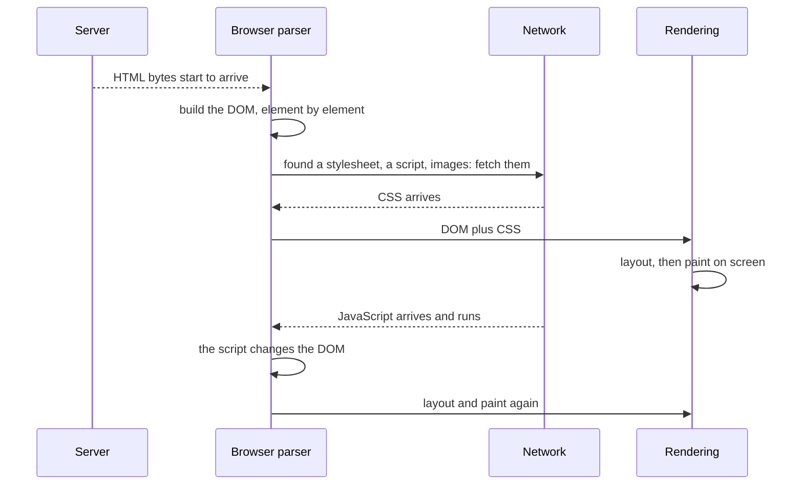

<Info>

**In short:** a page does not arrive; it is *assembled*. The browser finds a
server, downloads HTML, builds a tree of elements from it, fetches and applies
styles, runs scripts, and the scripts keep changing the page long after the
browser says it has "loaded". Automation tools can only report events, so a
test must wait for the thing it needs, not for the page to be "done".

</Info>

## From URL to bytes

A URL has parts, and the browser uses them in order:

```text
https://shop.example.com:443/search?q=rust#results
 scheme   host            port path    query  fragment
```

<Steps>

<Step title="Find the server (DNS)" icon="magnifying-glass">

The host name is turned into an IP address by asking a resolver, unless the
browser already has the answer cached. See [DNS](/concepts/network#dns-names-to-addresses).

</Step>

<Step title="Connect and encrypt (TCP and TLS)" icon="lock">

The browser opens a connection to that address and port, then, for `https`,
performs the TLS handshake and checks the server's certificate. See
[TLS and certificates](/concepts/network#tls-and-certificates).

</Step>

<Step title="Ask for the page (HTTP)" icon="arrows-left-right">

It sends `GET /search?q=rust` with headers and any cookies for this site. The
server answers with a status, headers and the **HTML** as the body. If the
status is a redirect (`301`, `302`), the browser repeats the process for the
new URL. The `#results` fragment is never sent: it is for the browser only.

</Step>

</Steps>

## From HTML to something you can click



*The steps overlap: the browser starts parsing before the download ends.*

1. **The DOM.** The parser reads the HTML as it streams in and builds the
   **Document Object Model**: a tree with one node per element, text and
   attribute. This tree, not the HTML text, is what scripts and automation
   tools work with. It is also what a selector such as `#go` or `h1` searches.
2. **Subresources.** As the parser meets `<link rel="stylesheet">`,
   `<script src>`, `` and fonts, it starts downloading each one in
   parallel. A typical page makes tens to hundreds of requests, many to other
   hosts, each going through the steps above.
3. **CSS.** Stylesheets become a style tree; together with the DOM they
   decide each element's size, position, colour and whether it is shown at all.
4. **Layout and paint.** The browser computes where every box goes (layout),
   then draws the pixels (paint) and composes the layers on screen. An element
   can exist in the DOM and still be invisible, zero-sized, or behind another.
5. **JavaScript.** A classic `<script>` **blocks the parser** until it has
   downloaded and run, because it might change the document. Scripts marked
   `defer` run after parsing; `async` ones run as soon as they arrive. Scripts
   can fetch more data (`fetch`, `XMLHttpRequest`), insert elements, and react
   to clicks.

Modern sites are often **single-page applications**: the first HTML is nearly
empty, and JavaScript downloads data and draws the whole interface. Moving to
another "page" inside the app changes the URL without loading a new document at
all.

## The events, and what "loaded" means

The browser reports progress with a few events and a `readyState`:

| Moment | Event or state | Meaning |
|---|---|---|
| Parsing, still in progress | `document.readyState` is `loading` | The HTML is still arriving. |
| HTML parsed | `DOMContentLoaded`, and `readyState` becomes `interactive` | The DOM is complete. Stylesheets and images may still be loading. |
| Everything referenced by the HTML has loaded | `load` on `window`, and `readyState` becomes `complete` | Scripts, styles, images and frames are done. |
| Later | (no event) | Anything a script does after `load`: fetching data, drawing a list, opening a menu. |

"The page loaded" is therefore a precise but **small** claim: the document and
the files it names have arrived. It says nothing about the data that scripts
fetch afterwards, the spinner that is still turning, or the button that only
works once its script has attached a handler.

Automation tools expose the same moments under their own names:

| Where | What you get |
|---|---|
| WebDriver | The `pageLoadStrategy` capability: `normal` waits for `load`, `eager` for `DOMContentLoaded`, `none` does not wait. See [WebDriver](/concepts/webdriver#sessions-and-capabilities). |
| CDP | The events `Page.domContentEventFired` and `Page.loadEventFired`, plus the `Network` events for each request. See [CDP](/concepts/cdp#what-a-page-load-looks-like). |
| seleniumbase-rs (pure CDP) | `Page::goto` waits for the load event, and returns at once for a change of only the `#fragment`. |

## Why automation needs waits

Put the pieces together and the problem shows. When `goto` returns, the page
has "loaded", yet:

- the list of results may still be a request in flight;
- the element you want may not exist yet, or exists but is hidden;
- a click handler may not be attached, so a click does nothing;
- an overlay (a cookie banner, a spinner) may cover the target;
- the framework may replace the element you just found (a stale reference).

None of these is an error. They are the normal state of a page between "loaded"
and "ready". A test that reads the page the moment `load` fires will sometimes win
this race and sometimes lose it, which is why it is **flaky**. The fix is to
wait for a *condition* the test actually needs:

- an element to **exist**, to be **visible**, or to be **clickable**;
- a text to appear, or a URL to change;
- the network to go quiet, when there is nothing specific to wait for.

SeleniumBase and the pure CDP engine build this in: their action methods and
`Locator`s wait for the element before they act, up to a timeout, and
`Locator`s look the element up again each time, so the stale-reference problem
does not arise. See [WebDriver waits](/concepts/webdriver#waits-and-why-tests-flake)
and [the CDP engine](/concepts/cdp#how-seleniumbase-rs-uses-it).

<Tip>

When a test is flaky, ask "what was I waiting for?". If the answer is "the page
to load" or "two seconds", replace it with the condition the next step needs.

</Tip>

## Other things that can happen

- **iframes** embed another document inside the page. Each has its own DOM, and
  often a different origin, so automation must switch into it (WebDriver) or
  attach to it as a separate target (CDP).
- **Shadow DOM** hides part of a component's tree from ordinary selectors. See
  [Shadow DOM](/glossary#shadow-dom).
- **Popups and new tabs** are new windows, with their own load.
- **Service workers** can answer requests from a cache without the network at
  all, so a "load" may never touch the server.
- **Cookies and storage** change as the page loads (`Set-Cookie`, `localStorage`
  writes); see [Sessions, cookies and storage](/concepts/sessions-and-state).

## Where to go next

<Columns cols={2}>

<Card title="WebDriver" icon="plug" color="#1a85d4" href="/concepts/webdriver">
  The standard protocol, and the race behind flaky tests.
</Card>

<Card title="The DevTools Protocol" icon="bolt" color="#199f43" href="/concepts/cdp">
  The page-lifecycle events on the wire.
</Card>

<Card title="Network and proxies" icon="network-wired" color="#d47628" href="/concepts/network">
  DNS, TLS, HTTP, proxies and interception in detail.
</Card>

<Card title="Sessions, cookies and storage" icon="cookie-bite" color="#a631be" href="/concepts/sessions-and-state">
  How the browser remembers you between pages.
</Card>

</Columns>
