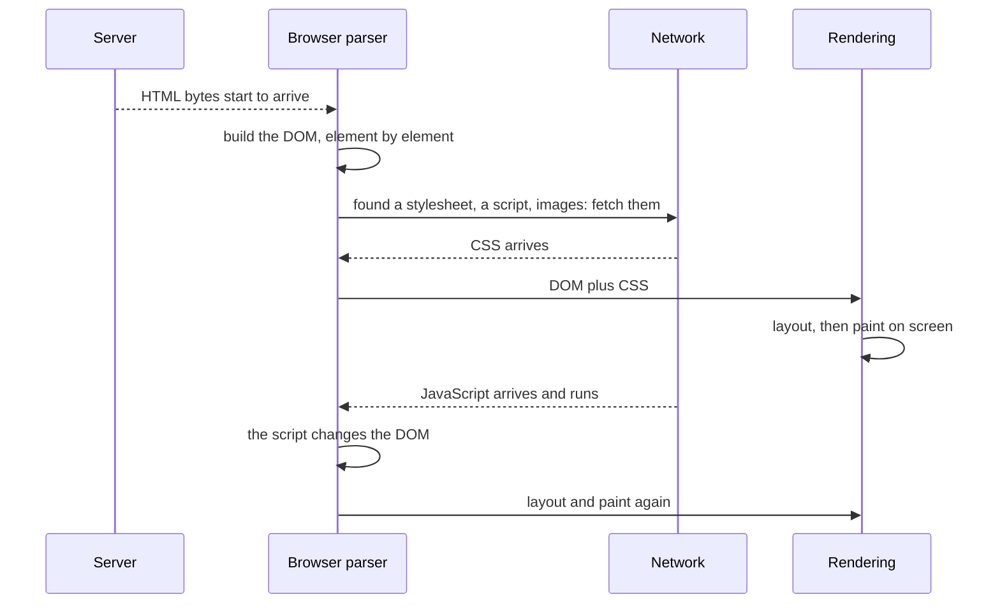
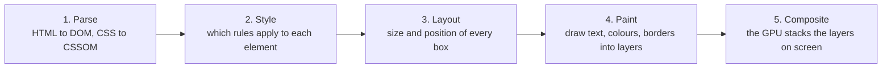

<Info>

**In short:** a page does not arrive; it is *assembled*. The browser finds a
server, downloads HTML, builds a tree of elements from it, fetches and applies
styles, runs scripts, and the scripts keep changing the page long after the
browser says it has "loaded". Every change then runs through a fixed series of
drawing steps (style, layout, paint, composite), so anything that moves while a
test acts on it is a source of flaky tests. Automation tools can only report
events, so a test must wait for the thing it needs, not for the page to be
"done".

</Info>

## From URL to bytes

A URL has parts, and the browser uses them in order:

```text
https://shop.example.com:443/search?q=rust#results
 scheme   host            port path    query  fragment
```

<Steps>

<Step title="Find the server (DNS)" icon="magnifying-glass">

The host name is turned into an IP address by asking a resolver, unless the
browser already has the answer cached. See [DNS](/concepts/network#dns-names-to-addresses).

</Step>

<Step title="Connect and encrypt (TCP and TLS)" icon="lock">

The browser opens a connection to that address and port, then, for `https`,
performs the TLS handshake and checks the server's certificate. See
[TLS and certificates](/concepts/network#tls-and-certificates).

</Step>

<Step title="Ask for the page (HTTP)" icon="arrows-left-right">

It sends `GET /search?q=rust` with headers and any cookies for this site. The
server answers with a status, headers and the **HTML** as the body. If the
status is a redirect (`301`, `302`), the browser repeats the process for the
new URL. The `#results` fragment is never sent: it is for the browser only.

</Step>

</Steps>

## From HTML to something you can click



*The steps overlap: the browser starts parsing before the download ends.*

1. **The DOM.** The parser reads the HTML as it streams in and builds the
   **Document Object Model**: a tree with one node per element, text and
   attribute. This tree, not the HTML text, is what scripts and automation
   tools work with. It is also what a selector such as `#go` or `h1` searches.
2. **Subresources.** As the parser meets `<link rel="stylesheet">`,
   `<script src>`, `` and fonts, it starts downloading each one in
   parallel. A typical page makes tens to hundreds of requests, many to other
   hosts, each going through the steps above.
3. **CSS.** Stylesheets become a style tree; together with the DOM they
   decide each element's size, position, colour and whether it is shown at all.
4. **Layout and paint.** The browser computes where every box goes (layout),
   then draws the pixels (paint) and composes the layers on screen. An element
   can exist in the DOM and still be invisible, zero-sized, or behind another.
5. **JavaScript.** A classic `<script>` **blocks the parser** until it has
   downloaded and run, because it might change the document. Scripts marked
   `defer` run after parsing; `async` ones run as soon as they arrive. Scripts
   can fetch more data (`fetch`, `XMLHttpRequest`), insert elements, and react
   to clicks.

Modern sites are often **single-page applications**: the first HTML is nearly
empty, and JavaScript downloads data and draws the whole interface. Moving to
another "page" inside the app changes the URL without loading a new document at
all.

## From bytes to pixels

Once the bytes of a page have arrived, the browser still has to turn them into
something you can see. It does that in five steps, called the **rendering
pipeline**.



*The rendering pipeline. Later steps depend on earlier ones.*

<Steps>

<Step title="Parse" icon="file-code">

The HTML becomes the **DOM**, a tree of elements (see
[selectors and the DOM](/concepts/selectors-and-the-dom)). The CSS becomes a
second tree, the CSSOM. A stylesheet in the `head` **blocks rendering**: the
browser will not paint until it has the CSS, because painting without it would
flash unstyled content. A plain script **blocks parsing** unless it is marked
`defer` or `async`.

</Step>

<Step title="Style" icon="palette">

For each element the browser works out which CSS rules apply and what the final
value of every property is (the "computed style"). Percentages, `em` units and
inheritance are resolved here.

</Step>

<Step title="Layout" icon="ruler-combined">

The browser computes how big each box is and where it goes. One box usually
depends on others: a paragraph's height depends on its width, which depends on
its parent. This step is also called **reflow**.

</Step>

<Step title="Paint" icon="paintbrush">

The boxes are drawn: text, backgrounds, borders, shadows, images. The result is
a set of **layers**, much like the layers of an image editor.

</Step>

<Step title="Composite" icon="layer-group">

The graphics card combines the layers, applying transforms and opacity, and
shows the result. Because this step runs on its own thread, a layer can move
smoothly even while JavaScript is busy.

</Step>

</Steps>

## Reflow and repaint

After the first frame, the page changes: a script edits the DOM, the user hovers
a button, an image finishes loading. The browser then redoes only the steps the
change needs. Cheaper changes skip steps.

| What changes | Steps redone | Examples | Cost |
|---|---|---|---|
| Geometry | Style, layout, paint, composite | `width`, `height`, `margin`, `top`, adding or removing an element, text changing | High |
| Looks only | Style, paint, composite | `color`, `background-color`, `box-shadow`, `visibility` | Medium |
| Layer only | Style, composite | `transform`, `opacity` | Low |

A **reflow** (layout again) can spread: changing one element near the top may
move everything below it. A **repaint** redraws pixels without moving anything.
Two habits make pages slow:

- **Layout thrashing.** A script writes to the DOM, then reads a layout value
  such as `offsetHeight`, then writes again, in a loop. Each read forces the
  browser to run layout at once, so the work is done many times instead of once.
  Reading everything first and writing afterwards avoids it.
- **Animating the wrong properties.** Animating `left` or `height` redoes layout
  on every frame. Animating `transform` and `opacity` only composites.

<Tip>

Reflows are why a "tiny" late change can move a button right as a test clicks
it. When the page stops changing, the layout is stable. Tests should wait for
that, not for a fixed time.

</Tip>

## The events, and what "loaded" means

The browser reports progress with a few events and a `readyState`:

| Moment | Event or state | Meaning |
|---|---|---|
| Parsing, still in progress | `document.readyState` is `loading` | The HTML is still arriving. |
| HTML parsed | `DOMContentLoaded`, and `readyState` becomes `interactive` | The DOM is complete. Stylesheets and images may still be loading. |
| Everything referenced by the HTML has loaded | `load` on `window`, and `readyState` becomes `complete` | Scripts, styles, images and frames are done. |
| Later | (no event) | Anything a script does after `load`: fetching data, drawing a list, opening a menu. |

"The page loaded" is therefore a precise but **small** claim: the document and
the files it names have arrived. It says nothing about the data that scripts
fetch afterwards, the spinner that is still turning, or the button that only
works once its script has attached a handler.

Automation tools expose the same moments under their own names:

| Where | What you get |
|---|---|
| WebDriver | The `pageLoadStrategy` capability: `normal` waits for `load`, `eager` for `DOMContentLoaded`, `none` does not wait. See [WebDriver](/concepts/webdriver#sessions-and-capabilities). |
| CDP | The events `Page.domContentEventFired` and `Page.loadEventFired`, plus the `Network` events for each request. See [CDP](/concepts/cdp#what-a-page-load-looks-like). |
| seleniumbase-rs (pure CDP) | `Page::goto` waits for the load event, and returns at once for a change of only the `#fragment`. |

## Why automation needs waits

Put the pieces together and the problem shows. When `goto` returns, the page
has "loaded", yet:

- the list of results may still be a request in flight;
- the element you want may not exist yet, or exists but is hidden;
- a click handler may not be attached, so a click does nothing;
- an overlay (a cookie banner, a spinner) may cover the target;
- the framework may replace the element you just found (a stale reference).

None of these is an error. They are the normal state of a page between "loaded"
and "ready". A test that reads the page the moment `load` fires will sometimes win
this race and sometimes lose it, which is why it is **flaky**. The fix is to
wait for a *condition* the test actually needs:

- an element to **exist**, to be **visible**, or to be **clickable**;
- a text to appear, or a URL to change;
- the network to go quiet, when there is nothing specific to wait for.

SeleniumBase and the pure CDP engine build this in: their action methods and
`Locator`s wait for the element before they act, up to a timeout, and
`Locator`s look the element up again each time, so the stale-reference problem
does not arise. See [WebDriver waits](/concepts/webdriver#waits-and-why-tests-flake)
and [the CDP engine](/concepts/cdp#how-seleniumbase-rs-uses-it).

<Tip>

When a test is flaky, ask "what was I waiting for?". If the answer is "the page
to load" or "two seconds", replace it with the condition the next step needs.

</Tip>

## Animations

Motion on a page comes from four sources, and a test can meet all of them.

| Mechanism | How it works | Test-relevant signal |
|---|---|---|
| CSS transitions | A property eases from one value to another when it changes (`transition: opacity 300ms`) | Event `transitionend` |
| CSS animations | Keyframes run on their own (`animation: spin 1s infinite`) | Events `animationstart`, `animationend` |
| `requestAnimationFrame` | A script asks the browser to call a function before the next frame, usually 60 times a second | None; it is just code |
| Web Animations API | `element.animate(keyframes, options)` is the script version of CSS animations, and `document.getAnimations()` lists every running animation | The animation's `finished` promise |

### Why animations make tests flaky

A test acts at machine speed, so it often acts in the middle of a movement.

- **A moving target.** A menu slides in over 300 ms. The test finds the button,
  measures its position, and clicks there, but by then the button has moved. The
  click lands on whatever is under that spot, or the browser reports that the
  element is covered.
- **A half-visible element.** A fade-in reaches `opacity: 0.4` when the test
  checks for visibility. Whether that counts as visible depends on the tool.
- **Different speed on different machines.** On a slow CI runner a 300 ms
  animation can take twice as long, so a fixed `sleep` that works on a laptop
  fails there.
- **Looping animations.** A spinner never ends, so "wait until nothing changes"
  never succeeds.
- **Screenshots.** A visual comparison catches a frame from the middle of the
  motion, and the images differ every run.

The usual fixes, from best to worst:

1. Wait for the **state** the animation leads to (the menu is open, the spinner is
   gone), not for time.
2. Ask the page for less motion. Many sites honour the CSS media query
   `prefers-reduced-motion: reduce`, which the user sets in the operating system.
3. Switch the animations off for the test run with a style rule:

```js
// Add a stylesheet that removes motion, then finish what is already running.
const style = document.createElement('style');
style.textContent = '*, *::before, *::after { animation: none !important; transition: none !important; }';
document.head.appendChild(style);
document.getAnimations().forEach(animation => animation.finish());
```

<Warning>

Turning animations off changes the page you are testing. A bug that only
appears while something animates (a click blocked by an overlay that is still
fading) will not show up. Keep at least some tests with animations on.

</Warning>

## Other things that can happen

- **iframes** embed another document inside the page. Each has its own DOM, and
  often a different origin, so automation must switch into it (WebDriver) or
  attach to it as a separate target (CDP).
- **Shadow DOM** hides part of a component's tree from ordinary selectors. See
  [Shadow DOM](/glossary#shadow-dom).
- **Popups and new tabs** are new windows, with their own load.
- **Service workers** can answer requests from a cache without the network at
  all, so a "load" may never touch the server.
- **Cookies and storage** change as the page loads (`Set-Cookie`, `localStorage`
  writes); see [Sessions, cookies and storage](/concepts/sessions-and-state).

## Core Web Vitals

**Core Web Vitals** are three numbers Google chose to describe how a page feels.
They are measured in real browsers and are one signal used by search (see
[SEO](/concepts/crawlers-and-seo#crawl-index-rank)).

| Metric | Measures | Good | Poor |
|---|---|---|---|
| **LCP**, Largest Contentful Paint | How long until the biggest thing on screen (a hero image, a headline block) is drawn. "Is it loaded?" | 2.5 s or less | over 4 s |
| **INP**, Interaction to Next Paint | How long the page takes to respond visibly to a click, tap or key press, over the whole visit. "Is it responsive?" | 200 ms or less | over 500 ms |
| **CLS**, Cumulative Layout Shift | How much visible content jumps around unexpectedly. "Is it stable?" | 0.1 or less | over 0.25 |

Typical causes:

- **Slow LCP:** a slow server (see [network](/concepts/network)), a big unoptimised
  image, a stylesheet or script that blocks rendering, content that only appears
  after JavaScript fetches it (see [frameworks and the DOM](/concepts/selectors-and-the-dom#one-page-three-doms)).
- **Slow INP:** long tasks on the main thread. JavaScript, style, layout and paint
  share one thread, so a 400 ms script means the click waits 400 ms.
- **High CLS:** images or ads without a reserved size, fonts that swap late, banners
  inserted above content that has already been read.

Two kinds of data exist. **Field data** comes from real visitors and is what
Google ranks on. **Lab data** comes from one controlled run, as in a test or in
Lighthouse. Lab data is repeatable, but it is a model: it has no real INP, since
nobody clicks.

## The Performance API

Every browser records timings and exposes them to JavaScript through the
`performance` object. You can read the same numbers from a test.

```js
// How the page load went, in milliseconds since the navigation started.
const nav = performance.getEntriesByType('navigation')[0];
({ ttfb: nav.responseStart, domReady: nav.domContentLoadedEventEnd, load: nav.loadEventEnd });

// When the first paint and first contentful paint happened.
performance.getEntriesByType('paint');

// Every request the page made, with its size and duration.
performance.getEntriesByType('resource').map(r => [r.name, Math.round(r.duration)]);
```

Some metrics are announced as they happen rather than stored. A
`PerformanceObserver` subscribes to them: `largest-contentful-paint`,
`layout-shift` (the pieces of CLS), `longtask`, `event`. Observers are described
in [Web APIs](/concepts/javascript-and-events#javascript-and-the-browser-are-two-things).

## Lighthouse

**Lighthouse** is Google's audit tool, built into Chrome DevTools and also
available on the command line. It loads a page in a controlled, throttled
setting, collects metrics and gives a 0 to 100 score for performance,
accessibility (see [accessibility](/concepts/mobile-and-accessibility#who-the-web-has-to-work-for)), best practices and
SEO. It drives Chrome through the [DevTools Protocol](/concepts/cdp). Treat the
score as a trend, not a verdict: it moves a few points between runs, and the
list of recommendations is more useful than the number.

## Making a slow machine behave like a slow phone

To see how a page behaves on a weak device, ask Chrome to slow itself down with
two DevTools Protocol commands: `Emulation.setCPUThrottlingRate` (a rate of 4
makes the CPU four times slower) and `Network.emulateNetworkConditions` (latency
and bandwidth; see [network](/concepts/network)). A page that is fine on a fast
laptop often shows its long tasks and layout shifts under throttling.

## How seleniumbase-rs uses it

seleniumbase-rs does not ship a Web Vitals or Lighthouse integration. What it
gives you are the tools to build one in a few lines.

- **Waiting for the load to finish.** `BaseCase::wait_for_ready_state_complete`
  polls `document.readyState` until it is `complete`, within the default wait,
  and fails with a wait timeout otherwise. It waits for the load event, not for
  the page to be visually stable.
- **Reading the browser's measurements.** `BaseCase::execute_script` (WebDriver
  engine) and `sb_cdp::Page::evaluate` (pure CDP engine) run JavaScript and return
  the JSON-representable result. `Page::evaluate` awaits promises, so an observer
  that resolves a promise works.
- **Throttling.** `BaseCase::execute_cdp_with_params` sends any DevTools command
  by name.

<Tabs>

<Tab title="Pure CDP engine" icon="bolt">

```rust,ignore src/main.rs
use seleniumbase_rs::sb_cdp::{Browser, LaunchOptions};

let browser = Browser::launch(LaunchOptions::builder().headless(true).build()?).await?;
let page = browser.default_page().await?;
page.goto("https://example.com").await?;

// LCP: the observer replays what already happened (buffered), and the promise is awaited.
let lcp = page
    .evaluate(
        r#"new Promise(resolve => {
             new PerformanceObserver(list => {
               const entries = list.getEntries();
               resolve(entries[entries.length - 1].startTime);
             }).observe({ type: 'largest-contentful-paint', buffered: true });
           })"#,
    )
    .await?;
assert!(lcp.as_f64().unwrap() < 2500.0, "LCP too slow: {lcp}");
browser.close().await?;
```

</Tab>

<Tab title="WebDriver engine" icon="plug">

```rust,ignore src/main.rs
use seleniumbase_rs::json::json;

sb.open("https://example.com").await?;
sb.wait_for_ready_state_complete().await?;

// Slow the CPU down four times for the rest of the session.
sb.execute_cdp_with_params("Emulation.setCPUThrottlingRate", json!({ "rate": 4 })).await?;

let nav = sb
    .execute_script("return performance.getEntriesByType('navigation')[0].responseStart;")
    .await?;
println!("time to first byte: {nav} ms");
```

</Tab>

</Tabs>

<Note>

A timing test is only as stable as the machine it runs on. Set a generous
budget, compare against a baseline from the same runner, and never fail a build
on a single run.

</Note>

## Where to go next

<Columns cols={2}>

<Card title="WebDriver" icon="plug" color="#1a85d4" href="/concepts/webdriver">
  The standard protocol, and the race behind flaky tests.
</Card>

<Card title="The DevTools Protocol" icon="bolt" color="#199f43" href="/concepts/cdp">
  The page-lifecycle events on the wire.
</Card>

<Card title="Network and proxies" icon="network-wired" color="#d47628" href="/concepts/network">
  DNS, TLS, HTTP, proxies and interception in detail.
</Card>

<Card title="Sessions, cookies and storage" icon="cookie-bite" color="#a631be" href="/concepts/sessions-and-state">
  How the browser remembers you between pages.
</Card>

<Card title="JavaScript and events" icon="bolt" color="#1a85d4" href="/concepts/javascript-and-events">
  The event loop that shares one thread with layout and paint.
</Card>

<Card title="Bundling, compression and caching" icon="box-archive" color="#a631be" href="/concepts/bundling-and-caching">
  Making the bytes smaller and fewer.
</Card>

</Columns>
