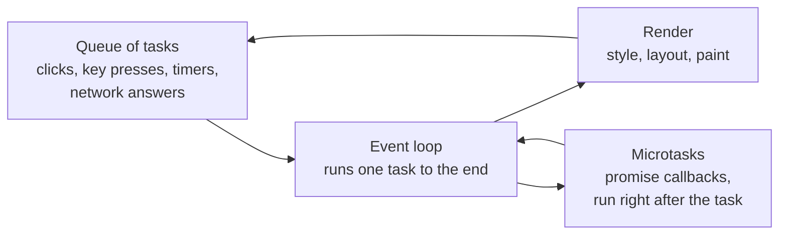

<Info>

**In short:** a page is a program that waits. It runs a little JavaScript, then
waits for the next click, key press, timer or network answer, then runs a little
more. JavaScript is only the language: everything that touches the page or the
outside world comes from the browser as **Web APIs** (the DOM, `fetch`, storage,
observers), and a test can call any of them with one line of script. A test that
acts too early finds a page that has not finished, and a test that fakes input
with script may not be believed. Good automation **waits for the page to be
ready** and **sends real input events**.

</Info>

## JavaScript and the browser are two things

The JavaScript language (called ECMAScript) gives you variables, functions,
arrays, promises and `Math`. It has no idea what a web page is. Everything that
touches the page or the outside world comes from the browser, as objects and
functions that already exist when your script starts:

- `window`, the global object, and `document`, the page (see
  [selectors and the DOM](/concepts/selectors-and-the-dom)).
- `navigator`, facts about the browser and the device.
- `fetch`, `localStorage`, `setTimeout`, `console`, `location`, `history`.

These are **Web APIs**. Each one is written down in a standard (mostly by the
WHATWG and the W3C) so that every browser implements it the same way. The same
JavaScript runs in a Node.js server without them: `document` does not exist
there. That is also why an automation tool has to run its script *inside* the
page (see [Running your own JavaScript](#running-your-own-javascript)).

## The APIs you meet most

| API | What it does | A taste | Notes |
|---|---|---|---|
| **DOM** | Read and change the page's tree of elements | `document.querySelector('h1').textContent` | Always available |
| **Fetch** | Make HTTP requests from a script | `await fetch('/api/items').then(r => r.json())` | Subject to CORS (see [network](/concepts/network)) |
| **Storage** | Keep data in the browser: `localStorage`, `sessionStorage`, IndexedDB, the Cache API | `localStorage.getItem('theme')` | See [sessions and state](/concepts/sessions-and-state) |
| **Canvas** | Draw pixels with code (2D, and WebGL for 3D) | `canvas.getContext('2d').fillRect(0, 0, 50, 50)` | No elements inside; a test sees a picture, not a tree |
| **Geolocation** | Ask where the device is | `navigator.geolocation.getCurrentPosition(ok, fail)` | Needs permission and a secure context |
| **Notifications** | Show a system notification | `new Notification('Done')` | Needs permission |
| **Clipboard** | Read and write copied text | `await navigator.clipboard.writeText('hi')` | Needs a secure context, a user action and often permission |
| **Permissions** | Ask whether a permission is granted, denied or still to be asked | `await navigator.permissions.query({ name: 'geolocation' })` | The answer is `granted`, `denied` or `prompt` |
| **History and URL** | Change the address bar without a reload; take addresses apart | `history.pushState({}, '', '/page/2')` | Used by single-page apps |
| **Workers** | Run scripts on another thread | `new Worker('job.js')` | Cannot touch the DOM |

Hundreds more exist (sensors, Bluetooth, payment, speech). New ones appear first
in Chromium, which is why a feature you rely on can work in your tests and fail
for a user on another browser.

### Secure contexts and permissions

Powerful APIs are limited in two ways.

- **Secure context.** They work only on `https://` pages (and on `localhost`, so
  developers can try them). On a plain `http://` page the object is missing.
- **Permission.** Many need the user to say yes, through a prompt that belongs to
  the **browser**, not to the page.

That second rule is a trap for automation. A prompt asking for the location is
browser interface, outside the page's DOM, so no selector can click "Allow". The
answer is to settle the permission before the page asks, with the
[DevTools Protocol](/concepts/cdp): `Browser.grantPermissions` grants a
permission to an origin, and `Emulation.setGeolocationOverride` sets the
position the page will receive. In a headless run with no answer, the request
usually just fails with the state `denied` or stays `prompt`.

## The event loop

JavaScript in a page runs on one thread. It cannot do two things at once, so the
browser keeps a queue of work and a loop that takes one job at a time.



*One turn of the loop: run a task, run its microtasks, maybe repaint, repeat.*

Three consequences matter for tests.

- **Nothing happens "in the middle" of a task.** A long computation freezes the
  page: clicks are queued, and nothing repaints, until it ends.
- **`setTimeout(fn, 500)` means "no sooner than 500 ms"**, not "at 500 ms". The
  callback waits its turn.
- **An action's effect usually arrives later.** A click runs its handler in one
  task; what the handler asks for (a request, an animation) finishes in later
  ones. The click has returned long before the page has changed.

## Loading things after the page: fetch and XHR

A modern page rarely arrives complete. The first HTML is a shell, and scripts
then ask the server for the data and fill the page in. Two APIs do the asking,
`XMLHttpRequest` (old) and `fetch` (newer). Both are **asynchronous**: the call
returns at once and the answer arrives later as an event, which the loop turns
into a task. The page may fire a dozen of these after the "load" event.

This is why [the page load events](/concepts/how-a-page-loads) are only the
start of readiness. `load` says the document and its first files arrived; it says
nothing about the data that the scripts are still asking for. A test needs to
wait for **the thing it wants** (an element, a text, a finished request),
not for the page.

## Single-page apps

In a **single-page application** (SPA) the browser loads the app once, and
clicking a link does not load a new page. A script changes the address with the
History API, asks for data with `fetch`, and rewrites the DOM. React, Vue,
Angular and Svelte work this way. See
[modern web technologies](/concepts/modern-web#single-page-apps-and-frameworks).

For automation this changes three things. There is **no load event** after the
first, so "wait for the page to load" returns at once. The **URL changes
without a navigation**. And elements are created and **replaced** all the time,
so an element you found a moment ago can be removed from under you.

## Observers: telling you when something changes

A modern page is never "finished". It loads data after the load event, adds
rows while you scroll and swaps parts of itself. Instead of asking the page
again and again, **observers** let you subscribe: the browser calls your
function when something happens.

| Observer | Calls you when | Typical use on a page | Typical use in a test |
|---|---|---|---|
| `MutationObserver` | The DOM changes: children added or removed, attributes or text changed | Update a widget when its container changes | Wait until a list gets its rows or a class appears |
| `IntersectionObserver` | An element enters or leaves the visible area (the viewport), by a fraction you choose | Lazy-load images, infinite scroll, "seen" tracking | Understand why content only appears after scrolling |
| `ResizeObserver` | An element's size changes | Responsive components, charts that redraw | Wait for a layout to settle |
| `PerformanceObserver` | A new performance entry is recorded: paint, largest-contentful-paint, layout-shift, long task, resource | Real-user monitoring | Read timings (see [rendering and performance](/concepts/how-a-page-loads#from-bytes-to-pixels)) |

All four work the same way: create the observer with a callback, call
`observe()` on a target, call `disconnect()` when done. They are asynchronous:
the callback runs after the change, batched, on the main thread.

### Waiting for a change

Two ways to wait for "the results are there":

- **Poll.** Ask every 100 ms or so, for example "does `#results` have children
  yet?", until yes or a timeout. It is simple, works anywhere, and is what the
  waits of most tools do.
- **Observe.** Let the browser tell you. It reacts at once and costs nothing
  between changes, but you write a small script.

A reliable observer script checks the state **first** (the change may already
have happened), then watches, and always has a timeout:

```js
new Promise((resolve, reject) => {
  const target = document.querySelector('#results');
  const done = () => target.children.length > 0;
  if (done()) return resolve(target.children.length);

  const timer = setTimeout(() => { observer.disconnect(); reject(new Error('no rows in 5 s')); }, 5000);
  const observer = new MutationObserver(() => {
    if (done()) { clearTimeout(timer); observer.disconnect(); resolve(target.children.length); }
  });
  observer.observe(target, { childList: true });
})
```

<Tip>

Infinite scroll is an `IntersectionObserver` waiting for a sentinel element to
come into view. If a test never scrolls, or the browser window is so tall that
everything is already visible, the next page loads in a different way than for
a real visitor. Scroll to the sentinel, then wait for new items.

</Tip>

## How a click or a key press becomes an event

When you press a mouse button, the operating system reports it to the browser
process, which finds out which page and which element is under the pointer and
sends the input to that page's renderer. The renderer builds an **event object**
and delivers it to the DOM in three steps: the capture phase (from the top down
to the target), the target itself, and the bubble phase (back up).

One physical click is several events, in a fixed order:

| Order | Events | Notes |
|---|---|---|
| 1 | `pointermove`, `mousemove` | The pointer arrives over the element |
| 2 | `pointerdown`, `mousedown` | The button goes down; focus moves here |
| 3 | `pointerup`, `mouseup` | The button comes up |
| 4 | `click` | Only if down and up were on the same element |

Typing is similar: `keydown`, then (for a character) `keypress` and a
`beforeinput` and `input` event as the text changes, then `keyup`. A page may
react to any of them, and a framework often listens to `input` to keep its
state in step with the field. A field filled by assigning `element.value = "x"`
raises none of these events, so the framework never learns about the text.

## Trusted and synthetic events

Every event object has a property, `event.isTrusted`.

- **`true`** when the event came from the browser itself: a real input, or one
  injected through the browser's own input path.
- **`false`** when a script created it, with `new MouseEvent(...)` and
  `dispatchEvent`, or with `element.click()`.

A script can only produce `false`. The page can read the flag, so it can tell. A
site can refuse an untrusted `click` on a payment button, or a cookie banner can
ignore it. Some actions are permitted only on a trusted event: opening a file
chooser, going fullscreen, playing sound, copying to the clipboard, and anything
that needs a **user gesture**.

<Warning>

A "JavaScript click" (`element.click()`, or an `execute_script` that clicks) is
not equivalent to a click. It skips the move, down and up sequence, it runs
even when the element is covered or off screen, it has `isTrusted` set to
`false`, and it does not scroll, focus or hover first. It is useful as a last
resort for an element that cannot otherwise be reached, and it hides the very
problems (a covered button, a missing wait) that a real click would reveal.

</Warning>

## Auto-waiting and actionability

Because of everything above, a click should not be fired the instant the
selector matches. A good tool waits until the element is **actionable**: ready
for a person to use it. The usual checks are that the element

1. exists,
2. is visible (it has a size and is not hidden),
3. is not covered by another element at the click point,
4. is enabled, and
5. has stopped moving.

The tool re-checks until all hold or a timeout runs out, then fails with a
message saying *which* check failed. This is called **auto-waiting**, and it
replaces the sleeps (`sleep(2)`) that make a suite slow and still flaky.

In seleniumbase-rs:

- **Pure CDP.** A `Locator` waits for its element to be visible, scrolls it
  into view and works out its centre before it acts (`Locator::click`,
  `type_text`, `hover` and the other actions do this). The wait is bounded by the
  locator's timeout, which `Locator::with_timeout` changes. If the element
  never appears the error is `ElementNotFound`; if it exists but never becomes
  visible, `ElementNotInteractable`; and a plain wait that runs out gives
  `WaitTimeout`. You can also wait yourself with
  `locator.wait_for(State::Visible)`, and `State` has `Present`, `Absent`,
  `Visible` and `Hidden`.
- **WebDriver.** `BaseCase` methods wait for the element, for example
  `wait_for_element_visible(selector, 10)` takes a timeout in seconds, and
  `wait_for_ready_state_complete()` waits for the document's ready state after a
  navigation.
- **Pages.** `Page::goto` waits for the load event; `Page::wait_for_load`
  waits for a load that a click started.

<Tip>

Wait for the **effect**, not for a time. After a click, wait for the element
that proves the click worked (the success message, the next screen) with
`wait_for` or an `expect()` assertion, not for two seconds.

</Tip>

## Reading MDN and its compatibility tables

**MDN Web Docs** is the reference for Web APIs. Learning to read a page pays off
every time you automate something new.

<Steps>

<Step title="Start from the summary and the box at the top" icon="flag">

The first lines say what the API is for. Badges mark the state of the feature:
**Experimental** (may change), **Deprecated** (do not start using it),
**Non-standard** (no standard backs it). A **Secure context** notice means it
only works on HTTPS. **Available in Web Workers** says whether a worker may use
it.

</Step>

<Step title="Read the syntax, parameters and return value" icon="code">

The syntax block shows the call. Pay attention to whether the call returns a
value, a promise (then you need `await`), or nothing and calls you back later.
The exceptions it can throw are listed, for instance `NotAllowedError` for a
refused permission.

</Step>

<Step title="Run the example" icon="play">

Most pages have live examples. Paste one into the browser console, or into your
test as a script, and see the real result before you wrap it.

</Step>

<Step title="Check the browser compatibility table" icon="table">

At the bottom, a table lists the first version of each browser that supports each
feature. Green means supported since that version. A flag or "Partial
implementation" means it is behind a setting or incomplete. A "Baseline" label
(widely available, newly available) says whether all major browsers support it.

</Step>

</Steps>

<Warning>

A feature that works in the Chrome that your tests drive may be missing in
Firefox or Safari, where your users are. Passing a test proves the page works in
that browser version, not that the API is safe to use everywhere. Check the
table before building a feature on a new API, and test with the browsers your
users have (see [browser engines](/concepts/browser-architecture#what-an-engine-is)).

</Warning>

## How seleniumbase-rs uses it

### Sending input

The pure CDP engine (`src/sb_cdp/input.rs`) sends input through the DevTools
`Input` domain, the browser's own input path, so every event is trusted. See
[the DevTools Protocol](/concepts/cdp#what-a-click-looks-like).

<Steps>

<Step title="A click" icon="hand-pointer">

`Page::mouse()` returns a `Mouse`. `Mouse::click(at)` sends three
`Input.dispatchMouseEvent` commands in order: `mouseMoved` to the point, then
`mousePressed` and `mouseReleased` with the left `Button`. They go out together
in one ordered batch, and the page sees the same sequence as a person's click.
`double_click` and `right_click` repeat or change the button, and `drag`,
`wheel` and `move_to` cover the rest.

</Step>

<Step title="A key press" icon="keyboard">

`Page::keyboard()` returns a `Keyboard`. `Keyboard::press(Key)` sends a
`keyDown` (a `rawKeyDown` for keys that produce no text) and a `keyUp` through
`Input.dispatchKeyEvent`. `Key` has `Enter`, `Tab`, `Escape`, `Backspace`,
`Delete`, the arrows, `Home`, `End`, `PageUp` and `PageDown`. Enter also carries
the character, which is what submits a form.

</Step>

<Step title="Typing text" icon="font">

`Keyboard::type_text(text)` presses **one key per character**, with an 8 ms
pause between them, so the page sees a `keydown`, `input` and `keyup` for each
letter as a person's typing would give. `Keyboard::insert_text(text)` sends the
whole string at once with `Input.insertText`, as a paste does: much faster, but
with no per-character key events.

</Step>

<Step title="Through a Locator" icon="crosshairs">

`Locator::type_text(text)` first clears the field (which also focuses it) and
then types through the keyboard. That is why recorded tests call it alone, with
nothing to empty the field first.

</Step>

</Steps>

#### Input with a person's pace

Real input is trusted, but a script's movement is still unlike a person's: the
pointer jumps in a straight line to the exact centre, and letters arrive at the
same interval. `Page::human(Behavior)` returns a `Human` whose
`move_to`, `click(&Locator)`, `type_text(&Locator, text)`, `type_focused` and
`scroll_by` move the pointer along a curve, land the click somewhere inside the
element and type at an uneven rhythm. The events are the same trusted input;
only the path and timing differ. It is slower on purpose, so use it where a page
watches how input arrives. See [Detection and spoofing](/concepts/detection) and
the glossary entry [Human-paced input](/glossary#human-paced-input).

```rust,ignore src/main.rs
use seleniumbase_rs::stealth::behavior::Behavior;

let person = page.human(Behavior::builder().typing_wpm(65.0).build()?);
person.type_text(&page.locator("#search"), "rust cdp").await?;
person.click(&page.locator("button[type=submit]")).await?;
```

### Running your own JavaScript

Sometimes you need to read something the DOM does not expose, or call a function
of the page. `Page::evaluate("document.title")` runs a script in the page and
returns its value, and `Page::execute("Runtime.evaluate", ...)` sends the raw
command (see [Any CDP command](/concepts/cdp#how-seleniumbase-rs-uses-it)). The
script runs in the page's own world, with the page's globals, and is bound by the
page's rules: if the page redefined a function, your script sees the change.

### Calling Web APIs from a test

seleniumbase-rs has no wrapper for these APIs, and does not need one: you call
them by running JavaScript in the page. That is also how the library itself reads
much of the page.

<Tabs>

<Tab title="WebDriver engine" icon="plug">

`BaseCase::execute_script` runs a script and returns its value as JSON.
`BaseCase::evaluate` is an alias for it.

```rust,ignore src/main.rs
let theme = sb.execute_script("return localStorage.getItem('theme');").await?;
let online = sb.execute_script("return navigator.onLine;").await?;
```

</Tab>

<Tab title="Pure CDP engine" icon="bolt">

`sb_cdp::Page::evaluate` runs an expression and **awaits promises**, so a
Promise built from an observer works as it is. `Page::evaluate_as` also turns the
result into a Rust type with serde. A script that throws comes back as
`SeleniumBaseError::CdpDriver`. A `return` that starts the last line is dropped,
so a Selenium-style script still works; a `return` anywhere else needs the
script wrapped in an arrow function that is called.

```rust,ignore src/main.rs
let rows: u64 = page
    .evaluate_as(
        r#"new Promise(resolve => {
             const target = document.querySelector('#results');
             const done = () => target.children.length > 0;
             if (done()) return resolve(target.children.length);
             new MutationObserver((_, observer) => {
               if (done()) { observer.disconnect(); resolve(target.children.length); }
             }).observe(target, { childList: true });
           })"#,
    )
    .await?;
```

</Tab>

<Tab title="MCP server" icon="robot">

The browser-driving MCP servers have a `run_javascript` tool that takes an
`expression`, so an assistant can read `navigator`, `localStorage` or a
`PerformanceObserver` result from the live page. See [MCP](/concepts/mcp).

</Tab>

</Tabs>

<Note>

The result of a script must be JSON-representable. A DOM element comes back as an
empty object `{}`, so return what you need from it (`el.textContent`,
`el.getBoundingClientRect().toJSON()`), not the element itself.

</Note>

<Accordion title="What about permissions in a test?" icon="shield">

Grant them before the page asks. With either engine you can send the DevTools
command by name, for example `Browser.grantPermissions` with the origin and a
list of permission names. On the WebDriver engine this is
`BaseCase::execute_cdp_with_params`. See [the DevTools Protocol](/concepts/cdp).

</Accordion>

## Where to go next

<Columns cols={2}>

<Card title="Selectors and the DOM" icon="code" color="#1a85d4" href="/concepts/selectors-and-the-dom">
  The first half of any action: pointing at the element.
</Card>

<Card title="The DevTools Protocol" icon="bolt" color="#199f43" href="/concepts/cdp">
  The Input, Runtime and Page domains this builds on.
</Card>

<Card title="Detection and spoofing" icon="user-secret" color="#d47628" href="/concepts/detection">
  How a page tells a script from a person, and what to do about it.
</Card>

<Card title="Modern web technologies" icon="layer-group" color="#a631be" href="/concepts/modern-web">
  Single-page apps, WebSockets, service workers and more.
</Card>

<Card title="How a page loads" icon="gauge-high" color="#d47628" href="/concepts/how-a-page-loads">
  What PerformanceObserver reports, and why pages feel slow.
</Card>

<Card title="Mobile web and accessibility" icon="universal-access" color="#a631be" href="/concepts/mobile-and-accessibility">
  The accessibility tree the browser builds from the DOM.
</Card>

</Columns>
