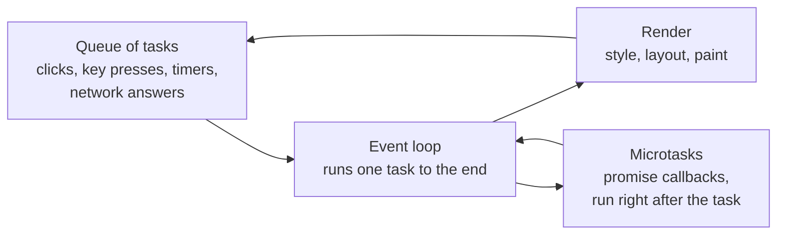

<Info>

**In short:** a page is a program that waits. It runs a little JavaScript, then
waits for the next click, key press, timer or network answer, then runs a little
more. A test that acts too early finds a page that has not finished, and a test
that fakes input with script may not be believed. Good automation **waits for
the page to be ready** and **sends real input events**.

</Info>

## The event loop

JavaScript in a page runs on one thread. It cannot do two things at once, so the
browser keeps a queue of work and a loop that takes one job at a time.



*One turn of the loop: run a task, run its microtasks, maybe repaint, repeat.*

Three consequences matter for tests.

- **Nothing happens "in the middle" of a task.** A long computation freezes the
  page: clicks are queued, and nothing repaints, until it ends.
- **`setTimeout(fn, 500)` means "no sooner than 500 ms"**, not "at 500 ms". The
  callback waits its turn.
- **An action's effect usually arrives later.** A click runs its handler in one
  task; what the handler asks for (a request, an animation) finishes in later
  ones. The click has returned long before the page has changed.

## Loading things after the page: fetch and XHR

A modern page rarely arrives complete. The first HTML is a shell, and scripts
then ask the server for the data and fill the page in. Two APIs do the asking,
`XMLHttpRequest` (old) and `fetch` (newer). Both are **asynchronous**: the call
returns at once and the answer arrives later as an event, which the loop turns
into a task. The page may fire a dozen of these after the "load" event.

This is why [the page load events](/concepts/how-a-page-loads) are only the
start of readiness. `load` says the document and its first files arrived; it says
nothing about the data that the scripts are still asking for. A test needs to
wait for **the thing it wants** (an element, a text, a finished request),
not for the page.

## Single-page apps

In a **single-page application** (SPA) the browser loads the app once, and
clicking a link does not load a new page. A script changes the address with the
History API, asks for data with `fetch`, and rewrites the DOM. React, Vue,
Angular and Svelte work this way. See
[modern web technologies](/concepts/modern-web#single-page-apps-and-frameworks).

For automation this changes three things. There is **no load event** after the
first, so "wait for the page to load" returns at once. The **URL changes
without a navigation**. And elements are created and **replaced** all the time,
so an element you found a moment ago can be removed from under you.

## How a click or a key press becomes an event

When you press a mouse button, the operating system reports it to the browser
process, which finds out which page and which element is under the pointer and
sends the input to that page's renderer. The renderer builds an **event object**
and delivers it to the DOM in three steps: the capture phase (from the top down
to the target), the target itself, and the bubble phase (back up).

One physical click is several events, in a fixed order:

| Order | Events | Notes |
|---|---|---|
| 1 | `pointermove`, `mousemove` | The pointer arrives over the element |
| 2 | `pointerdown`, `mousedown` | The button goes down; focus moves here |
| 3 | `pointerup`, `mouseup` | The button comes up |
| 4 | `click` | Only if down and up were on the same element |

Typing is similar: `keydown`, then (for a character) `keypress` and a
`beforeinput` and `input` event as the text changes, then `keyup`. A page may
react to any of them, and a framework often listens to `input` to keep its
state in step with the field. A field filled by assigning `element.value = "x"`
raises none of these events, so the framework never learns about the text.

## Trusted and synthetic events

Every event object has a property, `event.isTrusted`.

- **`true`** when the event came from the browser itself: a real input, or one
  injected through the browser's own input path.
- **`false`** when a script created it, with `new MouseEvent(...)` and
  `dispatchEvent`, or with `element.click()`.

A script can only produce `false`. The page can read the flag, so it can tell. A
site can refuse an untrusted `click` on a payment button, or a cookie banner can
ignore it. Some actions are permitted only on a trusted event: opening a file
chooser, going fullscreen, playing sound, copying to the clipboard, and anything
that needs a **user gesture**.

<Warning>

A "JavaScript click" (`element.click()`, or an `execute_script` that clicks) is
not equivalent to a click. It skips the move, down and up sequence, it runs
even when the element is covered or off screen, it has `isTrusted` set to
`false`, and it does not scroll, focus or hover first. It is useful as a last
resort for an element that cannot otherwise be reached, and it hides the very
problems (a covered button, a missing wait) that a real click would reveal.

</Warning>

## Auto-waiting and actionability

Because of everything above, a click should not be fired the instant the
selector matches. A good tool waits until the element is **actionable**: ready
for a person to use it. The usual checks are that the element

1. exists,
2. is visible (it has a size and is not hidden),
3. is not covered by another element at the click point,
4. is enabled, and
5. has stopped moving.

The tool re-checks until all hold or a timeout runs out, then fails with a
message saying *which* check failed. This is called **auto-waiting**, and it
replaces the sleeps (`sleep(2)`) that make a suite slow and still flaky.

In seleniumbase-rs:

- **Pure CDP.** A `Locator` waits for its element to be visible, scrolls it
  into view and works out its centre before it acts (`Locator::click`,
  `type_text`, `hover` and the other actions do this). The wait is bounded by the
  locator's timeout, which `Locator::with_timeout` changes. If the element
  never appears the error is `ElementNotFound`; if it exists but never becomes
  visible, `ElementNotInteractable`; and a plain wait that runs out gives
  `WaitTimeout`. You can also wait yourself with
  `locator.wait_for(State::Visible)`, and `State` has `Present`, `Absent`,
  `Visible` and `Hidden`.
- **WebDriver.** `BaseCase` methods wait for the element, for example
  `wait_for_element_visible(selector, 10)` takes a timeout in seconds, and
  `wait_for_ready_state_complete()` waits for the document's ready state after a
  navigation.
- **Pages.** `Page::goto` waits for the load event; `Page::wait_for_load`
  waits for a load that a click started.

<Tip>

Wait for the **effect**, not for a time. After a click, wait for the element
that proves the click worked (the success message, the next screen) with
`wait_for` or an `expect()` assertion, not for two seconds.

</Tip>

## How seleniumbase-rs sends input

The pure CDP engine (`src/sb_cdp/input.rs`) sends input through the DevTools
`Input` domain, the browser's own input path, so every event is trusted. See
[the DevTools Protocol](/concepts/cdp#what-a-click-looks-like).

<Steps>

<Step title="A click" icon="hand-pointer">

`Page::mouse()` returns a `Mouse`. `Mouse::click(at)` sends three
`Input.dispatchMouseEvent` commands in order: `mouseMoved` to the point, then
`mousePressed` and `mouseReleased` with the left `Button`. They go out together
in one ordered batch, and the page sees the same sequence as a person's click.
`double_click` and `right_click` repeat or change the button, and `drag`,
`wheel` and `move_to` cover the rest.

</Step>

<Step title="A key press" icon="keyboard">

`Page::keyboard()` returns a `Keyboard`. `Keyboard::press(Key)` sends a
`keyDown` (a `rawKeyDown` for keys that produce no text) and a `keyUp` through
`Input.dispatchKeyEvent`. `Key` has `Enter`, `Tab`, `Escape`, `Backspace`,
`Delete`, the arrows, `Home`, `End`, `PageUp` and `PageDown`. Enter also carries
the character, which is what submits a form.

</Step>

<Step title="Typing text" icon="font">

`Keyboard::type_text(text)` presses **one key per character**, with an 8 ms
pause between them, so the page sees a `keydown`, `input` and `keyup` for each
letter as a person's typing would give. `Keyboard::insert_text(text)` sends the
whole string at once with `Input.insertText`, as a paste does: much faster, but
with no per-character key events.

</Step>

<Step title="Through a Locator" icon="crosshairs">

`Locator::type_text(text)` first clears the field (which also focuses it) and
then types through the keyboard. That is why recorded tests call it alone, with
nothing to empty the field first.

</Step>

</Steps>

### Input with a person's pace

Real input is trusted, but a script's movement is still unlike a person's: the
pointer jumps in a straight line to the exact centre, and letters arrive at the
same interval. `Page::human(Behavior)` returns a `Human` whose
`move_to`, `click(&Locator)`, `type_text(&Locator, text)`, `type_focused` and
`scroll_by` move the pointer along a curve, land the click somewhere inside the
element and type at an uneven rhythm. The events are the same trusted input;
only the path and timing differ. It is slower on purpose, so use it where a page
watches how input arrives. See [Detection and spoofing](/concepts/detection) and
the glossary entry [Human-paced input](/glossary#human-paced-input).

```rust,ignore src/main.rs
use seleniumbase_rs::stealth::behavior::Behavior;

let person = page.human(Behavior::builder().typing_wpm(65.0).build()?);
person.type_text(&page.locator("#search"), "rust cdp").await?;
person.click(&page.locator("button[type=submit]")).await?;
```

## Running your own JavaScript

Sometimes you need to read something the DOM does not expose, or call a function
of the page. `Page::evaluate("document.title")` runs a script in the page and
returns its value, and `Page::execute("Runtime.evaluate", ...)` sends the raw
command (see [Any CDP command](/concepts/cdp#how-seleniumbase-rs-uses-it)). The
script runs in the page's own world, with the page's globals, and is bound by the
page's rules: if the page redefined a function, your script sees the change.

## Where to go next

<Columns cols={2}>

<Card title="Selectors and the DOM" icon="code" color="#1a85d4" href="/concepts/selectors-and-the-dom">
  The first half of any action: pointing at the element.
</Card>

<Card title="The DevTools Protocol" icon="bolt" color="#199f43" href="/concepts/cdp">
  The Input, Runtime and Page domains this builds on.
</Card>

<Card title="Detection and spoofing" icon="user-secret" color="#d47628" href="/concepts/detection">
  How a page tells a script from a person, and what to do about it.
</Card>

<Card title="Modern web technologies" icon="layer-group" color="#a631be" href="/concepts/modern-web">
  Single-page apps, WebSockets, service workers and more.
</Card>

</Columns>
