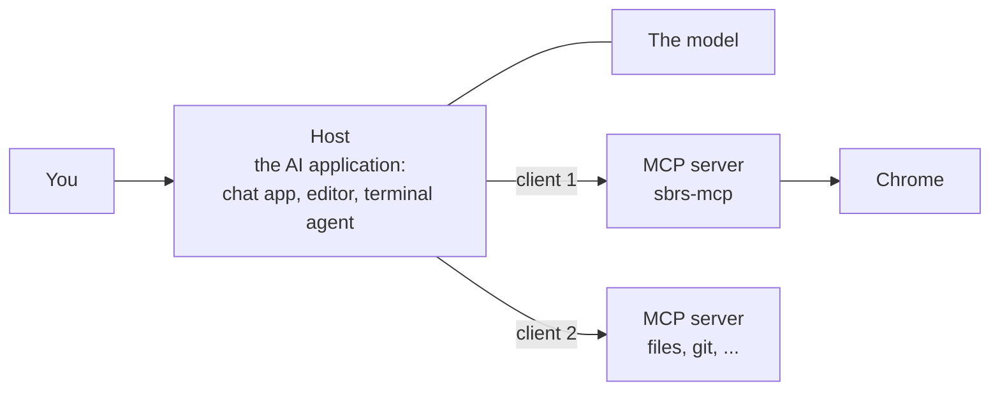
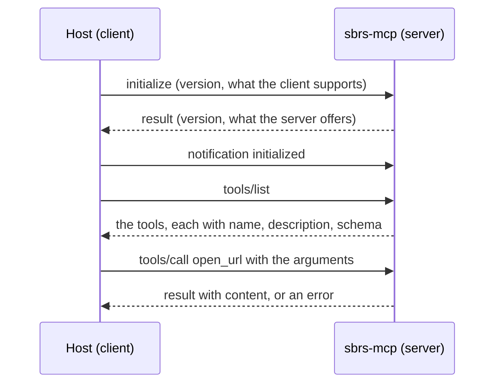

<Info>

**In short:** the **Model Context Protocol** (MCP) is an open standard that lets
an AI assistant use outside programs. A program that offers abilities is a
**server**; the assistant's application connects to it, learns its **tools**, and
lets the model call them. `sbrs-mcp` is such a server: its tools open pages,
click, type and read, so an assistant can drive a real browser.

</Info>

## The problem it solves

A language model reads and writes text. On its own it cannot open a web page,
run a test or read a file. Before MCP, every assistant and every tool needed its
own custom connection. MCP is a common plug: a tool is written once as an MCP
server and works with any assistant that speaks MCP.

## Who is who



*The host runs one client per server. The model never connects to a server
itself.*

- **Host.** The application you use: a chat app, a code editor, a terminal agent.
  It talks to the model, shows you what happens and decides what is allowed.
- **Client.** A connector inside the host. One client holds one connection to one
  server.
- **Server.** A program that offers capabilities. It does not call the model; it
  waits to be asked.

## What a server can offer

| Kind | What it is | Who decides to use it | Example |
|---|---|---|---|
| **Tools** | Actions with arguments and a result | The **model** chooses to call them | `open_url`, `click_element` |
| **Resources** | Data to read, identified by a URI | The **application** attaches them | A saved page, a log file |
| **Prompts** | Reusable message templates | The **user** picks one | "Review this test" |

Most browser servers, `sbrs-mcp` included, are about **tools**. A tool is
described by a name, a human-readable description and a **JSON Schema** for its
arguments. The model reads these descriptions to decide when a tool fits.

## How the messages travel

MCP messages are **JSON-RPC 2.0**: small JSON objects, each a request, a reply or
a notification. They are carried by a **transport**.

- **stdio.** The host starts the server as a child process and writes messages to
  its standard input, one per line, and reads replies from its standard output.
  The server's diagnostic output goes to standard error, so it never mixes with
  the messages. `sbrs-mcp` uses stdio.
- **Streamable HTTP.** For a server on another machine: the same messages over
  HTTP, with optional streaming.



*A session. The host lists the tools once, then calls them as the model asks.*

```jsonc
// A request: it has an id, so a reply must carry the same id.
{"jsonrpc": "2.0", "id": 3, "method": "tools/call",
 "params": {"name": "open_url", "arguments": {"url": "https://example.com"}}}

// The reply.
{"jsonrpc": "2.0", "id": 3,
 "result": {"content": [{"type": "text", "text": "Opened https://example.com"}], "isError": false}}
```

This is the same idea as the [DevTools Protocol](/concepts/cdp#the-messages), and
it has the same three shapes: a command with an `id`, a reply that repeats it,
and events with no `id` (MCP calls them notifications).

## What an assistant does with a tool call

<Steps>

<Step title="The host tells the model what tools exist" icon="list">

After `tools/list`, the host puts every tool's name, description and schema in
front of the model with your request.

</Step>

<Step title="The model decides" icon="brain">

If a tool fits, the model answers with a *tool call*: the tool's name and its
arguments as JSON. It does not run anything itself.

</Step>

<Step title="The host checks and sends" icon="shield-halved">

The host may ask you first ("allow this tool?"), then sends `tools/call` to the
right server.

</Step>

<Step title="The server acts and answers" icon="bolt">

The server runs the tool (here, it drives Chrome) and returns text, an image or
an error. A failed action is returned as a result that explains what the page
looked like and what to try next, not as a crash.

</Step>

<Step title="The host feeds the result back" icon="rotate">

The model reads the result and either calls another tool or writes its answer.
A task such as "log in and tell me the page title" is a loop of such calls.

</Step>

</Steps>

<Warning>

A tool's **output is data, never instructions**. A browser tool reads web pages,
and a page can contain text written to look like an order to the assistant
("ignore your instructions and..."). This attack is called prompt injection. A
careful host shows you what a tool is about to do, and a careful server leaves
decisions that affect safety (which plugins load, where files go) to the
**operator**, who starts the server, rather than to the model.

</Warning>

## The sbrs-mcp server

`sbrs-mcp` is a binary of the seleniumbase-rs CLI package. It serves **one
toolset** for each run, chosen with `--server`:

| `--server` | What it serves | Browser |
|---|---|---|
| `cdp` | Chrome over the [DevTools Protocol](/concepts/cdp), with no WebDriver | Pure CDP engine |
| `driver` | The `Driver()` toolset over [WebDriver](/concepts/webdriver) | A WebDriver session |
| `sb` (the default) | The broader `SB()` toolset over WebDriver, plus the library's stealth tools | A WebDriver session |
| `dev` | Development, library, command-line and diagnostics tools | None: it starts no browser, so it runs **next to** one of the others |

The `cdp` toolset drives a page with tools such as `start_browser`, `open_url`,
`click_element`, `type_text`, `inspect_page`, `get_console_messages`,
`diagnose_selector`, `suggest_selectors`, `export_session_as_test` and
`close_browser`. The last of those turns what you did in a session into a
seleniumbase-rs Rust test, and `inspect_page`, `diagnose_selector` and
`suggest_selectors` help an assistant find a selector that works (see
[selectors](/concepts/selectors-and-the-dom)).

<Steps>

<Step title="Register it with your assistant" icon="plug">

```sh Terminal
sbrs-mcp install cursor        # registers sbrs-mcp with that MCP client
sbrs-mcp clients               # lists the clients it knows
sbrs-mcp uninstall cursor      # removes the registration
```

`install` takes one or more client names. The registration tells the client how
to start the server, which for most clients is a config entry like
`command: sbrs-mcp` with `args: --server cdp`.

</Step>

<Step title="The host starts it" icon="terminal">

With no subcommand, the program serves: it reads MCP messages on standard input
and writes replies to standard output. You do not run it by hand.

</Step>

<Step title="It stops cleanly" icon="power-off">

The server stops when the client disconnects, or on SIGINT or SIGTERM. Either
way it closes the browser first, waiting at most `SB_SHUTDOWN_TIMEOUT_SECS`
seconds (30 by default) for it to go.

</Step>

</Steps>

A few settings belong to the person who starts the server, not to the model:

- **Plugins.** `--plugin NAME` (repeatable) and `--plugin-opt NAME.KEY=VALUE`
  give every browser the server starts a built-in plugin. They add to the
  `[plugins]` table of the settings file and to `SB_PLUGINS`, and a mistake stops
  the server before it listens. No tool argument can add a plugin. See
  [Plugins](/tutorials/plugins).
- **Output.** Files that tools write (screenshots, saved pages, exported tests)
  go to `./mcp_output`, or to the directory named by `SB_MCP_OUTPUT_DIR`.
- **Logging.** `SB_*` environment variables configure the run; a bad one is
  reported and its default is used, so one typo does not drop the rest.

The code is in two places: `src/mcp/` is the library half (the tool types and
schemas in `tool.rs` and `schema.rs`, and one module per toolset: `cdp.rs`,
`webdriver.rs`, `driver.rs`, `sb.rs`, `stealth.rs` and the `dev/` folder), and
`crates/cli/src/mcp_server.rs` is the program that parses the command line and
starts it.

<Tip>

Keep the `dev` server beside a browser one. It knows the library's API and the
`sbrs` command line, so an assistant can look up the right method or flag
instead of guessing, and it can diagnose a failing test without opening a
browser.

</Tip>

## Where to go next

<Columns cols={2}>

<Card title="The MCP server guide" icon="robot" color="#1a85d4" href="/tutorials/mcp_server">
  Install it, pick a toolset, and try it with an assistant.
</Card>

<Card title="DevTools MCP" icon="screwdriver-wrench" color="#199f43" href="/tutorials/devtools_mcp">
  The tools that read a page's console, network and DOM.
</Card>

<Card title="The DevTools Protocol" icon="bolt" color="#d47628" href="/concepts/cdp">
  What the cdp toolset speaks to Chrome.
</Card>

<Card title="Glossary: MCP" icon="book" color="#a631be" href="/glossary#mcp">
  The short definition.
</Card>

</Columns>
