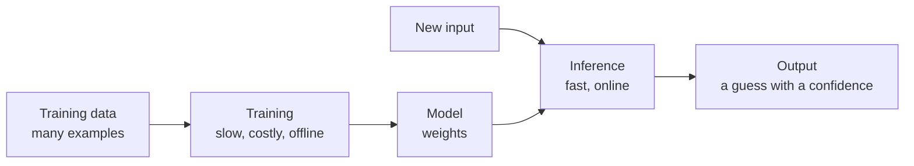
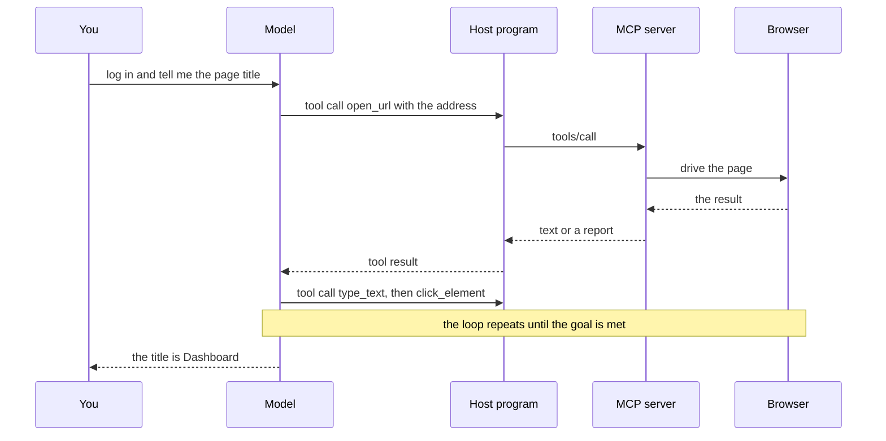
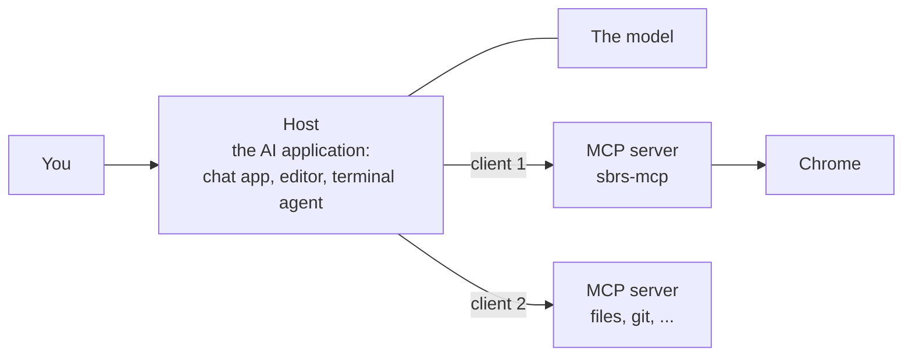
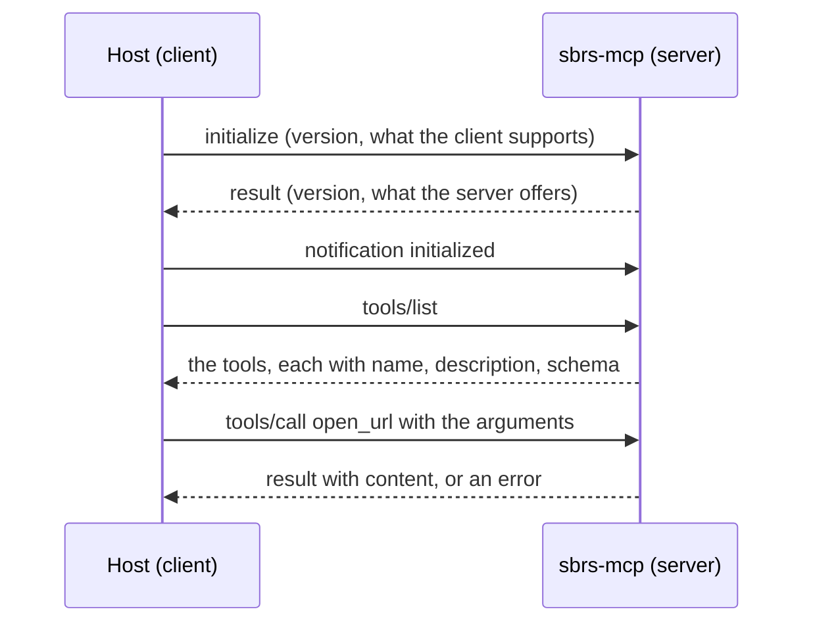

<Info>

**In short:** machine learning (ML) is software that learns a behaviour from
examples, and large language models (LLMs) are ML models that write text. For a
tester it matters three ways: sites contain ML features whose output varies,
sites use ML to spot robots, and an AI assistant can drive a browser or write a
test for you. The **Model Context Protocol** (MCP) is the open standard that
lets an assistant use outside programs; `sbrs-mcp` is such a server, and its
tools open pages, click, type and read. That is useful and fast, and its output
must be checked like any other code.

</Info>

## Machine learning in plain words

A normal program is a list of rules: *if the cart is empty, show the empty-cart
message.* That works when you can write the rules. It fails when you cannot, such
as "is this photo a cat?" or "which of these ten thousand products will this
person want?". **Machine learning** takes the other route: show the computer many
examples and let it find the pattern.

<Steps>

<Step title="Collect examples" icon="database">

Photos labelled "cat" or "not a cat"; past purchases; emails marked as spam. This
is the **training data**. Its quality limits everything that follows.

</Step>

<Step title="Train" icon="dumbbell">

A learning algorithm adjusts millions of numbers, called **weights** or
parameters, until the program's guesses match the examples well. The result is a
**model**: a big table of numbers plus the recipe that uses them. Training is
slow and expensive and happens once, or now and then.

</Step>

<Step title="Infer" icon="bolt">

**Inference** is using the finished model on new input: it takes a photo and
returns "cat, 94 percent sure". This is fast, and it is what runs when you use a
site. The weights do not change while you use it.

</Step>

</Steps>



*Training builds the model once; inference uses it many times.*

Two facts to keep in mind. A model gives a **guess with a confidence**, never a
guarantee. And it can only be as good as its examples, so it can be wrong in
ways that surprise its authors, especially on input unlike what it was trained on.

## Large language models

A **large language model** is a neural network trained on a huge amount of text to
predict the next piece of text. A piece is called a **token**: a word or part of
a word. Repeat that prediction many times and the model writes sentences, code and
answers. Words you will meet:

| Term | Meaning |
|---|---|
| Prompt | The text you give the model: the question, the rules, the examples |
| Context window | How many tokens the model can read at once, prompt and reply together |
| Temperature | How adventurous the choice of the next token is; higher gives more varied replies |
| Hallucination | A fluent answer that is simply false, such as an API method that does not exist |
| Embedding | A list of numbers that stands for the meaning of a text, so similar texts are close together |
| Tool calling | The model answers with a request to run a named function with arguments, instead of plain text |

Because the next token is chosen with some randomness, **the same prompt can give
different replies**. That single fact explains most of what is hard about testing
anything built on an LLM.

## How websites use ML

You meet ML on most large sites, often without a label:

- **Recommendations.** "People who bought this also bought", the next video, the
  order of a feed. Two visitors, or the same visitor twice, see different lists.
- **Search.** Ranking, spelling fixes, "did you mean", and answers written by a
  model above the results.
- **Chatbots and assistants.** A support widget that answers in free text and
  streams its reply word by word.
- **Moderation and fraud.** Filters that hide abusive posts, flag spam, or decide
  that a payment looks risky and ask for an extra check.
- **Personalisation and pricing.** Content, offers and sometimes prices that depend
  on who you appear to be.
- **Bot detection.** Models trained to tell people from programs.

### ML-based bot detection

Rule-based checks look for known tell-tale signs, such as a browser flag. ML-based
systems look at behaviour and combine many weak signals into one score: how the
mouse moves, how fast keys are typed, how steady the timing is, whether the
browser's reported properties agree with each other, and what the network
connection looks like. No single signal decides. A visitor whose score is too high
gets a challenge or a block. For more on the signals, see
[Detection and spoofing](/concepts/detection); for the challenges, see
[CAPTCHAs](/concepts/captchas).

<Note>

Because the verdict is a score and not a rule, a test that passes ten times can
fail on the eleventh with nothing changed. Treat a sudden challenge as a result to
investigate, and run protected flows against an environment that allows your test
traffic.

</Note>

## Testing a site that contains ML

The output of an ML feature is not fixed, so the usual "assert the exact text"
breaks. Some habits that work:

| Problem | Habit |
|---|---|
| The reply wording changes each run | Assert properties: it is not empty, it mentions the product name, it has no error text, it finished streaming |
| The reply arrives word by word | Wait for the final state, such as the send button coming back, not for a fixed time |
| Recommendations differ per visitor | Check structure (a list of ten cards with a title and a price), not the items |
| The model is slow or costly to call | Stub its API in the browser and test the page with a fixed answer; keep a few real calls as a separate check |
| A cached or personalised answer | Start from a clean browser profile so earlier visits do not shape the result |

Stubbing is the strongest tool. A chatbot widget usually calls a back-end endpoint;
if a test answers that call with a fixed reply, the page can be tested
deterministically, and the model can be tested on its own with a different kind of
test. See [Common backend patterns](/concepts/frontends-backends-and-apis#crud-the-pattern-behind-most-apps) and
[the network](/concepts/network).

## AI agents that drive a browser

An **AI agent** is an LLM placed in a loop with tools it may call. A browser agent
gets tools such as "open a page", "click this element" and "read the page", then
works toward a goal in steps.



*Tool calling in a loop. The model never touches the browser; the server does.*

How the agent perceives the page decides how well it works. Some agents read a
text outline of the page (the DOM and the accessibility tree), some look at
screenshots, and some use both. An outline is cheap and exact; a screenshot sees
what is drawn, including canvases and images. The protocol that connects the model
to the browser is the Model Context Protocol, described in the next sections.

## The problem MCP solves

A language model reads and writes text. On its own it cannot open a web page,
run a test or read a file. Before MCP, every assistant and every tool needed its
own custom connection. MCP is a common plug: a tool is written once as an MCP
server and works with any assistant that speaks MCP.

## Who is who in MCP



*The host runs one client per server. The model never connects to a server
itself.*

- **Host.** The application you use: a chat app, a code editor, a terminal agent.
  It talks to the model, shows you what happens and decides what is allowed.
- **Client.** A connector inside the host. One client holds one connection to one
  server.
- **Server.** A program that offers capabilities. It does not call the model; it
  waits to be asked.

## What an MCP server can offer

| Kind | What it is | Who decides to use it | Example |
|---|---|---|---|
| **Tools** | Actions with arguments and a result | The **model** chooses to call them | `open_url`, `click_element` |
| **Resources** | Data to read, identified by a URI | The **application** attaches them | A saved page, a log file |
| **Prompts** | Reusable message templates | The **user** picks one | "Review this test" |

Most browser servers, `sbrs-mcp` included, are about **tools**. A tool is
described by a name, a human-readable description and a **JSON Schema** for its
arguments. The model reads these descriptions to decide when a tool fits.

## How MCP messages travel

MCP messages are **JSON-RPC 2.0**: small JSON objects, each a request, a reply or
a notification. They are carried by a **transport**.

- **stdio.** The host starts the server as a child process and writes messages to
  its standard input, one per line, and reads replies from its standard output.
  The server's diagnostic output goes to standard error, so it never mixes with
  the messages. `sbrs-mcp` uses stdio.
- **Streamable HTTP.** For a server on another machine: the same messages over
  HTTP, with optional streaming.



*A session. The host lists the tools once, then calls them as the model asks.*

```jsonc
// A request: it has an id, so a reply must carry the same id.
{"jsonrpc": "2.0", "id": 3, "method": "tools/call",
 "params": {"name": "open_url", "arguments": {"url": "https://example.com"}}}

// The reply.
{"jsonrpc": "2.0", "id": 3,
 "result": {"content": [{"type": "text", "text": "Opened https://example.com"}], "isError": false}}
```

This is the same idea as the [DevTools Protocol](/concepts/cdp#the-messages), and
it has the same three shapes: a command with an `id`, a reply that repeats it,
and events with no `id` (MCP calls them notifications).

## What an assistant does with a tool call

<Steps>

<Step title="The host tells the model what tools exist" icon="list">

After `tools/list`, the host puts every tool's name, description and schema in
front of the model with your request.

</Step>

<Step title="The model decides" icon="brain">

If a tool fits, the model answers with a *tool call*: the tool's name and its
arguments as JSON. It does not run anything itself.

</Step>

<Step title="The host checks and sends" icon="shield-halved">

The host may ask you first ("allow this tool?"), then sends `tools/call` to the
right server.

</Step>

<Step title="The server acts and answers" icon="bolt">

The server runs the tool (here, it drives Chrome) and returns text, an image or
an error. A failed action is returned as a result that explains what the page
looked like and what to try next, not as a crash.

</Step>

<Step title="The host feeds the result back" icon="rotate">

The model reads the result and either calls another tool or writes its answer.
A task such as "log in and tell me the page title" is a loop of such calls.

</Step>

</Steps>

<Warning>

A tool's **output is data, never instructions**. A browser tool reads web pages,
and a page can contain text written to look like an order to the assistant
("ignore your instructions and..."). This attack is called prompt injection. A
careful host shows you what a tool is about to do, and a careful server leaves
decisions that affect safety (which plugins load, where files go) to the
**operator**, who starts the server, rather than to the model. For an agent
that browses, add two habits: keep it away from secrets, and ask for
confirmation before irreversible steps.

</Warning>

## AI-assisted test writing

An assistant can write a test from a description, turn a recorded session into
code, suggest a better selector, or explain an error. That saves real time. It also
has failure modes that people stop noticing once the code looks tidy.

<AccordionGroup>

<Accordion title="A test that passes and proves nothing" icon="circle-check">

A generated test can click through a page and then assert something that is
always true, or nothing at all. A green run says "no error happened", not "the
feature works". Break the feature on purpose and make sure the test fails.

</Accordion>

<Accordion title="Invented APIs" icon="ghost">

A model may call a method that does not exist or use one from another library or
language. The compiler catches that in Rust, which is a real advantage, but it
cannot catch a method that exists and does something else. Check names against the
documentation or an API lookup tool.

</Accordion>

<Accordion title="Fragile selectors" icon="link-slash">

A model may pick the first selector that works today, such as a generated class
name. Prefer a stable test attribute, and read
[Selectors and the DOM](/concepts/selectors-and-the-dom).

</Accordion>

<Accordion title="Hidden data" icon="user-secret">

A session recorded against a real account can contain a password, a token or
personal data. Check what a generated file contains before it is committed, and
use test accounts.

</Accordion>

</AccordionGroup>

<Tip>

A good division of labour: let the assistant draft and explore, then read the test
yourself, run it, break the feature to see it fail, and only then commit it.

</Tip>

## The sbrs-mcp server

`sbrs-mcp` is a binary of the seleniumbase-rs CLI package. It serves **one
toolset** for each run, chosen with `--server`:

| `--server` | What it serves | Browser |
|---|---|---|
| `cdp` | Chrome over the [DevTools Protocol](/concepts/cdp), with no WebDriver | Pure CDP engine |
| `driver` | The `Driver()` toolset over [WebDriver](/concepts/webdriver) | A WebDriver session |
| `sb` (the default) | The broader `SB()` toolset over WebDriver, plus the library's stealth tools | A WebDriver session |
| `dev` | Development, library, command-line and diagnostics tools | None: it starts no browser, so it runs **next to** one of the others |

The `cdp` toolset drives a page with tools such as `start_browser`, `open_url`,
`click_element`, `type_text`, `inspect_page`, `get_console_messages`,
`diagnose_selector`, `suggest_selectors`, `export_session_as_test` and
`close_browser`. The last of those turns what you did in a session into a
seleniumbase-rs Rust test, and `inspect_page`, `diagnose_selector` and
`suggest_selectors` help an assistant find a selector that works (see
[selectors](/concepts/selectors-and-the-dom)).

<Steps>

<Step title="Register it with your assistant" icon="plug">

```sh Terminal
sbrs-mcp install cursor        # registers sbrs-mcp with that MCP client
sbrs-mcp clients               # lists the clients it knows
sbrs-mcp uninstall cursor      # removes the registration
```

`install` takes one or more client names. The registration tells the client how
to start the server, which for most clients is a config entry like
`command: sbrs-mcp` with `args: --server cdp`.

</Step>

<Step title="The host starts it" icon="terminal">

With no subcommand, the program serves: it reads MCP messages on standard input
and writes replies to standard output. You do not run it by hand.

</Step>

<Step title="It stops cleanly" icon="power-off">

The server stops when the client disconnects, or on SIGINT or SIGTERM. Either
way it closes the browser first, waiting at most `SB_SHUTDOWN_TIMEOUT_SECS`
seconds (30 by default) for it to go.

</Step>

</Steps>

A few settings belong to the person who starts the server, not to the model:

- **Plugins.** `--plugin NAME` (repeatable) and `--plugin-opt NAME.KEY=VALUE`
  give every browser the server starts a built-in plugin. They add to the
  `[plugins]` table of the settings file and to `SB_PLUGINS`, and a mistake stops
  the server before it listens. No tool argument can add a plugin. See
  [Plugins](/tutorials/plugins).
- **Output.** Files that tools write (screenshots, saved pages, exported tests)
  go to `./mcp_output`, or to the directory named by `SB_MCP_OUTPUT_DIR`.
- **Logging.** `SB_*` environment variables configure the run; a bad one is
  reported and its default is used, so one typo does not drop the rest.

The code is in two places: `src/mcp/` is the library half (the tool types and
schemas in `tool.rs` and `schema.rs`, and one module per toolset: `cdp.rs`,
`webdriver.rs`, `driver.rs`, `sb.rs`, `stealth.rs` and the `dev/` folder), and
`crates/cli/src/mcp_server.rs` is the program that parses the command line and
starts it.

<Tip>

Keep the `dev` server beside a browser one. It knows the library's API and the
`sbrs` command line, so an assistant can look up the right method or flag
instead of guessing, and it can diagnose a failing test without opening a
browser.

</Tip>

The `cdp` server's own description tells a model how to use it: call
`start_browser` once, use the other tools, then call `close_browser`; selectors
may be CSS, XPath or `link=text`; `inspect_page` outlines the page,
`diagnose_selector` says why a selector fails, `suggest_selectors` finds one that
works. A failed action comes back as a report that names the page's state and
the next tools to try, which is what a model needs to recover instead of
guessing. The page-side script behind the developer tools ranks the attributes
that tests hang their hooks on, starting with `data-testid`.

### From a session to a test

`export_session_as_test` is the bridge from an AI session to a regression test.

<Steps>

<Step title="The server keeps a log" icon="list">

Every tool call is recorded in a bounded log (the last 200 calls) with its
arguments and a short note of how it ended.

</Step>

<Step title="You ask for the export" icon="file-export">

The tool takes an optional `test_name`, which must be usable as both a Rust
function name and a file name (letters, digits and underscores, at most 64
characters). With no steps to export, it refuses and says to open a page first.

</Step>

<Step title="A Rust file is written" icon="file-code">

The code goes into an `exported_tests` folder inside the output directory
(`./mcp_output`, or the one named by `SB_MCP_OUTPUT_DIR`), and the reply carries
the path, the number of steps, the code itself, and a list of steps it had to
skip with a reason for each.

</Step>

<Step title="You review and run it" icon="magnifying-glass-chart">

The exported test drives the browser through WebDriver with `BaseCase`, whichever
server recorded the session. Its own note says to put it under `tests/` and run it
with `cargo test`. Read it, add real assertions, and run it before you trust it.

</Step>

</Steps>

A related tool, `capture_debug_bundle`, gathers the same log for a bug report, and
it leaves out the text that was typed and the scripts that were run, because a
model may have typed a password.

### A session on the command line

```sh Terminal
sbrs-mcp clients                 # which MCP clients can be set up
sbrs-mcp install cursor          # register the server with one of them
```

After that, you ask the assistant in plain words ("open the login page and check
that a wrong password shows an error"), watch it work, then ask it to run
`export_session_as_test`.

<Note>

The `dev` server helps with the writing side. It knows the library's public
methods and the `sbrs` command line, so an assistant can look up a real method
name or flag instead of inventing one, and it can explain an error without opening
a browser.

</Note>

## Where to go next

<Columns cols={2}>

<Card title="The MCP server guide" icon="robot" color="#1a85d4" href="/tutorials/mcp_server">
  Install it, pick a toolset, and try it with an assistant.
</Card>

<Card title="DevTools MCP" icon="screwdriver-wrench" color="#199f43" href="/tutorials/devtools_mcp">
  The tools that read a page's console, network and DOM.
</Card>

<Card title="The DevTools Protocol" icon="bolt" color="#d47628" href="/concepts/cdp">
  What the cdp toolset speaks to Chrome.
</Card>

<Card title="Glossary: MCP" icon="book" color="#a631be" href="/glossary#mcp">
  The short definition.
</Card>

<Card title="Detection and spoofing" icon="user-secret" color="#a631be" href="/concepts/detection">
  The signals that bot detection, ML-based or not, looks at.
</Card>

<Card title="CAPTCHAs" icon="robot" color="#d47628" href="/concepts/captchas">
  The challenges a site shows when its score is too high.
</Card>

<Card title="Selectors and the DOM" icon="code" color="#199f43" href="/concepts/selectors-and-the-dom">
  Picking selectors that an AI-written test will not break on.
</Card>

</Columns>
