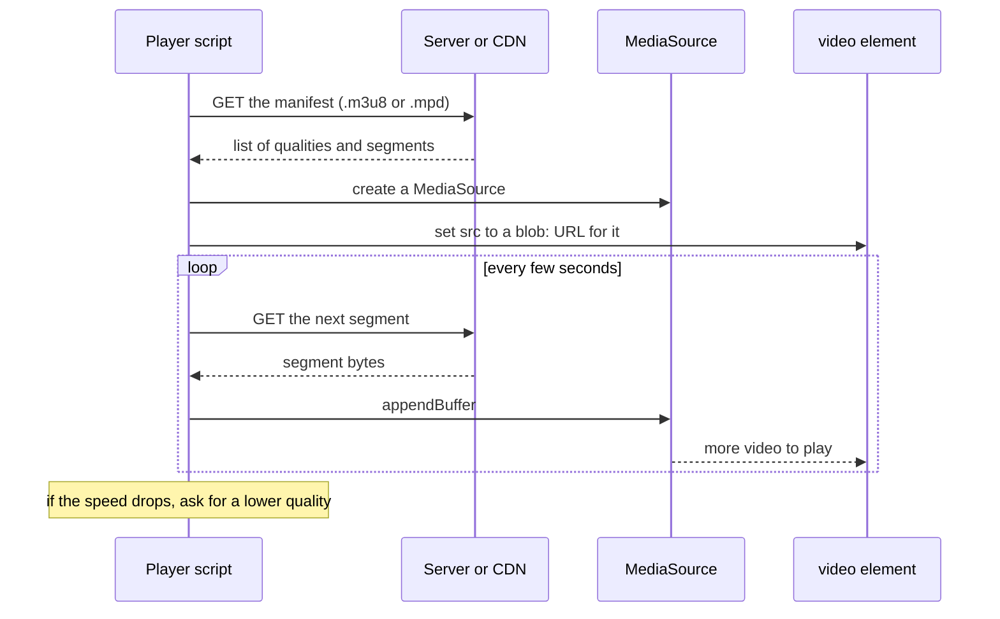
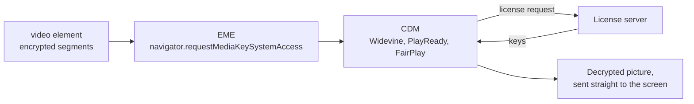

<Info>

**In short:** A video on a page is a `video` element that the browser fills with
data in one of two ways: it downloads one file, or JavaScript feeds it small
pieces from a streaming service. Chrome decides whether it may start by itself
(autoplay policy), whether it can decode the format (codecs), and whether it may
show protected content (DRM). A test should check that playback really **moves**,
not that a player is on the page.

</Info>

## Containers and codecs

Two words that people mix up.

- A **codec** (coder-decoder) is the method that compresses the pictures or the
  sound. The video in a movie is a long series of pictures that a codec squeezes
  to a small fraction of their raw size.
- A **container** is the file format that holds the compressed streams together,
  with timing, subtitles and metadata. It is the box; the codecs are what is in it.

| Container | Common file name | Typical video codec | Typical audio codec |
|---|---|---|---|
| MP4 | `.mp4`, `.m4s` | H.264 (AVC), H.265 (HEVC), AV1 | AAC |
| WebM | `.webm` | VP8, VP9, AV1 | Opus, Vorbis |
| Ogg | `.ogg`, `.ogv` | Theora | Vorbis, Opus |
| MPEG-TS | `.ts` | H.264 | AAC |
| MP3, WAV | `.mp3`, `.wav` | none (audio only) | MP3, PCM |

The file name does not tell you which codec is inside. An `.mp4` with H.264 plays
nearly everywhere; an `.mp4` with HEVC may not play in a given browser. The page
asks the browser what it can play with `video.canPlayType('video/mp4; codecs="avc1.42E01E"')`,
which answers `"probably"`, `"maybe"` or an empty string.

## The video element

```html
<video src="/media/intro.mp4" controls muted playsinline poster="/media/intro.jpg">
  <track kind="subtitles" src="/media/intro.en.vtt" srclang="en" label="English" default>
</video>
```

`audio` works the same way without the picture. The element has a JavaScript
interface, and a test lives off it.

| Property or method | Meaning |
|---|---|
| `paused`, `ended` | Whether playback is stopped, and whether it reached the end |
| `currentTime`, `duration` | Position and length, in seconds |
| `readyState` | 0 nothing, 1 metadata, 2 current frame, 3 next frame, 4 enough to play through |
| `networkState`, `error` | What the loader is doing, and the last failure, if any |
| `muted`, `volume`, `playbackRate` | Sound and speed |
| `videoWidth`, `videoHeight` | Size of the decoded picture; 0 until a frame is decoded |
| `play()`, `pause()` | Start and stop. `play()` returns a promise that can be rejected |
| `buffered`, `seekable` | Which time ranges are loaded, and which can be jumped to |

Events tell a script what happens: `loadedmetadata`, `canplay`, `playing`, `pause`,
`waiting` (stalled for data), `seeking`, `ended`, `timeupdate` and `error`. See
[JavaScript and events](/concepts/javascript-and-events).

## How the data arrives

### Progressive download

The simplest case: `src` points at one file. The browser asks for it with a normal
HTTP request and starts playing as soon as enough has arrived. To jump forward it
asks for a byte range, and the server answers `206 Partial Content`:

```text
GET /media/intro.mp4
Range: bytes=5000000-
```

This is fine for short clips. It cannot change quality while it plays.

### Adaptive streaming: HLS and DASH

Long videos and live streams use **adaptive bitrate streaming**. The video is cut
into segments of a few seconds, each made in several qualities. A text file, the
**manifest**, lists them. Two formats are common: **HLS** (manifest `.m3u8`) and
**DASH** (manifest `.mpd`). The player measures how fast data arrives and moves
up or down a quality as it plays, so a slow connection gets a lower picture rather
than a frozen one.

Most browsers cannot read a manifest by themselves (Safari can play HLS natively).
Instead the page runs a player library that uses **Media Source Extensions**
(MSE): it fetches each segment with JavaScript and appends the bytes to a
`SourceBuffer` of a `MediaSource` object, which the `video` element plays.



*Why a streaming video's `src` is a `blob:` address and not the file's URL.*

For testing, two consequences follow. The video's `src` tells you nothing about the
file, so do not assert on it. And the segments are fetched by JavaScript, so
the network log shows many small `.ts`, `.m4s` or `.mp4` requests and they are
usually typed as `XHR` or `Fetch`, not as `Media`.

## Autoplay policies

Browsers do not let a page blast sound the moment it opens. Chrome's rule, in
short, is that a video may start by itself if it is **muted**, or if the visitor
has interacted with the site, or (on desktop) if they often play media there. A
`play()` call that breaks the rule returns a promise that is rejected with
`NotAllowedError`, and the video stays paused.

A fresh browser started by a test has no history and no clicks, so it is the case
where the policy says no. Three ways to deal with it:

- **Mute first.** Set `video.muted = true` before `play()`.
- **Click first.** A real click on the page counts as a gesture.
- **Change the policy for the test.** Start Chrome with
  `--autoplay-policy=no-user-gesture-required`.

## Protected video: EME, CDMs and Widevine

Studios do not want their films to be saved, so commercial services encrypt the
stream. **Encrypted Media Extensions** (EME) is the browser interface for that. The
page asks the browser to create a media key session, the browser hands the request
to a **Content Decryption Module** (CDM), and the CDM talks to a **license server**
that returns the keys. The decrypted video never leaves the CDM as readable bytes.



*The page never sees the keys or the clear video.*

The three main systems are **Widevine** (Google; Chrome, Edge, Firefox, Android),
**PlayReady** (Microsoft) and **FairPlay** (Apple). Chrome ships the Widevine CDM as
a component that it downloads and updates. That has effects on tests:

- A browser that is not Chrome, or a Chrome profile that never downloaded the
  component, may fail to play protected video with an error about key systems.
- Because the decrypted picture goes straight to the screen, a screenshot of a
  protected video often shows a black rectangle.
- Services may also check the browser's security level and refuse an automated one.

Plan to test the **player around** protected video (the page loads, the controls
work, the license request was made) and not the picture itself.

## Captions: WebVTT

Captions and subtitles are usually a **WebVTT** file (`.vtt`): plain text with
timed cues.

```text
WEBVTT

00:00:01.000 --> 00:00:03.500
Welcome to the demo.

00:00:04.000 --> 00:00:06.000
First, open the settings.
```

A `track` element inside the `video` adds the file. In JavaScript the video's
`textTracks` list holds the tracks, each with a `mode` (`showing`, `hidden` or
`disabled`) and its `cues`. A test can switch a track on and read the text of the
active cue; a screenshot also shows it, when the captions are drawn by the
browser. Players built with a library often draw their own captions as ordinary
HTML, which a selector can read.

## Chrome and Chromium: proprietary codecs

H.264 and AAC are patented formats. The open-source **Chromium** project builds
without them by default, and a Chromium made without them cannot play many MP4
files. **Google Chrome** is built with the proprietary codecs, and with Widevine.
Distribution builds of Chromium differ from each other. So a test that passes on
Chrome can fail on a minimal Chromium in a container, with a video that simply
does not start and `video.error` set to a "format not supported" code.

Check the browser, not the page: run `canPlayType` for the formats your site
needs. See [Browser engines](/concepts/browser-architecture#what-an-engine-is) for how the builds relate.

## Controlling and checking playback from tests

Everything above is reachable from a test because everything is JavaScript on the
page. The key rule is to assert that playback **progresses**.

| Check | Weak | Better |
|---|---|---|
| The video plays | The player element exists | `currentTime` increases over a second or two |
| It started | `paused` is false | `readyState` is at least 3 and `videoWidth` is not 0 |
| It finished | A fixed sleep | `ended` is true, or wait for the `ended` event |
| It has no error | Nothing on the screen | `video.error` is null |
| Captions work | Looking for text | The active cue's text matches |

<Tabs>

<Tab title="Pure CDP engine" icon="bolt">

`Page::evaluate` runs an expression and awaits a promise;
`Page::wait_for_function` waits until an expression is truthy; and
`Page::evaluate_as` turns the result into a Rust type.

```rust,ignore src/main.rs
page.goto("https://example.com/watch").await?;

// Mute first, so the autoplay policy lets play() through.
page.evaluate(
    "(() => { const v = document.querySelector('video'); v.muted = true; return v.play().then(() => true); })()",
).await?;

// Playback must move, not just be "not paused".
page.wait_for_function(
    "!!document.querySelector('video') && document.querySelector('video').currentTime > 2",
).await?;

let failed: bool = page.evaluate_as("document.querySelector('video').error !== null").await?;
assert!(!failed);
```

</Tab>

<Tab title="WebDriver" icon="code">

`BaseCase::execute_script` runs a script in the page and returns its value as
JSON, so the same expressions work. Wait with the usual waits, or poll the
expression in a loop.

```rust,ignore src/main.rs
let time = sb.execute_script("return document.querySelector('video').currentTime").await?;
```

</Tab>

</Tabs>

<Note>

`wait_for_function` stops with an error if the expression **throws**, for example
by reading a property of a video that is not on the page yet. That is why the
expression above first checks that the element exists.

</Note>

### Settings for media tests

- **Autoplay.** Pass the Chrome flag `--autoplay-policy=no-user-gesture-required`.
  With the pure CDP engine, that is `LaunchOptions::builder().arg(...)`; with
  WebDriver, `BrowserConfig::with_chromium_arg("autoplay-policy=no-user-gesture-required")`.
- **Silence.** `--mute-audio` passes through `with_chromium_arg("mute-audio")`
  the same way.
- **Fake camera and microphone.** A page that calls `getUserMedia` needs a device.
  Chrome's `--use-fake-device-for-media-stream` and `--use-fake-ui-for-media-stream`
  flags supply a test pattern and skip the permission prompt.
- **What the page thinks is plugged in.** `FingerprintBuilder::media_device_counts`
  sets how many microphones, speakers and cameras `enumerateDevices()` reports, and
  `Page::capture_fingerprint` reads them. See [Detection and spoofing](/concepts/detection).
- **Skip media you do not test.** `BlockResources::media()` blocks audio and video
  files (`.mp4`, `.webm`, `.mp3`, `.ogg`, `.wav`, `.m4a`) and `Rule::block().resource_type(ResourceType::Media)`
  does so per page; see [block-resources](/plugins/block-resources). The first
  goes by file extension and the second by the browser's own type for the
  request, so a player that fetches segments by script (the MSE case above) may
  need a URL pattern for its segments as well.

<Warning>

Do not judge a video by a screenshot. The frame you capture depends on timing, on
the decoder, and, for protected content, may be black. Use the element's
properties for the verdict and keep screenshots for the report.

</Warning>

## Screenshots, and what is not there

For evidence, the library can capture the page:

- `Page::screenshot()` returns the viewport as PNG bytes (it sends
  `Page.captureScreenshot`), and `Locator::screenshot()` does the same for one
  element, such as the player.
- On the WebDriver side, `BaseCase::save_screenshot(filename)` writes a file and
  returns its path, and `BaseCase::screenshot_as_png()` returns the bytes.
- `Page::pdf()` renders the page to PDF.

The library has no video-recording or screencast API at this version. To keep a
moving record of a run, take a screenshot at each step, or record the screen with
a tool outside the library.

## Where to go next

<Columns cols={2}>

<Card title="JavaScript and events" icon="bolt" color="#1a85d4" href="/concepts/javascript-and-events">
  The event model that the video element's events belong to.
</Card>

<Card title="Browser architecture" icon="microchip" color="#a631be" href="/concepts/browser-architecture">
  Chrome, Chromium, Firefox and WebKit, and what each ships.
</Card>

<Card title="block-resources" icon="ban" color="#d47628" href="/plugins/block-resources">
  Stop a test page from loading images, fonts or media it does not need.
</Card>

<Card title="The network" icon="network-wired" color="#199f43" href="/concepts/network">
  Range requests, segments and how to see them.
</Card>

</Columns>
