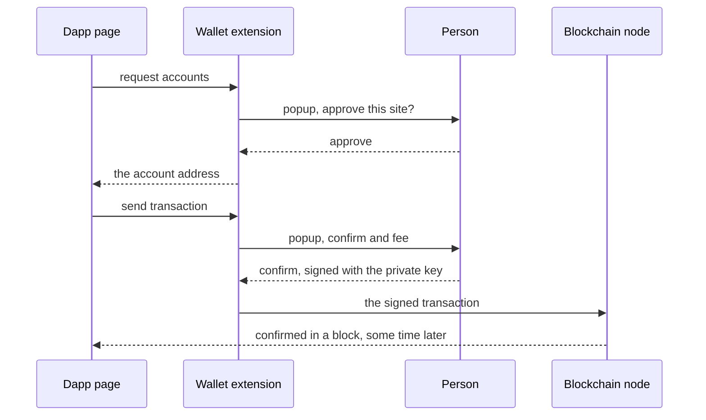
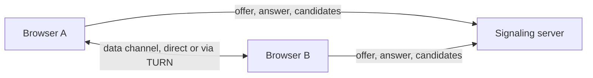
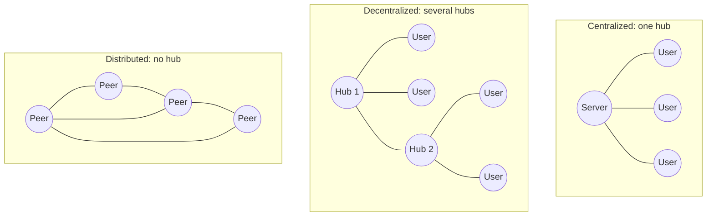

<Info>

**In short:** a page today is rarely a document the server sent whole. It is an
application that loads itself in pieces, talks to servers over several channels,
draws with the graphics card, and runs code that was compiled elsewhere, and a
newer family of projects tries to move parts of that work onto the users'
computers. Each of these features is useful to a site, and each one changes what
a test must wait for, what it can see, or what it can control. This page
explains what each is in plain words and **why it matters when you automate**,
then looks at the web in three eras and at peer-to-peer technology. It describes
the technology and does not judge it.

</Info>

| Technology | In one line | What to watch for in a test |
|---|---|---|
| [Single-page apps](#single-page-apps-and-frameworks) | One page that rewrites itself | No load event; elements replaced under you |
| [Web components](#web-components-and-shadow-dom) | Custom elements with hidden insides | Selectors stop at the shadow boundary |
| [WebSockets and SSE](#websockets-and-server-sent-events) | The server pushes data any time | The network is never idle |
| [Service workers](#service-workers-and-pwas) | A script that answers requests for the page | Requests that never reach the network |
| [WebAssembly](#webassembly) | Compiled code in the browser | Logic you cannot read in the page's source |
| [WebGL and WebGPU](#webgl-and-webgpu) | Graphics card access | A fingerprint of your hardware |
| [WebRTC](#webrtc) | Direct audio, video and data | Real IP addresses leak |
| [HTTP/3](#http3-and-quic) | HTTP over UDP | Proxies and tools that only know TCP |
| [Passkeys](#passkeys-and-webauthn) | Login with a device, not a password | A dialog no script can click |
| [Privacy Sandbox](#the-privacy-sandbox-changes) | Cookies keyed to the site you are on | Embedded logins that do not carry over |
| [Client Hints](#user-agent-client-hints) | The user agent, split into pieces | A spoofed UA that contradicts its hints |
| [WebDriver BiDi](#webdriver-bidi) | WebDriver with events | The standard route to what CDP does today |
| [Web3 and wallets](#web3-keys-and-shared-ledgers) | Keys and shared ledgers, with wallets as extensions | A wallet popup that is another window |
| [Peer-to-peer](#peer-to-peer) | Browsers and nodes that talk to each other | No central server to intercept |

## Single-page apps and frameworks

**What it is.** A **single-page application** (SPA) loads once and then changes
itself with JavaScript instead of loading a new page for each screen. It is
written with a **framework** such as React, Vue, Angular or Svelte. The framework
keeps a model of the page, and when the data changes it works out the smallest
set of DOM changes and applies them.

Three terms come up:

- **Client-side routing.** Clicking a link does not navigate; the app changes the
  address with the History API (`pushState`) and draws the new screen itself. The
  URL changes, the browser reports no page load.
- **Server-side rendering and hydration.** To show something sooner, the server
  sends HTML that is already drawn. The app's JavaScript then loads and
  **hydrates** it: it attaches its event handlers to the HTML that is already
  there. Between the first paint and the end of hydration the page **looks**
  ready and **does nothing** when clicked.
- **Re-rendering.** A framework may replace an element with an identical new one.
  A reference to the old element goes stale.

**Why it matters.**

- Waiting for the `load` event proves little. Wait for the element or the text
  that shows the screen is ready (see
  [JavaScript, events and waiting](/concepts/javascript-and-events)).
- A click during hydration can be lost. If a click "does nothing" once in ten
  runs, suspect hydration, and wait for something that only appears after it.
- A **controlled input** in React keeps its own copy of the text and updates it from
  the `input` event. Setting the field's `value` from a script changes the field
  and leaves the framework's copy alone; the next render puts the old text back.
  Typing real key events, as `Locator::type_text` does, goes through the path the
  framework listens to.
- Lists may be **virtualised**: only the rows on screen exist in the DOM, so a row
  that is off screen cannot be found until you scroll to it.

## Web components and shadow DOM

**What it is.** **Web components** are a browser feature for making your own HTML
tags (`<my-button>`). A **custom element** has its own behaviour, and a
**shadow root** hides the element's inner structure and styles from the rest of
the page, like a private room. The page's CSS and the page's selectors do not
reach in. A shadow root is **open** (reachable from script as
`element.shadowRoot`) or **closed** (unreachable).

**Why it matters.** A selector such as `my-app input` stops at `my-app` and never
finds the input inside. Search boxes, date pickers, video players and design
systems from large companies are often built this way. Both engines of
seleniumbase-rs pierce shadow roots with a `::shadow` combinator in any
selector (`my-app::shadow input`). The WebDriver engine asks the browser driver
for each root and so enters closed roots too; the pure CDP engine works through
page scripts and enters open roots only. Details and examples are in
[Selectors and the DOM](/concepts/selectors-and-the-dom#shadow-dom-and-web-components).

## WebSockets and Server-Sent Events

**What it is.** Ordinary HTTP is a question and an answer. Two features let the
server speak first.

- A **WebSocket** is one long-lived two-way connection. It starts as an HTTP
  request that asks to *upgrade*, and after the server agrees (status 101) both
  sides send small messages whenever they like. Chat, live prices, collaborative
  editing and games use it. The DevTools Protocol itself is carried by one (see
  [CDP](/concepts/cdp#connecting)).
- **Server-Sent Events** (SSE) is simpler and one-way: the server keeps a normal
  HTTP response open (`Content-Type: text/event-stream`) and writes events into
  it. The browser's `EventSource` reads them and reconnects by itself if the
  connection drops.

**Why it matters.**

- The network is **never idle**. A tool that waits for "no requests in flight"
  can wait for ever on a page that keeps a socket open.
- The page changes **without a request you can see**. An assertion on a price must
  wait for the message to arrive, not for a click's response.
- Interception does not work on the frames of a WebSocket. The DevTools
  `Fetch` domain pauses HTTP requests; the socket's messages are reported only
  as `Network.webSocketFrameSent` and `Network.webSocketFrameReceived` events.
  See [Network](/concepts/network).

## Service workers and PWAs

**What it is.** A **service worker** is a script a page registers with the
browser. It runs in its own thread, with no DOM, and **outlives** the tab. For
the pages under its scope it sits between the page and the network: every
`fetch` the page makes first goes to the worker, which can answer from its own
cache, from the network, or with something it makes up. That is how a page works
**offline**. Service workers also receive push messages and run background sync.

A **progressive web app** (PWA) is a site that has a web app manifest, a service
worker and HTTPS, so the browser can offer to install it like an application.

**Why it matters.**

- **Requests that never leave the machine.** A request answered from the worker's
  cache never reaches the network. A HAR recorded from the page may not show it,
  and an interception rule on the network cannot rewrite it. The worker is its own
  [target](/concepts/browser-architecture#tabs-frames-and-workers-the-things-you-can-control),
  with its own requests.
- **State that survives.** The worker and its caches live in the profile. A
  second run on the same profile can open an **old version** of the site. A fresh
  temporary profile avoids that; so does clearing site data for the origin
  (`Storage.clearDataForOrigin`, with the worker and cache storage included).
- **Controls.** In CDP, `Network.setBypassServiceWorker` makes a tab skip the worker
  and go to the network, and the `ServiceWorker` domain can stop or unregister
  workers. You can send either with `Page::execute`.
- **First load.** A worker starts controlling a page only after it has been
  installed, so the first visit may differ from the second.

## WebAssembly

**What it is.** **WebAssembly** (wasm) is a compact binary format that browsers
run at close to native speed in the same sandbox as JavaScript. Code written in
Rust, C++ or Go is compiled to it and loaded by a script. Image editors, games,
video codecs and some bot-defence scripts use it.

**Why it matters.** Logic that used to be readable JavaScript may be a
`.wasm` file you cannot read in the page source. Nothing about how you drive the
page changes: clicks, typing and the DOM work as before, and wasm can only affect
the page through the same browser APIs. It matters in two ways. A page that does
heavy work in wasm can hold the main thread for a while, so waits should allow for
it. And a challenge that runs as wasm cannot be understood by reading the page, so
a test has to treat it as a black box and check its **result** (the cleared
state).

## WebGL and WebGPU

**What it is.** **WebGL** gives a page access to the graphics card (through an
API based on OpenGL ES) to draw 3D scenes and, more quietly, to draw anything
fast. **WebGPU** is its modern successor: closer to how current graphics cards
work, and able to run general computations as well.

**Why it matters for fingerprinting.** A page can ask the graphics stack who it
is. WebGL exposes a **vendor and renderer** string (through the
`WEBGL_debug_renderer_info` extension), the list of supported extensions and
limits, and the exact pixels of a test scene, which differ a little between
cards and drivers. WebGPU exposes adapter information. Combined, this is a stable
hash of your hardware. On a server or in a container there is no graphics card,
so Chrome draws in software and the renderer string names a software renderer
(`SwiftShader` or `llvmpipe`), which is a strong sign of a machine with no
screen.

seleniumbase-rs lets you set the strings a page reads (the WebGL vendor and
renderer are settings of the `Fingerprint`) and add repeatable noise to canvas
and audio output. See [Detection and spoofing](/concepts/detection) and the
glossary entry [Canvas noise](/glossary#canvas-noise).

## WebRTC

**What it is.** **WebRTC** lets browsers exchange audio, video and data
**directly**, without sending it through a server. To find a path between two
machines that sit behind routers, a browser collects **ICE candidates**:
addresses it could be reached at, found by asking a STUN server what the outside
world sees, plus the machine's own local addresses.

**Why it matters.**

- **Leaks.** Those candidates can contain your real public and local IP address,
  even when the web traffic goes through a proxy. A page can read them with a few
  lines of script. See [WebRTC leaks](/concepts/network#webrtc-leaks) and the
  glossary entry [WebRTC leak](/glossary#webrtc-leak). seleniumbase-rs has a
  module for it (`sb_cdp::webrtc`) and a fingerprint setting for the addresses.
- **Cameras and microphones.** A page that asks for them triggers a permission
  prompt that a script cannot click. Chrome has flags for tests:
  `--use-fake-device-for-media-stream` supplies a test video and tone, and
  `--use-fake-ui-for-media-stream` accepts the prompt.

## HTTP/3 and QUIC

**What it is.** HTTP/1.1 and HTTP/2 run on TCP. **HTTP/3** runs on **QUIC**, a
newer transport built on UDP that has encryption (TLS 1.3) built in. Its
advantages are real: one lost packet no longer stalls every request on the
connection, a connection starts in fewer round trips, and a connection survives a
change of network (Wi-Fi to mobile).

A browser does not know a server speaks HTTP/3 until it is told. The first visit
uses HTTP/2 over TCP, and the server's `Alt-Svc` header advertises the upgrade:

```http
Alt-Svc: h3=":443"; ma=86400
```

**Why it matters.**

- **Proxies.** An ordinary HTTP or CONNECT proxy carries TCP only, so a browser
  behind one falls back to HTTP/2. QUIC works through a proxy only with one that
  relays UDP.
- **Interception.** A man-in-the-middle proxy (like `MitmProxy`, which offers
  `http/1.1` only) sees no HTTP/3 at all, because the browser is held to TCP.
- **Fingerprints.** The TLS handshake inside QUIC is a fingerprint like any other
  (JA4 marks QUIC with a `q`). See [Network](/concepts/network) and the glossary
  entry [QUIC](/glossary#quic).
- **Firewalls.** Some networks drop UDP on port 443. Chrome then falls back. The
  switch `--disable-quic` forces TCP if you need to test that path.

## Passkeys and WebAuthn

**What it is.** **WebAuthn** is the browser API behind **passkeys**. Instead of a
password, a site asks the device to create a key pair when you register and to
sign a challenge when you log in (`navigator.credentials.create` and
`navigator.credentials.get`). The private key never leaves the **authenticator**:
the phone, the laptop's secure chip (Touch ID, Windows Hello) or a hardware
security key. The credential is tied to the site's origin, so a look-alike site
cannot use it. A *passkey* is such a credential that can be synced between your
devices.

**Why it matters.** The step that proves you are present is a system dialog: a
fingerprint prompt, a PIN, a tap on a key. A script cannot click an operating
system dialog, so a login with a passkey cannot be automated by driving the page
alone. The tool for tests is a **virtual authenticator**: a software authenticator
the browser provides that answers instantly.

- The DevTools Protocol has a `WebAuthn` domain: `WebAuthn.enable`, then
  `WebAuthn.addVirtualAuthenticator` with the options you want (protocol,
  transport, whether it stores resident keys, whether the user counts as
  verified, whether presence is simulated), and `WebAuthn.addCredential` or
  `WebAuthn.getCredentials` to seed and inspect credentials.
- WebDriver has the same idea as a W3C extension, with virtual authenticator
  commands.
- seleniumbase-rs has no dedicated helper for either yet. You can send the DevTools
  commands yourself with `Page::execute`:

```rust,ignore src/main.rs
use seleniumbase_rs::json::json;

page.execute("WebAuthn.enable", json!({})).await?;
page.execute(
    "WebAuthn.addVirtualAuthenticator",
    json!({ "options": {
        "protocol": "ctap2",
        "transport": "internal",
        "hasResidentKey": true,
        "hasUserVerification": true,
        "isUserVerified": true,
        "automaticPresenceSimulation": true
    } }),
).await?;
// Registering or logging in with a passkey on the page now succeeds with no dialog.
```

## The Privacy Sandbox changes

**What it is.** For years a site embedded in another (an ad, a login widget, a
chat box) could set a **third-party cookie** and read it back on every site that
embedded it, which let it follow you across the web. Browsers have been closing
that gap. Safari and Firefox block or **partition** third-party storage already;
Chrome's own plan (the *Privacy Sandbox*) has changed several times and its status
is worth checking before you rely on it. The pieces that matter to a test are the
two that give a **partitioned** web:

- **Partitioned cookies (CHIPS).** A third-party cookie can be marked
  `Partitioned`, and then it is stored under the key (the embedded site, the
  **top-level site** you are on). The same widget on two sites gets two separate
  cookies. A partitioned cookie must also be `Secure`.

```http
Set-Cookie: session=abc123; Secure; SameSite=None; Partitioned; Path=/
```

- **Storage partitioning.** The same idea for the rest: in an embedded frame,
  `localStorage`, `IndexedDB`, the cache, service workers and broadcast channels
  are keyed by the top-level site as well as by the frame's own origin.

**Why it matters.**

- **A login inside an iframe does not carry over.** A widget logged in on one
  site starts logged out on another. A test that signs in at one address and then
  opens a page that embeds the widget elsewhere will find it signed out.
- **Setting cookies for a test.** A cookie added from outside needs its partition
  key (CDP's cookie parameters have a `partitionKey` field) or the page will not see it.
- **Reading cookies.** A partitioned cookie is not an ordinary one, so a read that
  filters by domain can miss it.
- **Try it before it ships.** Chrome has a switch that turns on the
  third-party-cookie behaviour for testing, `--test-third-party-cookie-phaseout`.

See [Sessions, cookies and storage](/concepts/sessions-and-state) and the glossary
entries [Third-party cookie](/glossary#third-party-cookie),
[Partitioned cookie](/glossary#partitioned-cookie) and
[SameSite](/glossary#samesite).

## User-Agent Client Hints

**What it is.** The `User-Agent` header grew into a long string that told every
site far more than it needed (exact OS version, device model) and was used to
track people. Chrome now **reduces** it: the string is frozen at a generic form
such as `Chrome/126.0.0.0`. The details moved into **Client Hints**: small
headers that the server must ask for.

| Kind | Examples | When it is sent |
|---|---|---|
| Low entropy | `Sec-CH-UA` (the brands and major versions), `Sec-CH-UA-Mobile`, `Sec-CH-UA-Platform` | On every request |
| High entropy | `Sec-CH-UA-Full-Version-List`, `Sec-CH-UA-Platform-Version`, `Sec-CH-UA-Arch`, `Sec-CH-UA-Model` | Only after the server asks, with an `Accept-CH` response header |

A script can read the same data from `navigator.userAgentData`: `brands`,
`mobile`, `platform`, and `getHighEntropyValues([...])` for the rest. It exists
only in Chromium browsers and only on secure (HTTPS) pages.

**Why it matters.** There are now **two** places that say what the browser is,
and they must agree. Spoofing the `User-Agent` header and leaving the hints alone
gives a request that says "Mac, Safari" in one place and "Linux, HeadlessChrome"
in the other, which is easier to catch than not spoofing at all. In CDP,
`Emulation.setUserAgentOverride` takes the user agent string **and** its hint
metadata together.

seleniumbase-rs treats them as one setting, the `client_hints` entry of the
`Fingerprint`, applied with `Page::apply_fingerprint`, and the companion
extension's Page tab shows both side by side. See
[Detection and spoofing](/concepts/detection) and the glossary entry
[Client Hints](/glossary#client-hints).

## WebDriver BiDi

**What it is.** Classic [WebDriver](/concepts/webdriver) is a question and an
answer over HTTP: the browser cannot tell the test anything on its own. **WebDriver
BiDi** ("bidirectional") adds a WebSocket beside it, over which the browser
**pushes events** (a console message, a request, a navigation, a new window) and
the test sends commands. It is a W3C standard that is still growing, and it is the
cross-browser answer to what the DevTools Protocol does only in Chromium.

**Why it matters.** With BiDi a test can listen to the console and to network
traffic, and intercept requests, in Firefox and Chromium alike, without a
browser-specific protocol. That is where cross-browser testing is heading.

seleniumbase-rs does not use BiDi today: its events and interception come from the
[DevTools Protocol](/concepts/cdp), which is Chromium only, and the WebDriver
engine uses the classic protocol. See
[WebDriver BiDi](/concepts/webdriver#webdriver-bidi) and the glossary entry
[WebDriver BiDi](/glossary#webdriver-bidi).

## Three eras

The names "Web 1.0", "Web 2.0" and "Web3" are labels people use, not versions
with release dates. They are useful for seeing **where the data and the control
sit**.

| | Web 1.0 | Web 2.0 | Web3 |
|---|---|---|---|
| Rough period | 1990s to early 2000s | Mid 2000s onwards | Late 2010s onwards |
| What a page is | A document | An application | An application that talks to a shared ledger |
| Who writes the content | The site owner | The users, on a platform | The users, with data they hold themselves |
| Where the data lives | Files on one server | The platform's database | A blockchain and other shared networks |
| How you are known | Not at all | An account with the platform | A cryptographic key held in a wallet |
| Technology | HTML, links, forms | JavaScript, AJAX, APIs, [frameworks](/concepts/selectors-and-the-dom#one-page-three-doms) | Wallet extensions, smart contracts, content addressing |
| Test difficulty | A static DOM | A DOM that changes after load | A DOM that depends on an extension and a slow network |

### Web 1.0: documents

A page was a file on a server. The browser asked for it, the server sent it, and
the browser showed it. Links connected pages; forms were the only way to send
anything back, and each submit loaded a new page. This is the model described in
[how a page loads](/concepts/how-a-page-loads), and it is the easiest thing to
automate: after the load event, the page is final.

### Web 2.0: applications on platforms

JavaScript changed the page from something you read into something you use.
`XMLHttpRequest` and later `fetch` let a page ask for data in the background, so
a feed can grow, a form can validate as you type and a map can scroll without
reloading. At the same time, large **platforms** appeared that host the content
of millions of people and know each of them by an account. The browser side is
covered in [frontends, backends and APIs](/concepts/frontends-backends-and-apis).
For tests, the page is never really "done", so tests wait for elements and
conditions instead of for the load event.

### Web3: keys and shared ledgers

"Web3" names the idea that applications can run against **public, shared
networks** that no single company operates, and that a person proves who they
are with a key instead of an account. The main parts:

- A **blockchain** is a ledger, a list of records grouped into blocks, copied
  across many computers. A new block is accepted by rules all computers apply, and
  old blocks are chained to new ones by hashes, so changing history is made
  evident.
- A **wallet** holds the keys. The **private key** (often written as a list of
  recovery words, the *seed phrase*) can sign; the **address** is derived from the
  public key and is safe to share.
- A **transaction** is a signed instruction, such as "send this amount" or "call
  this function". Sending one usually costs a fee and must be included in a block
  before it counts, which takes seconds to minutes.
- A **smart contract** is a program stored on the chain that runs when a
  transaction calls it. A **dapp** is a web page whose buttons call such
  contracts.
- A **testnet** is a separate network with worthless coins, made for trying
  things out.

### How a page talks to a wallet

Most wallets for browsers are [extensions](/concepts/browser-extensions), such as
MetaMask. An extension adds an object to every page, `window.ethereum` for
Ethereum-style wallets, and the page asks it for things:

```js
const accounts = await window.ethereum.request({ method: "eth_requestAccounts" });
console.log("connected as", accounts[0]);
```

The wallet does not answer by itself. It opens its **own popup window** and waits
for the person to approve. Only then does the promise resolve. Signing and
sending a transaction open the same kind of popup.



*A dapp never sees the private key. It receives a signature and an address.*

## Peer-to-peer

In a **client-server** system, every client talks to a server. In a
**peer-to-peer** (P2P) system, the computers talk to each other, and each one is
both client and server for the others. Three technologies show the idea.

### BitTorrent

A file is cut into pieces, and each piece has a hash so it can be checked. People
who already have pieces (**seeders**) send them to people who need them
(**leechers**), and a downloader gets different pieces from many peers at once.
A **magnet link** carries the hash of the file's description, and peers are found
through a **tracker** (a server that lists them) or a **distributed hash table**
(DHT, a lookup spread across the peers themselves). The more people share a file,
the faster it is for everyone, which is the opposite of a single overloaded
server.

### WebRTC and data channels

**WebRTC** (introduced [above](#webrtc), with its address leaks and test flags) is
the browser's built-in way to connect two browsers directly. It was
built for calls, and it also offers an `RTCDataChannel` for any data, such as
chat, game state or file transfer, with options for ordered or unordered
and reliable or unreliable delivery. Two browsers behind home routers cannot
simply connect, so they go through three steps:

1. **Signaling.** They swap descriptions of themselves (the *offer* and the
   *answer*) through any channel they both reach, usually the site's own server.
   WebRTC does not define this part.
2. **ICE.** Each side collects *candidates*, the possible addresses at which it
   can be reached. A **STUN** server tells a browser its public address as seen
   from outside. If no direct path works, a **TURN** server relays the data.
3. **Connect.** The best working pair of candidates is used, over UDP, with
   encryption always on.



*The server only introduces the two browsers. The data does not pass through it.*

### IPFS: addressing by content

A normal URL says **where** something is: this server, this path. If the server
changes the file or disappears, the address is useless. **IPFS** (InterPlanetary
File System) names a file by **what it is**: its **CID** (content identifier),
which comes from a hash of the bytes. Anyone who holds the content can serve it,
and the receiver can check the bytes against the CID, so a changed file would
have a different name. Peers find each other with a DHT, and a node that wants a
file to stay available **pins** it. Because ordinary browsers cannot speak the
network directly, a **gateway** serves it over HTTPS at an address such as
`https://gateway.example/ipfs/CID`.

## Centralized, decentralized, distributed

These three words are used loosely, but their original meanings are about how
many hubs a system has.



*Three shapes. The step from one to the next removes a single point of control and a
single point of failure.*

| | Centralized | Decentralized | Distributed |
|---|---|---|---|
| Example | A social network, a bank's website | E-mail, federated chat | BitTorrent, a public blockchain |
| Control | One operator | Several operators who interoperate | The rules of the protocol |
| If one part fails | Everything stops | Part of the network stops | The rest carries on |
| Cost | Cheap to run and to change | Needs agreed standards | Slower, more complex, harder to change |

<Note>

Real products are mixtures. A "decentralized" application often has a front end
served from one ordinary web server, and reads the chain through a company that
runs nodes. Always look at which parts are shared and which are not before you
rely on a claim about it.

</Note>

## What this means for automation

- **Web 1.0 pages** need few waits. **Web 2.0 pages** need waits for elements and
  for the [JavaScript](/concepts/javascript-and-events) to finish.
- **A dapp adds an extension and a network you do not control.** The wallet
  popup is another window of the browser, so a test has to switch to it, approve
  and switch back. A transaction that waits for a block takes real time, and
  that time varies, so poll for the result with a generous timeout.
- **Use a testnet or a local development chain, and throwaway keys.** Never put a
  real seed phrase into a test, a script, a log or a repository.
- **A page can replace the wallet.** A script injected before the page's own
  scripts can define a fake `window.ethereum` that answers instantly. That tests
  the page's logic without a popup, and it leaves the real wallet flow to a few
  separate tests.
- **WebRTC reveals addresses.** The candidates in step two of the connection list
  the machine's addresses, which is why a privacy-minded setup restricts them (see
  [detection](/concepts/detection)).

<Warning>

Treat anything that holds value as production. A wallet extension that is
connected to a real network with real funds does not belong in an automated
run. Create a new browser profile for tests, with a new wallet on a testnet.

</Warning>

## How seleniumbase-rs uses it

The library has **no wallet, blockchain or IPFS API**. What it offers are the
general pieces that these tests are built from.

- **Loading an extension.** `LaunchOptionsBuilder::extension(dir)` of the pure
  CDP engine starts the browser with an unpacked extension, and
  `Browser::extension_ids()` lists the extensions the browser holds. The command
  line has `--extension-dir` for the same purpose. See
  [browser extensions](/concepts/browser-extensions) for how loading works.
- **A fake provider.** `Page::execute` sends any [CDP](/concepts/cdp) command,
  including `Page.addScriptToEvaluateOnNewDocument`, which runs a script before
  the page's own scripts and can define the stand-in `window.ethereum`.
- **WebRTC.** A page can open an `RTCPeerConnection` without asking.
  `LaunchOptionsBuilder::shield_webrtc(true)` and `Page::shield_webrtc` make
  WebRTC relay-only, so no local candidates are gathered, and
  `Page::webrtc_report()` checks the result: its `is_clean()` is true when
  nothing leaked.

```rust,ignore src/main.rs
use seleniumbase_rs::json::json;
use seleniumbase_rs::sb_cdp::{Browser, LaunchOptions};

let browser = Browser::launch(LaunchOptions::builder().headless(true).build()?).await?;
let page = browser.default_page().await?;

// Define a stand-in wallet before any script of the page runs.
page.execute(
    "Page.addScriptToEvaluateOnNewDocument",
    json!({ "source": "window.ethereum = { request: async () => ['0xTEST'] };" }),
)
.await?;
page.goto("localhost:3000").await?;
```

## Where to go next

<Columns cols={2}>

<Card title="JavaScript, events and waiting" icon="bolt" color="#1a85d4" href="/concepts/javascript-and-events">
  The event loop and auto-waiting that SPAs and sockets make necessary.
</Card>

<Card title="Network" icon="network-wired" color="#199f43" href="/concepts/network">
  HTTP, TLS, proxies, interception and what a connection reveals.
</Card>

<Card title="Detection and spoofing" icon="user-secret" color="#d47628" href="/concepts/detection">
  How WebGL, Client Hints and WebRTC become a fingerprint.
</Card>

<Card title="Sessions, cookies and storage" icon="database" color="#a631be" href="/concepts/sessions-and-state">
  Cookies, storage and what partitioning does to them.
</Card>

<Card title="Browser extensions" icon="puzzle-piece" href="/concepts/browser-extensions">
  Manifest, service worker, content scripts and loading one in a test.
</Card>

</Columns>
