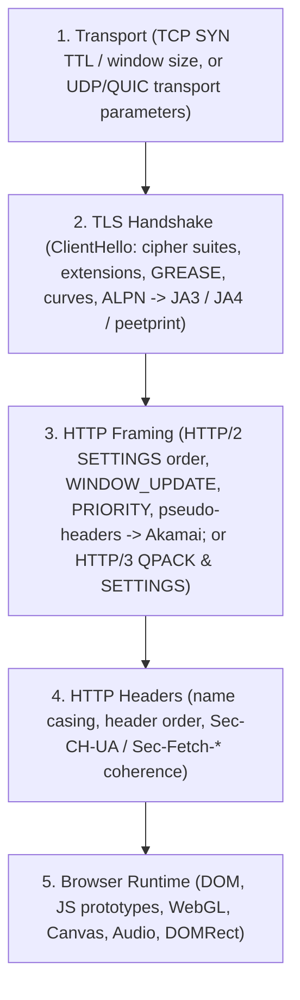

<Info>

**In short:** JavaScript stealth (`navigator`, Canvas, WebGL) operates *after* the TLS handshake and HTTP headers have already been exchanged. Anti-bot gateways inspect **TCP/IP metadata, TLS `ClientHello` extensions, HTTP/2 SETTINGS/PRIORITY frames, HTTP/3 QUIC transport parameters, and header ordering** at the socket before HTML is ever sent. In the `seleniumbase-rs-stealth` companion crate, the `network` (`spec`, `wire`, `mitm`, `http3`) and `session` (`CdpSession`, `HttpSession`, `HybridSession`) layers close that gap at both the direct HTTP client layer and a loopback MitM proxy for Chromium.

</Info>

## Why JavaScript spoofing is not enough

Every HTTPS request leaks client identity in layers well below `window.navigator`:



If an automated request claims to be **Chrome 157 on Windows** in its `User-Agent` header and JavaScript getters, while the socket sends a standard Rust `rustls` or OpenSSL `ClientHello` and generic `h2` settings, edge WAFs classify the mismatch immediately.

## Ground truth from measured browsers

Wire impersonation starts from **empirical captures** rather than guessed defaults:

- **`network::spec`** stores embedded JSON measurements (`measurement::get(Browser::Chrome, os)`) recorded from real browser binaries, capturing the exact `ClientHello` field order, extension permutation behavior, GREASE placement, HTTP/2 SETTINGS, `WINDOW_UPDATE`, pseudo-header sequence, and request-shape headers (document navigation vs subresource `fetch()`).
- **`WireFormat` (`network::wire`)** layers customizations (`WireFormatBuilder::ja3`, `ja4_r`, `ja4_ro`, `peetprint`, `akamai`, `client_headers`) on top of a measured base profile.

<Warning>

**Fail-closed fidelity:** BoringSSL and `wreq` cannot emit arbitrary combinations of extensions or malformed SETTINGS (such as `trust_anchors`, ML-DSA signature algorithms not yet in the pinned BoringSSL, or omitted HTTP/2 initial window sizes). Rather than silently sending an approximate fingerprint, `WireFormatBuilder` refuses unrepresentable inputs upfront with a typed `WireFormatError` before any network connection opens.

</Warning>

## The three wire layers

### 1. TLS handshake shaping (`TlsSpec` & BoringSSL)

On every TLS 1.2 / 1.3 handshake, the stack aligns:

- **Cipher suite list & order** including TLS 1.3 suites and GREASE values (RFC 8701).
- **TLS extension table** including `server_name`, `extended_master_secret`, `renegotiation_info`, `supported_groups`, `ec_point_formats`, `session_ticket`, `application_layer_protocol_negotiation`, `status_request`, `signature_algorithms`, `signed_certificate_timestamp`, `key_share`, `psk_key_exchange_modes`, `supported_versions`, `compress_certificate` (Brotli), `application_settings` (ALPS), and extension shuffling when `permute_extensions(true)` is active.
- **Fingerprints derived directly from bytes**: JA3, JA4 / `JA4_o` / `JA4_r` / `JA4_ro`, and `peetprint` can both be *parsed* (`Ja3::parse`, `str::parse::<Ja4>()`) and *verified* in local loopback tests (`tests/impersonate_wire.rs`).

### 2. HTTP/2 frame & header shaping (`H2Spec` & `HeaderSpec`)

HTTP/2 fingerprinting (popularized by Akamai) checks frame metadata before inspecting cookies or body payloads:

- **`SETTINGS` frame IDs and emission order** (e.g., `HEADER_TABLE_SIZE`, `ENABLE_PUSH`, `MAX_CONCURRENT_STREAMS`, `INITIAL_WINDOW_SIZE`, `MAX_HEADER_LIST_SIZE`, `NO_RFC7540_PRIORITIES`).
- **Connection-level `WINDOW_UPDATE` increment** and optional `PRIORITY` trees.
- **Pseudo-header order** (`:method`, `:authority`, `:scheme`, `:path`) vs request headers sorted by request shape (`RequestShape::Document` vs `RequestShape::Fetch`), preserving header casing and `Sec-Fetch-*` semantics.

### 3. HTTP/3 and QUIC (`H3Spec`)

Modern CDNs negotiate HTTP/3 over UDP (`Alt-Svc: h3=":443"`), exposing two additional passive vectors:

- **QUIC transport parameters in wire order** (`max_idle_timeout`, `initial_max_data`, `initial_max_stream_data_*`, `active_connection_id_limit`, etc.).
- **HTTP/3 `SETTINGS` frame entries** (`QPACK_MAX_TABLE_CAPACITY`, `MAX_FIELD_SECTION_SIZE`, `QPACK_BLOCKED_STREAMS`, `ENABLE_CONNECT_PROTOCOL`, `H3_DATAGRAM`) alongside pseudo-header ordering (`:method`, `:authority`, `:scheme`, `:path`), driven via `Http3Client` (`WireProtocol::Http3`).

## Loopback MitM interception (`MitmProxy`)

When driving a real Chromium instance whose system TLS or proxy headers need rewriting, or when bridging traffic across egress proxies, `network::mitm` runs an **in-process loopback proxy**:

```mermaid
sequenceDiagram
    participant Chrome as Chromium (browser process)
    participant MitM as Loopback MitM Proxy (127.0.0.1:PORT)
    participant Upstream as Upstream Proxy / Target Origin
    Chrome->>MitM: HTTP CONNECT example.com:443
    MitM-->>Chrome: 200 Connection Established
    Note over Chrome,MitM: Local EphemeralCa mints short-lived leaf cert for example.com
    Chrome->>MitM: TLS + HTTP request inside tunnel
    Note over MitM: Re-frames headers & TLS ClientHello per WireFormat + Egress route
    MitM->>Upstream: Shaped TLS ClientHello + HTTP/2 or HTTP/3 request
    Upstream-->>MitM: HTTP Response + Set-Cookie
    MitM-->>Chrome: Response forwarded; Set-Cookie synced to CookieJar
```

- **Zero persistent trust store mutation**: `EphemeralCa::generate()` holds the signing key strictly in memory for the run, and `MitmProxy::configure_launch(LaunchOptions)` attaches `--proxy-server` plus `--ignore-certificate-errors-spki-list` hashed strictly for the ephemeral root SPKI (never blanket certificate disabling).
- **DNS leak safety**: hostnames travel through the proxy tunnel rather than resolving on the local OS DNS stack when combined with `ProxyRoute` SOCKS5/HTTP routing.
- **Strict secret redaction**: `ProxyRoute` credentials (`username`/`password`) are masked via `RedactedUrl` and `Secret`, preventing accidental leaks in `EventSink` logs, `TracingEventSink`, or persisted `JsonLedger` state.

## Browser vs direct wire handoff (`HybridSession`)

A single `Identity` binds a browser `Fingerprint` (JS/CDP persona) with its matching `WireMeasurementRef` / `WireFormat`:

1. **`CdpSession`** solves initial JavaScript challenges or logins in headless/headed Chromium while recording `SiteRecord` outcomes and challenge classifications (`ChallengeKind`, `ProtectionVendor`) in an `InMemoryLedger` or `JsonLedger`.
2. **`CookieJar` sync** extracts verified session cookies (`cf_clearance`, session tokens) into `HttpSession` / `HybridSession`.
3. **Wire follow-ups** replay subsequent fetches through `HttpSession` using the exact TLS, ALPN, HTTP/2 / HTTP/3, `User-Agent`, and `Sec-CH-UA` headers of the same browser persona, with automatic `EscalationPolicy` fallback back to the browser if a route requires JS execution.

## Where to go next

<Columns cols={2}>

<Card title="Wire formats (API guide)" icon="code" color="#a631be" href="/stealth/advanced/wire-formats">
  Configure `WireFormat`, JA3/JA4/Akamai strings, and handle validation errors.
</Card>

<Card title="Loopback MitM proxy" icon="shield-halved" color="#1a85d4" href="/stealth/advanced/mitm-proxy">
  Run `MitmProxy` alongside real Chromium with ephemeral SPKI pinning.
</Card>

<Card title="HTTP/3 and QUIC" icon="bolt" color="#199f43" href="/stealth/advanced/http3">
  Configure `H3Spec`, `Http3Client`, and `WireProtocol::Http3` profiles.
</Card>

<Card title="Advanced stealthy scraping" icon="spider" color="#d47628" href="/scraping/advanced-stealthy/overview">
  Coordinate browser solves and direct HTTP fetches under `HybridSession`.
</Card>

</Columns>
