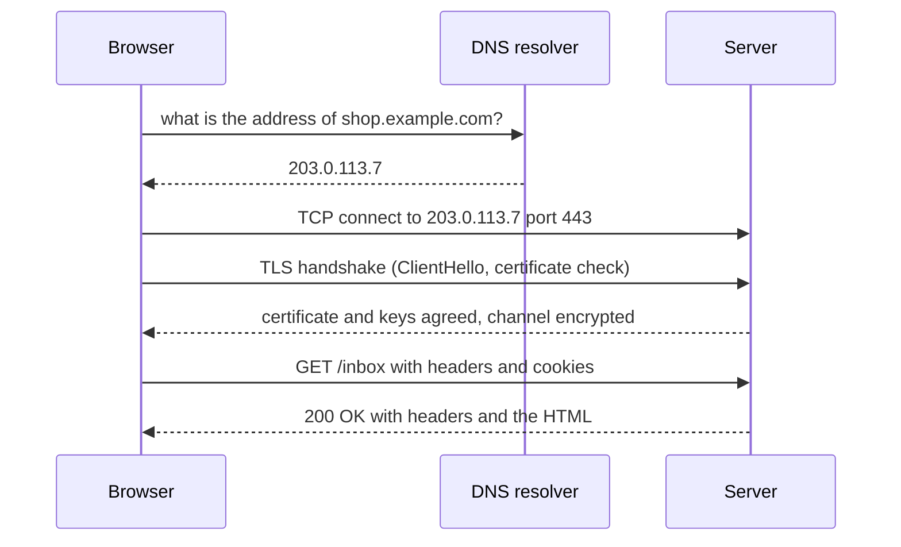
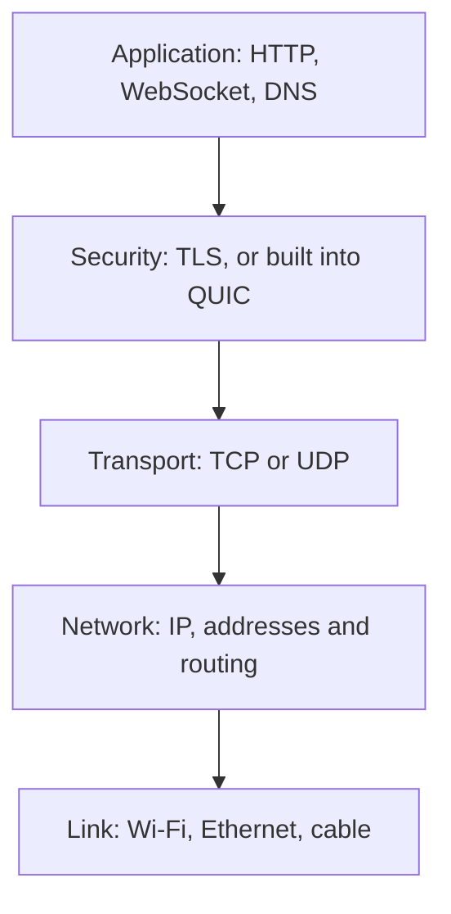
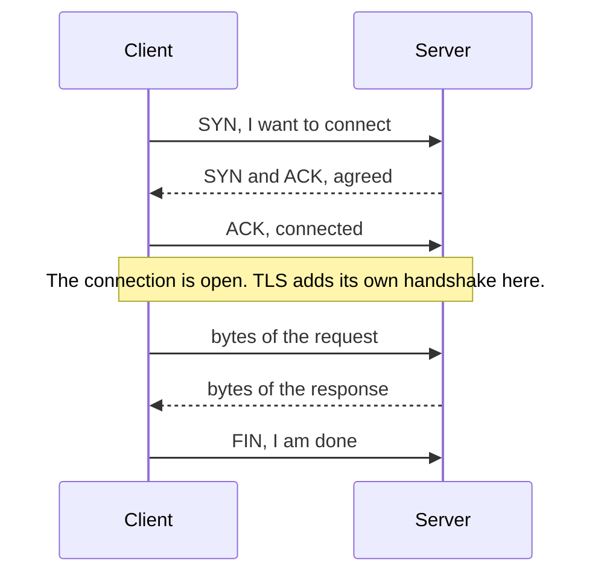
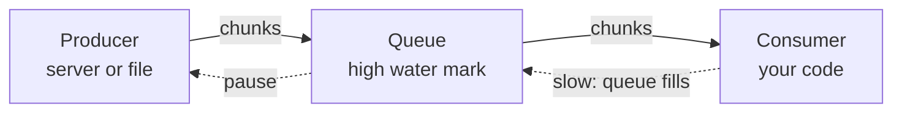

<Info>

**In short:** before any page script runs, the connection already tells a site
where you are and what software is talking. A browser turns a URL into an IP
address (DNS), opens a connection to an address and a port (TCP, or QUIC over
UDP), makes it private (TLS), sends an HTTP request and gets a response,
possibly through a proxy. Streams let a page start working before all of the
data has arrived, and a test that waits for "the network to be quiet" has to
know that some connections are meant to stay open forever. seleniumbase-rs can
route that traffic through a proxy, see it, block it, rewrite it, answer it with
a fake and record it as a HAR file.

</Info>

## The life of one request



Each arrow can fail for its own reason, and each is a place where something can
be observed, rewritten or recorded. [How a page loads](/concepts/how-a-page-loads)
shows what the browser does with the response.

## Addresses and ports

Two numbers say where a message goes.

- An **IP address** names a machine on a network: `93.184.216.34` (IPv4, four
  numbers) or `2606:2800:220:1::1` (IPv6, eight groups). The name
  `example.com` is turned into one of these by [DNS](#dns-names-to-addresses).
  The address `127.0.0.1` (or `::1`) is the **loopback**: it always means "this
  same machine", and the name `localhost` points to it.
- A **port** is a number from 0 to 65535 that says which program on that machine
  should get the message. Web servers use 80 for HTTP and 443 for HTTPS by
  default. A client does not choose a well-known port for itself: its operating
  system gives it a free one from a high range for each connection.

A connection is therefore named by four numbers: source address, source port,
destination address, destination port. That is how a browser keeps a hundred
connections to the same server on port 443 apart.



*The layers a request passes through. Each layer only talks to its neighbours.*

## TCP: a reliable pipe

**TCP** (Transmission Control Protocol) gives two programs a connection that acts
like a pipe: bytes put in at one end come out at the other, **complete and in
order**, or the connection reports an error. The network underneath loses and
reorders packets all the time; TCP numbers the bytes, asks for the missing ones
again and slows down when the network is crowded.



*The three-way handshake opens a TCP connection, one round trip before any data.*

Two properties matter every day:

- **TCP has no message boundaries.** It delivers a stream of bytes, not a list
  of messages. When a client writes two messages, the reader may get them as
  one chunk, or one message in three pieces. Every protocol on top of TCP must say
  where a message ends: HTTP uses a length or a chunk marker, a WebSocket uses
  frames.
- **A lost packet stalls everything behind it.** TCP must deliver in order, so one
  missing packet holds back all the bytes after it until it is resent. This
  *head-of-line blocking* is the weakness QUIC was built to remove.

## UDP and QUIC

**UDP** sends independent **datagrams** with no handshake, no ordering and no
resend. A datagram may arrive twice or never. That is bad for a web page and
good when speed matters more than completeness: DNS lookups, voice and video
calls, games.

**QUIC** is a modern transport built on top of UDP. It adds what TCP gave, plus
TLS 1.3 encryption, in one handshake, and it carries many independent
**streams** in one connection, so a lost packet delays only the stream it
belonged to. HTTP/3 is HTTP over QUIC. A server announces it with an `Alt-Svc`
response header and the browser switches on a later visit.

| | TCP | UDP | QUIC |
|---|---|---|---|
| Runs on | IP | IP | UDP |
| Connection | Yes, with a handshake | None | Yes, with a handshake that includes TLS |
| Delivery | Reliable and in order | Best effort | Reliable, in order per stream |
| Message boundaries | None | Each datagram | Per stream, none; the application adds them |
| Head-of-line blocking | Yes | Not applicable | Only inside one stream |
| Typical use | HTTP/1.1 and HTTP/2, email, SSH | DNS, calls, games | HTTP/3 |

## Sockets

A **socket** is the handle that an operating system gives a program for one end
of a connection. A server creates a socket, **binds** it to an address and a
port, **listens**, and **accepts** each client that connects. A client creates a
socket and **connects**. After that, both sides read and write bytes, and
closing the socket ends the connection.

Binding port 0 asks the system for any free port, which is how a test can start
a server without picking a port that another program already uses. Binding a
port that is taken fails with "address already in use".

<Accordion title="What do the network errors in Chrome mean?">

Chrome names its connection failures `net::ERR_...`, and each one points to a
layer:

- `ERR_NAME_NOT_RESOLVED`: DNS found no address for the name.
- `ERR_CONNECTION_REFUSED`: the machine answered, but no program listens on that
  port. Typical when a local test server is not running yet.
- `ERR_CONNECTION_TIMED_OUT`: nothing answered the first packet at all, often a
  firewall or a wrong address.
- `ERR_CONNECTION_RESET`: the other side closed the connection abruptly in the
  middle of a conversation.
- `ERR_CERT_AUTHORITY_INVALID`: the connection worked, but the TLS certificate
  was not trusted.

</Accordion>

## HTTP in ten minutes

HTTP is a text conversation. The client sends a **request**; the server sends a
**response**.

```http
GET /search?q=rust HTTP/1.1
Host: shop.example.com
User-Agent: Mozilla/5.0 (...) Chrome/154.0.0.0 Safari/537.36
Accept: text/html,application/xhtml+xml
Accept-Language: en-US,en;q=0.9
Cookie: sid=9f2c41ab7e

HTTP/1.1 200 OK
Content-Type: text/html; charset=utf-8
Cache-Control: max-age=60
Set-Cookie: theme=dark; Path=/; Secure
Content-Length: 5120

<!doctype html> ...
```

A request has a **method**, a **path** (with an optional query string after
`?`), **headers** and an optional **body**. A response has a **status code**,
headers and a body.

| Method | Used for |
|---|---|
| `GET` | Reading a page or a resource. No body. Can be repeated safely. |
| `POST` | Sending data: a login form, a new comment. The data goes in the body. |
| `PUT`, `PATCH`, `DELETE` | Replacing, changing and removing things, mostly in APIs. |
| `OPTIONS` | Asking what is allowed. Browsers send it as a "preflight" before a cross-origin request. |

| Status | Meaning |
|---|---|
| `200` | OK. |
| `301`, `302`, `307` | Redirect: go to the URL in the `Location` header. |
| `304` | Not modified: use your cached copy. |
| `401`, `403` | Not signed in, or signed in but not allowed. |
| `404` | Nothing here. |
| `407` | The **proxy** wants a login (see below). |
| `429` | Too many requests: slow down. |
| `500`, `502`, `503` | The server (or a gateway in front of it) failed. |

The headers that matter most:

| Header | Direction | Role |
|---|---|---|
| `Host` | Request | Which site on this server you want. |
| `User-Agent`, `Accept-Language` | Request | Who you claim to be, and which language you prefer. See [Detection](/concepts/detection). |
| `Cookie` and `Set-Cookie` | Request and response | The memory of the web. See [Sessions and storage](/concepts/sessions-and-state). |
| `Referer`, `Origin` | Request | Where the request came from. |
| `Authorization` | Request | A token or password for an API. |
| `Content-Type` | Both | What the body is: `text/html`, `application/json`, an image type. |
| `Location` | Response | Where a redirect points. |
| `Cache-Control`, `ETag` | Response | How long, and under which tag, a copy may be reused. |

**HTTP versions.** HTTP/1.1 sends one request at a time per connection as
readable text. HTTP/2 sends the same messages as binary frames and
**multiplexes** many requests over one connection. HTTP/3 does the same over
QUIC (on UDP). The browser picks the best one the server offers during the TLS
handshake (the ALPN extension).

## Where HTTP puts a message boundary

On HTTP/1.1 the client has to know when a response body ends. There are two
ways. With `Content-Length` the server states the size first. When it does not
know the size yet, because it generates the page as it goes, it uses
**chunked transfer encoding**: the body is sent in pieces, each preceded by its
size in hexadecimal, and a piece of size zero ends it.

```text
HTTP/1.1 200 OK
Transfer-Encoding: chunked

5
Hello
7
, world
0

```

A chunked response lets the browser start parsing and rendering the first part
of a page while the server is still producing the rest. HTTP/2 and HTTP/3 do not
need chunked encoding, because their frames carry the boundaries, but the idea of
a response that arrives in pieces is the same.

## Server-Sent Events

A **Server-Sent Event** stream (SSE) is an HTTP response that never finishes.
The server answers with `Content-Type: text/event-stream` and keeps writing
small text records, and the browser's `EventSource` object turns each into an
event in JavaScript:

```text
event: price
data: 42.17

event: price
data: 42.31

```

```js
const source = new EventSource("/prices");
source.addEventListener("price", (event) => console.log(event.data));
```

The channel is **one-way**, server to page, over plain HTTP, and `EventSource`
reconnects by itself and tells the server the last event it saw. A
[WebSocket](/concepts/modern-web) starts as an HTTP request with an `Upgrade`
header, answered by `101 Switching Protocols`, and from then on carries frames in
both directions over the same TCP connection.

<Warning>

A page with an open SSE stream or WebSocket **never has an idle network**. A
test that waits for "no requests for 500 ms" will wait until it times out.
Wait for something the page shows instead, such as a number, a row or a status
text.

</Warning>

## The Streams API

Inside the page, the **Streams API** gives JavaScript the same idea: handle data
as it arrives in pieces instead of waiting for all of it. There are three kinds
of stream. A **ReadableStream** produces chunks, a **WritableStream** consumes
them, and a **TransformStream** sits between and changes them. `fetch` returns a
response whose `body` is a ReadableStream:

```js
const response = await fetch("/big-report.csv");
const reader = response.body
  .pipeThrough(new TextDecoderStream())
  .getReader();

for (;;) {
  const { done, value } = await reader.read();
  if (done) break;
  console.log("got", value.length, "characters");
}
```

### Backpressure

A producer that is faster than its consumer would fill memory with data nobody
has read yet. **Backpressure** is the signal that travels backwards and says "slow
down". A stream has an internal queue with a size goal (the **high water mark**).
When the queue is full, the stream reports it, and a well-behaved producer pauses
until the consumer catches up.



*Backpressure: a full queue tells the producer to wait.*

The same rule works at every level. If a page reads a stream slowly, the
browser stops reading from the socket, the operating system's receive buffer
fills, TCP tells the server to stop sending, and the server's own stream pauses.
Where a chain has no backpressure, something must decide what to throw away
instead: a buffer that grows without limit, or the oldest data.

## DNS: names to addresses

People type names; computers connect to addresses. **DNS** (the Domain Name
System) translates `shop.example.com` into an IP address such as `203.0.113.7`.
The browser asks a **resolver** (your router, your ISP, or a public one), which
may ask others, and caches the answer for the record's **time to live (TTL)**.
A name can have several addresses (`A` for IPv4, `AAAA` for IPv6), or be an
alias (`CNAME`) for another name.

DNS matters for automation in two ways:

- **Where the name is resolved.** With an HTTP proxy the proxy usually looks the
  name up, not your machine. With a SOCKS5 proxy it depends on whether the client
  sends the name or an address already looked up. A lookup that bypasses the
  proxy is a **DNS leak**: it tells your resolver (and anyone watching) which
  sites you visit.
- **Test setups.** Chrome has a `--host-resolver-rules` switch that maps a name
  to an address without touching DNS, handy for pointing a real domain at a
  test server. In the pure CDP engine, pass it with
  `LaunchOptionsBuilder::arg`.

## TLS and certificates

**TLS** is what puts the S in HTTPS. Before any HTTP is sent, the client and
server perform a **handshake**: the client lists the TLS versions, ciphers and
extensions it supports (the `ClientHello`, including the server name it wants in
the SNI field and the protocols it offers in ALPN), the server picks, and they
agree on keys. From then on everything is encrypted.

The server also proves who it is with a **certificate**: a signed statement
"this key belongs to `shop.example.com`", issued by a certificate authority
(CA) the browser trusts. The browser checks the chain of signatures up to a
trusted root, the name against the address, and the dates. If a check fails,
the page does not load and Chrome reports an error such as
`net::ERR_CERT_AUTHORITY_INVALID` (unknown signer) or
`net::ERR_CERT_DATE_INVALID` (expired). **HSTS** is a header that tells the
browser to refuse plain HTTP for a site from then on.

For tests against your own server with a self-signed certificate:

- in a WebDriver session, the standard `acceptInsecureCerts` capability tells
  the driver to continue;
- in the pure CDP engine, pass Chrome's `--ignore-certificate-errors` switch
  with `LaunchOptionsBuilder::arg`.

Never use either against a site you do not control; it turns off the check that
protects you from someone in the middle.

Anything that wants to **read** encrypted traffic must sit in the middle with a
certificate the browser trusts: that is how a debugging proxy or the
[MitmProxy](/glossary#mitmproxy) of the stealth crates works, with an
[ephemeral CA](/glossary#ephemeral-ca) installed for the one browser. TLS
also leaves a fingerprint of the client (JA3 and JA4); see
[Detection](/concepts/detection#network-level-fingerprints).

## Proxies

A **proxy** is a server that makes requests on your behalf. The site sees the
proxy's IP address instead of yours. People use proxies to test how a site
looks from another country, to reach the internet from a restricted network, to
spread requests over many addresses, and to inspect or record traffic.

| Kind | How it works | Notes |
|---|---|---|
| HTTP proxy | The browser sends the request to the proxy. For HTTPS it sends `CONNECT shop.example.com:443`, and the proxy opens an opaque tunnel. | The proxy sees which host you visit but not the encrypted content. |
| HTTPS proxy | The same, but the connection **to the proxy** is itself TLS. | Hides the destination from someone watching your side of the link. |
| SOCKS5 proxy | A lower-level protocol: the proxy relays raw TCP (and optionally UDP) connections for any protocol. | `socks5h://` style: the proxy resolves the name. Plain SOCKS5 may leave resolution to the client. |
| SOCKS4 | The older version, no authentication, IPv4 only. | Rare today. |

Proxies can ask for a login. The proxy answers `407 Proxy Authentication
Required` and the client replies with a `Proxy-Authorization` header
(usually Basic: a user name and password). Note the difference from `401`,
which is a *website* asking.

**Bypass lists** name hosts that should skip the proxy, such as
`localhost` and `*.internal.example.com`. **PAC files** (proxy auto-config) go
further: a small JavaScript function decides per URL:

```javascript proxy.pac
function FindProxyForURL(url, host) {
  if (dnsDomainIs(host, ".internal.example.com")) return "DIRECT";
  if (shExpMatch(host, "*.cdn.example.com"))      return "PROXY edge.example.com:3128";
  return "PROXY gateway.example.com:8080; DIRECT"; // the second choice is the fallback
}
```

The proxy's country and kind (datacenter, residential, mobile) decide how the
site scores you, so keep the proxy in line with your time zone and locale; see
[Detection](/concepts/detection#coherence-why-a-fingerprint-must-hang-together).

### How seleniumbase-rs uses proxies

<Tabs>

<Tab title="BaseCase and the CLI" icon="flask">

Give a proxy with `--proxy host:port` or `scheme://host:port`, pick at random
from a file with `--proxy-list`, or use a PAC file with `--proxy-pac-url`.

</Tab>

<Tab title="Pure CDP engine" icon="bolt">

The launch options take a proxy string, `SERVER:PORT` or `USER:PASS@SERVER:PORT`,
optionally with a scheme such as `socks5://`. The same text is understood by
`Proxy::parse`, which exposes `server()`, `has_credentials()` and
`credentials()`:

```rust,ignore src/main.rs
use seleniumbase_rs::sb_cdp::{Browser, ContextOptions, LaunchOptions, Proxy};

// One proxy for the whole browser.
let browser = Browser::launch(
    LaunchOptions::builder()
        .proxy("alice:s3cret@proxy.example.com:8080")
        .build()?,
)
.await?;

// Or a different proxy for each isolated context.
let options = ContextOptions::new()
    .proxy(Proxy::parse("bob:hunter2@other.example.com:1080")?)
    .bypass("*.internal.example.com");
let context = browser.new_context_with(options).await?;
let page = context.new_page_at("https://example.com").await?;
```

</Tab>

</Tabs>

<Note>

Chrome ignores a user name and password written into a proxy address. The pure
CDP engine answers the proxy's authentication challenge itself, tab by tab
(through the `Fetch.authRequired` event), so different tabs can sit behind
different proxies, each with its own credentials. The credentials go to the
proxy only: a password prompt from a website (a `401`) is never given the proxy
account, and `Proxy` hides the password from its `Debug` and `Display` output.

One limit: a WebSocket's `407` never reaches the engine, so a WebSocket passes a
password-protected proxy only with credentials Chrome already holds from an
earlier request in the same context.

</Note>

## Seeing and changing requests: interception

A browser normally sends requests without asking you. **Interception** puts you
in the loop: the browser **pauses** each matching request before it leaves, tells
your code, and waits for a decision. In CDP this is the `Fetch` domain: you
enable it with patterns, receive `Fetch.requestPaused` events, and answer each
with one of `continueRequest`, `fulfillRequest` or `failRequest`. Only requests
that match stay paused, so the rest are not slowed.

There are four things you can do with a paused request:

| Decision | What happens | Typical use |
|---|---|---|
| **Block** | The request fails; it never reaches the network. | Skip images, fonts, analytics and ads to make pages faster. |
| **Fulfill** | You supply the whole response; the server is never contacted. | **Mocking**: test a page against a fixed API answer, an error page or an empty list. |
| **Modify** | The request goes out, but you change it first: a header, the method, the URL, the body. | Add a test header, strip a cookie, redirect to a staging server. |
| **Continue** | The request goes out unchanged. | Everything that no rule matched. |

The pure CDP engine wraps this in `Page::intercept`. A `Rule` says *what to
match* (a URL glob, a method, a `ResourceType` such as `Image`, `Script`, `Xhr`
or `Font`) and *what to do*:

```rust,ignore src/main.rs
use seleniumbase_rs::sb_cdp::{ResourceType, Response, Rule};
use seleniumbase_rs::json::json;

let interception = page
    .intercept(vec![
        // Block: no images.
        Rule::block().resource_type(ResourceType::Image),
        // Fulfill: answer an API call without contacting the server.
        Rule::fulfill(Response::json(200, &json!({ "items": [] })))
            .url("*/api/items*"),
        // Modify: add a header to every API request that does go out.
        Rule::modify().url("*/api/*").set_header("X-Test", "1"),
    ])
    .await?;

page.goto("https://example.com").await?;

// What happened to each request: Blocked, Fulfilled, Modified or Continued.
for seen in interception.log() {
    println!("{} -> {:?}", seen.request.url, seen.outcome);
}
interception.stop().await?; // stops intercepting and resumes normal traffic
```

A `Response` is built with `Response::new(status, body)`, `Response::json`,
`Response::html`, and `.header(name, value)`. A modifying rule can also use
`remove_header`, `redirect_to`, `change_method` and `replace_body`. Every
`Seen` pairs the `Request` (its `url`, `method`, `resource_type` and `headers`)
with the `Outcome`.

<Tip>

To make a test faster, **block** what the test does not need rather than
waiting for it: images, fonts and media rarely matter for logic. The
`ad_block(true)` launch option does the same for ad hosts.

</Tip>

## Recording traffic: HAR

A **HAR** (HTTP Archive) is a JSON file that records a browsing session: for
every request, the URL, method, headers, cookies, query string and body; for
the response, the status, headers and content; and a timing breakdown (waiting
for DNS, connecting, TLS, sending, waiting for the server, receiving). Browser
developer tools can export one, and the format is read by many viewers. It is
the standard way to answer "what did this page load, and what was slow?", and a
HAR can be used to replay or compare runs.

```rust,ignore src/main.rs
use seleniumbase_rs::sb_cdp::HarOptions;

let recorder = page.start_har_with(HarOptions::new().content(true)).await?;
page.goto("https://example.com").await?;
let har = recorder.finish().await?; // stops recording and returns a Har

println!("{} requests", har.log.entries.len());
har.save("example.har")?; // HAR 1.2 JSON; to_json() gives the same as a String
```

`Page::start_har()` records with the defaults. By default response bodies up
to `DEFAULT_MAX_CONTENT_BYTES` (1 MiB) are stored; `HarOptions::max_content_bytes`
changes that, up to the hard limit `MAX_CONTENT_BYTES` (64 MiB), and
`HarOptions::content(false)` leaves bodies out. The `Har` type models the
whole HAR 1.2 structure (`log`, `pages`, `entries`, each with `request`,
`response`, `cache` and `timings`).

<Warning>

A HAR contains everything the browser sent, including cookies, tokens and form
data. Treat the file like a password, and do not commit or share it.

</Warning>

### Other network controls

- `Page::emulation().offline(true)` simulates having no network, to test an
  "offline" message; it sends `Network.emulateNetworkConditions`.
- In a WebDriver session, CDP mode adds the same DevTools commands. See
  [CDP mode](/tutorials/cdp_mode).

## What the connection reveals

Whatever you do inside the browser, the connection itself shows:

| Signal | What the site learns | How to change it |
|---|---|---|
| IP address | Country, network owner, whether it is a datacenter | A proxy |
| WebRTC | Possibly the real IP, even behind a proxy | The WebRTC policy |
| TLS ClientHello | Which TLS library made the connection (<Tooltip tip="Hashes of the TLS handshake: versions, ciphers, extensions and their order">JA3, JA4</Tooltip>) | Use a real browser, or the stealth crates |
| HTTP/2 settings and frame order | Which HTTP/2 stack is talking (the Akamai fingerprint) | The same |
| Header order and values | Browser family and version | The same |

### WebRTC leaks

WebRTC can open direct UDP connections that bypass the proxy and expose the real
IP address. The `webrtc_policy` setting of a `StealthPolicy` picks what WebRTC
may use (on the pure CDP launch builder: `webrtc_policy` and `shield_webrtc`):

| `WebRtcPolicy` | Effect |
|---|---|
| `DisableNonProxiedUdp` (default) | No UDP outside the proxy: the real IP stays hidden. |
| `PublicInterfaceOnly` | Only the public interface is used; local addresses stay hidden. |
| `PublicAndPrivateInterfaces` | Public and private interfaces are both used. |

### TLS and HTTP/2 fingerprints

Every client opens a TLS connection with a ClientHello whose versions, ciphers,
extensions and their order identify the library. HTTP/2 adds its settings and
the order of its first frames. A real Chrome sends Chrome's values, so a browser
driven by seleniumbase-rs passes this check on its own.

A plain HTTP client does not. When requests are made outside the browser (to
continue a browser session faster), the experimental
[stealth crates](/stealth/overview), kept in the separate
[seleniumbase-rs-stealth](https://github.com/MustCodeAl/seleniumbase-rs-stealth)
repository, reproduce Chrome's fingerprint:

<Columns cols={2}>

<Card title="JA3 and JA4" icon="fingerprint" color="#1a85d4" href="/stealth/api/codec-ja4">
  How the TLS fingerprints are computed.
</Card>

<Card title="Akamai HTTP/2" icon="network-wired" color="#199f43" href="/stealth/api/codec-akamai">
  The HTTP/2 fingerprint string.
</Card>

<Card title="Wire formats" icon="code" color="#d47628" href="/stealth/wire-formats">
  Measured fingerprints and impersonating clients.
</Card>

<Card title="Limits" icon="triangle-exclamation" color="#d52c36" href="/stealth/limits">
  What is measured, and what is not.
</Card>

</Columns>

<Warning>

A clean fingerprint does not fix a bad IP: a datacenter address is still a
datacenter address. Keep the proxy's country, the time zone and the locale in
agreement. See [Detection and spoofing](/concepts/detection).

</Warning>

## How seleniumbase-rs uses it

The pure CDP engine ([CDP](/concepts/cdp)) is a program built on exactly these
pieces. The code is in `src/sb_cdp/client.rs`.

- **One long-lived connection.** Chrome listens for the DevTools Protocol on a
  TCP port on `127.0.0.1`, and the client opens a single WebSocket to it with
  the `tokio-tungstenite` library (`connect_async_with_config`). That one
  connection carries the traffic of every tab, so commands for different tabs
  never wait for new handshakes. It stays open for the whole browser session.
- **Matching by id.** Because a WebSocket is a stream of frames, not a series of
  separate requests, each command carries an `id`. A background task reads the
  socket, finds the waiting request for that `id` and hands it the reply. Other
  messages are events.
- **Backpressure policy.** Events go into a bounded channel with room for 1024
  messages (`EVENT_BACKLOG`). A subscriber that falls further behind **misses
  events** rather than slowing the reader task down, so one slow listener cannot
  stall the whole connection. This is the "throw away" choice from the section
  above, made on purpose.
- **Limits.** One command may take 30 seconds (`COMMAND_TIMEOUT`) before it is
  abandoned. One message may be up to 256 MiB (`MAX_MESSAGE_BYTES`), because
  Chrome sends a response body such as an image as a single frame, and a message
  over the limit closes the connection for every tab.
- **Ports.** `sbrs devtools` checks that its port is free before it starts
  Chrome, by trying to bind a TCP listener to it, and `--port 0` lets Chrome pick
  a free port, as described under sockets.

There is no library API for chunked transfer or SSE: the browser handles both,
and a test only sees their results. For waiting on a streamed page, use the
usual waits for an element or its text, as described in
[JavaScript and events](/concepts/javascript-and-events).

<Note>

CDP uses a WebSocket because it needs two-way traffic: commands go out and
events come in on the same pipe. SSE could carry the events but not the
commands, which is why the protocol did not choose it.

</Note>

## Where to go next

<Columns cols={2}>

<Card title="The DevTools Protocol" icon="bolt" href="/concepts/cdp">
  The messages that travel over that WebSocket.
</Card>

<Card title="How a page loads" icon="globe" href="/concepts/how-a-page-loads">
  DNS, connection, TLS and the load events, step by step.
</Card>

<Card title="Modern web" icon="rocket" href="/concepts/modern-web">
  WebSockets, service workers and other tools of today's pages.
</Card>

<Card title="Bundling, compression and caching" icon="box-archive" color="#199f43" href="/concepts/bundling-and-caching">
  Smaller bytes, Cache-Control and stale content in tests.
</Card>

<Card title="Encryption and certificates" icon="key" color="#d52c36" href="/concepts/encryption">
  Keys, certificates and the TLS handshake in detail.
</Card>

<Card title="Frontends, backends and APIs" icon="server" color="#d47628" href="/concepts/frontends-backends-and-apis">
  What sits behind a page: reverse proxies, CDNs and APIs.
</Card>

</Columns>
