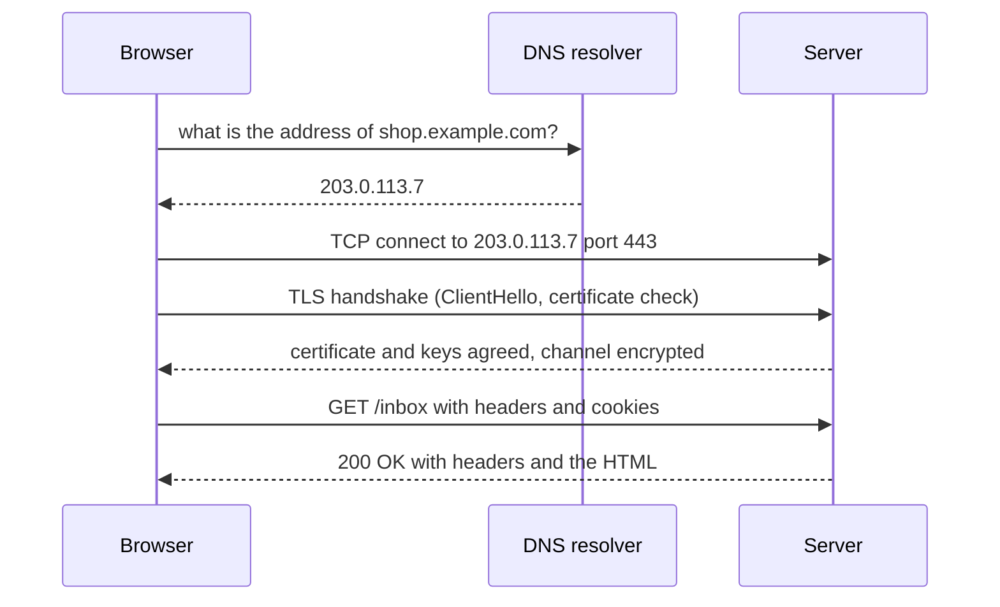

<Info>

**In short:** before any page script runs, the connection already tells a site
where you are and what software is talking. A browser turns a URL into an IP
address (DNS), opens an encrypted channel (TLS), sends an HTTP request and gets
a response, possibly through a proxy. seleniumbase-rs can route that traffic
through a proxy, see it, block it, rewrite it, answer it with a fake and record
it as a HAR file.

</Info>

## The life of one request



Each arrow can fail for its own reason, and each is a place where something can
be observed, rewritten or recorded. [How a page loads](/concepts/how-a-page-loads)
shows what the browser does with the response.

## HTTP in ten minutes

HTTP is a text conversation. The client sends a **request**; the server sends a
**response**.

```http
GET /search?q=rust HTTP/1.1
Host: shop.example.com
User-Agent: Mozilla/5.0 (...) Chrome/154.0.0.0 Safari/537.36
Accept: text/html,application/xhtml+xml
Accept-Language: en-US,en;q=0.9
Cookie: sid=9f2c41ab7e

HTTP/1.1 200 OK
Content-Type: text/html; charset=utf-8
Cache-Control: max-age=60
Set-Cookie: theme=dark; Path=/; Secure
Content-Length: 5120

<!doctype html> ...
```

A request has a **method**, a **path** (with an optional query string after
`?`), **headers** and an optional **body**. A response has a **status code**,
headers and a body.

| Method | Used for |
|---|---|
| `GET` | Reading a page or a resource. No body. Can be repeated safely. |
| `POST` | Sending data: a login form, a new comment. The data goes in the body. |
| `PUT`, `PATCH`, `DELETE` | Replacing, changing and removing things, mostly in APIs. |
| `OPTIONS` | Asking what is allowed. Browsers send it as a "preflight" before a cross-origin request. |

| Status | Meaning |
|---|---|
| `200` | OK. |
| `301`, `302`, `307` | Redirect: go to the URL in the `Location` header. |
| `304` | Not modified: use your cached copy. |
| `401`, `403` | Not signed in, or signed in but not allowed. |
| `404` | Nothing here. |
| `407` | The **proxy** wants a login (see below). |
| `429` | Too many requests: slow down. |
| `500`, `502`, `503` | The server (or a gateway in front of it) failed. |

The headers that matter most:

| Header | Direction | Role |
|---|---|---|
| `Host` | Request | Which site on this server you want. |
| `User-Agent`, `Accept-Language` | Request | Who you claim to be, and which language you prefer. See [Detection](/concepts/detection). |
| `Cookie` and `Set-Cookie` | Request and response | The memory of the web. See [Sessions and storage](/concepts/sessions-and-state). |
| `Referer`, `Origin` | Request | Where the request came from. |
| `Authorization` | Request | A token or password for an API. |
| `Content-Type` | Both | What the body is: `text/html`, `application/json`, an image type. |
| `Location` | Response | Where a redirect points. |
| `Cache-Control`, `ETag` | Response | How long, and under which tag, a copy may be reused. |

**HTTP versions.** HTTP/1.1 sends one request at a time per connection as
readable text. HTTP/2 sends the same messages as binary frames and
**multiplexes** many requests over one connection. HTTP/3 does the same over
QUIC (on UDP). The browser picks the best one the server offers during the TLS
handshake (the ALPN extension).

## DNS: names to addresses

People type names; computers connect to addresses. **DNS** (the Domain Name
System) translates `shop.example.com` into an IP address such as `203.0.113.7`.
The browser asks a **resolver** (your router, your ISP, or a public one), which
may ask others, and caches the answer for the record's **time to live (TTL)**.
A name can have several addresses (`A` for IPv4, `AAAA` for IPv6), or be an
alias (`CNAME`) for another name.

DNS matters for automation in two ways:

- **Where the name is resolved.** With an HTTP proxy the proxy usually looks the
  name up, not your machine. With a SOCKS5 proxy it depends on whether the client
  sends the name or an address already looked up. A lookup that bypasses the
  proxy is a **DNS leak**: it tells your resolver (and anyone watching) which
  sites you visit.
- **Test setups.** Chrome has a `--host-resolver-rules` switch that maps a name
  to an address without touching DNS, handy for pointing a real domain at a
  test server. In the pure CDP engine, pass it with
  `LaunchOptionsBuilder::arg`.

## TLS and certificates

**TLS** is what puts the S in HTTPS. Before any HTTP is sent, the client and
server perform a **handshake**: the client lists the TLS versions, ciphers and
extensions it supports (the `ClientHello`, including the server name it wants in
the SNI field and the protocols it offers in ALPN), the server picks, and they
agree on keys. From then on everything is encrypted.

The server also proves who it is with a **certificate**: a signed statement
"this key belongs to `shop.example.com`", issued by a certificate authority
(CA) the browser trusts. The browser checks the chain of signatures up to a
trusted root, the name against the address, and the dates. If a check fails,
the page does not load and Chrome reports an error such as
`net::ERR_CERT_AUTHORITY_INVALID` (unknown signer) or
`net::ERR_CERT_DATE_INVALID` (expired). **HSTS** is a header that tells the
browser to refuse plain HTTP for a site from then on.

For tests against your own server with a self-signed certificate:

- in a WebDriver session, the standard `acceptInsecureCerts` capability tells
  the driver to continue;
- in the pure CDP engine, pass Chrome's `--ignore-certificate-errors` switch
  with `LaunchOptionsBuilder::arg`.

Never use either against a site you do not control; it turns off the check that
protects you from someone in the middle.

Anything that wants to **read** encrypted traffic must sit in the middle with a
certificate the browser trusts: that is how a debugging proxy or the
[MitmProxy](/glossary#mitmproxy) of the stealth crates works, with an
[ephemeral CA](/glossary#ephemeral-ca) installed for the one browser. TLS
also leaves a fingerprint of the client (JA3 and JA4); see
[Detection](/concepts/detection#network-level-fingerprints).

## Proxies

A **proxy** is a server that makes requests on your behalf. The site sees the
proxy's IP address instead of yours. People use proxies to test how a site
looks from another country, to reach the internet from a restricted network, to
spread requests over many addresses, and to inspect or record traffic.

| Kind | How it works | Notes |
|---|---|---|
| HTTP proxy | The browser sends the request to the proxy. For HTTPS it sends `CONNECT shop.example.com:443`, and the proxy opens an opaque tunnel. | The proxy sees which host you visit but not the encrypted content. |
| HTTPS proxy | The same, but the connection **to the proxy** is itself TLS. | Hides the destination from someone watching your side of the link. |
| SOCKS5 proxy | A lower-level protocol: the proxy relays raw TCP (and optionally UDP) connections for any protocol. | `socks5h://` style: the proxy resolves the name. Plain SOCKS5 may leave resolution to the client. |
| SOCKS4 | The older version, no authentication, IPv4 only. | Rare today. |

Proxies can ask for a login. The proxy answers `407 Proxy Authentication
Required` and the client replies with a `Proxy-Authorization` header
(usually Basic: a user name and password). Note the difference from `401`,
which is a *website* asking.

**Bypass lists** name hosts that should skip the proxy, such as
`localhost` and `*.internal.example.com`. **PAC files** (proxy auto-config) go
further: a small JavaScript function decides per URL:

```javascript proxy.pac
function FindProxyForURL(url, host) {
  if (dnsDomainIs(host, ".internal.example.com")) return "DIRECT";
  if (shExpMatch(host, "*.cdn.example.com"))      return "PROXY edge.example.com:3128";
  return "PROXY gateway.example.com:8080; DIRECT"; // the second choice is the fallback
}
```

The proxy's country and kind (datacenter, residential, mobile) decide how the
site scores you, so keep the proxy in line with your time zone and locale; see
[Detection](/concepts/detection#coherence-why-a-fingerprint-must-hang-together).

### How seleniumbase-rs uses proxies

<Tabs>

<Tab title="BaseCase and the CLI" icon="flask">

Give a proxy with `--proxy host:port` or `scheme://host:port`, pick at random
from a file with `--proxy-list`, or use a PAC file with `--proxy-pac-url`.

</Tab>

<Tab title="Pure CDP engine" icon="bolt">

The launch options take a proxy string, `SERVER:PORT` or `USER:PASS@SERVER:PORT`,
optionally with a scheme such as `socks5://`. The same text is understood by
`Proxy::parse`, which exposes `server()`, `has_credentials()` and
`credentials()`:

```rust,ignore src/main.rs
use seleniumbase_rs::sb_cdp::{Browser, ContextOptions, LaunchOptions, Proxy};

// One proxy for the whole browser.
let browser = Browser::launch(
    LaunchOptions::builder()
        .proxy("alice:s3cret@proxy.example.com:8080")
        .build()?,
)
.await?;

// Or a different proxy for each isolated context.
let options = ContextOptions::new()
    .proxy(Proxy::parse("bob:hunter2@other.example.com:1080")?)
    .bypass("*.internal.example.com");
let context = browser.new_context_with(options).await?;
let page = context.new_page_at("https://example.com").await?;
```

</Tab>

</Tabs>

<Note>

Chrome ignores a user name and password written into a proxy address. The pure
CDP engine answers the proxy's authentication challenge itself, tab by tab
(through the `Fetch.authRequired` event), so different tabs can sit behind
different proxies, each with its own credentials. The credentials go to the
proxy only: a password prompt from a website (a `401`) is never given the proxy
account, and `Proxy` hides the password from its `Debug` and `Display` output.

One limit: a WebSocket's `407` never reaches the engine, so a WebSocket passes a
password-protected proxy only with credentials Chrome already holds from an
earlier request in the same context.

</Note>

## Seeing and changing requests: interception

A browser normally sends requests without asking you. **Interception** puts you
in the loop: the browser **pauses** each matching request before it leaves, tells
your code, and waits for a decision. In CDP this is the `Fetch` domain: you
enable it with patterns, receive `Fetch.requestPaused` events, and answer each
with one of `continueRequest`, `fulfillRequest` or `failRequest`. Only requests
that match stay paused, so the rest are not slowed.

There are four things you can do with a paused request:

| Decision | What happens | Typical use |
|---|---|---|
| **Block** | The request fails; it never reaches the network. | Skip images, fonts, analytics and ads to make pages faster. |
| **Fulfill** | You supply the whole response; the server is never contacted. | **Mocking**: test a page against a fixed API answer, an error page or an empty list. |
| **Modify** | The request goes out, but you change it first: a header, the method, the URL, the body. | Add a test header, strip a cookie, redirect to a staging server. |
| **Continue** | The request goes out unchanged. | Everything that no rule matched. |

The pure CDP engine wraps this in `Page::intercept`. A `Rule` says *what to
match* (a URL glob, a method, a `ResourceType` such as `Image`, `Script`, `Xhr`
or `Font`) and *what to do*:

```rust,ignore src/main.rs
use seleniumbase_rs::sb_cdp::{ResourceType, Response, Rule};
use serde_json::json;

let interception = page
    .intercept(vec![
        // Block: no images.
        Rule::block().resource_type(ResourceType::Image),
        // Fulfill: answer an API call without contacting the server.
        Rule::fulfill(Response::json(200, &json!({ "items": [] })))
            .url("*/api/items*"),
        // Modify: add a header to every API request that does go out.
        Rule::modify().url("*/api/*").set_header("X-Test", "1"),
    ])
    .await?;

page.goto("https://example.com").await?;

// What happened to each request: Blocked, Fulfilled, Modified or Continued.
for seen in interception.log() {
    println!("{} -> {:?}", seen.request.url, seen.outcome);
}
interception.stop().await?; // stops intercepting and resumes normal traffic
```

A `Response` is built with `Response::new(status, body)`, `Response::json`,
`Response::html`, and `.header(name, value)`. A modifying rule can also use
`remove_header`, `redirect_to`, `change_method` and `replace_body`. Every
`Seen` pairs the `Request` (its `url`, `method`, `resource_type` and `headers`)
with the `Outcome`.

<Tip>

To make a test faster, **block** what the test does not need rather than
waiting for it: images, fonts and media rarely matter for logic. The
`ad_block(true)` launch option does the same for ad hosts.

</Tip>

## Recording traffic: HAR

A **HAR** (HTTP Archive) is a JSON file that records a browsing session: for
every request, the URL, method, headers, cookies, query string and body; for
the response, the status, headers and content; and a timing breakdown (waiting
for DNS, connecting, TLS, sending, waiting for the server, receiving). Browser
developer tools can export one, and the format is read by many viewers. It is
the standard way to answer "what did this page load, and what was slow?", and a
HAR can be used to replay or compare runs.

```rust,ignore src/main.rs
use seleniumbase_rs::sb_cdp::HarOptions;

let recorder = page.start_har_with(HarOptions::new().content(true)).await?;
page.goto("https://example.com").await?;
let har = recorder.finish().await?; // stops recording and returns a Har

println!("{} requests", har.log.entries.len());
har.save("example.har")?; // HAR 1.2 JSON; to_json() gives the same as a String
```

`Page::start_har()` records with the defaults. By default response bodies up
to `DEFAULT_MAX_CONTENT_BYTES` (1 MiB) are stored; `HarOptions::max_content_bytes`
changes that, up to the hard limit `MAX_CONTENT_BYTES` (64 MiB), and
`HarOptions::content(false)` leaves bodies out. The `Har` type models the
whole HAR 1.2 structure (`log`, `pages`, `entries`, each with `request`,
`response`, `cache` and `timings`).

<Warning>

A HAR contains everything the browser sent, including cookies, tokens and form
data. Treat the file like a password, and do not commit or share it.

</Warning>

### Other network controls

- `Page::emulation().offline(true)` simulates having no network, to test an
  "offline" message; it sends `Network.emulateNetworkConditions`.
- In a WebDriver session, CDP mode adds the same DevTools commands. See
  [CDP mode](/tutorials/cdp_mode).

## What the connection reveals

Whatever you do inside the browser, the connection itself shows:

| Signal | What the site learns | How to change it |
|---|---|---|
| IP address | Country, network owner, whether it is a datacenter | A proxy |
| WebRTC | Possibly the real IP, even behind a proxy | The WebRTC policy |
| TLS ClientHello | Which TLS library made the connection (<Tooltip tip="Hashes of the TLS handshake: versions, ciphers, extensions and their order">JA3, JA4</Tooltip>) | Use a real browser, or the stealth crates |
| HTTP/2 settings and frame order | Which HTTP/2 stack is talking (the Akamai fingerprint) | The same |
| Header order and values | Browser family and version | The same |

### WebRTC leaks

WebRTC can open direct UDP connections that bypass the proxy and expose the real
IP address. The `webrtc_policy` setting of a `StealthPolicy` picks what WebRTC
may use (on the pure CDP launch builder: `webrtc_policy` and `shield_webrtc`):

| `WebRtcPolicy` | Effect |
|---|---|
| `DisableNonProxiedUdp` (default) | No UDP outside the proxy: the real IP stays hidden. |
| `PublicInterfaceOnly` | Only the public interface is used; local addresses stay hidden. |
| `PublicAndPrivateInterfaces` | Public and private interfaces are both used. |

### TLS and HTTP/2 fingerprints

Every client opens a TLS connection with a ClientHello whose versions, ciphers,
extensions and their order identify the library. HTTP/2 adds its settings and
the order of its first frames. A real Chrome sends Chrome's values, so a browser
driven by seleniumbase-rs passes this check on its own.

A plain HTTP client does not. When requests are made outside the browser (to
continue a browser session faster), the experimental
[stealth crates](/stealth/overview), kept in the separate
[seleniumbase-rs-stealth](https://github.com/MustCodeAl/seleniumbase-rs-stealth)
repository, reproduce Chrome's fingerprint:

<Columns cols={2}>

<Card title="JA3 and JA4" icon="fingerprint" color="#1a85d4" href="/stealth/api/codec-ja4">
  How the TLS fingerprints are computed.
</Card>

<Card title="Akamai HTTP/2" icon="network-wired" color="#199f43" href="/stealth/api/codec-akamai">
  The HTTP/2 fingerprint string.
</Card>

<Card title="Wire formats" icon="code" color="#d47628" href="/stealth/wire-formats">
  Measured fingerprints and impersonating clients.
</Card>

<Card title="Limits" icon="triangle-exclamation" color="#d52c36" href="/stealth/limits">
  What is measured, and what is not.
</Card>

</Columns>

<Warning>

A clean fingerprint does not fix a bad IP: a datacenter address is still a
datacenter address. Keep the proxy's country, the time zone and the locale in
agreement. See [Detection and spoofing](/concepts/detection).

</Warning>
