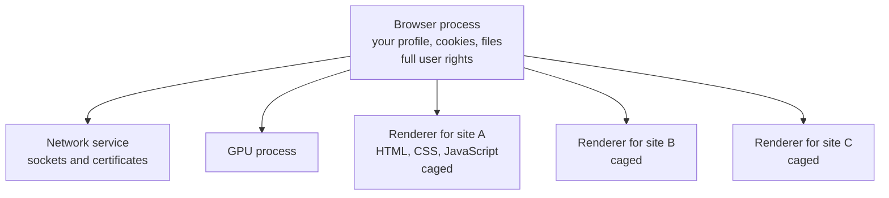

<Info>

**In short:** a browser runs code from strangers all day. A **sandbox** is a
cage around the part of the browser that handles that code, so that a bug in it
cannot read your files or start programs. **Site isolation** puts each website
in its own cage. Test runners often switch the sandbox off (`--no-sandbox`) to
make Chrome start inside a container, and that is a trade you should make with
open eyes.

</Info>

## The problem a sandbox solves

A web page is a program written by someone you may not trust. Your browser
downloads it, parses its HTML, runs its JavaScript, decodes its images and plays
its video. All of that code, and the browser's own code that handles it, has
bugs, and some bugs let a crafted page take over the process that is running it.

The sandbox assumes this will happen and limits what the taken-over process can
do. Think of a cook who works in a room with no door to the rest of the house:
if the cook goes rogue, the damage stays in the kitchen.

## Processes: where the cages are

A modern browser is not one program. It is many processes that each have one
job (see [browser architecture](/concepts/browser-architecture)).



*The browser process is the trusted one. The renderers hold the page code and
are the ones put in cages.*

A **renderer** has almost no rights of its own. It cannot open a file, cannot
open a network socket and cannot start a program. When a page needs something
(load an image, save a download, read a cookie) the renderer asks the browser
process through a message, and the browser process decides. This is the same
idea as a hotel clerk who fetches things for guests but never hands out the
master key.

## The operating system sandbox

The cage is built by the operating system, not by Chrome's own checks, so a bug
in Chrome's code cannot simply switch it off. Each system has its own tools:

| System | What Chrome uses | What it means |
|---|---|---|
| Linux | User namespaces or a setuid helper, plus a **seccomp-BPF** filter | The process gets an empty view of the file system and network, and the kernel refuses most system calls |
| macOS | Seatbelt profiles | A written list of what the process may touch; everything else is denied |
| Windows | Restricted tokens, job objects and a low integrity level | The process runs as a user with almost no rights and cannot create other processes |

The result: a renderer exploit alone is not enough to read your documents. An
attacker needs a **second** bug, one that escapes the cage. Chain two bugs and
the attack works, which is why browsers are patched so often. See
[web security](/concepts/web-security) for the other attacks a browser has to
withstand.

## Site isolation

The sandbox keeps a page away from your computer. **Site isolation** keeps one
website away from another.

Without it, two sites that happen to be open in the same tab, for example a
page and an advertisement frame inside it, could live in one renderer process.
A flaw in the CPU itself, such as Spectre, lets code read memory it should not
reach inside its own process. If a hostile site shares a process with your bank,
it could read the bank's data out of memory.

With site isolation, Chrome gives every **site** (scheme plus registrable domain,
such as `https://example.com`) its own renderer process, and even puts a
cross-site iframe in a different process from the page that embeds it (an
"out-of-process iframe"). It is on by default in desktop Chrome.

It has a visible effect on automation. A page and its cross-site iframe are
different **targets** in the [DevTools Protocol](/concepts/cdp), and a client
must attach to the iframe's target to talk to it. A test tool that treats the
page as one big document will not see inside such a frame unless it handles
this.

## Containers and virtual machines

The browser's sandbox is only the inner cage. Test suites usually run inside a
second one.

- **A container** (Docker and similar) is a group of ordinary processes that the
  Linux kernel gives a private view of files, processes, users and network.
  Containers share the host's kernel, so they are light and fast, but a kernel
  bug can reach out of one.
- **A virtual machine** runs a whole second operating system on virtual
  hardware. It is heavier and a much stronger wall, because an attacker must
  break the hypervisor rather than the shared kernel.
- Services that run tests for strangers often use a **micro virtual machine** or a
  user-space kernel to get close to virtual machine strength with container speed.

These layers add up. A good setup has the browser's sandbox **inside** a
container **inside** a machine that holds nothing valuable.

## Why --no-sandbox is risky

Chrome's sandbox needs help from the kernel. In a container two things often get
in the way:

1. Chrome refuses to start as the **root** user with its sandbox on, and many
   container images run everything as root.
2. The default container security profile can forbid the system calls the
   sandbox uses to build its cage, so it cannot start even as a normal user.

The quick fix found everywhere on the internet is the switch `--no-sandbox`.
It works, and it removes the cage entirely: a renderer exploit now runs with
every right of the user that started Chrome.

<Warning>

Never browse untrusted sites with `--no-sandbox` on a machine that holds secrets.
The container is then your only wall. Keep the container itself locked down:
no mounted home folder, no Docker socket, no cloud credentials in its
environment, and a fresh instance for every run.

</Warning>

Safer fixes, in order of preference:

<Steps>

<Step title="Run as a normal user" icon="user">

Add a non-root user to the image and start the tests as that user. This removes
the first of the two causes.

</Step>

<Step title="Allow what the sandbox needs" icon="unlock">

Use a container security profile (seccomp profile) that permits the namespace
calls the sandbox uses, or enable unprivileged user namespaces on the host.
The sandbox then works inside the container.

</Step>

<Step title="Accept it, and shrink the blast radius" icon="box">

If the sandbox cannot run, treat the browser as fully trusted by its attacker.
Visit only your own application and test sites, run on a throwaway machine
or a micro virtual machine, and keep secrets out of reach.

</Step>

</Steps>

When your tests only open the application you are building, the practical risk of
`--no-sandbox` in a clean container is small. When they follow links on the open
internet, scrape unknown sites or open files from strangers, it is not.

## Isolation inside the browser, for tests

Isolation also matters between two tests. A leftover cookie from test one can
make test two pass for the wrong reason. The tools are the same ideas in smaller
form:

- A **fresh profile** per run (a new user data folder), so no cookies, cache or
  logins carry over.
- An **incognito** or **guest** profile, which Chrome keeps in memory.
- A **browser context**, the protocol's name for an incognito-like partition
  that shares nothing with the others. See
  [sessions, cookies and storage](/concepts/sessions-and-state).

## How seleniumbase-rs uses it

The library does not build any sandbox itself. It decides **whether to switch
Chrome's sandbox off**, and it confines the files its own tools write.

<Tabs>

<Tab title="The sandbox switch" icon="shield">

- A WebDriver session is configured through `BrowserConfig`.
  `BrowserConfig::with_no_sandbox(true)` asks for `--no-sandbox`. The doc comment
  of that method says that sessions on Linux already do it, because the sandbox
  commonly cannot start there, so the switch is only added on other systems to
  avoid sending it twice.
- The pure CDP engine ([DevTools Protocol](/concepts/cdp)) builds its launch
  options with `LaunchOptions::builder()`. The builder's `no_sandbox(bool)` passes
  `--no-sandbox`, "which Chrome needs when run as root in a container". Setting
  the `SB_NO_SANDBOX` environment variable turns it on as well.
- The same options have an incognito and a guest profile mode, which pass
  `--incognito` and `--guest` to Chrome.

```rust,ignore src/main.rs
use seleniumbase_rs::sb_cdp::{Browser, LaunchOptions};

// In a container that runs Chrome as root, and only for your own test site:
let options = LaunchOptions::builder().headless(true).no_sandbox(true).build()?;
let browser = Browser::launch(options).await?;
```

</Tab>

<Tab title="MCP output folder" icon="folder">

The MCP servers ([MCP](/concepts/mcp)) give an AI assistant tools such as
"take a screenshot" or "save the page". A tool that writes a file has to be kept
from writing anywhere an assistant, or a page that fooled the assistant, might
ask.

The MCP `Settings` type (in `src/mcp/host.rs`) holds one output folder, set with the
environment variable `SB_MCP_OUTPUT_DIR` (the `sbrs-mcp install` command takes
`--output-dir` and registers it). `Settings::output_path(folder, file)` builds the
path of an output file inside it. That function returns
`ToolError::Refused` when the folder or the file name is absolute or climbs out of the
output folder, and when the file name is empty, so a tool cannot be talked into
writing to `/etc` or to `../../.ssh`. A test in the same file,
`output_paths_stay_inside_the_output_directory`, checks the allowed cases.

</Tab>

<Tab title="Saved cookie names" icon="cookie">

`BaseCase::save_cookies(name)` writes to `saved_cookies/` in the working folder.
Only the last part of `name` is used, so a name such as `../../x` cannot leave
the folder. `BaseCase::save_cookies_to_path(path)` is the explicit form for a
file somewhere else, where the caller chooses the place.

</Tab>

</Tabs>

<Note>

What this does **not** cover: a confined output folder says nothing about what
the **browser** can do. A page loaded in an unsandboxed Chrome still runs with the
user's rights. The library also does not start the browser inside a container or
virtual machine for you; that is a job for your test infrastructure.

</Note>

<Tip>

The debugging port that [CDP](/concepts/cdp) uses is open to every program on the
same machine, and anyone who can reach it can control the browser. Do not
publish it on a network interface, and in a shared container host keep the
browser's port inside the container.

</Tip>

## Where to go next

<Columns cols={2}>

<Card title="Security policies" icon="lock" color="#1a85d4" href="/concepts/security-policies">
  The rules the browser enforces between sites: same-origin policy, CORS and CSP.
</Card>

<Card title="Web security" icon="shield-halved" color="#d52c36" href="/concepts/web-security">
  The common attacks, and how to test only what you are allowed to test.
</Card>

<Card title="Browser architecture" icon="sitemap" color="#199f43" href="/concepts/browser-architecture">
  The processes a browser is made of.
</Card>

<Card title="Glossary" icon="book" color="#a631be" href="/glossary">
  Short definitions of every term used in these pages.
</Card>

</Columns>
