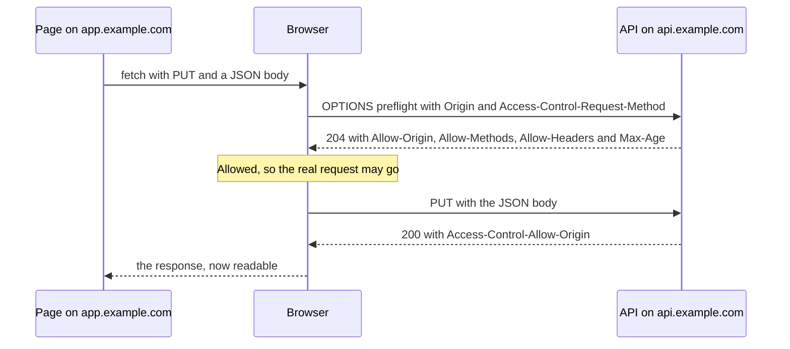

<Info>

**In short:** a browser lets any page *send* requests almost anywhere, but it
controls what a page may *read*, *run* and *embed*. The rules are set by the
browser (the same-origin policy) and relaxed or tightened by the server through
response headers (CORS, CSP, Permissions-Policy and others). When a test fails
with a "blocked" message in the console, one of these rules is nearly always the
reason.

</Info>

## Origins: the unit of trust

An **origin** is three things together: the scheme, the host and the port.

| URL | Same origin as `https://app.example.com/home`? | Why |
|---|---|---|
| `https://app.example.com/other` | Yes | Only the path differs |
| `http://app.example.com/home` | No | Different scheme |
| `https://api.example.com/home` | No | Different host |
| `https://app.example.com:8443/home` | No | Different port |

A **site** is looser: the scheme plus the registrable domain, so `app.example.com`
and `api.example.com` are the same *site* but different *origins*. The
difference matters: CORS and the same-origin policy work on origins, while
SameSite cookies and site isolation work on sites.

A test that opens its page on `http://localhost:3000` and calls an API on
`http://localhost:8080` has two origins, because the ports differ. This is the
commonest source of CORS errors in test setups.

## The same-origin policy

The **same-origin policy** is the browser's oldest rule: a page may freely use
resources from its own origin, but code from one origin may not **read** data
from another.

- Blocked: reading the response of a `fetch` or `XMLHttpRequest` to another origin,
  reading the document of a cross-origin iframe, reading another origin's cookies
  or `localStorage`.
- Allowed: *embedding* a cross-origin image, stylesheet, script or iframe, and
  *sending* a form to another origin. The page just cannot look at the answer.

That last point is the key to understanding web security. The policy hides
answers, it does not stop **requests** from being sent. A hostile page can make
your browser send a request to your bank, with your bank cookies attached. The
answer is hidden from the attacker, but the action may already have happened.
That is a CSRF attack, covered in [web security](/concepts/web-security), and
the reason for `SameSite` cookies later on this page.

## CORS: asking for a bigger window

**Cross-Origin Resource Sharing** (CORS) lets a server say "this other origin is
allowed to read my answers". The server does it with response headers; the
browser does the checking. The server never learns whether the browser accepted
the answer.

There are two paths, depending on how risky the request looks.

### Simple requests

A request is **simple** when it could already have been made by an old-fashioned
HTML form: the method is `GET`, `HEAD` or `POST`, it adds no unusual headers and, for
`POST`, the body type is a form type or plain text. The browser sends it at once,
adds an `Origin` header, and then checks the answer's
`Access-Control-Allow-Origin` header before giving the page access to it.

### Preflighted requests

Anything else (a `PUT` or `DELETE`, a JSON body, a custom header such as
`Authorization`) is **preflighted**. Before the real request the browser sends a
safe question, an `OPTIONS` request, to ask permission.



*A preflighted request. If the preflight answer does not allow the request, the
real one is never sent.*

The headers involved:

| Header | Direction | Meaning |
|---|---|---|
| `Origin` | Request | Who is asking |
| `Access-Control-Request-Method` and `-Headers` | Preflight request | What the real request will use |
| `Access-Control-Allow-Origin` | Response | The one origin allowed, or `*` for anyone |
| `Access-Control-Allow-Methods` and `-Headers` | Preflight response | Which methods and headers are permitted |
| `Access-Control-Allow-Credentials` | Response | `true` lets the page send and read cookies; the origin can then not be `*` |
| `Access-Control-Max-Age` | Preflight response | How many seconds the browser may remember the answer |
| `Access-Control-Expose-Headers` | Response | Extra response headers the page may read |

<Accordion title="The mistakes that cause most CORS failures">

- **Wildcard with credentials.** `Access-Control-Allow-Origin: *` is refused when
  the request carries cookies. The server must name the exact origin and send
  `Vary: Origin`, so that a cache does not hand one origin's answer to another.
- **Preflight answered with an error.** The `OPTIONS` request often never reaches
  the application's routes, so it gets a `404`, a `401` or a redirect, and the
  real request is never made. The console shows a CORS error although the real
  problem is the server.
- **Header missing from the allow list.** Adding an `Authorization` or custom
  header to the call without adding it to `Access-Control-Allow-Headers`.
- **Redirects.** A redirect on a preflighted request is refused.

</Accordion>

<Tip>

CORS is a **browser** rule. A command such as `curl`, or an HTTP client library, is
never blocked by it. When a call works in your HTTP client and fails in the
browser, CORS is the first thing to suspect. It also means a test that only
calls the API directly will not catch a missing CORS header: the page itself
has to make the call.

</Tip>

## Content Security Policy

A **Content Security Policy** (CSP) is a header that tells the browser which
sources a page may load and run from. It is the strongest defence against
**cross-site scripting** (XSS), where an attacker gets their script into your
page, because even if the script is injected, the browser refuses to run it.

```http
Content-Security-Policy: default-src 'self'; script-src 'self' 'nonce-r4nd0m'; img-src 'self' https:; frame-ancestors 'none'; report-to csp
```

| Directive | Controls |
|---|---|
| `default-src` | The fallback for every resource type not listed |
| `script-src`, `style-src` | Where scripts and styles may come from |
| `img-src`, `font-src`, `media-src` | Images, fonts, audio and video |
| `connect-src` | Where `fetch`, `XMLHttpRequest`, WebSocket and EventSource may connect |
| `frame-src`, `frame-ancestors` | Which pages may be framed, and who may frame this one |
| `form-action`, `base-uri` | Where forms may post and what `base` may be set to |

A source is a host (`https://cdn.example.com`), a scheme (`https:`) or a keyword
in quotes: `'self'` (the page's own origin), `'none'`, `'unsafe-inline'`
(allow any inline script or style, which removes most of the protection) and
`'unsafe-eval'` (allow `eval`).

**Nonces and hashes** are how a strict policy still allows the page's own inline
code. The server makes a fresh random value for each response, puts it in the
header (`'nonce-r4nd0m'`) and in the page's own script elements
(`script nonce="r4nd0m"`). An injected script does not know the nonce, so it is
blocked. A `'sha256-...'` source allows one inline script with exactly that
hash. With `'strict-dynamic'`, a script that has a valid nonce may load further
scripts.

**Report-only mode.** The header `Content-Security-Policy-Report-Only` applies the
same policy without enforcing it. The browser runs everything and *reports*
what would have been blocked to a URL named in `report-to` (or the older
`report-uri`). Teams use it to try a new policy on live traffic before they turn
it on.

### Why injected scripts can be blocked

Automation tools often add code to the page: a script element for highlighting,
a recorder overlay, an `eval` call. Under a strict CSP, the browser applies the
policy to that code like any other, and may refuse it. The console then shows
"Refused to execute inline script because it violates the following Content
Security Policy directive".

Scripts a tool sends through the debugging protocol or the driver
([CDP](/concepts/cdp), [WebDriver](/concepts/webdriver)) are evaluated by the
browser as a debugger would, and are **not** subject to the page's policy. The
difference is between *evaluating* a script in the page and *adding* an element
or calling `eval` from page code. If a helper stops working only on sites that
send a strict CSP, this is the first thing to look at.

## Permissions-Policy

**Permissions-Policy** (earlier called Feature-Policy) switches whole browser
features on or off for a page and for the frames inside it:

```http
Permissions-Policy: camera=(), geolocation=(self), microphone=(self "https://meet.example.com")
```

An empty list means "no origin", `self` means the page's own origin. A frame can
use a feature only if the policy allows it *and* the embedding page's `allow`
attribute on the iframe grants it. It is separate from the user's *permission
prompt* (the "allow location?" dialog): the policy decides whether the prompt may
even appear.

In a test, an unexpected permission prompt blocks the page until it is answered.
The DevTools Protocol can grant or deny permissions up front
(`Browser.grantPermissions`), so a run does not wait on a dialog.

## Referrer-Policy

When you follow a link, the browser tells the next site where you came from, in
the `Referer` header (the spelling error is historical). **Referrer-Policy**
decides how much of that address to send: `no-referrer` sends nothing,
`same-origin` only to the same site, and `strict-origin-when-cross-origin` (the
default) sends the full address within a site but only the origin to others, and
nothing when going from https to http.

Why tests care: some servers refuse a request that arrives without the expected
`Referer` (hotlink protection, some login redirects). A test that opens a deep
link directly sends none, which is a different path from clicking through.

## COOP, COEP and CORP: cross-origin isolation

Three headers work together to put a page in its own safe group, so that it can
use powerful features such as `SharedArrayBuffer` and high-resolution timers.

| Header | Set on | Effect |
|---|---|---|
| `Cross-Origin-Opener-Policy` (COOP) | The page | `same-origin` cuts the link (`window.opener`) between the page and windows opened from other origins |
| `Cross-Origin-Embedder-Policy` (COEP) | The page | `require-corp` refuses to load any cross-origin resource that has not opted in |
| `Cross-Origin-Resource-Policy` (CORP) | A resource | `same-origin`, `same-site` or `cross-origin`: who may load this file |

When a page sets COOP `same-origin` and COEP `require-corp`, the browser calls it
**cross-origin isolated** and exposes the strong features. Tests meet it as:
popups that lose `window.opener` (so a flow that depends on the opener breaks),
and images or scripts from a CDN that stop loading because they lack a CORP
header.

## Mixed content and HSTS

**Mixed content** is an https page that loads something over plain http. An
attacker on the network can change an http script and so take over the secure
page. Browsers therefore **block** active mixed content (scripts, frames,
fetches) and upgrade or warn about passive content such as images. The header
`Content-Security-Policy: upgrade-insecure-requests` asks the browser to
rewrite every http link on the page to https.

**HSTS** (HTTP Strict Transport Security) is a header on an https response that
tells the browser "only ever use https for this host":

```http
Strict-Transport-Security: max-age=31536000; includeSubDomains; preload
```

For `max-age` seconds the browser rewrites `http://` to `https://` before
sending anything, and it will not let the user click through a certificate error
for that host. For tests: a host that has sent HSTS once keeps forcing https in
that browser profile, so a staging site switched back to plain http seems broken
until the profile is new. `localhost` is treated as a secure context and needs
neither. A fresh profile per run avoids the stale rule; see
[sandboxing and isolation](/concepts/sandboxing).

## SameSite cookies

The `SameSite` attribute decides whether a cookie is sent on requests that
begin on **another site**.

| Value | Sent on cross-site requests? | Typical use |
|---|---|---|
| `Strict` | Never | Banking sessions |
| `Lax` (the default when the attribute is missing) | Only for top-level navigations with a safe method, such as clicking a link | Ordinary logins |
| `None` | Always, but the cookie must also be `Secure` | Embedded widgets, single sign-on across sites |

`Lax` as the default is what stops the classic CSRF attack: a hostile page can
still send a form `POST`, but your session cookie no longer goes with it. For
tests it explains why a login that works in a direct visit is lost when the page
is loaded inside an iframe, or after a cross-site redirect with a `POST`. See
[sessions, cookies and storage](/concepts/sessions-and-state) for the cookie
attributes `Secure`, `HttpOnly` and the `__Host-` prefix.

## What each rule means for a test

| You see | Likely rule | First thing to try |
|---|---|---|
| "blocked by CORS policy" | CORS | Check the preflight (`OPTIONS`) answer and the allowed origin |
| "Refused to execute inline script" | CSP | Look at the `Content-Security-Policy` response header |
| An iframe stays blank | CSP `frame-ancestors` or `X-Frame-Options` | See which header the framed page sends |
| A popup has no opener | COOP | Look for `Cross-Origin-Opener-Policy` |
| An image or script does not load on an https page | Mixed content or CORP | Open the console for the exact message |
| Login lost after a redirect | SameSite | Check the cookie's `SameSite` and `Secure` attributes |
| Page forced to https | HSTS | Use a fresh profile |

## How seleniumbase-rs uses it

The library does not weaken CORS or the same-origin policy. It can, on request,
remove the Content Security Policy, which is the one that most often gets in the
way of an injected helper.

- **Disable CSP.** `BrowserConfig::with_disable_csp(true)` is the launch switch
  `--disable-csp` (also written `--dcsp` or `--no-csp`; `disable_csp`, `dcsp` and
  `no_csp` in the Python-style names). The doc comment says it strips the Content
  Security Policy from every response, Chromium only. It is done with a bundled
  browser extension (see [browser extensions](/concepts/browser-extensions));
  for Firefox the same switch sets the preference `security.csp.enable` to false.
- **Stealth policy.** The stealth layer has a `disable_csp` option in its policy
  (`Fingerprint::disable_csp(bool)`) and a `grant_permissions` option that grants
  the browser's permission prompts ahead of time. See
  [detection and spoofing](/concepts/detection).
- **Reading and rewriting headers.** Network interception in the pure CDP engine
  can look at and change responses, so a test can add a CORS header to a
  response or drop a framing header. See [network](/concepts/network).

<Warning>

Turning CSP off makes the page behave differently from production. A test that
passes with CSP disabled can hide the very blocked-script bug your users will
see. Use it for tools that must inject code into pages you do not control, and
run your own application's tests with its real policy on.

</Warning>

## Where to go next

<Columns cols={2}>

<Card title="Web security" icon="shield-halved" color="#d52c36" href="/concepts/web-security">
  The attacks these policies defend against, and the security headers to check.
</Card>

<Card title="Authentication" icon="key" color="#1a85d4" href="/concepts/authentication">
  Cookies, tokens and logins, where SameSite and CORS credentials matter most.
</Card>

<Card title="Network" icon="network-wired" color="#a631be" href="/concepts/network">
  Seeing and changing the requests and headers a page sends.
</Card>

<Card title="Glossary" icon="book" color="#199f43" href="/glossary">
  Short definitions of every term used in these pages.
</Card>

</Columns>
