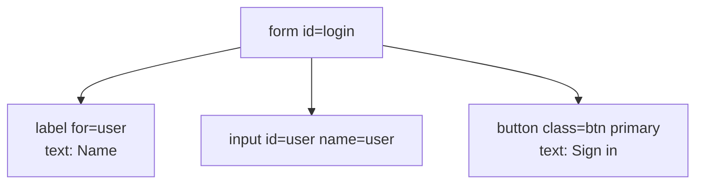

<Info>

**In short:** the browser turns a page's HTML into a tree of objects, the
**DOM**. A **selector** is a short text that describes where one element sits in
that tree or what it looks like. Every click, every typed word and every
assertion in a test starts with a selector, so a test is only as stable as its
selectors.

</Info>

## The DOM: a page as a tree

The browser reads HTML text and builds a tree of **nodes**. Most are
**elements** (a `div`, a `button`), some are text, and the top one is the
`document`.

```html
<form id="login">
  <label for="user">Name</label>
  <input id="user" name="user" type="text">
  <button class="btn primary" type="submit">Sign in</button>
</form>
```



*The DOM of that HTML. Each box is an element with attributes; the button has a
text child.*

The DOM is **alive**. JavaScript adds, removes and changes nodes after the page
has loaded, and the browser repaints. What you see is the DOM now, not the HTML
file the server sent. That is why "View source" and the Elements panel of the
developer tools can disagree, and why a test must wait for the element it wants
to exist (see [JavaScript, events and waiting](/concepts/javascript-and-events)).

An element has **attributes** (`id`, `class`, `name`, `type`, `href`, any
`data-*`), **text**, and a position among its **parent**, **children** and
**siblings**. A selector uses some of these.

## The ways to point at an element

<Tabs>

<Tab title="CSS selectors" icon="code">

The language the browser also uses to style pages. It is short and fast, and it
is the default in seleniumbase-rs.

| Selector | Means |
|---|---|
| `#user` | The element whose `id` is `user` |
| `.btn` | Elements with the class `btn` |
| `button` | Every `button` |
| `input[name="user"]` | An `input` whose `name` attribute is `user` |
| `form#login .primary` | A `.primary` anywhere inside `form#login` |
| `form > button` | A `button` that is a direct child of a `form` |
| `label + input` | An `input` right after a `label` |
| `li:nth-child(2)` | The second item of its parent |
| `[data-testid="save"]` | Any element with that attribute |

CSS can go down the tree and across to a following sibling. It cannot go up to
a parent and it cannot test an element's text.

</Tab>

<Tab title="XPath" icon="sitemap">

A query language for the tree, older and stronger than CSS.

| Expression | Means |
|---|---|
| `//button` | Any `button` in the document |
| `//input[@name="user"]` | An `input` with that `name` |
| `//button[text()="Sign in"]` | A `button` whose text is exactly "Sign in" |
| `//button[contains(., "Sign")]` | A `button` whose text contains "Sign" |
| `//input[@id="user"]/parent::form` | The parent of that input |
| `(//a)[2]` | The second link in the whole document |

XPath can go up (`parent::`, `ancestor::`) and can match on text, which CSS
cannot. It is longer, more brittle to layout changes and slower to read.

</Tab>

<Tab title="Text and link selectors" icon="font">

Sometimes the best handle is what a person reads. A **link text** selector
finds an `a` element by its visible text (`link=Sign in` finds the link whose
text is exactly that), and **partial link text** finds it by a part of the text
(`p_text=Sign`). Text is the part of a page that changes least when a
developer restyles it, and the part that changes most when the site is
translated.

</Tab>

</Tabs>

## How seleniumbase-rs reads a selector

You pass one string and the library works out which kind it is. The rules are in
`Selector::auto` (`src/utils/selectors.rs`), checked in this order:

<Steps>

<Step title="A partial-link-text prefix?" icon="magnifying-glass">

`p_text=Sign` is a link whose text contains "Sign".

</Step>

<Step title="A link-text prefix?" icon="link">

`link=Sign in` (and `text=Sign in`) is a link with exactly that text.
Everything after the prefix is the text, even if it looks like XPath. The
prefix is matched exactly: `LINK=Home` is read as CSS.

</Step>

<Step title="Does it start like XPath?" icon="sitemap">

A string that begins with `/`, `./`, `../` or `(`, is `..`, or begins with an
axis such as `parent::` or `ancestor::`, is XPath.

</Step>

<Step title="Otherwise it is CSS" icon="code">

Nothing that is valid CSS can start any of the ways above, so CSS is the
fallback. `is_xpath_selector` and `is_link_text_selector` expose the checks.

</Step>

</Steps>

For more than a string, the pure CDP engine builds on `SelectorBuf`. It has
constructors for each kind (`SelectorBuf::css`, `xpath`, `link_text`,
`partial_link_text`) and for what people read (`containing_text`, `text`,
`has_text`, `label` and `role`, which finds an element by its accessible role
and name). `xpath_to_css` converts a simple XPath expression into CSS.

A `Locator` (`page.locator("form#login")`) holds a selector and does not look
anything up until you act. You narrow it with `locator()` on the result,
`nth(i)`, `first()`, `last()`, `visible()` or `parent()`, count the matches
with `count()`, and read them with `text()`, `attribute(name)`, `is_visible()`
or `exists()`. An action acts on the **first** match.

<Tabs>

<Tab title="Pure CDP engine" icon="bolt">

```rust,ignore src/main.rs
let form = page.locator("form#login");            // CSS, nothing looked up yet
form.locator("input[name=user]").type_text("alice").await?;
form.locator("//button[text()='Sign in']").click().await?;   // XPath, found by the leading //
let links = page.locator("link=Help").count().await?;        // link text
```

</Tab>

<Tab title="WebDriver engine" icon="plug">

```rust,ignore src/main.rs
sb.type_text("input[name=user]", "alice").await?;
sb.click("//button[text()='Sign in']").await?;
sb.click("link=Help").await?;
```

</Tab>

</Tabs>

## Shadow DOM

A **web component** can hide its inner structure in a **shadow root**: a
separate small tree attached to a host element. A normal selector stops at the
host, because the shadow tree is not part of the main one. Selectors do not cross
the boundary on their own.

```html
<my-app>
  #shadow-root (open)
    <form class="form"><input></form>
</my-app>
```

- The **WebDriver engine** adds a piercing combinator, `::shadow`. The selector
  `my-app ::shadow .form ::shadow input` is split at each `::shadow`, and a
  script walks from the document into each host's shadow root in turn. Only
  **open** shadow roots can be entered; a **closed** one hides its contents
  from every script.
- The **pure CDP engine** has no shadow-piercing selector in this version. To
  reach into a shadow root there, run a script with `Page::evaluate`.
- The [companion extension](/ecosystem/browser-extension) records a click on a
  shadow element as a click on the shadow **host**, because that is what an
  outside selector can name.

See also the glossary entry [Shadow DOM](/glossary#shadow-dom) and the later
section on [web components](/concepts/modern-web#web-components-and-shadow-dom).

## Iframes

An `iframe` is a whole other document inside the page. Its elements are not in
the parent's DOM: a selector run in the parent does not see them, and a selector
run inside the frame does not see the parent. In WebDriver you **switch into**
the frame, work there, and switch back out.

```rust,ignore src/main.rs
sb.switch_to_frame("iframe#payment").await?;     // the selector names the frame element
sb.type_text("#card", "4242 4242 4242 4242").await?;
```

`BaseCase::switch_to_frame(css)` switches into the frame that `css` selects, and
`switch_to_frame_of_element` does the same for an element you already hold. A
cross-site frame is also drawn by a separate browser process (see
[browser architecture](/concepts/browser-architecture#site-isolation-and-the-sandbox)),
which is why the DevTools Protocol treats it as its own target.

## Why selectors break

Most broken tests are broken selectors. The page changed; the test did not.

| Selector | Why it breaks | Better |
|---|---|---|
| `div.container > div:nth-child(3) > span` | Any extra wrapper or reordered row moves it | A selector that names the thing itself |
| `.css-1x2y3z4` or `.btn-a8f3` | Generated class names change on every build | A stable attribute |
| `//*[@id="root"]/div/div[2]/button` | A path from the top breaks when the layout does | `//button[text()='Save']` |
| `button` | Matches the first of many | Add a hook, or narrow with a parent |
| `#next` where the id is reused | The page now has two | Check the match count |
| `link=Sign in` | A translation or a copy edit changes the text | Fine if the text is the contract; otherwise a `data-` attribute |

<Check>

**Writing stable selectors.** In order of preference: a dedicated test hook
(`data-testid="save"`, `data-test`, `data-qa`); a stable `id` or `name`; an
accessible role and name (`button` named "Save"), because that is also what a
screen reader sees; the visible text of a link or button; and last a short CSS
path anchored on something that does not move. Avoid positions (`nth-child`),
generated class names and long paths. Always check that the selector matches
**one** element before relying on it.

</Check>

## Waiting for the DOM

A selector describes where to look, not when. Right after a click, the new
element may not exist yet, and an element that is there may be covered by
another. The pure CDP `Locator` looks the element up again each time and waits
for it (see [actionability](/concepts/javascript-and-events#auto-waiting-and-actionability)),
so it cannot hold a reference that has gone stale. In the WebDriver engine a
found element is a **reference** that can go stale when the page redraws, which
is why `BaseCase` methods take a selector and find it again (see
[element references](/concepts/webdriver#element-references)).

The companion extension's inspector shows, for a picked element, every selector
it can think of in order of preference together with **how many elements each
one matches**, and the recorder only writes selectors it has checked in the
page. See [Browser extension](/ecosystem/browser-extension).

## Where to go next

<Columns cols={2}>

<Card title="JavaScript, events and waiting" icon="bolt" color="#1a85d4" href="/concepts/javascript-and-events">
  What happens between a selector and a click.
</Card>

<Card title="Modern web technologies" icon="layer-group" color="#199f43" href="/concepts/modern-web">
  Web components, single-page apps and other things that move the DOM.
</Card>

<Card title="Browser architecture" icon="sitemap" color="#d47628" href="/concepts/browser-architecture">
  Frames, targets and the processes behind them.
</Card>

<Card title="WebDriver and drivers" icon="plug" color="#a631be" href="/concepts/webdriver">
  Element references and how they go stale.
</Card>

</Columns>
