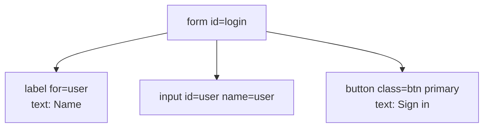
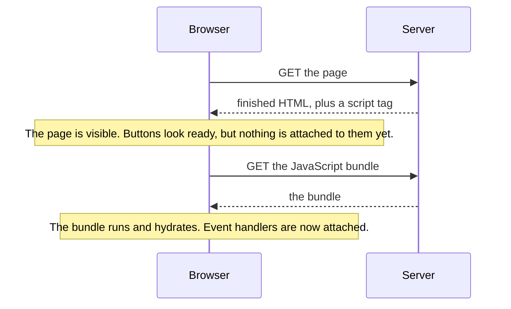

<Info>

**In short:** the browser turns a page's HTML into a tree of objects, the
**DOM**. A **selector** is a short text that describes where one element sits in
that tree or what it looks like. Every click, every typed word and every
assertion in a test starts with a selector, so a test is only as stable as its
selectors. A test never sees the source code of a site, only the DOM the browser
built from it, and different frameworks build different DOMs from the same
design: some add generated class names that change every build, some add
attributes you must ignore, some fill the page in only after JavaScript runs.
Selectors that name what a user sees or what the team marked on purpose
(`data-testid`, roles, labels, text) survive all of that. Selectors that copy
what the framework happened to generate do not.

</Info>

## The DOM: a page as a tree

The browser reads HTML text and builds a tree of **nodes**. Most are
**elements** (a `div`, a `button`), some are text, and the top one is the
`document`.

```html
<form id="login">
  <label for="user">Name</label>
  <input id="user" name="user" type="text">
  <button class="btn primary" type="submit">Sign in</button>
</form>
```



*The DOM of that HTML. Each box is an element with attributes; the button has a
text child.*

The DOM is **alive**. JavaScript adds, removes and changes nodes after the page
has loaded, and the browser repaints. What you see is the DOM now, not the HTML
file the server sent. That is why "View source" and the Elements panel of the
developer tools can disagree, and why a test must wait for the element it wants
to exist (see [JavaScript, events and waiting](/concepts/javascript-and-events)).

An element has **attributes** (`id`, `class`, `name`, `type`, `href`, any
`data-*`), **text**, and a position among its **parent**, **children** and
**siblings**. A selector uses some of these.

## The ways to point at an element

<Tabs>

<Tab title="CSS selectors" icon="code">

The language the browser also uses to style pages. It is short and fast, and it
is the default in seleniumbase-rs.

| Selector | Means |
|---|---|
| `#user` | The element whose `id` is `user` |
| `.btn` | Elements with the class `btn` |
| `button` | Every `button` |
| `input[name="user"]` | An `input` whose `name` attribute is `user` |
| `form#login .primary` | A `.primary` anywhere inside `form#login` |
| `form > button` | A `button` that is a direct child of a `form` |
| `label + input` | An `input` right after a `label` |
| `li:nth-child(2)` | The second item of its parent |
| `[data-testid="save"]` | Any element with that attribute |

CSS can go down the tree and across to a following sibling. It cannot go up to
a parent and it cannot test an element's text.

</Tab>

<Tab title="XPath" icon="sitemap">

A query language for the tree, older and stronger than CSS.

| Expression | Means |
|---|---|
| `//button` | Any `button` in the document |
| `//input[@name="user"]` | An `input` with that `name` |
| `//button[text()="Sign in"]` | A `button` whose text is exactly "Sign in" |
| `//button[contains(., "Sign")]` | A `button` whose text contains "Sign" |
| `//input[@id="user"]/parent::form` | The parent of that input |
| `(//a)[2]` | The second link in the whole document |

XPath can go up (`parent::`, `ancestor::`) and can match on text, which CSS
cannot. It is longer, more brittle to layout changes and slower to read.

</Tab>

<Tab title="Text and link selectors" icon="font">

Sometimes the best handle is what a person reads. A **link text** selector
finds an `a` element by its visible text (`link=Sign in` finds the link whose
text is exactly that), and **partial link text** finds it by a part of the text
(`p_text=Sign`). Text is the part of a page that changes least when a
developer restyles it, and the part that changes most when the site is
translated.

</Tab>

</Tabs>

## Shadow DOM and Web Components

**Web Components** are the browser's native way to make reusable elements:
custom tags such as `my-card`, defined with JavaScript. A component can attach a
**shadow root**, a separate small tree attached to a host element, so that its
insides cannot be damaged by the page around it. Styles and selectors from
outside do not reach in, and a normal selector stops at the host, because the
shadow tree is not part of the main one.

- An **open** shadow root can be entered by script (`element.shadowRoot`).
- A **closed** shadow root cannot be entered from page script, and not by
  WebDriver or CDP either: it hides its contents from every script.
- Content passed in from outside appears through **slots**.

```html
<my-app>
  #shadow-root (open)
    <form class="form"><input></form>
</my-app>
```

Search boxes, date pickers, video players and design systems from large
companies are often built this way. How each tool crosses the boundary:

- The **WebDriver engine** adds a piercing combinator, `::shadow`, as in
  `sb.shadow_click("my-app ::shadow button")`. The selector
  `my-app ::shadow .form ::shadow input` is split at each `::shadow`, and a
  script walks from the document into each host's shadow root in turn. Only
  **open** shadow roots can be entered.
- The **pure CDP engine** has no shadow-piercing selector in this version. To
  reach into a shadow root there, run a script with `Page::evaluate`.
- The [companion extension](/ecosystem/browser-extension) records a click on a
  shadow element as a click on the shadow **host**, because that is what an
  outside selector can name.

See the [Shadow DOM guide](/tutorials/shadow_dom), the
[Selectors guide](/tutorials/selectors#shadow-dom), the glossary entry
[Shadow DOM](/glossary#shadow-dom) and the
[web components](/concepts/modern-web#web-components-and-shadow-dom) entry of
the modern web page.

## Iframes

An `iframe` is a whole other document inside the page. Its elements are not in
the parent's DOM: a selector run in the parent does not see them, and a selector
run inside the frame does not see the parent. In WebDriver you **switch into**
the frame, work there, and switch back out.

```rust,ignore src/main.rs
sb.switch_to_frame("iframe#payment").await?;     // the selector names the frame element
sb.type_text("#card", "4242 4242 4242 4242").await?;
```

`BaseCase::switch_to_frame(css)` switches into the frame that `css` selects, and
`switch_to_frame_of_element` does the same for an element you already hold. A
cross-site frame is also drawn by a separate browser process (see
[browser architecture](/concepts/browser-architecture#site-isolation-and-the-sandbox)),
which is why the DevTools Protocol treats it as its own target.

## One page, three DOMs

The **DOM** (Document Object Model) is the live tree of elements the browser
keeps for a page. Tests, scripts and developer tools all work on it, not on the
HTML file. How it comes to exist is the first difference between sites.

<Tabs>

<Tab title="Server-rendered" icon="server">

The backend sends finished HTML. The DOM is what the HTML said, plus whatever
small scripts change afterwards. Every element is there when the load event
fires, so "page loaded" nearly means "content ready". PHP, Rails, Django and
most static sites work like this.

</Tab>

<Tab title="Client-rendered (SPA)" icon="window-maximize">

The backend sends an almost empty shell, for example one empty `div` with the id
`root`, and a JavaScript bundle. The bundle runs, fetches data as JSON and
**creates the DOM in the browser**. The load event fires while the page is still
empty, so a test has to wait for the content, not for the load. Clicking a link
may change the URL without loading a new document.

</Tab>

<Tab title="Server-rendered, then hydrated" icon="droplet">

The server sends finished HTML **and** the same JavaScript bundle. The page
looks ready at once, then the bundle runs and *hydrates* it: it attaches event
handlers to the existing elements. Next.js and Nuxt do this by default. Between
the two moments the page is visible but not yet interactive.

</Tab>

</Tabs>

See [how a page loads](/concepts/how-a-page-loads) for the events involved, and
[Frontends, backends and APIs](/concepts/frontends-backends-and-apis) for where
the HTML comes from.

## What each framework leaves in the DOM

Frameworks are libraries that keep the screen in step with the application's
data. To do that they add their own markers, and these markers are the first
thing a copied selector latches on to. This table shows what you will meet; the
exact names depend on the version and the build.

| Framework | How it updates the page | What it leaves in the DOM |
|---|---|---|
| **Plain HTML** | Nothing; scripts change the DOM by hand | Exactly what the author wrote, including stable `id` values |
| **React** | Keeps a *virtual DOM* (a light copy in memory), compares the old and new copy on each change and applies only the difference | No attributes of its own in production. Class names are often generated: `Button_primary__3xYz` (CSS Modules), `css-1x2y3z` (Emotion), `sc-bdfBwQ` (styled-components). Ids from `useId` look like `:r1:` |
| **Vue** | Reactive data triggers updates; templates compile to render functions | Scoped styles add an attribute such as `data-v-7ba5bd90` to every element of a component. A false `v-if` leaves a comment node in the DOM |
| **Angular** | Components with templates; *zones* (a library that wraps browser timers and events) tell it when to check for changes | Attributes such as `_ngcontent-abc-c123` on elements and `_nghost-abc-c123` on component hosts, an `ng-version` attribute on the root, and in development builds `ng-reflect-*` |
| **Svelte** | A *compiler*: it turns components into plain DOM code at build time, with no virtual DOM at run time | Scoped class names such as `svelte-1abc23x` added to your selectors' targets |
| **Next.js** (React) and **Nuxt** (Vue) | Server rendering plus hydration, and often routing without full page loads | A root such as `__next` or `__nuxt`, and a script tag holding the data the server used (`__NEXT_DATA__` in Next.js) |
| **Web Components** | The browser's own custom elements, with optional private DOM | Custom tags such as `my-card`, and *shadow roots* that hide their insides from ordinary selectors |

A few details that matter in practice:

- **Generated names change.** The hash in `Button_primary__3xYz` is derived from
  the file and its contents. Rename a file or upgrade the build tool and every
  such selector breaks, though nothing a user sees has changed.
- **Structure shifts.** A framework may wrap a component in extra `div`
  elements, and an A/B test may reorder a page. A selector that counts
  `div > div > div:nth-child(3)` breaks with it.
- **Portals and teleports.** A modal is often moved to the end of `body`, away
  from the button that opened it. A selector that starts at the button's parent
  will not find the dialog.
- **Virtualised lists.** Long lists (and "infinite scroll") may keep only the
  visible rows in the DOM. Row 80 does not exist until you scroll.
- **Controlled inputs.** React and similar frameworks watch input events, not
  the field's value. Setting `input.value = "x"` from a script changes what is on
  screen but not what the framework knows, so the next render may erase it. Real,
  trusted keystrokes fire the events the framework listens for.

## Hydration and why clicks get lost



*Server rendering with hydration. The gap between the two notes is where a very
early click does nothing.*

A test that clicks as soon as the button is visible can click inside that gap.
The click is delivered, but no handler is attached, so nothing happens and the
test fails for no visible reason. Remedies, from best to worst:

1. **Wait for the effect, not for the clock.** Click, then wait for the thing the
   click should cause. If it does not appear, click again, a few times at most.
2. Wait for a signal the app gives when it is ready, if the team can add one (an
   attribute set after hydration, or a network request that the page makes only
   once it is interactive).
3. Do not add a fixed `sleep`. It is slow when the page is fast and still fails
   when the page is slow.

**Hydration mismatches** are a related bug. If the HTML the server made differs
from what the browser would build (a date formatted in two time zones, a random
id, a value that depends on `window`), the framework warns in the console and may
rebuild the part of the page, discarding what a test just typed. A `Console`
error about hydration in a test run is worth reading (see
[developer tools](/concepts/cdp#the-console-in-depth)).

## Why selectors break

Most broken tests are broken selectors. The page changed; the test did not.

| Selector | Why it breaks | Better |
|---|---|---|
| `div.container > div:nth-child(3) > span` | Any extra wrapper or reordered row moves it | A selector that names the thing itself |
| `.css-1x2y3z4` or `.btn-a8f3` | Generated class names change on every build | A stable attribute |
| `//*[@id="root"]/div/div[2]/button` | A path from the top breaks when the layout does | `//button[text()='Save']` |
| `button` | Matches the first of many | Add a hook, or narrow with a parent |
| `#next` where the id is reused | The page now has two | Check the match count |
| `link=Sign in` | A translation or a copy edit changes the text | Fine if the text is the contract; otherwise a `data-` attribute |

### Why a selector works on one site and not on another

A selector is a question asked of the DOM. It fails when the answer changes, and
the usual reasons are these:

| Symptom | Likely cause |
|---|---|
| Worked yesterday, fails after a deploy | A generated class name or attribute changed with the build |
| Finds nothing, though you see the element | It is in an iframe, in a shadow root, in a portal, or not rendered yet |
| Finds the wrong element | The selector is too loose: the same class is used in several places, or a list reorders |
| Works in the console, fails in the test | The test ran before the content was created (client rendering), or clicked before hydration |
| Works on staging, fails in production | Different build, different feature flags, or an A/B variant |
| Fails only at some window sizes | The site shows different markup on small screens |

`diagnose_selector` (an MCP tool) answers this question for a given selector: it
reports invalid syntax, no match, matches that are hidden, off screen, disabled
or covered, matches inside an iframe or a shadow root, and near misses such as a
similar id. `suggest_selectors` proposes ones that work and `inspect_page` outlines the
page. See [developer tools](/concepts/cdp#debugging-tools-for-mcp-clients).

## Stable strategies

Choose selectors by what is **meaningful and intended**, in this order:

1. **A test attribute the team owns**: `data-testid`, `data-test` or `data-qa`.
   They exist only for tests, so nobody changes them by accident. If the
   application has none, ask for them; it is the cheapest fix.
2. **Role and accessible name.** A "Sign in" button has the role `button` and
   the name "Sign in" whatever markup produced it. These are the same facts that
   screen readers use, so a selector built on them also checks that the page is
   accessible.
3. **Label or visible text.** A field is "the one labelled Email". A button is
   "the one that says Add to cart". Users find the page this way, so tests
   written this way follow what users see, and they survive restyling.
4. **A stable `id` or `name`**, if the application writes them by hand. Ignore
   ids a framework generates.
5. **Short CSS structure** only as a last resort, and never a long chain or a
   position (`nth-child`).

Avoid anything copied from a framework's output: hashed class names, `data-v-*`,
`_ngcontent-*`, `svelte-*`, and `css-*` classes. Whichever you choose, check that
the selector matches **one** element before you rely on it.

<Tip>

Browser developer tools can copy a selector or XPath for the element you
inspect. Treat the result as a starting point: it usually names a long path of
generated classes. Replace it with a test attribute or a role before you keep it.

</Tip>

## Waiting for the DOM

A selector describes where to look, not when. Right after a click, the new
element may not exist yet, and an element that is there may be covered by
another. The pure CDP `Locator` looks the element up again each time and waits
for it (see [actionability](/concepts/javascript-and-events#auto-waiting-and-actionability)),
so it cannot hold a reference that has gone stale. In the WebDriver engine a
found element is a **reference** that can go stale when the page redraws, which
is why `BaseCase` methods take a selector and find it again (see
[element references](/concepts/webdriver#element-references)).

The companion extension's inspector shows, for a picked element, every selector
it can think of in order of preference together with **how many elements each
one matches**, and the recorder only writes selectors it has checked in the
page. See [Browser extension](/ecosystem/browser-extension).

## How seleniumbase-rs reads a selector

You pass one string and the library works out which kind it is. The rules are in
`Selector::auto` (`src/utils/selectors.rs`), checked in this order:

<Steps>

<Step title="A partial-link-text prefix?" icon="magnifying-glass">

`p_text=Sign` is a link whose text contains "Sign".

</Step>

<Step title="A link-text prefix?" icon="link">

`link=Sign in` (and `text=Sign in`) is a link with exactly that text.
Everything after the prefix is the text, even if it looks like XPath. The
prefix is matched exactly: `LINK=Home` is read as CSS.

</Step>

<Step title="Does it start like XPath?" icon="sitemap">

A string that begins with `/`, `./`, `../` or `(`, is `..`, or begins with an
axis such as `parent::` or `ancestor::`, is XPath.

</Step>

<Step title="Otherwise it is CSS" icon="code">

Nothing that is valid CSS can start any of the ways above, so CSS is the
fallback. `is_xpath_selector` and `is_link_text_selector` expose the checks.

</Step>

</Steps>

For more than a string, the pure CDP engine builds on `SelectorBuf`. It has
constructors for each kind (`SelectorBuf::css`, `xpath`, `link_text`,
`partial_link_text`) and for what people read (`containing_text`, `text`,
`has_text`, `label` and `role`, which finds an element by its accessible role
and name). `xpath_to_css` converts a simple XPath expression into CSS.

A `Locator` (`page.locator("form#login")`) holds a selector and does not look
anything up until you act. You narrow it with `locator()` on the result,
`nth(i)`, `first()`, `last()`, `visible()` or `parent()`, count the matches
with `count()`, and read them with `text()`, `attribute(name)`, `is_visible()`
or `exists()`. An action acts on the **first** match.

<Tabs>

<Tab title="Pure CDP engine" icon="bolt">

```rust,ignore src/main.rs
let form = page.locator("form#login");            // CSS, nothing looked up yet
form.locator("input[name=user]").type_text("alice").await?;
form.locator("//button[text()='Sign in']").click().await?;   // XPath, found by the leading //
let links = page.locator("link=Help").count().await?;        // link text
```

</Tab>

<Tab title="WebDriver engine" icon="plug">

```rust,ignore src/main.rs
sb.type_text("input[name=user]", "alice").await?;
sb.click("//button[text()='Sign in']").await?;
sb.click("link=Help").await?;
```

</Tab>

</Tabs>

### Prefixes, the Selector enum and role selectors

Every method that takes a selector reads a plain string and works out its kind
from how it begins (`Selector::auto` in `src/utils/selectors.rs`):

| The string begins with | Kind |
|---|---|
| `/`, `./`, `../`, `(`, or an XPath axis such as `parent::` | XPath |
| `link=`, `link_text=` or `text=` | Link text, exactly |
| `partial_link=`, `partial_link_text=`, `partial_text=`, `p_link=`, `p_link_text=` or `p_text=` | Link text, containing |
| Anything else | CSS |

The prefixes are matched exactly, so `LINK=Home` is CSS. To state the kind
yourself, use the `Selector` enum (`Css`, `XPath`, `LinkText`, `PartialLinkText`
and `Id`; an `Id` needs no escaping, which helps with ids such as `:r1:`) or the
owning type `SelectorBuf`, which the pure CDP engine takes in `Page::locator`.

`SelectorBuf` also has constructors for the stable strategies above. They build
XPath for you, as approximations of Playwright's `getByText`, `getByLabel` and
`getByRole`:

| Constructor | Finds |
|---|---|
| `SelectorBuf::text(text, exact)` | The innermost elements that show the text, ignoring ASCII case unless `exact`; `input` buttons match by their value |
| `SelectorBuf::label(text, exact)` | Form controls by their `label`, wrapping `label` or `aria-label` |
| `SelectorBuf::role(role, name, exact)` | Elements with the ARIA role, set explicitly or implied by the tag (`button`, `a` with `href` for `link`, `h1` to `h6` for `heading`), and optionally an accessible name taken from `aria-label`, text, `value`, `title`, `alt` or a label |
| `SelectorBuf::containing_text(text, tag)` | Elements of a tag whose text contains the text |
| `SelectorBuf::has_text(text)` | Keeps the matches of a previous selector whose text contains the text |

Their limits are written in their documentation: `aria-labelledby` is not
followed, and roles that depend on context, hidden elements and states such as
`checked` are not covered.

<Tabs>

<Tab title="Pure CDP engine" icon="bolt">

```rust,ignore src/main.rs
use seleniumbase_rs::utils::selectors::SelectorBuf;

// A test attribute: the most stable choice.
page.locator("[data-testid='checkout']").click().await?;

// By role and accessible name, whatever markup the framework made.
page.locator(SelectorBuf::role("button", Some("Sign in"), false)).click().await?;

// By the text a user reads.
page.locator(SelectorBuf::text("Add to cart", true)).click().await?;
```

A `Locator` is lazy: it looks the element up again each time it acts, and waits
for it, so a re-render in between does not leave it holding a stale element.

</Tab>

<Tab title="BaseCase" icon="flask">

```rust,ignore src/main.rs
// The prefix says what kind of selector this is.
sb.click("[data-testid='checkout']").await?;
sb.click("link=Sign up").await?;
sb.assert_text_visible("$42.00", "[data-testid='total']").await?;
```

See the [Selectors guide](/tutorials/selectors) for every form and for
shadow DOM, and [Best practices](/best-practices) for the habits around them.

</Tab>

</Tabs>

<Note>

The library cannot make a selector stable for you. It can tell you why one
failed (`diagnose_selector`), suggest others (`suggest_selectors`) and run
`audit_page`, which reports missing labels and names; those are the same
problems that make role- and label-based selectors fail.

</Note>

## Where to go next

<Columns cols={2}>

<Card title="JavaScript, events and waiting" icon="bolt" color="#1a85d4" href="/concepts/javascript-and-events">
  What happens between a selector and a click.
</Card>

<Card title="Modern web technologies" icon="layer-group" color="#199f43" href="/concepts/modern-web">
  Web components, single-page apps and other things that move the DOM.
</Card>

<Card title="Browser architecture" icon="sitemap" color="#d47628" href="/concepts/browser-architecture">
  Frames, targets and the processes behind them.
</Card>

<Card title="WebDriver and drivers" icon="plug" color="#a631be" href="/concepts/webdriver">
  Element references and how they go stale.
</Card>

<Card title="Selectors guide" icon="crosshairs" color="#1a85d4" href="/tutorials/selectors">
  Every selector form, shadow DOM and XPath to CSS.
</Card>

<Card title="How a page loads" icon="globe" color="#1a85d4" href="/concepts/how-a-page-loads">
  The load events that client rendering and hydration come after.
</Card>

</Columns>
