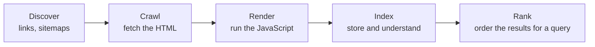

<Info>

**In short:** a search engine sends a bot to fetch your pages, stores what it
understands, and ranks the stored pages for each query. SEO (search engine
optimisation) is making the first two steps easy and the page worth showing in
the third. Most of the basics are plain facts in the HTML, such as the title,
the canonical link and the robots tag, so a browser test can check them and
catch the expensive mistakes before they ship.

</Info>

## Crawl, index, rank



*The path of a page into search results.*

<Steps>

<Step title="Discover and crawl" icon="spider">

The bot starts from known pages, follows their links, and reads the URLs in
your **sitemap**. It fetches each page with an ordinary HTTP request, as a
browser would (see [how a page loads](/concepts/how-a-page-loads)), and obeys
your `robots.txt`.

</Step>

<Step title="Render" icon="display">

Modern search bots run a Chromium-based browser to execute the page's
JavaScript, so content that scripts add can be seen. This happens after the
crawl, in a queue, and costs the engine resources. Not every bot does it.

</Step>

<Step title="Index" icon="database">

The engine reads the text, the title, the headings, the links, the language and
the structured data, decides which URL is the main copy of the content (the
**canonical**), and stores the result. A page can be crawled and still not be
indexed, because it is a duplicate, thin or told not to be.

</Step>

<Step title="Rank" icon="ranking-star">

For each query the engine picks matching pages and orders them by relevance and
quality: how well the content answers the question, how many trusted sites link
to it, and signals about the page experience such as speed and mobile
friendliness. Nobody outside the engine knows the exact recipe, and no setting
guarantees a position.

</Step>

</Steps>

## What a page must say

Almost everything below is in the `head` of the HTML.

| Element | What it is for | Rules of thumb |
|---|---|---|
| `title` | The headline in results and in the browser tab. The strongest on-page signal | Unique on each page, specific, about 50 to 60 characters (longer is cut off) |
| `meta name="description"` | The summary under the headline. Not a ranking factor, but it changes whether people click | About 150 to 160 characters, written for a person. The engine may rewrite it |
| `h1` and the other headings | The outline of the page | One `h1`; levels in order |
| `html lang` | The language of the text | Always set |
| `link rel="canonical"` | The preferred URL for this content | Absolute, one per page, normally pointing to itself |
| `meta name="robots"` | Whether to index and follow | Absent means "index, follow" |
| `meta name="viewport"` | Mobile layout | `width=device-width`; the engine ranks the mobile version first (see [mobile web](/concepts/mobile-web)) |
| `img alt` | Describes an image | Meaningful, not stuffed with keywords |
| Open Graph tags (`og:title`, `og:image`) | The preview card when a link is shared | Not for search, but part of the same checklist |

Also part of the page: readable URLs (`/shoes/trail-runner`, not `/p?id=88213`),
links with descriptive text, not "click here", and content that is useful to
read. Headings, alt text and a good title also help assistive technology (see
[accessibility](/concepts/accessibility)).

### Canonical URLs

The same page often has many addresses: with and without `www`, `http` and
`https`, a trailing slash, tracking parameters (`?utm_source=...`), a sort order.
Search engines would treat them as separate pages and split the credit. The
canonical link names the main one:

```html
<link rel="canonical" href="https://example.com/shoes/trail-runner">
```

It is a strong **hint**, not an order. A permanent redirect (status 301) is the
stronger tool when an address should simply disappear.

### Structured data (JSON-LD)

**Structured data** states facts in a form a machine can read, using the
vocabulary of schema.org. The usual format is **JSON-LD**, a script block that
holds JSON and is not displayed:

```html
<script type="application/ld+json">
{
  "@context": "https://schema.org",
  "@type": "Product",
  "name": "Trail Runner",
  "offers": { "@type": "Offer", "price": "89.00", "priceCurrency": "EUR" }
}
</script>
```

It can earn **rich results** (stars, prices, recipe times, FAQ entries) in the
listing. Common types are `Product`, `Article`, `Recipe`, `Event`,
`BreadcrumbList` and `Organization`. The data must match what the visitor can
see; invalid or misleading markup is ignored or penalised. Google's Rich Results
Test and the Schema Markup Validator check it.

### Robots, sitemaps and status codes

Three tools look alike and do different jobs.

| Tool | Where | Controls | Careful |
|---|---|---|---|
| `robots.txt` | `/robots.txt` at the site root | **Crawling**: which paths bots may fetch | A blocked page can still be indexed from links to it, without its content |
| `meta name="robots"` or the `X-Robots-Tag` header | In the page, or in its HTTP response | **Indexing**: `noindex` keeps it out of results, `nofollow` ignores its links | The bot must be able to crawl the page to see the tag, so do not block it in `robots.txt` as well |
| Sitemap | `/sitemap.xml`, named in `robots.txt` with `Sitemap:` | **Discovery**: lists the URLs you want found, with `lastmod` | A hint to find pages, not a promise to index them |

The HTTP status code is read too: `200` is a page, `301` a permanent move,
`302` a temporary one, `404` and `410` mean gone, `5xx` means the server failed
and the bot should come back later. A page that says "not found" but answers
`200` (a **soft 404**) confuses engines. Links can carry `rel="nofollow"`,
`rel="sponsored"` or `rel="ugc"` to withhold credit, and `hreflang` points to the
translations of a page.

## Server rendering or client rendering

Compare what a bot receives with what a browser shows (see
[frameworks and the DOM](/concepts/frameworks-and-the-dom) and
[modern web](/concepts/modern-web)).

| How the page is made | First HTML response | For search |
|---|---|---|
| **Client-side rendering** (CSR) | An almost empty shell, such as `div id="root"`, plus scripts | The bot must run the scripts to see anything. It is slower to index, can fail on an error or a timeout, and is invisible to bots that do not run JavaScript |
| **Server-side rendering** (SSR) | Complete HTML built per request | Visible at once. The best choice for pages that change |
| **Static generation** (SSG) | Complete HTML built ahead of time | Visible at once and fast |
| **Hydration** | SSR or SSG HTML, then scripts make it interactive | Visible at once, interactive soon after |

Search engines are better at JavaScript than they were, but other consumers are
not: the preview card for a shared link, some smaller search engines and many AI
crawlers read the first HTML only. The simplest check is to compare **View
Source** (the response as sent) with the **Elements panel** (the DOM after the
scripts). If the title, the headings and the text are missing in the first,
you depend on rendering.

### Core Web Vitals

Speed and stability are a ranking signal, grouped as **page experience** and
measured by the Core Web Vitals (LCP, INP and CLS; see
[rendering and performance](/concepts/rendering-and-performance)). They matter
most as a tie-breaker between pages of similar relevance: a fast page with poor
content will not beat a slow page that answers the question.

## Checking SEO in automated tests

SEO bugs are quiet: nothing crashes, the traffic just goes. The most expensive
ones are easy to test.

- **Production carries `noindex`.** A staging setting leaks into the release and
  the whole site drops out of search. Assert that the robots tag does *not*
  contain `noindex` on production, and that it *does* on staging.
- **The canonical is wrong**: it points to staging, to a relative path, or to the
  home page for every page.
- **The title or the description is missing, empty or duplicated** by a template
  bug.
- **No single `h1`**, or the text appears only after a script runs.
- **JSON-LD is broken** and no longer parses.
- **`robots.txt` blocks everything**, left over from development.
- **A redirect chain or a `404`** on a page that is in the sitemap.

Check the **rendered** page (what the browser shows) and, for the content that
must not depend on scripts, the **raw** HTML as an ordinary HTTP client such as
`curl` gets it.

## How seleniumbase-rs uses it

The library has no SEO audit, and nothing to check a canonical link, a meta
description, the robots tag or JSON-LD directly. It gives you the pieces to read
them from the live page.

- **Title.** `BaseCase::get_title`, `assert_title(expected)` and
  `assert_title_contains(expected)`. The pure CDP engine has `Page::title()` and
  page expectations `to_have_title` and `to_contain_title`.
- **Tags in the head.** `BaseCase::get_attribute(css, attribute)` returns the
  attribute of an element as an `Option<String>`. It first waits for the element
  to be present, so it suits tags that must exist. For a tag that may be absent,
  read it with `execute_script`, or `Page::evaluate` on the pure CDP engine.
- **Basic structure.** `HtmlInspector::inspect(html)` has rules that double as SEO
  checks: `document-title` (no title, or an empty one), `document-lang`,
  `meta-viewport`, `page-h1` (no `h1`, or more than one), `image-alt`,
  `heading-order` and `link-text`. The MCP tool `audit_page` runs the same rules
  on the open page (see [accessibility](/concepts/accessibility) and
  [MCP](/concepts/mcp)).

<Tabs>

<Tab title="WebDriver engine" icon="plug">

```rust,ignore src/main.rs
use seleniumbase_rs::api::html_inspector::HtmlInspector;

sb.open("https://example.com/shoes/trail-runner").await?;
sb.assert_title_contains("Trail Runner").await?;

// Tags that must exist: get_attribute waits for them.
let description = sb.get_attribute("meta[name=description]", "content").await?;
assert!(description.is_some_and(|text| (50..=160).contains(&text.len())));
let canonical = sb.get_attribute("link[rel=canonical]", "href").await?;
assert_eq!(canonical.as_deref(), Some("https://example.com/shoes/trail-runner"));

// A tag that may be absent: read it with a script instead.
let robots = sb
    .execute_script("return document.querySelector('meta[name=robots]')?.content ?? '';")
    .await?;
assert!(!robots.as_str().unwrap_or_default().contains("noindex"));

// The structural rules, on the DOM as it is now.
let html = sb.execute_script("return document.documentElement.outerHTML;").await?;
let result = HtmlInspector::inspect(html.as_str().unwrap_or_default())?;
let seo_rules = ["document-title", "page-h1", "document-lang"];
assert!(result.issues.iter().all(|issue| !seo_rules.contains(&issue.rule.as_str())));
```

</Tab>

<Tab title="Pure CDP engine" icon="bolt">

```rust,ignore src/main.rs
use serde_json::Value;

page.goto("https://example.com/shoes/trail-runner").await?;
assert!(page.title().await?.contains("Trail Runner"));

// Every JSON-LD block must parse and have a type.
let blocks: Vec<Value> = page
    .evaluate_as(
        "[...document.querySelectorAll('script[type=\"application/ld+json\"]')]
           .map(script => JSON.parse(script.textContent))",
    )
    .await?;
assert!(!blocks.is_empty() && blocks.iter().all(|block| block["@type"].is_string()));
```

</Tab>

</Tabs>

<Tip>

Keep these checks in a small smoke test that runs against every environment,
with the expected canonical host and the expected robots value as parameters.
That one test would have caught most "we disappeared from Google" incidents.

</Tip>

<Note>

A browser test sees the page after its scripts ran, which is what the rendering
step of a search engine sees. It cannot tell you how the engine ranks the page,
or whether a page is indexed. For that, use the engine's own tools, such as
Search Console.

</Note>

## Where to go next

<Columns cols={2}>

<Card title="Frameworks and the DOM" icon="layer-group" color="#1a85d4" href="/concepts/frameworks-and-the-dom">
  How client-side rendering builds the page that a bot must wait for.
</Card>

<Card title="Modern web" icon="rocket" color="#199f43" href="/concepts/modern-web">
  SSR, SSG and hydration in the context of today's stacks.
</Card>

<Card title="Rendering and performance" icon="gauge-high" color="#d47628" href="/concepts/rendering-and-performance">
  Core Web Vitals and how to measure them.
</Card>

<Card title="Accessibility" icon="universal-access" color="#a631be" href="/concepts/accessibility">
  The checks that overlap with good SEO markup.
</Card>

</Columns>
