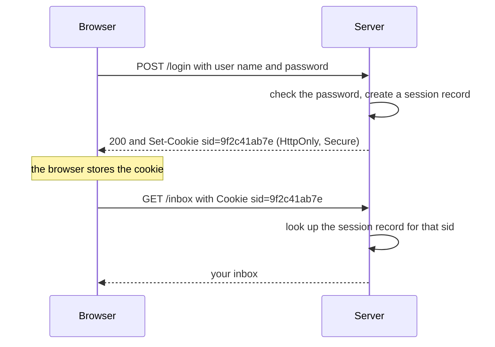

<Info>

**In short:** a site remembers you through state the browser keeps: cookies,
`localStorage`, `sessionStorage` and `IndexedDB`. That state lives in a browser
profile. Keep the profile, or save the state and load it into another browser,
and the site sees the same signed-in user without a new login.

</Info>

## HTTP forgets everything

The web's transport, [HTTP](/concepts/network#http-in-ten-minutes), is
**stateless**: each request is a self-contained question, and the server
answers it without remembering the last one. Ask for `/inbox` twice and, as far
as the protocol is concerned, two strangers asked.

Every feature that needs memory (a login, a shopping cart, a language choice, a
"don't show this again") has to be added on top. The browser carries the memory
and hands it back with each request. There are two places it can live:

- **In the request itself**, as a **cookie**: a small piece of text the browser
  sends automatically, so the server sees it on every request.
- **In the page's storage**, as **web storage**: data the page's own JavaScript
  reads and writes. The server sees it only if the script chooses to send it.

## Cookies, in depth

A cookie is born when a server answers with a `Set-Cookie` header. The browser
stores it, and sends it back in a `Cookie` header on later requests that match:

```http
HTTP/1.1 200 OK
Set-Cookie: sid=9f2c41ab7e; Domain=example.com; Path=/; Secure; HttpOnly; SameSite=Lax; Max-Age=2592000

GET /inbox HTTP/1.1
Host: shop.example.com
Cookie: sid=9f2c41ab7e; theme=dark
```

Everything after the first `name=value` pair is an **attribute** that tells
the browser when the cookie applies and how to protect it:

| Attribute | What it does |
|---|---|
| `Domain` | Which hosts get the cookie. `Domain=example.com` covers `example.com` and every subdomain. **Without it** the cookie is "host-only": it goes to the exact host that set it and to no subdomain. |
| `Path` | Only URLs under this path get the cookie. `Path=/` means the whole site; `Path=/admin` means `/admin` and below. |
| `Expires` and `Max-Age` | How long the cookie lives. `Expires` is a date; `Max-Age` is seconds from now (and wins if both are present). Without either it is a **session cookie** and disappears when the browser closes. With one it is **persistent** and survives restarts. |
| `Secure` | Send it only over HTTPS. |
| `HttpOnly` | Hide it from JavaScript: `document.cookie` cannot read it. This protects a login cookie from being stolen by an injected script. The browser still sends it. |
| `SameSite` | Whether the cookie is sent on requests that start from another site. `Strict`: never. `Lax` (the default in modern browsers): only on top-level navigations such as following a link. `None`: always, but then `Secure` is required. |
| `Partitioned` | Store this third-party cookie separately for each top-level site (see below). |

Cookie names can also carry a **prefix** that the browser enforces:
`__Secure-` requires `Secure`, and `__Host-` additionally requires `Path=/` and
no `Domain`, which pins the cookie to one host.

### First-party and third-party

A cookie is **first-party** when it belongs to the site shown in the address
bar and **third-party** when it is set by something embedded in the page: an
ad, a video player, a "like" button. The same third-party service embedded on
many sites can recognise you on all of them, which is how cross-site tracking
works. Browsers have been closing that door in different ways: blocking
third-party cookies, applying `SameSite=Lax` by default, and **partitioning**
(each top-level site gets its own copy of the third-party cookie, so the
embedded service cannot connect your visits).

"Same site" has a precise meaning: the **registrable domain**, the part of the
host you can buy, found with the Public Suffix List. `shop.example.com` and
`www.example.com` are the same site; `example.com` and `example.org` are not;
`alice.github.io` and `bob.github.io` are different sites, because `github.io`
is on the list.

### Limits and the rest

Browsers cap a cookie at about 4 KB and the number of cookies per domain (Chrome:
about 180), dropping the oldest. Cookies are also not private to a port or to
`http` versus `https` in the way origins are, which is part of why they are
easy to misuse. A cookie is the **key to the account**: if a server uses a
random `sid` value as proof of login, whoever holds that value is that user.

## Web storage

Cookies are small and travel on every request. For larger data that only the
page needs, browsers provide storage APIs. They are scoped to an **origin**
(defined below).

| Storage | Size | Lifetime | Shared between tabs | Sent to the server |
|---|---|---|---|---|
| `localStorage` | About 5 MB | Until deleted | Yes, all tabs of the origin | Never |
| `sessionStorage` | About 5 MB | Until the tab closes | No, one tab only | Never |
| `IndexedDB` | Large (a share of the disk) | Until deleted | Yes | Never |
| Cookies | About 4 KB each | Until they expire | Yes | With every matching request |

`localStorage` and `sessionStorage` hold strings as key and value pairs and are
synchronous. `IndexedDB` is a real database of objects, with indexes and
transactions, and is asynchronous. Single-page apps often keep their session
token, user settings or an offline copy of data in these places, not in
cookies, so saving only the cookies may not be enough to restore a login.

Two more places hold state: the **HTTP cache** (files the browser reuses
instead of downloading again) and **service workers** with their Cache Storage
(a script that can answer requests itself, which is how sites work offline).

## Origins and the same-origin policy

An **origin** is the triple of **scheme, host and port**. Two URLs are the same
origin only if all three match:

| Compared with `https://shop.example.com` | Same origin? | Why |
|---|---|---|
| `https://shop.example.com/cart` | Yes | Only the path differs. |
| `http://shop.example.com` | No | Different scheme. |
| `https://shop.example.com:8443` | No | Different port. |
| `https://www.example.com` | No | Different host. |

The **same-origin policy** is the browser's main security rule: a page can read
data only from its own origin. A script on `evil.example` cannot read your
`localStorage` for `bank.example`, cannot read the response of a request to
`bank.example`, and cannot reach into a `bank.example` iframe. Sites that want
to share data on purpose use **CORS** headers (`Access-Control-Allow-Origin`) or
`postMessage`.

This rule explains two behaviours you will meet in automation:

- Storage belongs to the origin, so you must be **on a page of that origin**
  before you can read or write its `localStorage`.
- A cookie belongs to a domain, so a cookie for `example.com` can only be
  added while the browser can attribute it to that domain.

## How a login persists



The password is sent once. The server hands back an opaque **session id**, the
browser attaches it to every later request, and the server looks the id up.
Some sites keep a signed token (a JWT) in a cookie or in `localStorage`
instead; a "remember me" login is a persistent cookie with a long `Max-Age`.
The server decides when the login ends: the session record can expire, be
revoked, or be tied to details such as the IP address or the browser. A saved
state that worked yesterday can therefore stop working even though the cookie is
unchanged.

## Profiles, and what is in one

A <Tooltip tip="The folder where Chrome keeps cookies, storage, history and settings">browser profile</Tooltip>
is a folder on disk, the **user data directory** (`--user-data-dir`). It holds
the cookie database, `localStorage`, `IndexedDB`, the cache, saved passwords,
extensions and settings. If you start Chrome again with the same folder, it is
the same user: still logged in, same history.

Two rules follow:

- **A fresh profile is a fresh visitor.** The default for automation: every
  run starts with an empty temporary profile and the site sees a first visit.
- **One browser per profile folder.** Chrome locks the folder, so two browsers
  cannot share it at the same time.

Chrome also has two modes that never write a profile to disk: **incognito**
(a temporary profile that is thrown away) and **guest** (a clean profile with
no sign-in).

## Contexts: isolation without a second browser

A **browser context** is the DevTools Protocol's name for what Chrome shows as
an incognito window: a set of tabs with their own cookies, storage and cache,
sharing nothing with any other context in the same Chrome process. It is far
cheaper than starting another browser, which makes it the right unit for
"one clean user per test" and for running many users in parallel.

## Sessions in each engine

<Tabs>

<Tab title="BaseCase (WebDriver)" icon="flask">

A WebDriver session is one browser started by the driver, with one profile.
`sb.quit()` ends it. `--reuse-session` (`SB_REUSE_SESSION`) shares browsers
between the tests of a run, so later tests start where earlier ones left off.

Cookies and storage have their own methods: `get_cookie`, `add_cookie`,
`delete_cookie`, `save_cookies` and `load_cookies` to a file, and
`get_local_storage_item`, `set_local_storage_item` and their session-storage
twins. See [Cookies and storage](/api/cookies-storage).

</Tab>

<Tab title="Pure CDP" icon="bolt">

A `Page` gives direct access to its state, all through the DevTools Protocol:

| Accessor | Type | What you can do |
|---|---|---|
| `page.cookies()` | `Cookies` | `all()`, `set(&[Cookie])`, `clear()`, `header()`, `save(path, filter)`, `load(path, filter)` |
| `page.local_storage()` | `Storage` | `get(key)`, `set(key, value)`, `remove(key)`, `clear()`, `entries()` |
| `page.session_storage()` | `Storage` | The same, for `sessionStorage` |
| `page.emulation()` | `Emulation` | `timezone(id)`, `locale(..)`, `geolocation(..)`, `user_agent(..)`, `offline(..)` |

A `Cookie` is built with `Cookie::new(name, value)` and the attribute methods
`domain`, `path`, `expires`, `secure`, `http_only` and `same_site(SameSite)`,
mirroring the table above.

```rust,ignore src/main.rs
use seleniumbase_rs::sb_cdp::{Cookie, SameSite};

page.goto("https://example.com").await?; // be on the origin first
page.cookies()
    .set(&[Cookie::new("theme", "dark")
        .domain("example.com")
        .path("/")
        .secure(true)
        .same_site(SameSite::Lax)])
    .await?;
page.local_storage().set("onboarding", "done").await?;

for cookie in page.cookies().all().await? {
    println!("{} = {} (HttpOnly: {})", cookie.name, cookie.value, cookie.http_only);
}
```

One `Browser` can hold several isolated `BrowserContext`s, made with
`Browser::new_context()`; `BrowserContext::dispose()` throws everything away.
`BrowserPool` hands out one context per lease and keeps signed-in states in a
`SessionStore`: a lease saves its state under a name, and another lease loads it.

```rust,ignore src/main.rs
let worker = pool.acquire().await?;
worker.page().goto("https://example.com/login").await?;
// ... sign in ...
worker.save_session("alice").await?;
worker.release().await;

let another = pool.acquire().await?;
another.page().goto("https://example.com").await?;
another.load_session("alice").await?; // signed in, without logging in again
another.release().await;
```

See [Pure CDP](/tutorials/pure_cdp).

</Tab>

<Tab title="Launch options" icon="rocket">

On launch, `LaunchOptions::builder()` decides which profile the browser uses:
`user_data_dir(dir)` for a folder you keep, `incognito(true)` or `guest(true)`
for a profile that is not kept. With none of them the browser gets a temporary
profile folder that is removed when it closes.

</Tab>

</Tabs>

## Saving a signed-in state

<Steps>

<Step title="Sign in once" icon="right-to-bracket">

Run the login flow in a browser.

</Step>

<Step title="Save the state" icon="floppy-disk">

Save the cookies (and storage, where the site uses it): `save_cookies` in
`BaseCase`, `page.cookies().save(path, filter)` for a file in the pure CDP
engine, `save_session` on a pool lease for an in-memory copy.

</Step>

<Step title="Load it next time" icon="rotate">

Open the site's origin, then load the state: `load_cookies`,
`page.cookies().load(path, filter)`, or `load_session`. Cookies belong to a
domain, so the page must be on that domain first.

</Step>

</Steps>

The in-memory form is a `Session`: the cookies plus the `localStorage` entries
of one origin, built with `Session::new(cookies)` and
`with_local_storage(origin, entries)`. A `SessionStore` keeps named sessions
for as long as the process runs; it does not write to disk. Both drop what has
expired: `Session::without_expired(now)` and `SessionStore::prune_expired(now)`,
where `now` is a Unix time in seconds, the unit a `Cookie`'s `expires` field
uses.

<Warning>

Saved cookies are credentials: anyone with the file is signed in as you. Keep
them out of version control. With the `turso` feature, `ProfileVault` stores
browser profiles encrypted; see
[Results database and encrypted profiles](/tutorials/results_and_profiles).

</Warning>

## Where to go next

<Columns cols={2}>

<Card title="Cookies and storage API" icon="cookie-bite" color="#1a85d4" href="/api/cookies-storage">
  Every BaseCase cookie and storage method.
</Card>

<Card title="Browser profiles" icon="id-card" color="#199f43" href="/tutorials/browser_profiles">
  Profiles and how their settings map to a browser.
</Card>

<Card title="Pure CDP" icon="bolt" color="#d47628" href="/tutorials/pure_cdp">
  Contexts, pools and the session store.
</Card>

<Card title="The network" icon="network-wired" color="#d52c36" href="/concepts/network">
  The requests and headers that carry cookies.
</Card>

<Card title="Detection and spoofing" icon="mask" color="#a631be" href="/concepts/detection">
  Why a consistent identity matters as much as cookies.
</Card>

</Columns>
